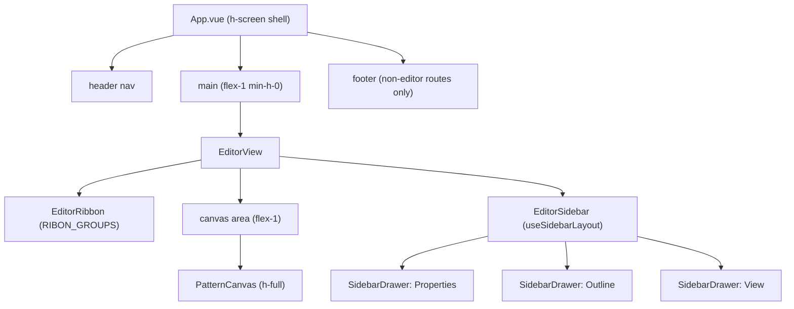

# 013 — Editor workspace shell

Status: in progress
Depends on: 004, 005

Refs #17

## 📝 TLDR

Turn the pattern editor into a full-height drafting workspace: a **tool ribbon**
under the top bar that holds all tools/actions, and a **resizable, collapsible
right sidebar** whose **accordion drawers** host the tool/selection properties,
the edge list and the view toggles. Today every control lives in one wrapping row
above a fixed-height (`h-80`) canvas inside a padded page frame, with parameters
stacked under the canvas — it does not scale as tools grow and gives parameters
no home near their tool.

## 📝 Problem Statement

- **Who needs it:** the solo maker drafting a pattern before cutting fabric, on a
  desktop where the canvas should own the window.
- **What happens today:** `frontend/src/App.vue` caps the whole app at
  `min-h-screen` and pads the `<main>` region (`px-4 py-8`), so the editor is a
  scrolling page rather than a workspace. `frontend/src/views/EditorView.vue`
  renders every control in one `flex flex-wrap` row (lines 205–251), a fixed
  `h-80` canvas (`PatternCanvas.vue:347`) and a parameters block _below_ the
  canvas (lines 267–318).
- **Evidence it matters:** the canvas never fills the viewport, and as tools are
  added the ribbon row only grows wider — there is no home for per-tool
  parameters near the tool, and no place for future drawer panels.
- **Constraint:** the app shell's full-width behaviour (FR #3) must not regress,
  and `@sewcraft/geometry` plus the command spec must stay untouched.

## 📝 Proposed Solution

Restructure the frontend shell into a fixed-height, full-width workspace:

| Region                  | Today                                                          | Proposed                                              |
| ----------------------- | -------------------------------------------------------------- | ----------------------------------------------------- |
| App shell (`App.vue`)   | `flex min-h-screen flex-col`                                   | `flex h-screen flex-col overflow-hidden`              |
| `<main>` (`App.vue`)    | `w-full flex-1 px-4 py-8`                                      | `flex min-h-0 w-full flex-1 flex-col`                 |
| Footer (`App.vue`)      | always rendered                                                | rendered only on non-editor routes                    |
| `ProjectsView.vue`      | `space-y-6`                                                    | `h-full space-y-6 overflow-y-auto px-4 py-8`          |
| `EditorView.vue`        | padded page, wrapping control row, `h-80` canvas, params below | ribbon row + `flex-1` canvas + right sidebar drawers  |
| `PatternCanvas.vue` box | `h-80 w-full`                                                  | `h-full w-full` (re-measured with a `ResizeObserver`) |

**Ribbon** (`EditorRibbon.vue`, data from `lib/editor-ribbon.ts`): groups —
**Tools** (Select/Point/Line/Curve), **History** (Undo/Redo), **Edit** (Delete),
**Canvas** (Fit / Download SVG) — so tool groups/tabs can grow. Buttons keep
their existing `data-testid`s (`tool-*`, `delete`, `fit`, `download-svg`) and the
Undo/Redo text labels.

**Sidebar** (`EditorSidebar.vue`) with accordion **drawers**
(`SidebarDrawer.vue`, built on the shadcn-vue `Collapsible`):

- **Properties** (open): active tool, current selection, command/cut-edge counts.
- **Outline** (open): the per-edge rows — seam-width input, allowance
  add/remove and construction conversion — with their existing testids.
- **View** (collapsed): Show construction, Show seam allowance, Include
  construction.

The sidebar is 240–560 px wide (default 320), collapsed state and width persist
in `localStorage` (`lib/sidebar-layout.ts` + `composables/use-sidebar-layout.ts`).

New shadcn-vue primitives added with the CLI: `collapsible`, `separator`,
`tooltip`, `scroll-area` (adds `reka-ui`, `@vueuse/core`, `@lucide/vue`).

**Alternatives considered.** (a) A fixed non-resizable sidebar: rejected — the
issue asks for a resizable/collapsible rail and it is cheap with a composable.
(b) Tabs instead of an accordion: rejected — the issue specifies multiple-open
accordion drawers so parameters and outline can be seen together. (c) Keeping
parameters under the canvas: rejected — that is the layout being replaced.

## 📝 Architecture



- **Pure logic lives in `frontend/src/lib/`:** `editor-ribbon.ts` (group
  definitions), `editor-drawers.ts` (drawer definitions + initial open state),
  `sidebar-layout.ts` (clamp, parse/serialize, localStorage load/save over an
  injected `KeyValueStore`). These are framework-free and fully unit-tested.
- **State:** `composables/use-sidebar-layout.ts` wires the pure helpers to a
  reactive width/collapsed pair and persists on change. The command bus remains
  the only mutation path — this spec adds **no** command and no second store.
- **Components stay thin:** `EditorRibbon`, `EditorSidebar` and `SidebarDrawer`
  render data and emit intents; `EditorView` keeps the command handlers.
- **Protected contracts untouched:** no geometry export, command type, API route
  or database surface changes (`BACKWARD_COMPATIBILITY.md` §2/§3).

## 📝 UI/UX

- **Layout:** ribbon pinned under the header; below it a single row: canvas
  (`flex-1`, padding-free workspace) and the right sidebar. The canvas fills all
  remaining height/width and keeps its ruler/zoom behaviour.
- **Drawers:** accordion with multiple sections open at once. Properties and
  Outline start open; View starts collapsed. Each header is a button with
  `aria-expanded`; the body is the shadcn-vue `CollapsibleContent`.
- **Sidebar:** a 4 px drag handle on its leading edge resizes between 240 and
  560 px; a chevron collapses it to a narrow rail with an expand button.
  Width/collapsed persist across reloads.
- **Empty/selection states:** the Properties drawer always shows the active tool
  and reports `None` when nothing is selected. The Outline drawer keeps its
  existing empty behaviour (hidden when there are no edges).
- **Accessibility:** controls keep their labels/testids and focus order flows
  ribbon → canvas → sidebar; the resize handle and collapse/expand toggles are
  real buttons, and the accordion headers expose `aria-expanded`.
- **Responsive:** desktop-first. Narrow viewports keep the basic sidebar
  collapse; no full mobile redesign.

## 📝 Edge Cases & Failure Scenarios

- **`localStorage` unavailable or corrupt:** `loadSidebarLayout` falls back to
  defaults and `saveSidebarLayout` swallows a throwing store, so the editor
  never crashes when storage is disabled or a stale value is malformed.
- **Out-of-range width:** any parsed or dragged width is clamped to 240–560;
  a non-finite width falls back to the 320 px default.
- **Collapsed rail:** when collapsed, drawer content is not rendered; expanding
  restores the previous width.
- **Canvas re-measure:** the canvas observes its own box so a sidebar resize
  re-measures the ruler/hit-testing without a window resize event.
- **`ResizeObserver` absent:** guarded — the canvas still measures on mount and
  on window resize (the previous behaviour).

## 📝 Risks & Impact Review

- **Reversibility:** all changes are frontend layout/state; a `git revert` fully
  restores the previous UI. No data, schema or contract is involved.
- **Protected surfaces:** none touched (`BACKWARD_COMPATIBILITY.md`).
- **Blast radius:** medium — the editor shell is restructured, so every editor
  control is verified after the move via the existing tests.
- **Test impact:** the View drawer is collapsed by default, so the three tests
  that drive `show-construction` / `show-seam-allowance` / `toggle-construction`
  must open the drawer first; all testids are preserved.

## 📋 Acceptance criteria

- [ ] The editor is a full-height workspace: ribbon under the header, canvas
      fills the space, resizable + collapsible right sidebar with accordion
      drawers.
- [ ] Properties + Outline are open by default; View is collapsed.
- [ ] Every existing editor control still works from its new location, with the
      same testids (tools, undo/redo/delete, fit, download SVG, show
      construction, show seam allowance, include construction, per-edge seam
      add/remove, edge construction conversion).
- [ ] Sidebar width (clamped 240–560) and collapsed state persist across
      reloads.
- [ ] Full gate green: `format`, `typecheck`, `lint`, `format:check`,
      `test:coverage` (**100 %**, including the new `.vue` components), `build`;
      backend Pest unchanged.

## Out of scope

- New geometry, tools or commands; a second state store.
- Full responsive/mobile redesign; additional drawers (Constraints, Layers,
  Measurements, Export) come later.

## 📋 Implementation Plan

1. Add the shadcn-vue primitives (`collapsible`, `separator`, `tooltip`,
   `scroll-area`) plus `tw-animate-css` if the Tailwind v4 build needs it.
2. Add `lib/editor-ribbon.ts`, `lib/editor-drawers.ts`, `lib/sidebar-layout.ts`
   and `composables/use-sidebar-layout.ts` with unit tests.
3. Add `components/EditorRibbon.vue`, `components/SidebarDrawer.vue`,
   `components/EditorSidebar.vue` with unit tests.
4. Restructure `App.vue`, `ProjectsView.vue`, `EditorView.vue` and
   `PatternCanvas.vue`; update the affected tests.
5. Run the full gate and format.

## 📝 Resolved assumptions

| #   | Question                                       | Applied default                                      | Why                                                                                                             | Confirm?   |
| --- | ---------------------------------------------- | ---------------------------------------------------- | --------------------------------------------------------------------------------------------------------------- | ---------- |
| Q1  | Which shadcn primitives?                       | Collapsible/Separator/Tooltip/ScrollArea via the CLI | Issue's resolved default; the CLI ran cleanly under Tailwind v4.                                                | Reversible |
| Q2  | Default-open drawers                           | Properties + Outline open, View collapsed            | Issue's resolved default.                                                                                       | Reversible |
| Q3  | Where does the per-edge seam-width input live? | Outline edge rows                                    | Keeps the existing `seam-width-*`/`add-seam-*`/`remove-seam-*` testids reachable without a selection, as today. | Reversible |
| Q4  | Responsive behaviour                           | Desktop-first, basic collapse                        | Issue's non-goal set; no mobile redesign.                                                                       | Reversible |

## Checks

```bash
npm run format
npm run typecheck
npm run lint
npm run format:check
npm run test:coverage
npm run build
```

## Files

- `frontend/src/App.vue`, `frontend/src/views/ProjectsView.vue`,
  `frontend/src/views/EditorView.vue`, `frontend/src/components/PatternCanvas.vue`
- `frontend/src/components/EditorRibbon.vue`,
  `frontend/src/components/EditorSidebar.vue`,
  `frontend/src/components/SidebarDrawer.vue`
- `frontend/src/lib/editor-ribbon.ts`, `frontend/src/lib/editor-drawers.ts`,
  `frontend/src/lib/sidebar-layout.ts`
- `frontend/src/composables/use-sidebar-layout.ts`
- `frontend/src/components/ui/{collapsible,separator,tooltip,scroll-area}/`
- colocated `*.test.ts`
