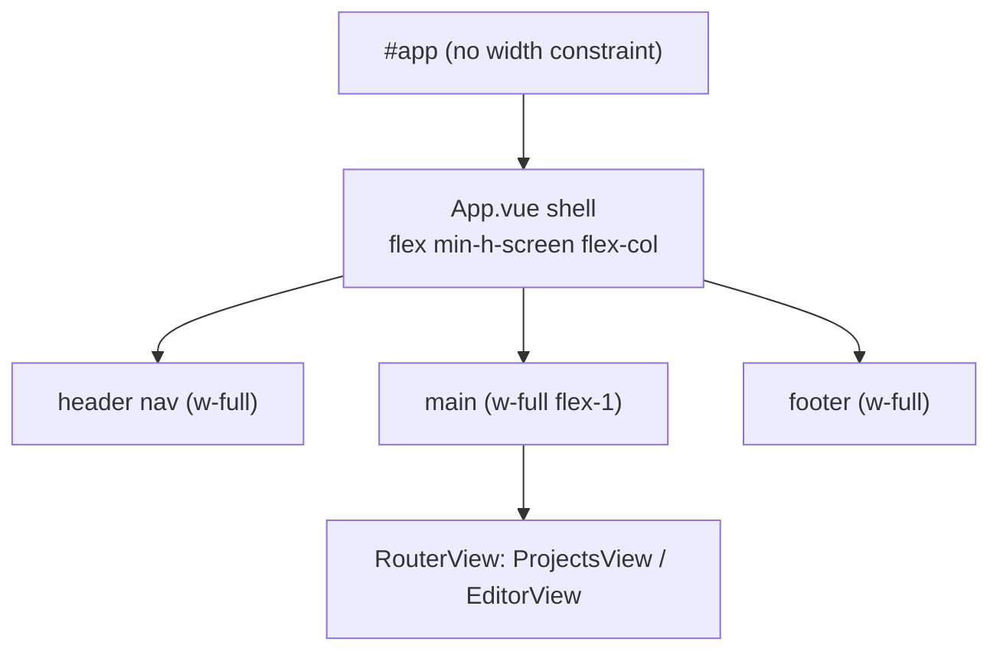

# Full-screen-width frontend views

Refs #3

## 📝 TLDR

The app shell (`frontend/src/App.vue`) centres every routed view inside a
`max-w-5xl` (1024 px) column, so on a desktop the views stop well short of the
viewport edges. Today, the header nav, the `<main>` view container and the footer
each carry `mx-auto w-full max-w-5xl px-4`. Proposed (future behavior): remove the
`max-w-5xl`/`mx-auto` cap from all three so views span the full viewport width,
while keeping the existing `px-4` padding so content is never flush to the edge.

## 📝 Problem Statement

- **Who needs it:** the single user of the self-hosted app (`AGENTS.md`), drafting
  patterns on a desktop where horizontal space is the scarce resource.
- **What happens today:** `frontend/src/App.vue` wraps the routed view in
  `mx-auto … max-w-5xl` on the header `<nav>` (line 8), `<main>` (line 16) and the
  footer `
` (line 21). At viewport widths above ~1024 px the shell stays
  centred and narrow instead of using the whole window (`App.vue:6-25`).
- **Evidence it matters:** `#app` itself has no width constraint
  (`frontend/src/assets/main.css` only resets `body` margin; `frontend/index.html`
  mounts a bare `
`), so the `max-w-5xl` cap is the sole reason no
  view fills the window. The requested behavior — full-screen-width views — is
  therefore a one-surface change.

## 📝 Proposed Solution

Drop the width cap from the three shell regions in `frontend/src/App.vue`:

| Region | Today | Proposed |
| --- | --- | --- |
| Header `<nav>` (`App.vue:8`) | `mx-auto flex w-full max-w-5xl items-center gap-6 px-4 py-3` | `flex w-full items-center gap-6 px-4 py-3` |
| `<main>` (`App.vue:16`) | `mx-auto w-full max-w-5xl flex-1 px-4 py-8` | `w-full flex-1 px-4 py-8` |
| Footer `
` (`App.vue:21`) | `mx-auto w-full max-w-5xl px-4 py-4 …` | `w-full px-4 py-4 …` |

`mx-auto` is removed with `max-w-5xl` because it is a no-op once the element has no
maximum width. `px-4` is retained on all three regions.

**Alternatives considered.** (a) Widening only `<main>`: rejected — it would leave
the nav and footer centred over a full-width body, producing a visibly
inconsistent shell. (b) Raising the cap (e.g. `max-w-screen-2xl`): rejected — it
preserves the reported symptom (views still do not span the viewport) and adds a
magic breakpoint. (c) Extracting a shared `Container` component: rejected for this
ticket as extra surface with no second consumer; the change is class-only.

## 📝 Architecture

Single-file, frontend-only change to the app shell. `frontend/src/App.vue` is the
only layout wrapper in the SPA (verified: no other wrapper exists under
`frontend/src`); each route (`/projects` → `ProjectsView`, `/projects/:id/edit` →
`EditorView`, `frontend/src/router/index.ts`) renders through its `<RouterView />`.

Takeaway: widening the three shell regions is sufficient; each view inherits the
full width automatically and no view needs its own change. The `EditorView` SVG
(`class="h-80 w-full …"`, `EditorView.vue:104`) already stretches to its
container, so it expands with the shell.

No backend, API, command-spec, geometry-package, schema or config surface is
touched. No new component, dependency or build step.

## 📝 UI/UX

- **Scope of the change:** header nav, main content region and footer of every
  route now span the viewport width on desktop; behaviour at viewports narrower
  than the old 1024 px cap is unchanged (the shell already used the full width
  there).
- **States:** no new loading/empty/error states; this is a static layout class
  change. Existing content layouts inside the views (cards, lists, form, SVG) are
  untouched and simply gain horizontal room.
- **Accessibility:** no change to semantics or focus order; `px-4` preserves the
  visual gutter, and the document keeps a normal horizontal flow with no
  horizontal scrollbar introduced.
- No interactive prototype or mockups for this spec (see the PR's
  `Mockups: skipped` note — no `om-prepare-test-env` descriptor is present, and a
  browser/test environment was not provisioned for a class-only cosmetic change).

## 📝 Edge Cases & Failure Scenarios

- **Very narrow viewports (mobile):** `px-4` keeps a 16 px gutter; body content
  previously filled the width here, so nothing regresses.
- **Horizontal overflow:** removing a `max-width` cannot introduce overflow on its
  own; the shell's children (`flex`, `w-full`, wrapping lists) already tolerate
  full width. Verified by reading `ProjectsView.vue` and `EditorView.vue`: neither
  sets a fixed width that assumes the old cap.
- **Long single-line content:** could now stretch further before wrapping rather
  than wrap at 1024 px; acceptable for a single-user drafting tool and unchanged
  by the padding.

## 📝 Risks & Impact Review

- **Reversibility:** the entire change is Tailwind class strings in one file;
  rollback is a `git revert` with no data, schema or contract involvement.
- **Protected surfaces:** `BACKWARD_COMPATIBILITY.md` lists no frontend layout
  surface; this changes none of `/api`, the command spec, geometry package or
  database schema.
- **Blast radius:** low — isolated cosmetic change confined to the app shell, per
  the risk classification already applied to FR #3.
- **Test impact:** `frontend/src/App.test.ts` asserts rendered text, not classes,
  so it is unaffected. A class-only change adds no branch, so it adds no unit
  coverage gap.

## 📋 Phasing

- **Phase 1 (single phase):** widen all three shell regions in `App.vue` and
  confirm the existing validation gate stays green.

## 📋 Implementation Plan

1. In `frontend/src/App.vue`, change the header `<nav>` (line 8) classes from
   `mx-auto flex w-full max-w-5xl items-center gap-6 px-4 py-3` to
   `flex w-full items-center gap-6 px-4 py-3`.
2. Change `<main>` (line 16) from
   `mx-auto w-full max-w-5xl flex-1 px-4 py-8` to `w-full flex-1 px-4 py-8`.
3. Change the footer `
` (line 21) from
   `mx-auto w-full max-w-5xl px-4 py-4 text-xs text-muted-foreground` to
   `w-full px-4 py-4 text-xs text-muted-foreground`.
4. Run the gate: `npm run typecheck`, `npm run lint`, `npm run format:check`,
   `npm run test:coverage`, `npm run build`. All must stay green with no new tests
   required (class-only, no branch).

## Resolved assumptions (autonomous defaults)

The FR's non-blocking Open Questions were answered with the most reversible,
lowest-blast-radius options. All are class-only and trivially reversible before or
after merge; none weakens a documented contract.

| # | Question | Applied default | Why | Confirm? |
| --- | --- | --- | --- | --- |
| Q1 | Should the header nav and footer also lose the `max-w-5xl` cap, or only `<main>`? | All three regions widen | Keeps one consistent shell; a full-width body under a centred nav/footer would look broken. Reversible class change. | Reversible |
| Q2 | Keep the `px-4` horizontal padding? | Keep `px-4` | Prevents content sitting flush against the viewport edge; preserves current narrow-viewport behaviour. | Reversible |
| Q3 | No specific screen is named as the motivation — widen all views uniformly, or target one screen? | Widen all views uniformly | The cap is on the shared shell, not one view; scoping to one route would require new per-view overrides with no stated benefit. Reversible. | Reversible |

No `⚠ NEEDS HUMAN CONFIRMATION` rows: the change is cosmetic, isolated and
reversible, so defaults are safe to apply and the PR opens ready for review.
