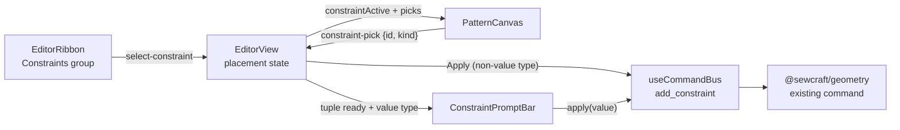

# Constraint tools in the ribbon

Status: proposed
Depends on: **PR #20** (constraints overlay and drawer) merging first. This spec
reuses `frontend/src/lib/constraint-view.ts` and the drawer's list/remove
controls, and removes that drawer's add form. No geometry, command, API or
database contract changes.

## 📝 TLDR

The model and the `add_constraint` command already support seven v0.1 constraint
types, but the editor has no direct way to apply one to geometry. Proposed
(future behavior): a **Constraints** group in the editor ribbon with one button
per type. Clicking **Horizontal**, for example, arms a placement mode; the user
then clicks a line (its two endpoints) or two points on the canvas and the
constraint is applied through the command bus. **Distance** and **Angle** finish
with a small inline value bar prefilled from the picks, because those commands
require a value. This makes "choose the relation, then pick the geometry" the
primary creation path and keeps every mutation on the existing command bus.

## 📝 Problem Statement

- **Who needs it:** the solo maker drafting a pattern, who thinks in relations
  ("this edge is horizontal", "these two edges are equal length") while looking
  at the canvas.
- **What happens today:** `frontend/src/lib/editor-ribbon.ts:31-63` exposes only
  Select/Point/Line/Curve, Undo/Redo, Delete, Fit and Download SVG. The geometry
  package defines `coincident`, `horizontal`, `vertical`, `point_on_line`,
  `distance`, `angle` and `equal` (`packages/geometry/src/types.ts:42-61`), and
  `docs/domain/command-spec.md:71-87` documents their tuple order, but the
  editor's pointer handling switches only on `props.tool`
  (`frontend/src/components/PatternCanvas.vue:187-210`) and never emits a
  constraint intent. On `origin/develop` constraints exist only in the seeded
  sketch, not in the UI.
- **Evidence it matters:** the constraints drawer this work depends on (PR #20)
  adds a dropdown form: choose a type, then find each entity id in a select list.
  It proves the command wiring but is a form-first gesture, detached from the
  geometry it constrains. The natural CAD gesture — arm a relation, then click
  the edge or points — is missing.
- **Constraint:** commands are the only mutation path, and
  `@sewcraft/geometry` stays untouched. This is a frontend interaction change,
  not a model change.

## 📝 Proposed Solution

### Interaction

1. A new ribbon group **Constraints** sits after **Tools** and contains seven
   buttons, one per v0.1 type: Coincident, Horizontal, Vertical, Point on line,
   Distance, Angle, Equal length. Each is a real `<button>` with
   `aria-pressed` and `data-testid="constraint-<type>"`.
2. Clicking a constraint button arms that placement mode. The active button is
   pressed, the tool buttons are not, and a prompt bar appears under the ribbon:
   "Horizontal — pick a line, or two points."
3. Picks happen on the canvas:
   - a **point** click adds that point;
   - a **line** click is shorthand for its `start` and `end` points wherever the
     constraint needs a segment — Horizontal, Vertical, Distance, Equal length,
     and the `a`/`b` pair of Point on line;
   - a **curve** click is not accepted in v1 (its control points can still be
     clicked individually).
4. Slots fill in pick order, first-fit, so the user may click the line first or
   the points first. The prompt names the next thing to pick and updates after
   every accepted pick.
5. Coincident, Horizontal, Vertical, Point on line and Equal length dispatch as
   soon as their tuple is complete.
6. Distance and Angle open the inline value bar instead: a numeric field
   prefilled with the current measurement (mm or degrees), **Apply** and
   **Cancel**. Apply converts degrees to radians and dispatches.
7. A successful dispatch clears the picks, keeps the mode armed for the next
   application, and leaves the constraint visible in PR #20's drawer list and as
   a canvas icon.
8. **Esc**, the prompt bar's **Cancel**, clicking the active button again, or
   choosing another tool exits the mode and clears the picks.
9. A solver failure uses the existing error banner. The document is unchanged,
   the picks and the value stay in place, and the user may retry or cancel.

### Alternatives considered

| Alternative | Why it lost |
| --- | --- |
| Keep the drawer form from PR #20 as the only creation path | It is the form-first gesture this brief replaces; the drawer remains the list/removal surface. |
| Preselect geometry, then click a constraint (Onshape supports both orders) | The editor currently holds a single `selectedId`; multi-select is separate work. Constrain-then-pick covers the requested flow. |
| Infer constraints on hover while drawing (FreeCAD/Onshape) | Implicit mutation needs solver-aware inference and is a different design. Deferred. |
| One "Constraint" menu button that opens a list | Adds a click to every use and hides the available relations; the ribbon has room to wrap. |

### Prior art

- **Onshape** keeps constraints at the right of the sketch toolbar; Horizontal
  and Vertical accept a line or two points, and dimensional constraints ask for
  a value.
- **FreeCAD Sketcher** offers both preselection and post-click selection, shows
  a specialized cursor while a constraint tool is active, and opens a value
  dialog for dimensional constraints.

Takeaway: constrain-then-pick, line-as-two-points, and an explicit value step
match established CAD behavior. Inference and preselection are natural follow-ups,
not prerequisites.

## 📝 Architecture



- **Pure logic** lives in `frontend/src/lib/constraint-tools.ts`, framework-free
  and fully unit-tested:
  - `CONSTRAINT_TOOLS` — ribbon id, label and type, derived from
    `CONSTRAINT_TYPES` and the labels in `constraint-view.ts`.
  - `CONSTRAINT_SLOTS` — the role slots per type: a `point` slot takes one
    point; a `segment` slot takes one line or two points.
  - `applyConstraintPick(state, pick, document)` — fills the first compatible
    slot and returns `picking | ready | rejected`. It is the single authority for
    placement: when the tuple is complete it calls `constraintParams` and either
    returns the `AddConstraintParams` or rejects a degenerate tuple.
  - `constraintParams(type, picks, document)` — resolves line endpoints, checks
    the type-specific distinctness rules and flattens the slots into
    `add_constraint` order. Returns `null` for an incomplete or invalid tuple.
  - `constraintPrompt(type, picks)` and `constraintRejection(reason)` — the
    visible next step and the rejection message.
  - `prunePicks(picks, document)` — drops picks whose entity disappeared after
    undo/redo, so a stale id is never dispatched.
  - `constraintValueSpec(type)` — `null` for non-dimensional types; otherwise
    the input unit (`mm` / `°`), label, validation and the
    `toCommandValue` conversion (degrees → radians for angle).
  - `constraintInitialValue(type, picks, document)` — the prefilled measurement,
    or an empty string when the picked points are geometrically coincident.
- **Measurement uses the geometry package, not new math.** Prefill calls the
  already-exported `distance`, `sub`, `dot`, `cross` and `magnitude` helpers from
  `@sewcraft/geometry`; the angle is `Math.atan2(cross(u, v), dot(u, v))`. No
  solver logic is copied into `frontend/src/lib`.
- **`EditorRibbon.vue` stays a renderer.** Its item union gains a
  `RibbonConstraintItem` kind, plus `activeConstraint` and a `select-constraint`
  emit. No geometry logic enters the component.
- **`PatternCanvas.vue` gains two props and one emit.** `constraintActive` and
  `constraintPicks` switch pointer handling to picking and highlight the picks;
  `constraint-pick` carries `{ id, kind }`. Middle-button and space-drag panning,
  wheel zoom and the rulers are unchanged.
- **`ConstraintPromptBar.vue` is the only new component.** It renders the
  prompt, the optional value form, Apply and Cancel; it owns the raw input
  string and delegates validation/conversion to `constraint-tools.ts`.
- **`EditorView.vue` owns UI state only:** active type, picks, pending params,
  prompt/error text, and the `add_constraint` dispatch. No second store, no
  direct document mutation.
- **One creation path.** PR #20's Constraints drawer keeps its list and
  **Remove** controls; its add form and the `constraint-type` /
  `constraint-entity-*` / `constraint-value` / `add-constraint` testids are
  removed. The drawer remains the place to review and delete constraints.
- **Protected contracts untouched:** no change to `@sewcraft/geometry`,
  `config/geometry.php`, `docs/domain/command-spec.md`, the API, the database or
  persistence (`BACKWARD_COMPATIBILITY.md` §2/§3).

## 📝 API Contracts

No new or changed command. The UI emits the existing `add_constraint`:

```json
{
  "id": "<command id>",
  "type": "add_constraint",
  "params": { "type": "horizontal", "entities": ["a", "b"] },
  "issuedAt": "2026-10-19T12:00:00Z"
}
```

`entities` is the command's array parameter; `a`/`b`/`c`/`point` are the solver's
internal tuple names used when building that array. Distance and Angle add
`"value"` in millimetres and radians respectively. Tuple order and validation
stay exactly as documented in `docs/domain/command-spec.md:71-87`. Degrees exist
only in the input bar and are converted before dispatch.

## 📝 UI/UX

- **Ribbon:** a seventh group, `Constraints`, after `Tools`. Text labels keep it
  consistent with the existing ribbon; the constraint glyphs from
  `constraint-view.ts` may replace them later without changing testids. Groups
  wrap as units, so the extra buttons may add a second ribbon row on narrow
  desktops without introducing horizontal scrolling.
- **Prompt bar:** one line under the ribbon, `role="status"` and
  `aria-live="polite"`. It always shows the active constraint, the next pick
  prompt and a **Cancel** button; for Distance/Angle with a complete tuple it
  also shows the value field, **Apply** and **Cancel**. Angle names the vertex
  explicitly: "Pick the first ray point", "Pick the vertex", "Pick the second ray
  point". Equal length names the pair: "Pick the first line, or two points" then
  "Pick the second line, or two points". Point on line says "Pick the point to
  constrain" first, so a point click is never mistaken for a line endpoint.
- **Picks on canvas:** picked points use the primary fill/stroke, picked lines
  use the primary stroke and a thicker stroke. Points render above lines, so a
  click at a shared coordinate picks the point. Entering a constraint mode clears
  `selectedId`, so primary always means "picked" and never competes with
  selection styling. The cursor is a crosshair while the mode is active.
- **Value bar:** labels are "Distance (mm)" and "Angle (°)". The field is
  prefilled with the measured value rounded to three decimals (0.001 mm /
  0.001°); the displayed number is what Apply dispatches, so the prefill never
  silently shifts geometry by more than that precision. If a positive distance
  would round to zero, the exact measurement is used instead. A degenerate
  measurement (coincident points) leaves the field blank. Invalid input shows an
  inline message, sets `aria-invalid="true"` and keeps **Apply** disabled.
- **Bar lifetime:** the bar closes and clears its raw input whenever the tuple
  becomes incomplete or invalid (a pruned pick, a cancelled mode, a tool switch,
  or a successful Apply). A newly ready tuple always re-prefills from the
  current geometry, so a value typed for an earlier tuple is never reused.
- **Keyboard:** Esc exits the mode; Enter in the value field applies; Space and
  the middle mouse button still pan; Delete is unchanged and does nothing while
  picking because no entity is selected.
- **States:** with no geometry or an incomplete tuple, the prompt still guides
  the next pick and no command is emitted. After Apply, the constraint appears
  in PR #20's drawer list and its canvas icon refreshes from the solved
  document.
- **Errors:** a solver rejection appears in the existing error banner; picks and
  the value are retained so the user can change the value or cancel.
- **Accessibility:** every ribbon control is a labelled button with
  `aria-pressed`; the prompt is announced; the value input is labelled and
  focused when it opens; focus order remains ribbon → prompt → canvas → sidebar.
- **Mockups:** skipped — no `om-prepare-test-env` descriptor is present in this
  repository, so the current-app screenshots and proposed-UI mockups could not be
  produced. The same path was taken for the previous UI-only spec. The flows
  above are the design evidence; implementation will add browser evidence where
  the environment allows.

## 📝 Edge Cases & Failure Scenarios

- **Curve picked:** rejected with "Curves are not supported yet; pick a point or
  a line." The picks do not change.
- **Wrong kind:** a line clicked for a point-only slot (Coincident, Angle, or the
  single point of Point on line) is rejected with "Pick a point."; a point
  clicked for a line-only slot cannot occur because segment slots accept points.
- **Duplicate or degenerate tuple:** the same point twice, a line whose
  endpoints are identical, Point on line where the point is one of the line's
  endpoints, Angle with a repeated point, or Equal length with an identical pair
  is rejected with "Pick distinct points." The completed pick is not committed.
- **Equal length on adjacent edges:** sharing one endpoint between the two
  segments is valid and must not be rejected as a duplicate.
- **Undo/redo while picking:** `prunePicks` drops picks whose entity vanished;
  the prompt recomputes from what remains, an incomplete tuple waits for the next
  pick instead of dispatching stale ids, and an open value bar closes. The
  document watcher is the only trigger; Delete cannot remove an entity while
  picking because no entity is selected.
- **Switching type or tool mid-pick:** clears picks, pending value and prompt;
  the new mode starts clean.
- **Solver non-convergence:** `executeCommand` throws
  `CommandExecutionError`; `EditorView` catches it into the existing banner and
  never applies the command. Picks/value stay for a retry.
- **Value edge cases:** empty, `NaN`, zero or negative distance is invalid;
  angle accepts any finite number, including negative signed angles. `1e3` is a
  valid `Number` input.
- **Long ribbon:** the Constraints group may wrap to a second row; it must not
  create a horizontal scrollbar, and the canvas must keep its remaining height.

## 📝 Risks & Impact Review

- **Reversibility:** all changes are frontend UI state; `git revert` restores the
  previous editor. No data, schema, command or API change is involved.
- **Coordination:** implementation starts after PR #20 merges; this work removes
  that drawer's add form and keeps its list/remove controls. That is a small,
  explicit diff in `EditorView.vue`. The spec is not implementable against a
  branch without #20, which is why the dependency is stated up front.
- **Ribbon growth:** sixteen buttons in total may wrap on smaller desktops,
  costing some canvas height. This is acceptable for a desktop-first tool; the
  alternative — a hidden menu — adds a click to every constraint.
- **Angle semantics:** the command's tuple is `[a, b, c]` with the angle at `b`.
  The prompt therefore names the vertex explicitly; the input is signed degrees
  and is converted to radians. A user who picks in an unusual order gets the
  vertex they picked second, as the prompt states.
- **Equal length:** the spec allows the two segments to share an endpoint; only
  individually degenerate or identical pairs are rejected.
- **Test impact:** new branches in `constraint-tools.ts`, `EditorRibbon.vue`,
  `PatternCanvas.vue`, `ConstraintPromptBar.vue` and `EditorView.vue` all need
  tests to keep the 100 % gate. Removing the drawer form removes its tests and
  testids, so PR #20's tests must be updated in the same diff.
- **Protected surfaces:** none (`BACKWARD_COMPATIBILITY.md` §2/§3); the geometry
  package and command spec are read-only consumers of existing behavior.

## 📋 Acceptance criteria

- [ ] The ribbon shows a Constraints group with seven buttons:
      `constraint-coincident`, `constraint-horizontal`, `constraint-vertical`,
      `constraint-point_on_line`, `constraint-distance`, `constraint-angle`,
      `constraint-equal`.
- [ ] Clicking a constraint button arms it (`aria-pressed="true"`), clears the
      active tool/selection, and shows the next-pick prompt.
- [ ] Horizontal, Vertical, Distance and Equal length accept one line or two
      points; Point on line accepts a point plus a line or two points; Coincident
      and Angle accept points only.
- [ ] Distance and Angle open a prefilled value bar; angle input in degrees is
      converted to radians; Apply dispatches and Cancel/Esc exits.
- [ ] Picked points and lines are highlighted; curves and degenerate tuples are
      rejected without changing the picks.
- [ ] A successful application stays armed and clears picks; a solver failure
      leaves the document unchanged and keeps the picks/value for retry.
- [ ] Undo/redo while picking prunes vanished entities instead of dispatching
      stale ids.
- [ ] PR #20's drawer keeps its list and Remove controls and loses its add form,
      so the ribbon is the single creation path.
- [ ] No change to `@sewcraft/geometry`, the command spec, the API or the
      database.
- [ ] `npm run test:coverage` stays at **100 %** for statements, branches,
      functions and lines; `format`, `typecheck`, `lint`, `format:check` and
      `build` are green, and the unchanged backend gate still passes.

## Out of scope

- New constraint types, solver changes, degrees-of-freedom diagnostics.
- Preselect-then-constrain and hover inference.
- Curve/arc-aware constraints and curve-as-segment shorthand.
- Interacting with constraint icons on the canvas (select, drag, delete); the
  drawer remains the list/removal surface.
- Persisting the active constraint across reloads.
- Mobile redesign.

## 📋 Phasing

- **Phase 1 — Placement and non-dimensional types.** Pure placement model,
  ribbon group with the five non-dimensional buttons, prompt bar, canvas picking.
  Ships Coincident, Horizontal, Vertical, Point on line and Equal length end to
  end. The two dimensional buttons are not rendered yet, so every visible button
  works.
- **Phase 2 — Dimensional types.** Add Distance and Angle to the group, with the
  prefilled value bar, degrees-to-radians conversion, validation and failure
  retention.
- **Phase 3 — Consolidation and hardening.** Remove PR #20's drawer add form,
  wire prune-on-undo/redo, add accessibility polish, update affected tests and
  run the full gate.

## 📋 Implementation Plan

1. **Add `frontend/src/lib/constraint-tools.ts`** with `CONSTRAINT_TOOLS`,
   `CONSTRAINT_SLOTS`, `applyConstraintPick`, `constraintParams`,
   `constraintPrompt`, `constraintRejection`, `prunePicks`,
   `constraintValueSpec` and `constraintInitialValue`. Unit-test every type, line
   shorthand, point/line order, rejection reason, prompt, prune case, measurement
   and conversion.
2. **Extend `frontend/src/lib/editor-ribbon.ts`** with a `constraint` item kind
   and the Constraints group (derived from `CONSTRAINT_TOOLS`, filtered to the
   five non-dimensional types in Phase 1), then update `EditorRibbon.vue` to
   render it, expose `activeConstraint` and emit `select-constraint`. Update
   `EditorRibbon.test.ts` for the five new buttons, pressed state and the new
   emit.
3. **Extend `PatternCanvas.vue`** with `constraintActive` and `constraintPicks`
   props, the `constraint-pick` emit, picked styling and the crosshair cursor.
   Test point, line and curve clicks, a click at a point-on-line shared
   coordinate (the point wins), empty-canvas clicks, the no-selection behaviour
   and that the existing tools are unchanged.
4. **Wire `EditorView.vue`** to own the placement state: toggle/switch constraint
   modes, clear the active tool when arming, accumulate picks through
   `applyConstraintPick`, show the prompt/rejection, dispatch non-dimensional
   types, handle Esc/Cancel/tool switch, and prune picks on document changes.
   Test a line click for Horizontal, two points for Vertical, two lines for
   Equal length, a point + line for Point on line, a rejected curve click and a
   solver error that retains picks.
5. **Add `frontend/src/components/ConstraintPromptBar.vue`** for the value
   types, with prefilled measurement, label/unit, inline validation, Apply and
   Cancel. Test prefill, invalid input, degree-to-radian dispatch, blank
   measurement and focus. Add Distance and Angle to the ribbon group and wire
   them in `EditorView.vue`, so the group reaches seven buttons.
6. **Remove PR #20's drawer add form**, keep its list and Remove controls, and
   update the affected `EditorView` and drawer tests so the old form testids are
   gone.
7. **Run the full gate** (`format`, `typecheck`, `lint`, `format:check`,
   `test:coverage`, `build`, plus the unchanged backend Pest/Pint commands) and
   exercise the flow in a browser if a test environment is available. No
   documentation contract changes are expected; update this spec's checkboxes
   and `Status:` when implementation lands.

## 📝 Resolved assumptions (autonomous defaults)

The brief left these choices open. Each default is the most reversible option
that still ships the requested flow; none weakens a protected contract or a
documented product decision.

| # | Question | Applied default | Why | Confirm? |
| --- | --- | --- | --- | --- |
| Q1 | Which constraint types get a ribbon button? | All seven v0.1 types, one button each | The command and solver already support all seven; hiding some would make the ribbon arbitrary. Removing a button is trivial. | Reversible |
| Q2 | Does clicking a line mean its two endpoints? | Yes for segment roles (Horizontal, Vertical, Distance, Equal, Point on line's `a`/`b`) | The brief names "point, line, etc."; CAD tools treat a line as its endpoints. Curves stay point-picked. | Reversible |
| Q3 | Keep the drawer's add form as a second path? | No — the ribbon becomes the single creation path; the drawer keeps list/remove | Two creation UIs for one command invites drift; the brief asks for ribbon access. Restoring the form is a small revert. | Reversible |
| Q4 | Where does a Distance/Angle value come from? | Inline bar under the ribbon, prefilled with the measured value; angle in degrees, converted to radians | The command requires a value; prefill avoids retyping, and degrees match the drawer's existing display. The command contract stays unchanged. | Reversible |
| Q5 | After a successful application, stay armed? | Yes — clear picks, keep the constraint active | Constraint work comes in batches; re-arming every time would add a click. Esc exits. | Reversible |
| Q6 | What does Esc cancel when the value bar is open? | The whole placement, including the value | One predictable escape is easier to learn than a two-stage cancel. | Reversible |
| Q7 | Preselect geometry, then click a constraint? | Deferred | The editor has a single `selectedId`; multi-select is separate work. The requested order is constrain-then-pick. | Reversible |
| Q8 | Infer constraints on hover while drawing? | Deferred | Implicit mutation needs solver-aware inference and a separate design. | Reversible |

No `⚠ NEEDS HUMAN CONFIRMATION` rows: every default is frontend-only,
reversible, and consistent with the brief and the existing command contract. The
spec PR opens ready for review.

## Checks

```bash
npm run format
npm run typecheck
npm run lint
npm run format:check
npm run test:coverage
npm run build
```

Backend code is untouched, but the repository gate still applies:

```bash
docker compose run --rm --no-deps -e DB_CONNECTION=sqlite -e DB_DATABASE=:memory: \
  app sh -c "composer install --no-interaction && php artisan test --coverage --min=100"
docker compose run --rm --no-deps app sh -c "composer install --no-interaction && vendor/bin/pint --fix"
```

## Files

- `frontend/src/lib/constraint-tools.ts` (new) and `constraint-tools.test.ts`
- `frontend/src/lib/editor-ribbon.ts` and `editor-ribbon.test.ts`
- `frontend/src/components/EditorRibbon.vue` and `EditorRibbon.test.ts`
- `frontend/src/components/PatternCanvas.vue` and `PatternCanvas.test.ts`
- `frontend/src/components/ConstraintPromptBar.vue` (new) and
  `ConstraintPromptBar.test.ts`
- `frontend/src/views/EditorView.vue` and `EditorView.test.ts`
- `frontend/src/lib/constraint-view.ts` (reuse the labels/units merged in PR #20;
  no changes expected)
