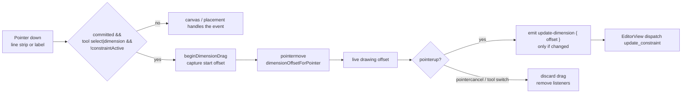

# Movable linear dimensions

Status: done
Implements: [#30 — Dimensions should be movable](https://github.com/slawekniewiadomski/sew-craft/issues/30)
Depends on: spec 003 (constraint solver), spec 005 (canvas editor interactions), spec 009 (command spec API)

## 📝 TLDR

Issue #30 reports that a linear dimension renders too close to the geometry it
measures, and that the user cannot pull it far enough away.

Two things cause that experience:

1. `DEFAULT_DIMENSION_OFFSET` is **12 mm**, so a freshly placed dimension sits
   almost on top of its measured span.
2. A dimension can only be dragged with the **Select** tool. The Dimension tool
   stays active after placing one, and the 14 px hit strip plus a `cursor-text`
   label make the line hard to grab and easy to mistake for read-only.

Proposed: raise the default offset to **20 mm**, let dimensions be dragged with
both **Select** and **Dimension** (the two tools where a placed dimension is
under the pointer), widen the invisible hit strip to **24 px**, use a move cursor
on the line and label, and cancel an in-flight drag cleanly on `pointercancel` or
a tool switch. No new command, entity or document field is involved — `offset`
is already part of every distance constraint.

## 📝 Problem Statement

- **Who needs it:** anyone reading or tidying a dimension after placing it. A
  pattern draft quickly collects several dimensions, and the user needs to fan
  them out so the value labels do not collide with the edge and with each other.
- **What happens today:**
  - `packages/geometry/src/dimension.ts` sets `DEFAULT_DIMENSION_OFFSET = 12`.
    Every placement starts at that distance and, when placed from a line or a
    pair of points without moving the pointer, is committed at it
    (`PatternCanvas.startDimensionPlacement`).
  - `PatternCanvas.beginDimensionDrag` returns unless
    `props.tool === 'select'`, so dragging does nothing while the Dimension tool
    is still active — the exact moment a user wants to adjust the dimension they
    just made. `constraintActive` also blocks dragging, which is correct.
  - The drag handle is a transparent 14 px stroke on the dimension line; the
    value label is the other handle and shows `cursor-text`, implying editing
    rather than movement. There is no hover cue on the line beyond `cursor-move`
    and no hint that the label can be dragged.
  - Window listeners are attached for `pointermove`/`pointerup` only. A
    `pointercancel` (touch scroll, browser gesture, OS interruption) leaves
    `dimensionDrag` populated and the listeners attached until some later
    pointer event, so the dimension can appear stuck mid-drag.
- **Why the range feels limited:** dragging itself is unbounded and accepts
  negative offsets, so the range is not the limitation. The limitations are the
  too-small default, the unavailable gesture in the active tool, and the small,
  ambiguous target.
- **Constraint:** `offset` is already presentation-only data on distance
  constraints and is mutated through the existing `update_constraint` command.
  No contract changes beyond the documented default value.

## 📝 Proposed Solution

### 1. Place dimensions farther from their span

- Change `DEFAULT_DIMENSION_OFFSET` from `12` to `20` mm in
  `packages/geometry/src/dimension.ts`.
- The value remains a signed perpendicular offset: positive is one side of the
  span, negative the other, `0` is still allowed, and the user can drag anywhere
  in either direction. No clamping is introduced.
- `dimensionOffsetForPointer`, `constraintOffset` and the command defaults all
  derive from the constant, so placement, the inline preview and the sidebar
  stay consistent automatically.
- Update every place that states the default: `docs/architecture/geometry-core.md`,
  `docs/architecture/data-model.md` and `docs/domain/command-spec.md`.

### 2. Drag with Select **and** Dimension

- A dimension is draggable when it is a committed constraint (not the placement
  preview), the active tool is `select` or `dimension`, and no constraint
  placement is in progress (`constraintActive` is false).
- `PatternCanvas.beginDimensionDrag` accepts the Dimension tool by requiring one
  of those two tools instead of only `select`. The `constraintActive` guard
  stays.
- The currently rendered drag offset still applies immediately while dragging;
  on release a single `update-dimension` event is emitted only when the offset
  actually changed. A click without movement emits nothing, so double-click
  editing keeps working.
- With the Dimension tool active, pointer-down on an existing dimension line or
  label takes precedence over starting a new placement: a drag repositions it,
  a plain click does nothing. Starting a new dimension still works from points,
  lines, curves and empty canvas.
- The tool-switch watcher cancels any in-flight dimension drag and detaches the
  window listeners, so a completed drag belongs to the tool that started it.

### 3. Make the target easier to grab

- Increase the transparent drag stroke on the dimension line from `14` to `24`
  screen pixels (`vector-effect="non-scaling-stroke"` is kept, so zoom does not
  change the grab area).
- Render the drag strip only while the dimension is draggable, so another tool
  never shows an affordance that does not work.
- Use a move cursor on both handles:
  - line strip and label: `cursor-move` while draggable;
  - label: `cursor-text` when editing is available but dragging is not (for
    example while another sketch tool is active);
  - preview: no pointer events.
- Update the label tooltip to say `Drag to reposition, double-click to edit`
  when draggable and `Double-click to edit` when only editing is possible.

### 4. End every pointer interaction cleanly

- Add a `pointercancel` window listener alongside `pointermove` and `pointerup`.
- `onPointerCancel` discards the in-flight interaction without emitting:
  - a dimension drag is dropped and the rendered offset returns to the stored
    constraint offset;
  - an in-progress point drag is dropped (no `move-point`);
  - a pan is dropped (no additional viewport change);
  - all window listeners are removed.
- `pointerup` and `pointercancel` share one teardown helper so listeners cannot
  leak. The existing unmount cleanup keeps removing the same listeners.

### 5. Keep the command layer untouched

- Repositioning continues to dispatch `update_constraint` with
  `{ id, offset }` through `onUpdateDimension`; the inverse is the existing
  previous-offset update.
- No `add_constraint` default in the command schema changes textually: it still
  says the offset is optional and falls back to the documented default. Only the
  documented number moves from 12 to 20.
- No undo, solver, persistence or API shape changes.

## 📝 Architecture



- **Pure geometry:** `dimension.ts` only changes the default constant; layout and
  pointer math already support arbitrary signed offsets. Tests keep using
  `DEFAULT_DIMENSION_OFFSET` and one new test pins the value to `20`.
- **Canvas:** `PatternCanvas.vue` owns drag eligibility, the hit strip, cursor
  classes, the live preview and teardown. Eligibility becomes a computed flag on
  the drawing rather than a check hidden inside the handler.
- **View:** `EditorView.vue` is unchanged; it already maps
  `update-dimension` to `update_constraint`.
- **No contract change:** the command spec version stays at its current value
  because the command set and schemas do not change. Documentation of the
  default offset is corrected.

## 📝 API Contracts

No command or endpoint is added or removed.

`update_constraint` continues to accept:

| Field | Type | Rule |
| --- | --- | --- |
| `id` | `entity_id` | existing `distance` constraint |
| `offset` | `number` | finite, signed millimetres; presentation only |

- An offset-only update remains a no-op for the solver and still emits an
  inverse carrying the previous offset.
- The documented fallback for an omitted `offset` becomes **20 mm**:
  `DEFAULT_DIMENSION_OFFSET = 20`.
- `docs/domain/command-spec.json` needs no schema edit unless it embeds the
  default value; if it does, it changes to `20`.

## 📝 UI/UX

- **Placement:** a dimension placed from a line or point pair lands 20 mm away
  from the measured span instead of 12 mm, leaving room for the value label and
  chevrons at typical zoom.
- **Dragging:** with Select or Dimension active, the user grabs the dimension
  line or its value and moves it perpendicular to the span, out or in, including
  across to the other side. The label follows the line live.
- **Affordance:** the 24 px hit strip is invisible but doubles the practical
  grab width. Both the line and the label show a move cursor; hovering the label
  explains drag and double-click.
- **No accidental edits:** a click without movement on a label still emits
  nothing, so the existing double-click editor opens normally.
- **Interruption:** touch scrolling or a browser gesture cancels the drag and
  restores the committed offset instead of leaving it visually detached.
- **Accessibility:** the label keeps its `role="img"` and
  `aria-label="Dimension <value> millimetres"`; cursor styling is decorative and
  no new keyboard interaction is introduced. The existing sidebar offset field
  remains the keyboard-accessible way to reposition a dimension.

## 📝 Edge Cases & Failure Scenarios

- **Constraint placement active:** dimensions are neither draggable nor
  editable; pointer events feed constraint picking.
- **Preview dimension:** not draggable, not editable and has no hit strip.
- **Zero movement:** no `update-dimension`, no undo entry.
- **Offset crosses zero:** allowed; the dimension flips to the other side and the
  label normal flips with it.
- **Large offsets:** allowed; the canvas pan/zoom controls are the way back.
- **Pointer leaves the window:** window-level listeners keep the drag alive until
  release or cancel.
- **`pointercancel`:** the drag is discarded, the stored offset is restored and
  the listeners are removed. No command is dispatched.
- **Tool switch mid-drag:** same discard behavior; the next pointer gesture uses
  the new tool.
- **Hidden dimensions:** turning the layer off removes the drawings and any
  handles; an in-flight drag is cancelled when the layer hides (existing editor
  close behavior is extended to the drag state).
- **Undo during a drag:** the document watcher clears inline editing; the drag
  preview uses the constraint from the latest document, and release emits the
  offset change against the current constraint.
- **Missing or degenerate span:** no dimension is rendered, so there is nothing
  to drag.
- **Dimension tool drag precedence:** dragging an existing dimension while the
  Dimension tool is active never starts a second placement. Clicking elsewhere
  still places normally.

## 🧪 Test cases

### Geometry — `packages/geometry/tests/dimension.test.ts`

1. `DEFAULT_DIMENSION_OFFSET` is `20`.
2. An omitted offset produces a dimension line at 20 mm from the span.
3. Explicit positive, negative and zero offsets still produce the existing
   layouts (the current tests continue to pass).
4. Printing the default in docs is covered by the documentation check, not a
   runtime test; no geometry behavior beyond the constant changes.

### Frontend canvas — `frontend/src/components/PatternCanvas.test.ts`

5. Placement without pointer movement emits
   `add-dimension` with `offset: 20` (update the two hard-coded `12` assertions).
6. With the Dimension tool active, dragging the line strip emits
   `update-dimension` with the new offset.
7. With the Dimension tool active, dragging the label emits the new offset.
8. With Select, dragging still emits exactly one update on release.
9. A click without movement still emits nothing and leaves double-click editing
   available.
10. With the Dimension tool active, double-clicking a committed label still
    opens `dimension-editor`; the preview label still does not.
11. The drag strip is not rendered for the preview, when dimensions are hidden,
    during constraint placement, or while a non-drag tool such as `add_line` is
    active.
12. The rendered drag strip has a 24 px transparent stroke and a `cursor-move`
    class; the label uses `cursor-move` when draggable and `cursor-text` when
    only editable.
13. The label tooltip reflects drag plus edit when draggable and edit-only
    otherwise.
14. `pointercancel` during a dimension drag emits nothing, removes the live
    preview and detaches the window listeners (a later `pointermove` has no
    effect).
15. `pointercancel` during point drag and pan emits nothing and detaches the
    listeners.
16. Switching tools mid-drag cancels the drag, restores the committed offset and
    detaches the listeners.
17. An unmount mid-drag still removes every window listener
    (`pointermove`, `pointerup`, `pointercancel`).
18. Constraint placement still blocks dragging and editing.

### Editor view — `frontend/src/views/EditorView.test.ts`

19. Creating a dimension from a line commits `offset: 20` (update the assertion).
20. Selecting an existing dimension and dragging it dispatches
    `update_constraint` with the new offset; undo restores the old offset.
21. Reusing an existing distance constraint during placement updates its offset
    to the placed value (existing test updated to 20) and dispatches only once.
22. Dragging with the Dimension tool still leaves the tool active for the next
    placement.

### Documentation / contract

23. `docs/domain/command-spec.md`, `docs/architecture/geometry-core.md` and
    `docs/architecture/data-model.md` state 20 mm, not 12 mm.
24. The command spec version and every command schema are unchanged.
25. Backend `CommandSpecTest` passes without edits other than any assertion that
    documents the default offset.

### Integration / manual

26. Browser: place a dimension from a line and confirm it starts visibly clear of
    the edge; with the Dimension tool still active, drag it in and out and across
    the span; confirm the value label stays upright; double-click and edit the
    value; undo the drag.

## 📋 Acceptance criteria

- [ ] A newly placed linear dimension defaults to a **20 mm** signed offset from
      its measured span.
- [ ] Committed dimensions can be dragged with both the **Select** and
      **Dimension** tools, and the drag remains blocked during constraint
      placement.
- [ ] The dimension line and value label are easy to grab, show a move cursor,
      and the line's hit strip is 24 px wide without changing at zoom.
- [ ] Dragging out or in — including across the span to a negative
      offset — updates the constraint through `update_constraint` with a
      lossless inverse.
- [ ] A click without movement still emits nothing and double-click value
      editing still works.
- [ ] `pointercancel`, a tool switch and unmount all end the interaction without
      dispatching and without leaving window listeners attached.
- [ ] Docs state the 20 mm default; no command schema or spec version changes.
- [ ] Existing dimension, constraint and editor tests pass, and coverage stays at
      **100 %** statements/branches/functions/lines.

## Out of scope

- Dragging dimensions with other sketch tools (Point, Line, Curve, Seam
  allowance). Those tools own the pointer for their own workflow.
- Auto-placement or collision avoidance between several dimensions.
- Snapping a dimension offset to a grid or to a measurement.
- Keyboard nudging of the dimension line.
- Changing extension-line gaps, chevron geometry or label typography.
- Hiding/showing extension lines per dimension.
- Touch-specific handles larger than the 24 px strip.
- Changing the default offset per orientation, per project or per document.

## 📋 Implementation plan

1. **Default:** change `DEFAULT_DIMENSION_OFFSET` to `20`; add the explicit
   constant test; update the geometry tests and docs. Run
   `npm test -w @sewcraft/geometry`.
2. **Canvas eligibility:** derive `draggable` from the tool and
   `constraintActive`, keep committed dimensions editable, and only render the
   drag strip when draggable.
3. **Hit target and cursors:** widen the drag stroke to 24 px; apply
   `cursor-move` / `cursor-text` and the tooltip copy.
4. **Teardown:** add `pointercancel`, a shared teardown helper, drag cleanup on
   tool switch and on hiding dimensions; keep unmount cleanup complete.
5. **Canvas tests:** update the two offset assertions to 20 and add the dragging,
   hit-target, cursor, cancellation and listener tests.
6. **View tests:** update the two EditorView offset assertions and add the
   Dimension-tool drag test.
7. **Docs:** correct the 12 mm references in the three architecture/domain docs.
8. **Gate:** run the full validation set below.

## Checks

```bash
npm run format
npm run typecheck
npm run lint
npm run format:check
npm run test:coverage
npm run build
docker compose run --rm app php artisan test
docker compose run --rm app vendor/bin/pint
```
