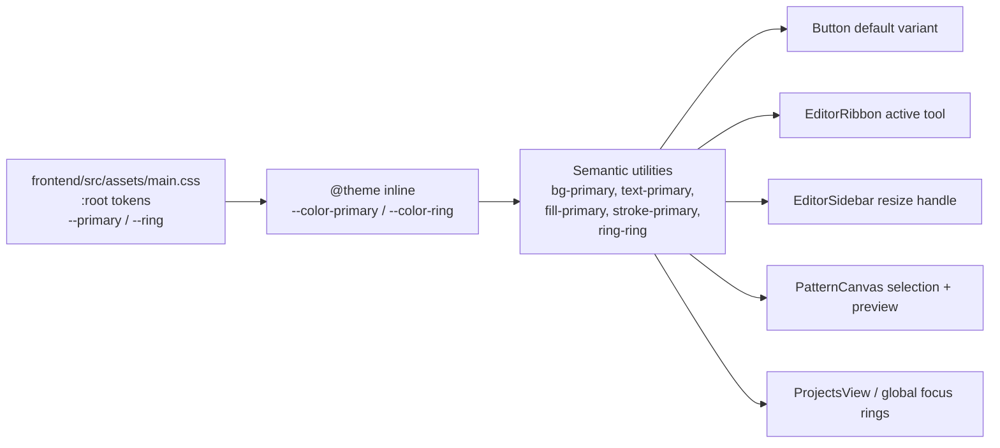

# Primary color: green

Status: proposed
Implements: [#26 — Primary color](https://github.com/slawekniewiadomski/sew-craft/issues/26)
Depends on: none (reverts the token change shipped in PR #25)

## 📝 TLDR

Who needs this: the maker using SewCraft, who sees the brand color on every
primary button, the active ribbon tool, selected canvas entities and focus rings.
Issue #26 asks for the primary color to be **green**. Today it is blue, because
PR #25 changed the two theme tokens from Tailwind green-600 to blue-600.

Proposed: change `--primary` and `--ring` in `frontend/src/assets/main.css` back
to Tailwind **green-600** (`oklch(0.627 0.194 149.214)`), leaving
`--primary-foreground` white. Every component already reads the semantic
`bg-primary` / `text-primary` / `fill-primary` / `stroke-primary` / `ring-ring`
utilities, so this is a two-line token change with no component edits. No API,
command, geometry or database contract changes.

## 📝 Problem Statement

- **Who needs it:** the solo maker drafting a pattern in the editor. The primary
  color is the app's single accent: it marks the default action, the active tool,
  the current selection and keyboard focus.
- **What happens today:** `frontend/src/assets/main.css:8` sets
  `--primary: oklch(0.546 0.245 262.881)` (Tailwind blue-600) and
  `frontend/src/assets/main.css:20` sets `--ring` to the same blue. Those values
  were introduced by PR #25, which replaced the previous green-600
  (`oklch(0.627 0.194 149.214)`).
- **Evidence it matters:** [issue #26](https://github.com/slawekniewiadomski/sew-craft/issues/26)
  states plainly: "I want the primary color to be green." The green was the
  original brand color (configured in the pipeline-setup change) and the project
  is a sewing/pattern tool, where green reads as the established identity.
- **Constraint:** colors are consumed only through theme tokens. A grep of
  `frontend/src` finds no hard-coded blue brand values outside `main.css`, so the
  fix is confined to the token block. The only other blue in the repository is
  `SEAM_ALLOWANCE_COLOR` in `packages/geometry/src/export.ts`, a domain-specific
  export layer color, not a brand token (see Out of scope).

## 📝 Proposed Solution

Set both brand tokens to the exact pre-PR-#25 green:

| Token                 | Today (blue)                  | Proposed (green)              | Tailwind name |
| --------------------- | ----------------------------- | ----------------------------- | ------------- |
| `--primary`           | `oklch(0.546 0.245 262.881)`  | `oklch(0.627 0.194 149.214)`  | green-600     |
| `--ring`              | `oklch(0.546 0.245 262.881)`  | `oklch(0.627 0.194 149.214)`  | green-600     |
| `--primary-foreground`| `oklch(0.985 0 0)`            | unchanged                     | near-white    |

Why this exact shade:

- It is the value the app shipped before PR #25, so it is a true revert of that
  presentational change rather than a new design direction.
- It stays on the same Tailwind palette tier (600) as the blue it replaces, so
  the change is one-line reversible and visually consistent in weight.
- Keeping `--ring` in sync with `--primary` preserves the existing focus-ring
  treatment; leaving it blue would strand a blue accent on every focused control.

No component, test-id or behavior changes. `@theme inline` in `main.css` already
maps `--color-primary` and `--color-ring` to these tokens, so all utilities
update at once.

### Alternatives considered

| Alternative | Why it lost |
| --- | --- |
| Keep blue and close the issue | Contradicts the explicit request in #26. |
| Use green-700 (`oklch(0.527 0.154 150.069)`) for stronger white-text contrast | Better AA contrast (~5.0:1 vs ~3.3:1), but it is a different shade from the app's previous brand color and a design decision the issue did not ask for. Noted as the one-line follow-up if accessibility review requires it. |
| Change only `--primary`, leave `--ring` blue | Produces two competing accents and a blue focus ring around green controls; almost certainly not intended. |
| Override colors per component | Bypasses the semantic token layer and spreads the same value across many files; `main.css` is the single source of truth. |
| Edit `SEAM_ALLOWANCE_COLOR` to green as well | That constant is an export-layer semantic color, not the brand token; changing it is out of scope and would alter exported SVG output. |

## 📝 Architecture



- **Single source of truth:** `frontend/src/assets/main.css`. The `:root` block
  holds raw OKLCH values; `@theme inline` exposes them to Tailwind v4; components
  never name a raw color.
- **No logic layer changes.** `@sewcraft/geometry`, the command bus, the API and
  the database are untouched.
- **No dark theme exists**, so there is no second token block to mirror (see PR
  #25's scope note).

## 📝 API Contracts

None. No command, endpoint, event, payload or exported document shape changes.

## 📝 UI/UX

Primary-colored surfaces affected (all inherit the token automatically):

- Default `Button` background and its white label (`button/variants.ts`).
- Active ribbon tool/constraint background and selected canvas entities
  (`EditorRibbon.vue`, `PatternCanvas.vue`).
- Picked and selected points (`fill-primary`), selected entity stroke
  (`text-primary`), preview stroke.
- Sidebar resize handle while dragging (`bg-primary`).
- Focus rings on inputs and buttons (`ring-ring`), including the project search
  field.

Visual target:

```text
Before (blue-600)                 After (green-600)
┌──────────────┐                  ┌──────────────┐
│   Download   │  blue fill       │   Download   │  green fill
└──────────────┘                  └──────────────┘
  focus ring: blue                  focus ring: green
```

- **Foreground:** `--primary-foreground` stays near-white. On green-600 the
  contrast is approximately **3.3:1**, which meets the WCAG 2.1 non-text/UI
  component minimum of 3:1 and the large-text threshold, but is below the
  4.5:1 normal-text target. This is the same trade-off the app shipped before
  PR #25; buttons use small semibold labels. If a stricter gate is required,
  green-700 is the documented one-line fallback.
- **Focus visibility:** the ring color changes with the primary, so the focus
  ring remains visible against the light background (green-600 on white is a
  strong hue contrast, ~3.3:1 against the page).
- **No layout change:** only hue/chroma change; sizes, spacing and typography are
  untouched.

## 📝 Edge Cases & Failure Scenarios

- **Stale built CSS:** Vite/Tailwind may serve a cached bundle during local
  development. After the change, restart the dev server or hard-refresh, and
  verify the production build (below) contains the green value.
- **Missed blue literal:** if any component hard-coded blue, it would not follow
  the token. A repository grep for `0.546 0.245 262.881` and for blue hex values
  in `frontend/src` is part of verification; today only `main.css` matches.
- **Ring left behind:** changing `--primary` but not `--ring` would leave blue
  focus outlines. Both are changed in the same commit and asserted by the test.
- **Export seam allowance stays blue:** `SEAM_ALLOWANCE_COLOR = '#2563eb'` in
  `packages/geometry/src/export.ts` is intentional layer semantics for SVG/DXF
  output. It is not the UI brand token and PR #25 did not change it either.
  Leave it untouched unless a separate issue asks for export palette changes.
- **Contrast regression:** see UI/UX. If reviewers require AA for normal text,
  switch both tokens to green-700 in a follow-up; no component changes needed.
- **Color-blind users:** primary is never the only signal — active tools also
  carry `aria-pressed`, selected entities are outlined, and buttons have labels.
  The hue change does not remove those affordances.

## 📝 Risks & Impact Review

- **Blast radius:** one CSS file, two values. No runtime logic, data or contract.
- **Reversibility:** `git revert` restores blue; the spec records the exact
  previous and new values, so either direction is mechanical.
- **Visual risk:** the accent appears in many places at once, so a single wrong
  value is immediately visible in the editor. Verification includes a browser
  pass across the affected surfaces.
- **Test impact:** no existing test asserts a concrete color value; they assert
  semantic classes (`bg-primary`, `fill-primary`), which remain valid. A new
  token regression test guards the literal values.
- **Protected surfaces:** none (`BACKWARD_COMPATIBILITY.md` §2/§3 untouched).

## 📋 Acceptance criteria

- [ ] `--primary` in `frontend/src/assets/main.css` is
      `oklch(0.627 0.194 149.214)` (green-600), replacing the blue value.
- [ ] `--ring` uses the same green value, so focus rings are no longer blue.
- [ ] `--primary-foreground` remains `oklch(0.985 0 0)`.
- [ ] No other file hard-codes a blue brand color; no component or test-id
      changes are needed.
- [ ] Default buttons, the active ribbon tool, selected canvas points/entities,
      the sidebar resize handle and focus rings render green in a browser.
- [ ] `SEAM_ALLOWANCE_COLOR` in the geometry export is unchanged.
- [ ] `npm run test:coverage` stays at **100 %** for statements, branches,
      functions and lines; `format`, `typecheck`, `lint`, `format:check` and
      `build` are green, and the backend gate still passes.

## 🧪 Test cases

Automated — new `frontend/src/assets/main.test.ts` (token regression test,
imports `./main.css?raw`):

1. **Primary is green** — parse the `:root` block and assert `--primary` is
   `oklch(0.627 0.194 149.214)`.
2. **Ring matches primary** — assert `--ring` is the same green value (guards the
   "changed one, forgot the other" failure).
3. **Foreground unchanged** — assert `--primary-foreground` is
   `oklch(0.985 0 0)`.
4. **No blue token remains** — assert the stylesheet does not contain
   `oklch(0.546 0.245 262.881)`.

Existing suites (must stay green, no edits expected):

5. `Button` / `buttonVariants` tests — semantic `bg-primary` classes still
   resolve.
6. `EditorRibbon.test.ts` — active tool/constraint still uses `bg-primary`; all
   testids and emits unchanged.
7. `PatternCanvas.test.ts` — selected/picked points still use `fill-primary`;
   selected entities and previews still use `text-primary` / `stroke-primary`.
8. `EditorSidebar.test.ts` — resize handle still uses `bg-primary`.
9. `ProjectsView` / focus-ring behavior — `ring-ring` utility still present.

Manual / build verification:

10. `npm run build`, then confirm the built CSS contains
    `oklch(62.7% .194 149.214)` (or the normalized equivalent) for
    `--primary`/`--ring` and contains no `262.881` (the blue value) in the theme
    tokens.
11. Browser pass in the running editor: capture a default button, the ribbon with
    an active tool, a selected canvas point/entity, and a focused input; all
    accents are green and the focus ring is visible.
12. Backend gate is unchanged but still runs: Pest with `--coverage --min=100`
    and Pint.

## Out of scope

- Choosing a different green shade, a palette overhaul, or adding a dark theme.
- Changing `SEAM_ALLOWANCE_COLOR` or any export-layer color.
- Component redesigns, spacing/typography changes, or accessibility work beyond
  the token swap.
- User-configurable themes or brand-color settings.

## 📋 Phasing

- **Phase 1 — Token change.** Update `--primary` and `--ring` in `main.css`;
  add the regression test; run the frontend gate.
- **Phase 2 — Verification.** Build the production bundle, grep for the green
  value and absence of blue, and confirm the affected surfaces in a browser.
  No documentation contract changes are expected; update this spec's checkboxes
  and `Status:` when implementation lands.

## 📋 Implementation Plan

1. Edit `frontend/src/assets/main.css`: replace both
   `oklch(0.546 0.245 262.881)` values (`--primary` and `--ring`) with
   `oklch(0.627 0.194 149.214)`. Do not touch any other token.
2. Add `frontend/src/assets/main.test.ts` importing `./main.css?raw`, extracting
   the `:root` declarations and asserting cases 1–4 above.
3. Run `npm run format`, then `npm run typecheck`, `npm run lint`,
   `npm run format:check`, `npm run test:coverage`, `npm run build`.
4. Run the unchanged backend gate (Pest 100 % coverage + Pint).
5. Verify in a browser and attach before/after screenshots if a test environment
   is available.
6. Tick the acceptance criteria, set `Status: complete`, and note the green value
   in the implementation PR so it can be reverted mechanically if needed.

## Checks

```bash
npm run format
npm run typecheck
npm run lint
npm run format:check
npm run test:coverage
npm run build
```

Backend code is untouched, but the repository gate still applies:

```bash
docker compose run --rm --no-deps -e DB_CONNECTION=sqlite -e DB_DATABASE=:memory: \
  app sh -c "composer install --no-interaction && php artisan test --coverage --min=100"
docker compose run --rm --no-deps app sh -c "composer install --no-interaction && vendor/bin/pint"
```

## Files

- `frontend/src/assets/main.css` — change `--primary` and `--ring`
- `frontend/src/assets/main.test.ts` (new) — token regression test
- `.ai/specs/2026-10-19-primary-color-green.md` (this spec)
