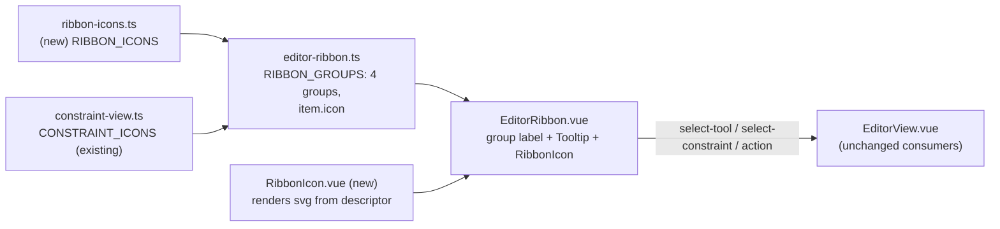
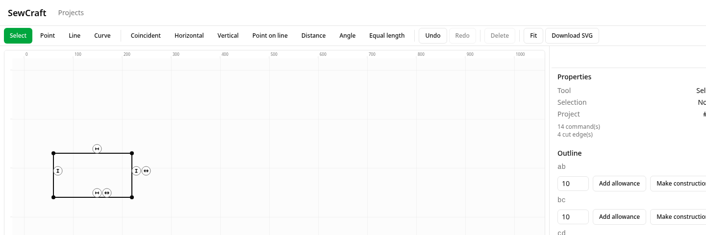
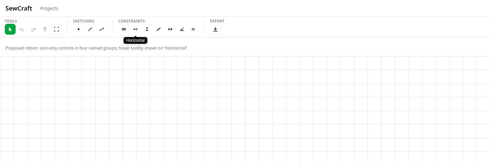

# Ribbon icons and named groups

Status: proposed
Depends on: 013 (editor workspace shell), PR #22 (constraint tools in the ribbon)

## 📝 TLDR

Who needs this: the solo maker drafting a pattern, who reads the editor ribbon to
find the next action. Today the ribbon is one wrapping row of **six unnamed
text-button groups** (`Tools`, `Constraints`, `History`, `Edit`, `Canvas`) whose
16 labelled buttons consume horizontal space and grow a second row on narrow
desktops. Proposed (future behavior): every ribbon control becomes an
**icon-only button with a tooltip**, regrouped into **four named groups — Tools,
Sketching, Constraints, Export** — each carrying a small, uppercase label at its
top-left. This is a frontend presentation change: no geometry, command, API or
database contract changes, and every existing `data-testid` is preserved.

## 📝 Problem Statement

- **Who needs it:** the solo maker drafting a pattern on a desktop where the
  canvas should own the window; the ribbon is the primary discovery surface for
  every tool, constraint and action.
- **What happens today:** `frontend/src/lib/editor-ribbon.ts:39-81` defines six
  groups (`tools`, `constraints`, `history`, `edit`, `canvas`) and
  `frontend/src/components/EditorRibbon.vue:67-92` renders each item as a
  text-label `<Button>`. There is no visible group label: grouping is only an
  `aria-label` plus a `Separator` (`EditorRibbon.vue:75-76`). The item labels
  range from one word (`Undo`) to two (`Download SVG`), so the row is wide.
- **Evidence it matters:** the ribbon now holds 16 controls. The constraint-tools
  spec (`.ai/specs/2026-10-19-constraint-tools-ribbon.md`, §UI/UX) already
  anticipates that "16 buttons in total may wrap on smaller desktops, costing
  some canvas height", and calls icon glyphs a natural follow-up. Icons recover
  that width without removing any control, and named groups make the ribbon's
  structure legible at a glance.
- **Constraint:** commands stay the only mutation path and `@sewcraft/geometry`
  stays untouched — this spec changes only how ribbon controls are drawn.

## 📝 Proposed Solution

### Icon-only controls

Every ribbon item gains an icon. A control renders as a square, icon-only
`Button` (`size="icon"`); its text label moves into a **tooltip** and a real
`aria-label`, so the control stays discoverable and screen-reader labelled. The
`data-testid` and the emitted events (`select-tool`, `select-constraint`,
`action`) are unchanged, so `EditorView.vue` and every existing test keep working.

### Four named groups

The six current groups are consolidated into four visible groups. The mapping
(chosen as the most reversible option — see the resolved-assumptions table):

| Group      | Controls                                                        | Count |
| ---------- | --------------------------------------------------------------- | ----- |
| Tools      | Select, Undo, Redo, Delete, Fit                                 | 5     |
| Sketching  | Point, Line, Curve                                              | 3     |
| Constraints| Coincident, Horizontal, Vertical, Point on line, Distance, Angle, Equal length | 7 |
| Export     | Download SVG                                                    | 1     |

Each group renders its `label` in **small, uppercase, muted** text at the group's
top-left, above the icons. The group label is presentational; the existing
`role="group"` + `aria-label` stays for assistive technology. A vertical
`Separator` still divides adjacent groups, and groups wrap **as units** so a
narrow desktop stacks whole groups rather than splitting one.

### Tooltips

Tooltips reuse the shadcn-vue `tooltip` primitive already used by
`EditorSidebar.vue:55` (`TooltipProvider` + `Tooltip` + `TooltipTrigger as-child`
+ `TooltipContent`), wrapped once at the ribbon root with
`delay-duration="300"`. The tooltip shows the control's full label. It is the
visual label that icon-only controls would otherwise lose.

### Icons

Icons are authored as data descriptors — inline SVG path strings, optionally with
filled dots — against a **24 × 24 viewBox**, the common library grid, mirroring
the existing `ConstraintIcon` shape in `frontend/src/lib/constraint-view.ts:66`.
The constraint icons already exist there and are reused verbatim for the
Constraints group; the canvas marker badge renders them at half size. The
tool/action icons live in a new `frontend/src/lib/ribbon-icons.ts`. **No new
dependency is introduced** (see the resolved-assumptions table, Q2): the
project's established icon primitive is an inline-SVG descriptor, not an icon
component library.

### Alternatives considered

| Alternative | Why it lost |
| --- | --- |
| Keep text labels and add icons beside them | Doubles each button's width; the width problem is the motivation. Icon-only + tooltip is the requested form. |
| Add an icon library (`lucide` / `@lucide/vue`) | A new runtime dependency and install step for nine glyphs the repo can author as data. Reversible later by swapping the icon registry. |
| Group names as tabs / collapsible sections | More chrome for a ribbon that must stay glanceable; the brief asks for visible labels, not navigation. |
| Keep the six current groups and only add icons | Leaves `History`/`Edit`/`Canvas` as administrative buckets; the brief names the four target groups. |

### Prior art

- **Microsoft Office / CAD ribbons** (Onshape, FreeCAD) group commands into
  labelled panels whose caption sits above the panel, and rely on hover tooltips
  for icon-only controls.
- **Onshape's sketch toolbar** separates sketch geometry from constraints exactly
  as the *Sketching* / *Constraints* split here.

Takeaway: a labelled panel + icon-only button + tooltip is the established
pattern; the group *names* are the one product-specific choice, surfaced below.

## 📝 Architecture



- **Pure data + logic** lives in `frontend/src/lib/` and is framework-free and
  fully unit-tested:
  - `ribbon-icons.ts` (new) — `RibbonIcon { paths: string[]; dots? }`,
    `RibbonIconName`, and `RIBBON_ICONS: Record<RibbonIconName, RibbonIcon>`.
    The constraint entries are re-exported from `CONSTRAINT_ICONS` so there is
    one source of truth for each constraint glyph; `ribbonIcon(name)` is the
    single accessor used by the renderer.
  - `editor-ribbon.ts` — `RIBBON_GROUPS` becomes the four named groups; each
    `RibbonItem` gains `icon: RibbonIconName`. The item union, `id`s and label
    strings are otherwise unchanged, so `data-testid`s and emitted values are
    preserved.
- **`EditorRibbon.vue` stays a thin renderer.** It resolves each item's icon,
  wraps the button in the shared tooltip, and renders the group label. It gains
  no business logic; `isActive`, `variantFor`, `isDisabled`, `pressed` and
  `activate` are unchanged.
- **`RibbonIcon.vue` (new)** renders one descriptor as an `<svg>` at a size
  passed by the caller (default 16 px). It is `aria-hidden="true"` — the button
  carries the accessible name.
- **No cross-system effects.** `EditorView.vue` is an unchanged consumer of the
  same props and events. `PatternCanvas.vue`, the command bus, `@sewcraft/geometry`,
  `config/geometry.php`, the API and the database are untouched
  (`BACKWARD_COMPATIBILITY.md` §2/§3).

## 📝 API Contracts

None. No command, endpoint, event or payload shape changes. The ribbon's emitted
values (`select-tool` / `select-constraint` / `action`) and every `data-testid`
are byte-for-byte identical to today.

## 📝 UI/UX

Proposed ribbon layout (each group is a column; label top-left, icons below):

```text
┌ TOOLS ────────┐ ┌ SKETCHING ─┐ │ ┌ CONSTRAINTS ───────────────┐ ┌ EXPORT ─┐
│ ⬚ ↺ ↻ 🗑 ⤢     │ │ • ╱ ⌒       │ │ │ = ─ │ ⊥ ⊙ ↔ ∠ ≣            │ │ ⇩       │
└───────────────┘ └────────────┘ │ └────────────────────────────┘ └─────────┘
```

- **Group label:** small, uppercase, letter-spaced, muted-foreground text at the
  group's top-left. It is always visible (not collapsible) and does not change
  height between active/inactive states.
- **Buttons:** icon-only, square (`size="icon"`); the active tool/constraint keeps
  the current `default` variant and `aria-pressed="true"`; other tools/constraints
  stay `ghost`; actions stay `outline`. Disabled actions (undo/redo/delete when
  unavailable) keep their `disabled` attribute.
- **Tooltip:** appears on hover and on keyboard focus, showing the full label
  ("Horizontal", "Download SVG"). Nothing else is added to the tooltip — there
  are no keyboard shortcuts to advertise yet.
- **Accessibility:** each button keeps an `aria-label` equal to its label (the
  visible text moves off the button), so an icon-only control is still named;
  `aria-pressed` marks the active toggle; the group keeps
  `role="group"` + `aria-label`; the decorative group caption and the SVG are
  `aria-hidden`. Focus order is unchanged (Tools → Sketching → Constraints →
  Export).
- **Responsive:** desktop-first. Groups wrap as **units** (a group stays on one
  line); the ribbon gains no horizontal scrollbar and the canvas keeps the rest
  of the height. With icons the whole ribbon is materially narrower than the
  current text row, so it is expected to fit one line at the widths where the
  text ribbon wrapped.
- **Empty/disabled states:** no new states. A disabled action's tooltip is
  best-effort (see Edge Cases).
- **Visual evidence:** the current text-labelled ribbon and the proposed
  icon-grouped ribbon.

  

  

## 📝 Edge Cases & Failure Scenarios

- **Tooltip on a disabled button:** a `<button disabled>` fires no pointer events
  in some browsers, so its tooltip may not appear on hover. Decision: keep the
  native `disabled` attribute (no behaviour change) and accept best-effort
  tooltips for disabled undo/redo/delete; the control is still `aria-disabled`
  through `disabled` for assistive tech. Reversible by switching to
  `aria-disabled` if it proves confusing.
- **Focus vs hover:** the tooltip must be reachable by keyboard focus as well as
  hover; the `TooltipTrigger as-child` wrapper keeps the button focusable when
  enabled.
- **Icon missing for an item:** the `RibbonIconName` union and the `RIBBON_ICONS`
  record are typed so a missing entry is a compile error, not a blank button.
- **Unknown/renamed item:** the item `id`/`data-testid` is untouched, so tests and
  `EditorView` handlers never depend on the icon.
- **Very narrow width:** groups wrap whole; a single group never splits mid-way,
  and no horizontal scrollbar is introduced.
- **Screen reader on a purely visual label:** the group caption is decorative and
  `aria-hidden`; the semantic name comes from `role="group"`/`aria-label`, so no
  text is announced twice.

## 📝 Risks & Impact Review

- **Reversibility:** every change is frontend presentation and data; a `git
  revert` restores the text ribbon. No data, schema, command or API change is
  involved.
- **Discoverability:** icon-only controls are only as understandable as their
  icons and tooltips. Mitigation: tooltips on hover and focus, a real
  `aria-label`, and recognisable glyphs; the group names carry the intent. This
  is a product-direction trade-off the brief explicitly asks for, not a defect.
- **Group membership is a judgement call:** the four names in the brief do not
  fix where Select/Undo/Redo/Delete/Fit land. The chosen mapping is a one-line
  change in `editor-ribbon.ts` if a human disagrees (Q1 below).
- **Test impact:** new branches in `ribbon-icons.ts`, `editor-ribbon.ts` and
  `RibbonIcon.vue`, and the changed `EditorRibbon.vue` template, all need tests
  to hold the 100 % gate. `EditorRibbon.test.ts` already asserts exact button
  counts and testids; those assertions are kept and extended for the group
  labels and icon presence.
- **Protected surfaces:** none touched (`BACKWARD_COMPATIBILITY.md` §2/§3).

## 📋 Acceptance criteria

- [ ] Every ribbon control is an icon-only button with a tooltip; no text label
      is rendered inside a button.
- [ ] The ribbon shows four groups named **Tools**, **Sketching**,
      **Constraints**, **Export**, each with a visible small uppercase label at
      its top-left.
- [ ] The mapping is Tools = Select, Undo, Redo, Delete, Fit; Sketching = Point,
      Line, Curve; Constraints = the seven constraint types; Export = Download
      SVG.
- [ ] Every existing `data-testid` is preserved and every emit
      (`select-tool` / `select-constraint` / `action`) fires exactly as before.
- [ ] Each button keeps an accessible name (`aria-label`); the active toggle keeps
      `aria-pressed`; groups keep `role="group"` + `aria-label`.
- [ ] No new runtime dependency is added; constraint icons reuse
      `CONSTRAINT_ICONS`.
- [ ] No change to `@sewcraft/geometry`, the command spec, the API or the
      database.
- [ ] `npm run test:coverage` stays at **100 %** for statements, branches,
      functions and lines; `format`, `typecheck`, `lint`, `format:check` and
      `build` are green, and the unchanged backend gate still passes.

## Out of scope

- New tools, constraints, commands or icons beyond the sixteen existing controls.
- Keyboard shortcuts and shortcut hints in tooltips.
- A user-configurable or collapsible ribbon; multiple ribbon tabs.
- Reordering controls beyond the group consolidation above.
- Canvas constraint markers (already shipped in PR #22).
- Mobile redesign.

## 📋 Phasing

- **Phase 1 — Icon data and renderer.** Add `ribbon-icons.ts` and `RibbonIcon.vue`;
  wire an `icon` onto every existing item. Button content is still text at this
  point, so the app keeps working and the icon registry is fully tested.
- **Phase 2 — Icon-only buttons and tooltips.** Render icons, move labels to
  tooltips and `aria-label`s, add the shared `TooltipProvider`. Update
  `EditorRibbon.test.ts`.
- **Phase 3 — Named groups.** Consolidate `RIBBON_GROUPS` into the four named
  groups and render the uppercase group caption + separators; run the full gate.

## 📋 Implementation Plan

1. **Add `frontend/src/lib/ribbon-icons.ts`** with the `RibbonIcon` type, the
   `RibbonIconName` union (`select`, `point`, `line`, `curve`, `undo`, `redo`,
   `delete`, `fit`, `download` + the seven constraint types), `RIBBON_ICONS`
   (constraint entries reused from `CONSTRAINT_ICONS`) and a `ribbonIcon(name)`
   accessor. Unit-test that every union member resolves and that constraint
   entries equal `CONSTRAINT_ICONS`.
2. **Add `frontend/src/components/RibbonIcon.vue`** rendering a descriptor to an
   `aria-hidden` `<svg>` (paths + optional dots) at a caller-set size. Test path
   and dot rendering, the default size, and that it is `aria-hidden`.
3. **Extend `frontend/src/lib/editor-ribbon.ts`**: add `icon: RibbonIconName` to
   each item and restructure `RIBBON_GROUPS` into the four named groups. Update
   `editor-ribbon.test.ts` for the new group ids/labels and that every item has
   an icon.
4. **Update `frontend/src/components/EditorRibbon.vue`**: wrap the toolbar in
   `TooltipProvider`; render each control as an icon-only `Button` with
   `aria-label`, an `RibbonIcon`, and a `TooltipContent` label; render the group
   caption and keep the separators. Update `EditorRibbon.test.ts` for the button
   count, preserved testids, `aria-label`s, tooltip content, group captions and
   the unchanged emits. Verify `EditorView.error.test.ts` (which drives the
   ribbon) still passes.
5. **Run the full gate** (`format`, `typecheck`, `lint`, `format:check`,
   `test:coverage`, `build`, plus the unchanged backend Pest/Pint commands) and
   exercise the ribbon in a browser if a test environment is available. No
   documentation contract changes are expected; update this spec's checkboxes and
   `Status:` when implementation lands.

## 📝 Resolved assumptions (autonomous defaults)

The brief named the four groups and the icon+tooltip treatment but left the
membership and the icon source open. Each default is the most reversible option
that still delivers the requested ribbon; none weakens a protected contract or a
documented product decision.

| # | Question | Applied default | Why | Confirm? |
| --- | --- | --- | --- | --- |
| Q1 | Which controls belong to each of the four groups? | Tools = Select, Undo, Redo, Delete, Fit; Sketching = Point, Line, Curve; Constraints = the seven types; Export = Download SVG | Puts geometry creation in *Sketching* and everything non-drawing in *Tools*, matching CAD toolbars. Grouping is a one-line change in `editor-ribbon.ts`. | Reversible |
| Q2 | Where do the icons come from? | Inline SVG descriptors in a local `ribbon-icons.ts`, reusing `CONSTRAINT_ICONS`; no new dependency | An inline-SVG descriptor is the project's established icon primitive (`constraint-view.ts`); adding an icon library is new surface for nine glyphs. Swapping the registry later is small. | Reversible |
| Q3 | What does a tooltip show? | The control's full label only | There are no keyboard shortcuts to advertise yet; the label is what the icon replaces. | Reversible |
| Q4 | Do buttons keep a text label next to the icon? | No — icon-only | The brief asks for "icons with tooltips"; side-by-side labels would not recover the width. | Reversible |
| Q5 | How is the group label presented? | Always-visible small uppercase `text-muted-foreground` caption at the group's top-left; semantic name stays in `role="group"`/`aria-label` | "Small, uppercase, top-left" is the brief's wording; a static caption adds no interaction. | Reversible |
| Q6 | Do disabled actions show a tooltip? | Best-effort — keep the native `disabled` attribute, accept that some browsers suppress its tooltip | Avoids changing disabled semantics; switch to `aria-disabled` only if it proves confusing. | Reversible |

No `⚠ NEEDS HUMAN CONFIRMATION` rows: every default is frontend-only, reversible,
and consistent with the brief and the existing component contracts. The spec PR
opens ready for review.

## Checks

```bash
npm run format
npm run typecheck
npm run lint
npm run format:check
npm run test:coverage
npm run build
```

Backend code is untouched, but the repository gate still applies:

```bash
docker compose run --rm --no-deps -e DB_CONNECTION=sqlite -e DB_DATABASE=:memory: \
  app sh -c "composer install --no-interaction && php artisan test --coverage --min=100"
docker compose run --rm --no-deps app sh -c "composer install --no-interaction && vendor/bin/pint"
```

## Files

- `frontend/src/lib/ribbon-icons.ts` (new) and `ribbon-icons.test.ts`
- `frontend/src/components/RibbonIcon.vue` (new) and `RibbonIcon.test.ts`
- `frontend/src/lib/editor-ribbon.ts` and `editor-ribbon.test.ts`
- `frontend/src/components/EditorRibbon.vue` and `EditorRibbon.test.ts`
- `frontend/src/lib/constraint-view.ts` (reused; no changes expected)
