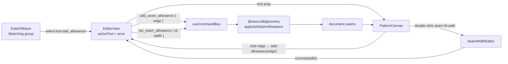

# Seam allowance as a sketch tool

Status: proposed
Implements: [#29 — Seam allowance should be a sketch tool](https://github.com/slawekniewiadomski/sew-craft/issues/29)
Depends on: spec 007 (seam-allowance offset engine), spec 014 (inline value editing pattern)

## 📝 TLDR

Issue #29 asks for two things: adding a seam allowance should be a **ribbon
sketch tool**, and the created allowance's width should be editable by
**double-clicking it on the canvas**.

Today the only way to attach an allowance is a per-edge width field plus an
`Add allowance` button buried in the Outline drawer, and an attached width
cannot be changed at all — the command core has `add_seam_allowance` and
`remove_seam_allowance` but no update command, so editing means remove + re-add.

Proposed: a **Seam allowance** tool in the Sketching ribbon group. With it armed,
clicking a cut line or curve attaches a 10 mm allowance through the existing
command bus and stays armed for the next edge. The dashed allowance becomes
clickable; double-clicking it opens a small inline millimetre editor that
dispatches a new additive `set_seam_allowance` command. The Outline drawer keeps
the attached width (now editable) and the Remove button, and drops its pre-add
input/button so the ribbon is the single creation path.

## 📝 Problem Statement

- **Who needs it:** the pattern maker drafting an edge and immediately deciding
  how much fabric to leave at the seam.
- **What happens today:**
  - `frontend/src/lib/editor-tools.ts` exposes only Select, Point, Line, Curve
    and Dimension. There is no seam tool in the ribbon
    (`frontend/src/lib/editor-ribbon.ts`).
  - `frontend/src/views/EditorView.vue` owns a local `seamWidths` map and
    renders a number input plus `Add allowance` per unseamed edge in the
    Outline drawer. The canvas itself cannot add an allowance
    (`PatternCanvas.vue` only renders `seamAllowancePaths` as a
    `pointer-events-none` dashed layer).
  - An attached seam is displayed read-only (`Allowance 10 mm`) and can only be
    removed. `packages/geometry/src/commands.ts` has no command that changes a
    seam's width.
- **Why the current gesture is wrong:** seam allowance is geometry-level work
  that happens while looking at the edge, like Line or Dimension. Requiring the
  user to find the edge id in a sidebar form separates the action from the
  object and makes the canvas feel read-only.
- **Constraint:** commands remain the only mutation path. The `Seam` model
  already carries `{ id, edge, width }`, so no database, API or document-shape
  migration is needed. The new behavior is one additive command plus UI wiring.

## 📝 Proposed Solution

### 1. A Seam allowance tool in the ribbon

- Add `'add_allowance'` to the `EditorTool` union and to `EDITOR_TOOLS`:
  `{ id: 'add_allowance', label: 'Seam allowance' }`, placed after Dimension in
  the **Sketching** group.
- Add an `allowance` glyph to `RIBBON_ICONS` (two parallel lines closed by short
  end caps, authored in the existing 12 × 12 box) and map the tool to it.
- The existing active-tool button treatment, `aria-pressed`, tooltip and
  `data-testid="tool-add_allowance"` all come for free from `RIBBON_GROUPS`.
- Clicking the active Seam allowance button again returns to Select. `Escape`
  does the same. The canvas cursor is the existing crosshair for non-select
  tools.

### 2. Attach an allowance from the canvas

With the tool armed:

- Clicking a **cut line or curve** emits `add-allowance` with the edge id; the
  view dispatches `add_seam_allowance` with `{ edge }` and lets the command
  default the width to `DEFAULT_SEAM_ALLOWANCE` (10 mm).
- The tool stays armed after a successful attach, so several edges can be done
  in one pass.
- Clicking a **construction edge** dispatches nothing and shows the existing
  error banner: `Only cut edges can carry a seam allowance`.
- Clicking an edge that **already has** an allowance dispatches nothing; the
  allowance is already there, and the edit gesture is double-click on its dashed
  path.
- Clicking empty space or a point dispatches nothing and does not change the
  selection.

The canvas does not validate width or construction state; it emits the edge id
and the view owns the policy. This keeps `PatternCanvas.vue` a renderer plus
pointer router, matching how dimensions and constraints are wired today.

### 3. Edit the width by double-clicking the allowance

- The visible dashed path stays non-interactive. A sibling transparent hit path
  (12 px, `pointer-events-auto`, `cursor-pointer`) is rendered for every seam
  with `data-seam-hit="<edge>"`.
- Double-clicking the hit path (or the visible path area it covers) opens a
  small inline **`SeamWidthEditor.vue`** at the double-click point in screen
  space.
- The editor is prefilled with the current width, focuses and selects the input,
  and has an explicit `mm` suffix:
  - `Enter` or the form submit commits a valid width.
  - `Escape` cancels.
  - Blur commits a valid width and discards an invalid one.
  - An invalid value (empty, non-numeric, `<= 0`, non-finite) shows
    `Use a width greater than 0.`, sets `aria-invalid="true"` and keeps the
    editor open for Enter; blur with an invalid value cancels.
  - Committing the unchanged width is a cancel, so no no-op command is sent.
- Dispatch uses the new `set_seam_allowance` command. The editor closes when the
  active tool changes, the document changes, the seam layer is hidden, or the
  seam disappears.
- A double-click during constraint placement does nothing; constraint placement
  keeps pointer precedence.

### 4. Sidebar becomes review/edit/remove

The Outline drawer is no longer the creation path:

- An attached edge shows `Allowance <input> mm` and **Remove allowance**. The
  input is editable (`data-testid="seam-width-<edge>"`) and dispatches
  `set_seam_allowance` on `change`/`Enter`; invalid or unchanged values snap
  back to the current width and send nothing.
- An unattached edge shows a muted `No allowance`
  (`data-testid="seam-empty-<edge>"`) and no add control.
- The local `seamWidths` map, `seamWidthFor`, `setSeamWidth`, `addSeam` and the
  `DEFAULT_SEAM_ALLOWANCE` import are removed from `EditorView.vue`.
- Remove dispatch is unchanged. The Show seam allowance and construction
  toggles are unchanged.

### 5. Additive `set_seam_allowance` command

New command:

```json
{
  "id": "<command id>",
  "type": "set_seam_allowance",
  "params": { "id": "<seam id>", "width": 15 }
}
```

- `width` must be a finite number `> 0` (same rule as `add_seam_allowance`).
- `id` must reference an existing seam; an unknown seam is a
  `CommandValidationError`.
- Re-applying the current width is a no-op with `inverse: null`.
- The inverse is `set_seam_allowance` with the previous width, keeping the
  command id, so undo/redo is lossless.
- The command does not move geometry and does not need a solver pass beyond the
  existing `executeCommand` pipeline.
- Adding the command is additive: v0.3 payloads still apply. The command spec
  moves to **0.4.0** and all three copies (`config/geometry.php`,
  `docs/domain/command-spec.json`, `docs/domain/command-spec.md`) change
  together.

## 📝 Architecture



- **Pure helpers:** `frontend/src/lib/seam-width.ts` exports
  `parseSeamWidth(input: string): number | null` and
  `isValidSeamWidth(value: unknown): value is number`. Both are framework-free
  and unit-tested: an empty/whitespace/non-numeric/zero/negative/non-finite
  value is `null`; a positive finite number (including `0.1`, `12.5`, `1e3`)
  is valid.
- **`SeamWidthEditor.vue`** follows the inline Dimension editor pattern: a small
  absolutely positioned form over the canvas, local raw string, validation and
  `commit`/`cancel` emits. It is the only new component.
- **`PatternCanvas.vue`** gains `add-allowance` and `set-seam-width` emits, plus
  seam hit paths and the editor. It keeps the existing `SeamView` shape plus the
  seam id/width needed to open the editor.
- **`EditorView.vue`** owns the tool state, the construction/duplicate checks,
  the two dispatches and the sidebar edit. No second store and no direct
  document mutation.
- **Command core** gets one interface, one union member, one `applyCommand` arm
  and one apply function. `delete_entity` already cascades seams; nothing else
  changes.

## 📝 API Contracts

New command in `config/geometry.php`, `docs/domain/command-spec.json` and
`docs/domain/command-spec.md`:

| Field | Type | Rule |
| --- | --- | --- |
| `id` | `entity_id` | existing seam id |
| `width` | `number` | finite, `> 0` (mm) |

- inverse: `set_seam_allowance` (previous width, same command id)
- no-op: width already equal; `inverse: null`
- error: unknown seam, invalid width

`config('geometry.spec_version')`, the JSON `$id`/`schema`/`spec_version` and
the backend `CommandSpecTest` assertion move from `0.3.0` to `0.4.0`.

## 📝 UI/UX

- **Ribbon:** the Sketching group becomes Point, Line, Curve, Dimension, Seam
  allowance. The new button uses the existing icon-button style, tooltip and
  pressed state; no layout change beyond one more icon.
- **Canvas:** the seam tool shows the crosshair. The visible dashed allowance
  keeps its current styling and destructive colour for self-intersections. The
  invisible hit path adds no pixels; `cursor: pointer` communicates that the
  allowance is interactive.
- **Inline editor:** a compact bordered form at the click point, same visual
  language as the Dimension editor; the unit sits beside the field so `15`
  reads as `15 mm`.
- **Sidebar:** attached width becomes editable in place; unattached rows say
  `No allowance`. The Remove button stays. The behaviour is immediately
  understandable after adding from the ribbon.
- **Accessibility:** the ribbon button has an accessible name and
  `aria-pressed`; the width input is labelled `Allowance width in millimetres`;
  invalid input exposes `aria-invalid` and a visible error; focus is moved into
  the editor on open and returns to the canvas when it closes (normal document
  focus behavior after unmount).
- **States:** empty document → the tool does nothing on empty space; no
  allowance → click adds; existing allowance → click does nothing, double-click
  edits; hidden seam layer → no hit paths and any open editor closes.

## 📝 Edge Cases & Failure Scenarios

- **Construction edge:** no dispatch, visible error message. The edge can be
  converted to a cut edge with the Construction tool and then receive an
  allowance.
- **Duplicate attach:** clicking an already-seamed edge sends nothing. Direct
  re-dispatch of `add_seam_allowance` still rejects a duplicate edge as today.
- **Invalid width:** `0`, negative, `NaN`, `Infinity`, empty and non-numeric
  text never dispatch. The inline editor keeps the message for Enter; the
  sidebar snaps back to the stored value.
- **Unchanged width:** no command, so the journal and undo stack stay clean.
- **Stale seam (undo/redo):** if the seam disappears while the editor is open,
  the document watcher closes the editor; a late dispatch is caught by the
  existing error banner rather than mutating the document.
- **Multiple seams:** the editor carries the seam id, not the edge id, so
  editing one never touches another.
- **Curve edge:** the same tool and hit path work; the offset path supplies the
  geometry.
- **Self-intersecting allowance:** still editable; the destructive style is a
  warning, not a block.
- **Hiding seam allowances:** the layer disappears, the hit path disappears and
  an open editor closes without dispatching.
- **Tool switch / Escape:** closes the editor and leaves the document
  unchanged.
- **Double-click during constraint placement:** ignored; picks keep working.
- **Undo after a width change:** the inverse restores the previous width and
  keeps the seam id.

## 🧪 Test cases

### Geometry / command core — `packages/geometry/tests/commands.test.ts`

1. `set_seam_allowance` updates only the target seam and returns an inverse that
   restores the previous width.
2. It leaves other seams and all entities/constraints untouched.
3. Same width is a no-op: same document reference and `inverse: null`.
4. Unknown seam throws `CommandValidationError` without mutating.
5. `NaN`, `Infinity`, `0` and negative widths throw without mutating.
6. `executeCommand` accepts the command and returns a converged solve result.
7. `delete_entity` still cascades a seam when the edge is deleted (existing
   test stays green).

### Frontend helpers — `frontend/src/lib/seam-width.test.ts`

8. `parseSeamWidth` accepts `10`, `10.5`, `.5`, `1e3` and surrounding
   whitespace.
9. It rejects empty, whitespace-only, `abc`, `0`, `-1`, `NaN`, `Infinity`.
10. `isValidSeamWidth` mirrors the same boundary.

### `SeamWidthEditor.vue`

11. Renders prefilled with the current width, focuses and selects the input.
12. Enter with a valid changed width emits `commit` with the number.
13. Enter with the unchanged width emits `cancel`, not `commit`.
14. Enter with an invalid value keeps the editor open, shows the error and sets
    `aria-invalid`.
15. Escape emits `cancel` and never `commit`.
16. Blur commits a valid value; blur discards an invalid value.
17. Editing the raw input clears the error state.

### `PatternCanvas.vue`

18. Renders a hit path (`data-seam-hit`) only when the seam layer is visible.
19. With the seam tool, clicking a cut line emits `add-allowance('ab')`; clicking
    a cut curve emits its id; clicking a construction line still emits (the view
    owns rejection) or is covered by the view test.
20. With the seam tool, clicking empty space or a point emits nothing.
21. Double-clicking the seam hit path opens `seam-width-editor` prefilled with
    the seam width at the click point.
22. Committing the editor emits `set-seam-width` with the seam id and number;
    Escape emits nothing.
23. Changing the document, hiding seam allowances, or switching tools closes the
    editor.
24. A double-click during constraint placement does not open the editor.
25. The tool switch watcher still clears pending line/curve/dimension state.

### `EditorView.vue`

26. Clicking `tool-add_allowance` activates the tool and the ribbon button is
    pressed.
27. Clicking a candidate edge dispatches `add_seam_allowance` with `{ edge }`
    and `DEFAULT_SEAM_ALLOWANCE` semantics (no explicit width).
28. Clicking a construction edge shows `Only cut edges can carry a seam
    allowance` and leaves the document unchanged.
29. Clicking an edge that already has an allowance dispatches nothing.
30. Double-clicking an allowance and committing dispatches `set_seam_allowance`
    with `{ id, width }`; the sidebar updates and undo restores the old width.
31. The sidebar attached width input dispatches on `change`/`Enter`, snaps back
    on invalid input, and does nothing when unchanged.
32. An unattached edge shows `No allowance` and has no add/save control.
33. Remove allowance still detaches and removes the dashed path.
34. Escape and clicking the active tool again return to Select.

### Ribbon / tools

35. `EDITOR_TOOLS` lists the six tools with `add_allowance` last.
36. `RIBBON_GROUPS[1]` contains `tool-add_allowance` with label `Seam allowance`,
    icon `allowance`, after `tool-dimension`.
37. `RIBBON_ICONS.allowance` exists and `RibbonIcon` renders its paths.

### Command spec / backend

38. `GET /api/commands` reports `0.4.0` and exposes
    `commands.set_seam_allowance.params.{id,width}` and
    `inverse = set_seam_allowance`.
39. Existing v0.3 command assertions still pass.

### Integration / manual

40. Browser: arm the tool, click two edges, see two dashed allowances; double
    click one, set 15 mm, see it update and undo restore; hide the layer and
    confirm the hit path is gone; switch to a construction edge and confirm the
    error.

## 📋 Acceptance criteria

- [ ] A **Seam allowance** tool appears in the Sketching ribbon group and can be
      activated, deactivated and cancelled with Escape.
- [ ] Clicking a cut line or curve with the tool attaches a 10 mm allowance via
      `add_seam_allowance`; the tool stays armed; construction edges are rejected
      with the existing error banner.
- [ ] The dashed allowance is hit-testable; double-clicking it opens an inline
      width editor positioned at the click.
- [ ] Enter/blur commit a valid width through the new `set_seam_allowance`
      command; Escape and invalid blur cancel; invalid input stays editable with
      a visible error.
- [ ] The Outline drawer shows an editable width for attached seams, `No
      allowance` for unattached seams, and no pre-add input/button.
- [ ] `set_seam_allowance` is documented at spec **0.4.0**, validates width and
      seam id, is idempotent for an unchanged width, and has a lossless inverse.
- [ ] All existing seam, dimension, constraint and editor tests still pass, and
      coverage stays at **100 %** statements/branches/functions/lines.

## Out of scope

- Per-piece seam allowances (pieces are still spec 006 work).
- Independent inside/outside or per-corner offset styles; the existing offset
  engine settings stay unchanged.
- Seam allowance in SVG/PDF/DXF export (008/010/011).
- Notches, facings, linings and seam allowance presets per project.
- Dragging the dashed allowance line itself to change width (double-click is the
  requested and implemented gesture).
- A ribbon width dropdown or "last used width" memory; the default stays 10 mm
  and the width is set after creation.

## 📋 Implementation plan

1. **Command core:** add `SetSeamAllowanceParams`, the union member and
   `applySetSeamAllowance` in `packages/geometry/src/commands.ts`; add the
   command tests. Run `npm test -w @sewcraft/geometry`.
2. **Contract copies:** add the command to `config/geometry.php`,
   `docs/domain/command-spec.json` and `docs/domain/command-spec.md`; bump all
   three to `0.4.0`; update `tests/Feature/CommandSpecTest.php`.
3. **Helpers:** add `frontend/src/lib/seam-width.ts` and its test.
4. **Editor:** add `SeamWidthEditor.vue` and its test.
5. **Canvas:** extend `SeamView` with the seam id/width, add the hit paths, the
   `add-allowance` / `set-seam-width` emits, the inline editor state and the
   close watchers. Update `PatternCanvas.test.ts`.
6. **View and ribbon:** add `'add_allowance'` to `EditorTool`/`EDITOR_TOOLS`,
   the `allowance` icon, the ribbon item and the view handlers, error checks and
   sidebar edit; remove the old `seamWidths` add path. Update the affected tests.
7. **Gate:** `npm run format`, `npm run typecheck`, `npm run lint`,
   `npm run format:check`, `npm run test:coverage`, `npm run build`, plus the
   backend Pest/Pint commands from `AGENTS.md`.

## Checks

```bash
npm run format
npm run typecheck
npm run lint
npm run format:check
npm run test:coverage
npm run build
docker compose run --rm app php artisan test
docker compose run --rm app vendor/bin/pint
```
