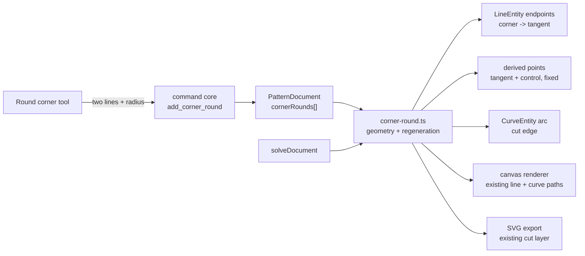

# Corner rounding tool

Status: implemented
Refs #46
Closes #46
Builds on: `.ai/specs/006-construction-geometry.md` (cut vs construction
entities) and the curve primitive in `packages/geometry/src/types.ts`.

## 📝 TLDR

A corner between two lines can only be changed by moving the shared point, so a
rounded neckline, pocket corner or cuff is drawn by hand with a curve and then
loses the exact radius. Proposed future behaviour: a **Round corner** tool asks
for two lines that meet at a corner and a radius, trims both lines to their
tangent points, inserts a tangent circular arc, and keeps the radius editable.
The original sharp corner survives as a construction point, so existing
dimensions and constraints on it still define the pattern; the arc and tangent
points are derived from the radius and the two line directions and are
regenerated whenever the sketch changes.

## 📝 Problem Statement

- **Who needs it:** the maker drafting a pattern. Rounded corners are normal on
  necklines, armholes, pocket flaps, cuffs and waistbands, and the radius is a
  design decision that is tuned repeatedly.
- **What happens today:** geometry is points, straight lines and cubic Bézier
  curves (`packages/geometry/src/types.ts:18-38`). There is no arc primitive, no
  trim/split command, and no way to relate a curve to two lines. The user can
  place a Curve tool by clicking four control points, but the result is an
  eyeballed approximation: it is not tangent, its radius is not a number, and
  changing the adjacent lines leaves it detached.
- **Evidence it matters:** #46 asks for exactly the missing primitive — select
  two lines at a corner, enter a radius, keep the radius editable, and keep the
  points where the lines become the radius. A hand-drawn curve satisfies none of
  those.
- **Constraint:** commands remain the only mutation path, `@sewcraft/geometry`
  stays pure, and SVG export must contain the rounded boundary as real cut
  geometry. Existing documents must load and render unchanged.

## 📝 Proposed Solution

### Vocabulary

| Term | Meaning |
| ---- | ------- |
| **Corner round / fillet** | A circular arc replacing a sharp corner between two straight edges. |
| **Sharp corner** | The original shared point of the two lines. It stays as a construction point and can keep its constraints and dimensions. |
| **Tangent point** | Where a line stops being straight and the arc begins. Each selected line gets one. |
| **Corner-round feature** | The persisted record of a sharp corner, its two lines, its radius and its derived geometry. |

### Options considered

| # | Option | Trade-offs | Verdict |
| - | ------ | ---------- | ------- |
| A | **Parametric corner-round feature over existing lines and a cubic Bézier arc** — the feature stores the sharp corner, the two lines, the opposite original corners and the radius; derived tangent/control points and the arc are regenerated after each solve | One new optional collection, no new entity kind; reuses the curve renderer and SVG exporter; radius and line edits stay consistent; constraints on the sharp corner still work. Cost: line endpoints are trimmed, derived geometry needs an invariant pass, and the arc is an approximation | **Recommended** |
| B | **First-class `ArcEntity` plus tangency constraints** — add center/radius/start/end geometry and tangent relations to the solver | Exact arcs, general arc drafting later, and a more natural CAD model. Cost: solver, rendering, hit-testing, export, command and data-model changes across the stack; tangency in the solver is a large project on its own | Future — split into an "arcs and tangency" spec; this tool can migrate to it |
| C | **Static bake** — trim the lines and insert a Bézier, store no feature | Smallest implementation and no regeneration pass. Cost: the radius is not editable, which is an explicit requirement in #46 | Rejected — fails the issue |
| D | **Render/export-only rounded overlay** — derive the rounded outline without changing entities | Non-destructive and reversible. Cost: hit-testing, seam allowance, selection, export and every future consumer must know about a hidden overlay; the document no longer describes its own cut boundary | Rejected — hidden state in a geometry document |

Option A is the smallest design that actually keeps the radius editable. It also
retains the sharp corner as the theoretical construction point, which is how CAD
fillets usually behave and what lets existing width/height dimensions keep
working.

### Behaviour

1. **Arm the tool.** A new **Round corner** tool in the editor ribbon enters a
   two-line pick mode with the prompt "Round corner — pick the first line."
2. **Pick two lines.** A line click fills the first slot; the second click must
   be a different line that shares exactly one point with the first. The shared
   point is the sharp corner. Picking a curve, a point, a line that shares no
   point, or a line already rounded at that corner is rejected with a short
   reason and leaves the first pick in place.
3. **Enter the radius.** Once two valid lines are picked, the prompt bar shows a
   radius field in millimetres, prefilled with a safe default (the smaller of
   5 mm and the largest radius both lines can take), plus **Apply** and
   **Cancel**. A live preview shows the proposed tangent points and arc while the
   field changes; nothing is committed until Apply.
4. **Apply.** `add_corner_round` trims both lines to their tangent points,
   creates the arc and its control points, keeps the sharp corner as a
   construction point, and stores the feature. The tool stays armed for the next
   corner, as the other drawing tools do.
5. **Edit the radius.** Select the arc or either rounded line. The Properties
   panel shows a **Corner round** section with a radius field and **Remove**.
   On the canvas, the two tangent points render as handles; dragging one along
   its line changes the radius symmetrically (both tangent points move to the
   same tangent distance) and commits once on release. Double-clicking the
   small `R 12` label also opens the radius field. All three paths dispatch
   `set_corner_round_radius`.
6. **Remove.** `remove_corner_round` deletes the arc and derived points, restores
   both lines to the sharp corner and restores the corner's previous
   construction flag. Undo re-rounds with the same radius.
7. **Keep the sharp corner.** The original corner point is not deleted. It is
   marked construction and keeps any dimensions or constraints that reference it;
   width/height dimensions between sharp corners remain meaningful. The trimmed
   line endpoints are the tangent points, which are derived and not directly
   editable.
8. **Stay consistent.** After every solve, the feature recomputes the tangent
   points and control points from the sharp corner, the opposite original
   corners and the radius. Moving a line, dragging a sharp corner or changing a
   radius keeps the arc tangent. An edit that would make the round impossible
   (the tangent distance exceeds the remaining line length, or the corner
   becomes straight) fails the command and leaves the document unchanged.

## 📝 Architecture



Takeaway: the feature is a small, pure geometry module plus one post-solve
regeneration pass; rendering and export keep using ordinary lines and curves.

### Geometry package

- `types.ts` — add the feature and extend `PatternDocument`:
  ```ts
  export interface CornerRoundEnd {
    /** The selected line, trimmed at the shared corner. */
    line: EntityId;
    /**
     * The original point at the line's opposite end. It defines the line
     * direction even after the line has been trimmed at both ends.
     */
    anchor: EntityId;
    /** The derived point where this line becomes the arc. */
    tangent: EntityId;
  }

  export interface CornerRound {
    id: EntityId;
    /** The sharp corner, kept as a construction point. */
    corner: EntityId;
    ends: [CornerRoundEnd, CornerRoundEnd];
    /** Arc radius in millimetres. */
    radius: number;
    /** Derived cubic Bézier, a cut edge. */
    arc: EntityId;
    /** Derived Bézier control points p1 and p2. */
    controls: [EntityId, EntityId];
    /** The sharp corner's construction flag before the round. */
    cornerConstruction: boolean;
  }

  export interface PatternDocument {
    // …
    /** Optional so documents written before corner rounds load unchanged. */
    cornerRounds?: CornerRound[];
  }
  ```
  `point.fixed` already exists and is used to exclude derived points from the
  solver's variable vector.
- `corner-round.ts` — new pure module:
  - `cornerRoundsForEntity(document, id)` — every feature that references a
    line, arc, tangent, control point, sharp corner or anchor (a line may have
    two, one at each end). Empty when the entity is not part of a round.
  - `isCornerRoundDerived(document, id)` — true for an arc, tangent or control
    point. Used by command validation and the canvas.
  - `maxCornerRadius(document, round)` — the largest radius that still leaves
    both tangent distances and at least 0.001 mm of each selected line, including
    any round at the opposite end of either line; `null` when the corner is
    degenerate.
  - `cornerRoundGeometry(document, corner, anchorA, anchorB, radius)` — pure
    math returning tangent points, control points, arc endpoints and a
    validation error when the corner is too sharp, too straight or the radius
    does not fit.
  - `regenerateCornerRounds(document)` — recompute every feature's derived
    points and arc from its radius and source lines. Returns a new document or
    throws `CommandValidationError` with the offending round and the reason.
  - `normalizeCornerRounds(document)` — validate loaded features without moving
    geometry; drop a feature whose invariants no longer hold and keep its
    persisted entities as static geometry. Never throws. The load path calls it
    once.
- Math (all in millimetres, `θ` is the interior angle at the sharp corner):
  - `uA = normalize(anchorA - corner)`, `uB = normalize(anchorB - corner)`;
    `θ = acos(clamp(dot(uA, uB), -1, 1))`.
  - Reject `θ` within 1° of 0° or 180°: a spike or a straight line has no
    usable fillet.
  - Tangent distance `t = radius / tan(θ / 2)`.
  - Tangent points `T_A = corner + uA * t`, `T_B = corner + uB * t`.
  - Control distance `k = (4 / 3) * tan((π - θ) / 4) * radius`;
    `P1 = T_A - uA * k`, `P2 = T_B - uB * k`.
  - Arc is the cubic `p0 = T_A`, `p1 = P1`, `p2 = P2`, `p3 = T_B`. For a 90°
    corner this is the standard 0.5523·r control offset.
  - Bezier error is at most ~0.027 % of the radius (13.5 µm at a 50 mm radius),
    below any sewing tolerance. Option B is the exact-arc path if a future
    feature needs it.
- `document.ts` — selectors for the optional collection:
  `cornerRounds(document): CornerRound[]` (defaults to `[]`) and
  `cornerRoundsForEntity`.
- `solver.ts` — derived tangent/control points are `fixed: true`, so they are
  already excluded from the variable vector. No residual changes.
- `commands.ts` — new commands, validation, cascade and inverse precision (see
  **API Contracts**); regeneration runs after solving (see **Regeneration**).
- `export.ts` — no code change: the arc is a normal `CurveEntity` in the cut
  layer, and the trimmed lines are normal `LineEntity`s. The rounded boundary is
  exported as real cut geometry.
- No new dependency; bump the package minor above `develop`'s version.

### Regeneration

`regenerateCornerRounds(document)` is a deterministic pass:

1. Resolve every feature's sharp corner, both anchors and radius.
2. Compute `t` for every feature. For each selected line, the sum of the `t`
   values at its two ends (or one end, when the line has a single round) must
   leave at least 0.001 mm of the original corner-to-anchor length. This is the
   only cross-round check; it lets a line carry a round at each end, so all four
   corners of a rectangle can be rounded.
3. Compute tangent and control points, update the derived point coordinates,
   update the arc's point references and set the line endpoint at each rounded
   corner to its tangent point.
4. Keep the sharp corner as a construction point; do not move it.

It runs at the end of `solveDocument`, after the solver has written updated
coordinates and before the document is returned. A feature that can no longer
be regenerated makes the command fail with a clear validation error and leaves
the input document untouched. It is idempotent, so running it after a pure
`applyCommand` in a test is safe. A document loaded from storage is trusted to
contain its persisted derived geometry; a hand-edited document whose feature is
inconsistent is loaded as static geometry with the feature dropped (see
**Edge Cases**).

### Frontend

- `frontend/src/lib/editor-tools.ts` — add `round_corner` to `EditorTool` and
  `EDITOR_TOOLS`; the ribbon gets a **Round corner** button in the existing Tools
  group.
- `frontend/src/lib/corner-round.ts` — framework-free pick state and radius
  helpers: `cornerRoundPicks`, `cornerRoundRejection`, `defaultCornerRadius`,
  `maxCornerRadiusForLines`, `radiusFromTangentDistance`. All math delegates to
  `@sewcraft/geometry`; no solver or geometry formula is copied.
- `CornerRoundPromptBar.vue` — a new small component, modelled on
  `ConstraintPromptBar.vue`: prompt text, radius field, Apply/Cancel, and an
  inline reason when the radius is too large or the picks do not meet.
- `PatternCanvas.vue` — accepts `roundCornerActive` and `roundCornerPicks`,
  emits `round-corner-pick` for lines, highlights picked lines, and renders the
  live preview from the pending radius. Once a round is committed it renders as
  ordinary trimmed lines and an arc; the overlay adds the tangent handles and the
  `R 12` label only for the selected round.
- `frontend/src/views/EditorView.vue` — owns the pick state and the command dispatch
  (`add_corner_round`, `set_corner_round_radius`, `remove_corner_round`), like
  the other tools. No second store.
- `EntityPropertiesPanel.vue` — when the selected line or arc belongs to one or
  more rounds, show one **Corner round** section per round: radius field, the
  opposite sharp corner ids, and Remove. A line with rounds at both ends shows
  two sections. The radius field is the keyboard-accessible edit path; the
  tangent handles are an additional pointer affordance.
- Derived points and control points are hidden from the normal point layer; the
  sharp corners render as construction points. Tangent handles render only while
  the round is selected or hovered.
- No change to the command bus, the solver UI, the dimension UI or the ribbon's
  constraint groups.

### Documentation

Update `docs/architecture/geometry-core.md` (feature, derived geometry,
regeneration), `docs/architecture/data-model.md` (optional `cornerRounds`
collection), `docs/domain/glossary.md` (corner round, tangent point, sharp
corner) and the command-spec trio at `spec_version` `0.7.0` on this branch
(rebase to the next free version if another spec bumps first).

## 📝 Data Model

`PatternDocument` gains an optional `cornerRounds` array. A 90° corner rounded
with a 10 mm radius looks like this (all ids are illustrative):

```jsonc
{
  "schema": "sewcraft.pattern/0.1",
  "units": "mm",
  "entities": [
    { "id": "c1", "kind": "point", "x": 0, "y": 0, "construction": true, "fixed": false },
    { "id": "c2", "kind": "point", "x": 100, "y": 0, "construction": false, "fixed": false },
    { "id": "c3", "kind": "point", "x": 0, "y": 100, "construction": false, "fixed": false },
    { "id": "t1", "kind": "point", "x": 10, "y": 0, "construction": false, "fixed": true },
    { "id": "t2", "kind": "point", "x": 0, "y": 10, "construction": false, "fixed": true },
    { "id": "k1", "kind": "point", "x": 4.477, "y": 0, "construction": true, "fixed": true },
    { "id": "k2", "kind": "point", "x": 0, "y": 4.477, "construction": true, "fixed": true },
    { "id": "l1", "kind": "line", "start": "t1", "end": "c2", "construction": false },
    { "id": "l2", "kind": "line", "start": "t2", "end": "c3", "construction": false },
    { "id": "arc1", "kind": "curve", "p0": "t1", "p1": "k1", "p2": "k2", "p3": "t2", "construction": false }
  ],
  "constraints": [],
  "seams": [],
  "cornerRounds": [
    {
      "id": "r1",
      "corner": "c1",
      "ends": [
        { "line": "l1", "anchor": "c2", "tangent": "t1" },
        { "line": "l2", "anchor": "c3", "tangent": "t2" }
      ],
      "radius": 10,
      "arc": "arc1",
      "controls": ["k1", "k2"],
      "cornerConstruction": false
    }
  ]
}
```

Rules:

- `corner` is a point; `ends[*].line` are distinct `line` entities that share
  exactly that point at the time of creation.
- `ends[*].anchor` is the original point at the opposite end of the line. When
  that end already has a round, the anchor is that round's sharp corner, not the
  current tangent point, so the line direction stays the original one.
- `radius` is finite and `> 0`; the derived tangent distance must fit on both
  lines (see **Regeneration**).
- `arc` is a `curve` entity with `p0`/`p3` = the two tangent points and
  `p1`/`p2` = the two control points. `controls` stores the control ids for
  lookup and validation.
- Derived tangent points and control points are `fixed: true`; tangent points
  inherit the selected lines' `construction` flag and control points are
  `construction: true`. The arc inherits the same flag (the two lines must
  match).
- `cornerConstruction` records the sharp corner's construction flag before the
  round; it is restored when the round is removed.
- A line may appear in two rounds, one at each end. A sharp corner may appear in
  at most one round.
- `PatternDocument.schema` stays `sewcraft.pattern/0.1`: the collection is
  optional and older documents load unchanged. Documents written by the new code
  are downgrade-tolerant: an older build ignores `cornerRounds` and still renders
  the trimmed lines and arc as ordinary geometry, but cannot edit the radius.

## 📝 API Contracts

### `add_corner_round`

Round a corner between two lines.

- params: `first: entity_id`, `second: entity_id`, `radius: number` (mm)
- Both params name `line` entities, are distinct, and share exactly one point.
- Neither line may already be rounded at that shared corner.
- Both lines must have the same `construction` flag.
- No line may carry a seam allowance (Q3), and no third line with the same
  construction flag may meet at the shared corner (for a cut fillet, a
  construction guide at the sharp corner is allowed).
- `radius` must be finite, at least 0.001 mm, and fit both selected lines while
  leaving at least 0.001 mm of each line outside the tangent point; the command
  rejects with the maximum usable radius when it does not.
- The corner angle must be strictly between 0° and 180° (a 1° guard at each
  end); a spike, a straight line or a zero-length line is rejected.
- Derived ids are deterministic from the command id:
  `<id>:a` (tangent A), `<id>:b` (tangent B), `<id>:c1`, `<id>:c2`
  (controls), `<id>:arc`. A collision is a validation error. Re-applying the
  command when the feature exists is a no-op.
- The sharp corner is set `construction: true` and its previous flag is stored.
- inverse: `remove_corner_round { id }`.

### `set_corner_round_radius`

Change the radius without removing the round.

- params: `id: entity_id` (the feature id), `radius: number`
- Same fit and angle rules as `add_corner_round`, including the 0.001 mm
  minimum, the minimum remaining line segment and any round at the opposite end
  of either line; an out-of-range radius is a validation error and leaves the
  document unchanged.
- Re-applying the current radius is a no-op with `inverse: null`.
- Regeneration recomputes both tangent points and the arc in the same command.
- inverse: `set_corner_round_radius` on the same feature with the previous
  radius.

### `remove_corner_round`

Restore the sharp corner and delete the derived geometry.

- params: `id: entity_id`
- Restores each selected line's rounded endpoint to the sharp corner, restores
  `cornerConstruction`, deletes the tangent points, control points and arc, and
  removes the feature. A line with a round at its other end keeps that round.
- inverse: `add_corner_round` with the original feature id, `first`, `second`
  and `radius` (the lines are back at the sharp corner, so re-adding is valid
  and recreates the same derived ids).

### Cascade

- `delete_entity` on a rounded line removes every feature that uses that line
  (restoring the other lines and sharp corners), then deletes the line.
  Deleting the arc or a tangent/control point removes its one feature first.
  Snapshot undo covers the multi-entity change, as it already does for point
  deletion.
- `delete_entity` on a sharp corner or an anchor point that a feature uses is
  rejected while the feature exists: "Remove the corner round first." This
  avoids leaving lines with dangling endpoints.
- `move_point` on a derived point is rejected. `move_point` on a sharp corner or
  an anchor is allowed; regeneration runs after the solve.
- `add_line`, `add_curve`, `add_constraint`, `add_seam_allowance` and
  `set_construction` reject derived points/arcs where they would attach new
  geometry or change the derived state. `set_construction` is also rejected on
  a rounded line or a sharp corner that a round uses. The radius and Remove are
  the edit paths.
- `add_seam_allowance` on a line that belongs to a round is rejected in v1
  (Q3): the offset would stop at the tangent point and leave a gap around the
  arc.

### Command spec sync

Update `config/geometry.php`, `docs/domain/command-spec.md` and
`docs/domain/command-spec.json` in sync. All three commands are additive;
existing `0.6.0` payloads still apply. Bump `spec_version` to `0.7.0` on this
branch and note the migration.

## 📝 UI/UX

### Tool flow

1. **Round corner** is a ribbon tool. The prompt bar says "Round corner — pick
   the first line." Lines are the only pickable entities in this mode; a point,
   curve or empty-canvas click is ignored with a short hint.
2. The first line is highlighted in the primary stroke. The second pick must
   share exactly one point with it; a non-meeting line is rejected and the first
   pick stays. The prompt names the shared corner once both are picked.
3. The radius field appears prefilled with `min(5 mm, maximum radius)`, showing
   the maximum in the hint. Values are millimetres, rounded to 0.001 mm in the
   field; invalid, zero, negative or too-large input keeps the field open and
   disables Apply.
4. A live preview renders the tangent points, the arc and the trimmed lines from
   the current radius, in the primary color with a dashed arc. Nothing is
   written until Apply.
5. Apply dispatches `add_corner_round`. A solver or regeneration failure uses the
   existing error banner and keeps the picks and radius for a retry.
6. Esc, Cancel, selecting another tool or clicking the active tool again clears
   the picks and preview.

### Selected round

- The arc and the two trimmed lines are ordinary selectable entities. Selecting
  any of them shows the **Corner round** section(s) for the round(s) that use
  it in the Properties panel.
- The tangent points render as small square handles while the round is selected
  or hovered. Dragging one along its line moves both tangent points to the same
  tangent distance and updates the preview; on release one
  `set_corner_round_radius` is dispatched. The radius is `t * tan(θ/2)`; the
  drag clamps to the maximum and shows the clamp in the hint.
- A small `R 12` label sits outside the arc at its midpoint. Double-clicking it
  opens the radius field. It is a render-only overlay, not a dimension: it
  follows the round's selection/hover state rather than the dimension-layer
  toggle, so hiding dimensions does not hide the radius affordance.
- The sharp corner and control points are not selectable; the sharp corner shows
  as a small construction point, the control points are hidden. The tangent
  handles are the visible "points where the lines become a radius" the issue
  asks for.
- **Remove** in the Properties panel dispatches `remove_corner_round`; the sharp
  corner and both lines return, and Undo restores the round.

### States and accessibility

- The radius field is labelled "Radius for corner round `<id>` (mm)" and is the
  keyboard path; the tangent handles are an additional pointer affordance, not
  the only way to edit.
- The arc keeps the standard curve selection and `<title>`; the `R 12` label has
  an accessible name "Corner radius 12 millimetres".
- The preview is `aria-hidden` and never announced as committed geometry.
- Errors name the concrete limit: "Radius 30 mm is too large for these lines;
  the maximum is 18.4 mm" or "The lines form a straight corner."

## 📝 Edge Cases & Failure Scenarios

| Scenario | Expected behaviour |
| -------- | ------------------ |
| Two lines share one point | The tool arms the radius field with that point as the sharp corner. |
| Two lines share no point | Rejected: "The lines must meet at a corner." The first pick stays. |
| Two lines share both points (duplicate line) | Rejected: "Pick two different lines." |
| Curves, points or empty canvas in pick mode | Ignored with the current prompt; no partial command. |
| Lines are collinear (180°) | Rejected: "The lines are straight; there is no corner to round." |
| Lines form a spike (near 0°) | Rejected: "The corner is too sharp for a round." |
| Radius too large, or the fit leaves less than 0.001 mm of a line | Rejected with the computed maximum; the previous radius is unchanged. |
| Radius zero, negative, below 0.001 mm, NaN or text | The field stays open and Apply is disabled; no command. |
| Zero-length selected line | Rejected: "The line has no direction." |
| One line cut, one construction | Rejected: "Both lines must be cut edges or both construction." |
| A third line with the same construction flag meets at the shared corner | Rejected: "The corner is shared by more than two edges of this kind." A guide of the other kind is allowed. |
| Either line already has a seam allowance | Rejected: "Remove the seam allowance first." |
| Add a seam allowance to a rounded line | Rejected in v1; the offset would not wrap the arc. |
| The shared corner already has a round | Rejected: "This corner is already rounded." |
| One line has a round at its other end | Allowed; the two rounds share the line and must fit together. |
| Both ends of a line rounded with fitting radii | Both render; the line is the segment between the two tangent points. |
| Both ends rounded with radii that overlap | Rejected with the maximum radius that leaves both tangent points on the line. |
| Drag a sharp corner or an anchor | Allowed; regeneration keeps the fillet tangent, or the command fails if the new geometry cannot fit. |
| Drag a tangent or control point | Rejected: "This point is derived by a corner round; edit the radius." |
| Add a line, curve or constraint on a derived point | Rejected; derived geometry is not a drafting handle. |
| Delete a rounded line | Every round on that line is removed, the other lines return to their sharp corners, then the line is deleted; Undo restores the snapshot. |
| Delete the arc, a tangent or a control point | The round is removed and the requested entity is deleted; Undo restores. |
| Delete the sharp corner or an anchor while a round exists | Rejected: "Remove the corner round first." |
| Toggle construction on a rounded line or sharp corner | Rejected while the round exists; remove and re-add after changing the flag. |
| Undo add | The sharp corner and both lines are restored; no derived points remain. |
| Undo remove | The same radius and its derived geometry return. |
| Undo a radius change | The previous radius and its derived geometry return. |
| Undo an anchor drag | The old anchor and the regenerated fillet return. |
| Reload a document | The persisted lines, arc and feature render identically; no regeneration is required. |
| Hand-edited document with an inconsistent feature | Loaded as static geometry with the feature dropped; no partial repair and no crash. |
| SVG export | The trimmed lines and the arc are in the cut layer; the rounded boundary is exported. |
| Hidden construction layer | Derived control points and the sharp corner disappear; the cut arc and trimmed lines remain. |
| Zoom/pan | The arc scales in world units; the `R` label and handles stay readable at a constant screen size. |

## 📝 Risks & Impact Review

- **Wide blast radius (high).** The design mutates line endpoints, adds a
  document collection, a post-solve pass and three commands, and touches the
  solver's return path. It does not change the solver's residuals or the variable
  vector, but every command's post-solve document now has an invariant to
  satisfy. This is why the spec is `risk-high` and needs design review before
  implementation.
- **Topology mutation.** The selected lines are re-pointed from the sharp corner
  to tangent points. Constraints and dimensions on the sharp corner still work
  because the corner is retained as construction geometry; this is the key
  property that makes the operation safe for existing patterns. Constraints that
  try to put the sharp corner back on the line (a `point_on_line` involving the
  corner and both line anchors) can make the fillet degenerate; regeneration
  fails the command instead of silently distorting it.
- **Derived geometry consistency.** Tangent and control points are `fixed`, so
  the solver never moves them; regeneration owns them. A hand-edited document can
  still be inconsistent; the load path drops the feature and keeps the static
  geometry rather than guessing.
- **Post-solve failure.** An edit that makes a round impossible (a line shortened
  below the tangent distance, a corner straightened) fails the command. The user
  sees the error and can reduce the radius or remove the round. This is
  deliberate: silently clamping the radius would change a number the user set.
- **Seam allowance gap (product limitation).** A seam offset on a trimmed line
  stops at the tangent point and does not wrap the arc. v1 rejects seams on
  rounded lines; making the offset follow the arc is a follow-up (Q3).
- **Bezier approximation.** The arc is a cubic, accurate to ~0.027 % of the
  radius. Sewing tolerances are far above that; exact arcs need option B.
- **Undo precision.** Add/remove are multi-entity changes. `remove_corner_round`
  has a precise `add_corner_round` inverse; deleting a line or point uses the
  existing snapshot undo. Tests cover each path.
- **Two rounds on one line.** The anchor is the opposite original corner, not the
  current tangent, so the direction survives both trims. The fit check sums both
  tangent distances; tests cover a fully rounded rectangle.
- **Export.** The arc is a cubic in the SVG cut layer. DXF/PDF are not
  implemented; a future DXF exporter may want to fit a true arc from the three
  points instead of writing a Bézier.
- **Schema.** `cornerRounds` is optional and additive, so the document schema
  stays `0.1`. Older builds render the trimmed lines and arc as ordinary
  geometry and ignore the feature; the shape survives a downgrade even though the
  radius cannot be edited.
- **Performance.** Regeneration is O(rounds) per solve, with a small constant;
  there is no per-iteration cost.
- **Nested or adjacent rounds.** Two rounds cannot share the same corner; a line
  can carry one round at each end. Rounding a curve-line corner is out of scope.

## ❓ Open Questions

These are blocking product/architecture decisions, not implementation details.
The `spec-ready` approval on #46 adopted the recommended answers below; no
option changed during implementation.

| # | Question | Why it blocked | Adopted answer |
| - | -------- | -------------- | -------------- |
| Q1 | Should the round be a **live parametric feature** (regenerates when the radius or the lines change) or a **static bake** (simpler, but the radius is only editable until the lines move)? | It decides the document collection, the post-solve pass and the undo model. A static bake is much smaller but conflicts with "radius should remain editable" as soon as the pattern is edited. | **Live parametric feature (A).** The sharp corner, opposite anchors and radius are the source of truth; the arc is regenerated. Shipped in `packages/geometry/src/corner-round.ts`. |
| Q2 | Should constraints and dimensions on the **sharp corner** be kept and allowed to drive it, or should the tool require them removed or retargeted? | Keeping the corner as construction geometry is what lets existing width/height dimensions survive; blocking it would make the tool unusable on a dimensioned pattern, while retargeting changes user intent. | **Keep them.** The sharp corner remains the theoretical corner; a constraint that makes the fillet degenerate fails the command with a clear error. |
| Q3 | How should **seam allowances** behave on a rounded edge in v1: reject them, allow them with a documented gap at the arc, or make the offset follow the arc now? | The offset layer is per edge; a trimmed line's allowance stops at the tangent point. Making it wrap the arc is a real offset-algorithm change, not a UI toggle. | **Reject in v1.** Round first, then add allowances only where a straight offset is correct; wrapping the arc is a follow-up spec. |

## ✅ Resolved assumptions (autonomous defaults)

| # | Assumption | Why | Status |
| - | ---------- | --- | ------ |
| R1 | Represent the arc as a cubic Bézier `CurveEntity`, not a new arc entity | Reuses the renderer, exporter and entity model; error is far below sewing tolerance. Option B remains the exact-arc path. | ✅ Adopted (Q1) |
| R2 | Keep the sharp corner as a construction point and retain its constraints | Existing dimensions keep defining the theoretical corner; the fillet is derived from it | Reversible |
| R3 | Derived tangent/control points are `fixed` and regenerated after each solve; they are not direct edit targets | One authority for derived geometry; prevents the radius from silently drifting | Reversible |
| R4 | A radius that does not fit is rejected with the computed maximum; no clamping | The user set a number; silently changing it is worse than an error | Reversible |
| R5 | A line may carry one round at each end, using the opposite original corner as its anchor; a corner gets one round | Lets all four corners of a rectangle round without splitting lines, while keeping direction stable | Reversible |
| R6 | Both lines must have the same construction flag | A mixed cut/guide corner has no single cut boundary; reject the ambiguity | Reversible |
| R7 | The arc inherits the lines' cut/construction state; a cut arc exports in the existing cut layer | The rounded boundary is real geometry, not an overlay | Reversible |
| R8 | `cornerRounds` is an optional collection; schema stays `0.1`; command spec moves to `0.7.0` on this branch | Additive document shape; new commands need a sync and a version | Reversible |
| R9 | Deleting a line, arc or derived point removes the round; deleting a sharp corner or anchor while it is in use is rejected | Avoids dangling line endpoints and preserves the existing delete cascade | Reversible |
| R10 | A hand-edited invalid round is loaded as static geometry with the feature dropped | Do not guess a radius or silently repair user data | Reversible |
| R11 | Adjacent rounds on the same corner are rejected; curve-line corners are out of scope | One round per corner keeps the topology unambiguous; curves need a different tangency solve | Reversible |

## 📋 Phasing

- **Phase 1 — Geometry and model.** `CornerRound` types, optional collection,
  pure math, `maxCornerRadius`, `isCornerRoundDerived`, and regeneration. Ships
  a document model and pure helpers that can round a corner in tests before any
  UI exists.
- **Phase 2 — Solver and commands.** Post-solve regeneration, `add_corner_round`,
  `set_corner_round_radius`, `remove_corner_round`, cascade and inverse
  precision, command-spec sync at `0.7.0`. Ships a complete API for agents and
  tests.
- **Phase 3 — Tool and preview.** Ribbon tool, two-line picking, prompt bar,
  live preview, Apply/Cancel. Ships the issue's creation flow.
- **Phase 4 — Editing and properties.** Tangent handles, `R` label, radius
  field, Remove, selection and hidden derived points. Ships the full editable
  radius flow.
- **Phase 5 — Documentation and verification.** Geometry, data-model, glossary,
  command-spec docs; full gate and a manual four-corner rectangle walkthrough.

## 📋 Implementation Plan

### Phase 1 — Geometry and model

1. Add `CornerRoundEnd` and `CornerRound` to `packages/geometry/src/types.ts`;
   add the optional `cornerRounds` field to `PatternDocument`.
   `createEmptyDocument` needs no change because the field is optional; the
   selector defaults to `[]`.
2. Create `packages/geometry/src/corner-round.ts` with
   `cornerRoundsForEntity`, `isCornerRoundDerived`, `cornerRoundGeometry`,
   `maxCornerRadius`, `regenerateCornerRounds` and `normalizeCornerRounds`.
   Tests: 90°, acute and obtuse corners; tangent distance; control offset;
   maximum radius; two rounds on one line; degenerate/spike/straight rejection;
   missing point handling; an invalid loaded feature is dropped without throwing.
3. Export the new module from `packages/geometry/src/index.ts`; bump the package
   minor and refresh the lockfile. Run `npm test -w @sewcraft/geometry` and
   `npm run typecheck -w @sewcraft/geometry`.

### Phase 2 — Solver and commands

1. Call `regenerateCornerRounds` at the end of `solveDocument`, after the solved
   coordinates are written; propagate a validation error without returning a
   partially regenerated document. Tests: a solved anchor move keeps tangency; a
   move that no longer fits fails and leaves the input untouched; derived
   `fixed` points are excluded from the solver variable vector.
2. `applyAddCornerRound`: validate two distinct lines, one shared point, no
   round at that corner, matching construction flags, no seam, radius fit and
   angle guard; create the feature, derived points and arc, trim the line
   endpoints, set the sharp corner construction, and return
   `remove_corner_round` as the inverse. Tests for every rejection and for
   idempotent re-application.
3. `applySetCornerRoundRadius`: validate the new radius and regenerate; no-op
   when unchanged; inverse carries the previous radius. Tests for growth,
   shrink, max rejection and undo.
4. `applyRemoveCornerRound`: restore line endpoints and the sharp corner's
   construction flag, delete derived entities and the feature; inverse is
   `add_corner_round`. Tests: one round per corner, two rounds on one line, undo.
5. Extend `applyDeleteEntity`, `applyMovePoint`, `applyAddLine`,
   `applyAddCurve`, `applyAddConstraint`, `applyAddSeamAllowance` and
   `applySetConstruction` with the derived-point/corner-round rules from
   **API Contracts**. Tests for the rejection messages and the cascade.
6. Call `normalizeCornerRounds` from the document load path
   (`frontend/src/stores/editor.ts` and any API hydration point) so an invalid
   hand-edited feature is dropped once, without moving geometry. Tests for a
   valid document (unchanged) and an invalid one (feature dropped, entities
   kept).
7. Sync `config/geometry.php`, `docs/domain/command-spec.md` and
   `docs/domain/command-spec.json`; test the exposed spec matches the PHP
   config.

### Phase 3 — Tool and preview

1. Add `round_corner` to `EditorTool` and `EDITOR_TOOLS`, and a ribbon button.
2. Add `frontend/src/lib/corner-round.ts` for pick state, rejection reasons,
   default/maximum radius and tangent-distance conversion; tests for the
   two-line slot rules and the radius helpers.
3. Wire `EditorView` state and `PatternCanvas` line picking/highlighting; add
   `round-corner-pick` and the live preview. Tests: first pick, meeting second
   pick, non-meeting rejection, curve/point rejection, preview geometry.
4. Add `CornerRoundPromptBar.vue` with prompt, radius field, max hint, Apply,
   Cancel and error text. Tests: default value, invalid/too-large input, Apply
   dispatch, Esc/Cancel, tool switch.
5. Dispatch `add_corner_round` from the prompt; test success, solver failure and
   the tool staying armed.

### Phase 4 — Editing and properties

1. Render tangent handles and the `R` label when the round is selected or
   hovered; hide the sharp corner and control points from the normal point
   layer. Tests for visibility and hit targets.
2. Implement tangent-handle dragging with a live radius preview and one
   `set_corner_round_radius` on release; clamp to the maximum; test both handles,
   the clamp, cancellation and pointercancel.
3. Add the **Corner round** section to `EntityPropertiesPanel` for a selected
   line or arc: radius field, sharp corner and anchor ids, Remove. Tests: edit,
   invalid radius, remove and undo.
4. Test selection of the arc and a rounded line, double-click on the `R` label,
   and that selecting another entity hides the handles.
5. Verify the command bus and undo/redo across add, radius change, remove and a
   two-round line.

### Phase 5 — Documentation and verification

1. Update `docs/architecture/geometry-core.md` (feature, math, regeneration,
   derived points), `docs/architecture/data-model.md` (optional `cornerRounds`,
   anchors and derived ids) and `docs/domain/glossary.md`.
2. Run the full gate: `npm run format`, `npm run typecheck`, `npm run lint`,
   `npm run format:check`, `npm run test:coverage` (100 % for geometry and
   frontend), `npm run build`, and the Pest coverage command.
3. Manually round one corner, change its radius, drag a tangent handle, round
   both ends of one line, round all four corners of a rectangle, remove one,
   undo/redo, and export SVG. Confirm the arc is tangent and present in the cut
   layer.

## ✅ Acceptance criteria

- [x] Selecting two lines that meet at a corner and entering a radius creates a
      tangent arc and trims both lines to their tangent points.
- [x] The radius remains editable from the Properties panel, by double-clicking
      the `R` label, and by dragging a tangent handle.
- [x] The original sharp corner is retained as a construction point and
      existing dimensions/constraints on it still drive the pattern.
- [x] A line can carry one round at each end; all four corners of a rectangle can
      be rounded with fitting radii.
- [x] Changing a radius, moving an anchor or moving the sharp corner regenerates
      the fillet; an edit that no longer fits fails cleanly and leaves the
      document unchanged.
- [x] A too-large or sub-0.001 mm radius, a straight/spike/zero-length corner, a
      third cut edge, mixed construction flags, a seam allowance, a duplicate
      round and a curve pick are rejected with a concrete reason.
- [x] Derived points are fixed, hidden from normal editing, and rejected as
      line/curve/constraint/seam anchors.
- [x] Remove restores the sharp corner and both lines; undo restores the round,
      the radius and the derived geometry.
- [x] SVG export contains the trimmed lines and the arc in the cut layer.
- [x] The command spec is synced at `0.7.0`; existing payloads still apply.
- [x] The full validation gate passes and coverage stays at 100 %.

## Out of scope

- Exact `ArcEntity` geometry and tangency constraints (option B).
- Rounding a corner between a curve and a line, or between two curves.
- More than one round at the same sharp corner.
- Chamfers, asymmetric fillets or variable-radius corners.
- A seam allowance that follows the arc (option to Q3; follow-up spec).
- Auto-constraining the tangent points or exposing them to the dimension tool.
- Splitting a line to create an additional corner.
- DXF/PDF arc fitting; SVG exports the cubic as a path.
- A generic feature tree or history browser beyond this one derived feature.
- Rounding every corner of a selection in one command.

## Checks

```bash
npm run format
npm run typecheck
npm run lint
npm run format:check
npm run test:coverage
npm run build
docker compose run --rm app php artisan test
docker compose run --rm app vendor/bin/pint
```
