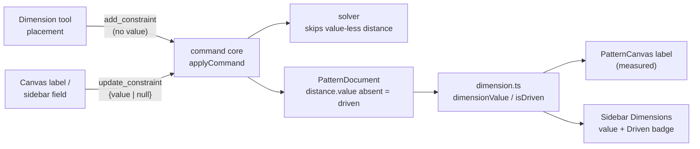

# Driven and set linear dimensions

Status: proposed
Refs #34
Depends on: PR #32 (movable linear dimensions) — it touches the same dimension
rendering and drag paths. Land it first, or rebase this work onto it.

## 📝 TLDR

A linear dimension today exists only as a **driving** `distance` constraint: the
moment the Dimension tool places one, its measured length becomes an equation the
solver must satisfy, and there is no way to keep a dimension as a pure reference
measurement. Proposed future behaviour: every newly placed linear dimension starts
**driven** — it measures the geometry, changes when the geometry changes, and
renders in parentheses. Typing a length turns it into a **set** dimension that
drives the sketch and renders without parentheses. Clearing the value returns it
to driven without moving the geometry.

## 📝 Problem Statement

- **Who needs it:** the solo maker drafting a pattern, who reads distances while
  deciding them. A first draft is mostly driven measurements ("how long is this
  edge right now?") before any length is committed.
- **What happens today:** `onAddDimension` in `frontend/src/views/EditorView.vue`
  measures the picked span and immediately dispatches `add_constraint` **with that
  value** (`EditorView.vue:213-247`). `DistanceConstraint.value` is a required
  number (`packages/geometry/src/types.ts:71-80`), the solver emits a residual for
  every distance constraint (`packages/geometry/src/solver.ts:162-180`), and the
  canvas label always prints the plain value (`PatternCanvas.vue:284-303`). The
  editor's value rules reject an empty input
  (`frontend/src/lib/dimensions.ts:37-42`), so the only way to stop a dimension
  driving the sketch is to delete it — losing its placement and its reading.
- **Evidence it matters:** the seeded sketch in `EditorView.vue:332-367` already
  distinguishes `horizontal`/`vertical` relations from `distance` dimensions, but
  every distance is a hard 160 mm / 90 mm equation. There is no representation for
  "measure this, don't constrain it", which is the normal first state of a CAD
  dimension.
- **Constraint:** commands remain the only mutation path, `@sewcraft/geometry`
  stays pure, and `distance` constraints must keep their current behaviour when a
  value is present so existing documents and tests remain valid.

## 📝 Proposed Solution

### Vocabulary

| Term        | Meaning                                                                 | Renders |
| ----------- | ----------------------------------------------------------------------- | ------- |
| **Driven**  | A reference measurement. Recomputed from point coordinates; no solver residual. | `(120)` |
| **Set**     | A driving measurement. The solver keeps the span at this value.          | `120`   |

"Driven" and "set" are the two states of one `distance` constraint, not two
entities. This reuses the existing dimension identity, placement, selection,
undo journal and persistence.

### Options considered

| # | Option | Trade-offs | Verdict |
| - | ------ | ---------- | ------- |
| A | **Optional `value` on `DistanceConstraint`** — absence means driven | One persisted object, no second collection; "set" literally means it has a value; the measured value is already computable. Cost: the exported type and the command contract become optional, so every reader must handle absence | **Recommended** |
| B | **`driven: boolean` with the value retained** | Keeps `value` required. But a driven dimension then carries a stale value beside the live measurement (two sources of truth); the solver, renderer and editor each need a rule for which one wins | Rejected — duplicated truth |
| C | **Separate `measurement` entity / constraint type** | Clean conceptual split between annotations and equations; no optional value | Rejected — a new persisted collection, new commands, and duplicated render/select/undo/export paths for a binary state |
| D | **Render-only driven dimensions** (never persisted) | Smallest model change | Rejected — dimensions would disappear on reload, could not be selected or converted to set, and would not survive undo |

Option A is also the only one that makes the issue's wording literal: a dimension
"becomes set" when it has a value and "becomes driven" when that value is removed.

### Behaviour

1. **Placement.** The **Dimension** tool dispatches `add_constraint` for
   `distance` with `orientation` and `offset` but **no `value`**. The new
   dimension is driven: it measures immediately, renders `(120)`, and adds no
   equation. It does not move or lock the sketch.
   When a distance constraint already exists between the same two points, the
   placement keeps today's behaviour: it updates that constraint's `orientation`
   and `offset` only (`EditorView.vue:213-224`). An existing set dimension stays
   set.
2. **Set.** Editing the label or the sidebar value to a finite number `> 0`
   dispatches `update_constraint { value }`. The solver runs, the label loses its
   parentheses, and later geometry edits must satisfy the value. If the solver
   cannot converge, the existing error banner appears and the document is
   unchanged — the dimension stays driven.
3. **Driven again.** Clearing the input and committing dispatches
   `update_constraint { value: null }`. The residual disappears; the label shows
   the current measured value in parentheses. The geometry is not restored to a
   previous state: it stays where it is, and the measurement reports what it now
   reads. If other constraints moved the geometry after the value was set, the
   new reading can differ from the cleared value — that is the point of a
   reference dimension.
4. **Editing rules.** The inline canvas editor and the sidebar field share one
   parser:

   | Input | Enter / blur | Escape |
   | ----- | ------------ | ------ |
   | empty or whitespace | clear to driven | cancel, keep previous state |
   | finite number `> 0` | set to that value | cancel |
   | anything else (`abc`, `0`, `-5`, `NaN`) | Enter keeps editing; blur discards | cancel |

5. **Rendering.** Driven values are wrapped in parentheses; set values are not.
   Both use the existing 1 µm rounding (`formatDimensionValue`). Parentheses count
   toward the label background width, which is derived from the rendered string.
   The accessible name says **"Driven dimension, measured 120 millimetres"** or
   **"Dimension 120 millimetres"**.
6. **Sidebar.** Each row in the Dimensions drawer shows the effective value
   (set value, or live measurement) and a **Driven** / **Set** state. On a driven
   row the number input displays the measurement; clearing it keeps the dimension
   driven. The drawer and the canvas remain two views of one constraint — both
   dispatch the same command.
7. **Constraint tool stays set.** The ribbon's **Distance** constraint tool
   (`ConstraintPromptBar`) asks for a value and creates a driving constraint. The
   Dimension tool is the measurement-first path; the constraint tool is the
   explicit-equation path. Their behaviours should not silently converge.

## 📝 Architecture



Takeaway: the only new state is the **absence of a number**; everything else
already exists and keeps one code path.

### Geometry package

- `types.ts` — `DistanceConstraint.value` becomes optional:
  ```ts
  export type DistanceConstraint = {
    id: EntityId;
    type: 'distance';
    a: EntityId;
    b: EntityId;
    /** Driving length in mm. Absent means driven: measured, never solved. */
    value?: number;
    orientation?: DimensionOrientation;
    offset?: number;
  };
  ```
  With `exactOptionalPropertyTypes`, a driven constraint is built **without** the
  key, never with `value: undefined`.
- `solver.ts` — a distance constraint without a value contributes **no residual**.
  The convergence shortcut counts driving constraints, not all constraints, so a
  document containing only driven dimensions is converged by definition.
- `dimension.ts` — two small helpers shared by the canvas and sidebar:
  - `isDrivenDimension(constraint): boolean` — `constraint.value === undefined`.
  - `dimensionValue(document, constraint): number | null` — the set value, or the
    live `measureLinearDimension` result; `null` when a referenced point is
    missing.
- `commands.ts` — see **Contract changes**.
- Package version: bump the minor above `develop`'s `@sewcraft/geometry` version
  (`0.4.0` after the seam-allowance merge) — this branch ships `0.5.0` — and
  update the lockfile.

### Frontend

- `frontend/src/lib/dimensions.ts` — add
  `parseDimensionEdit(input): { kind: 'set'; value: number } | { kind: 'driven' } | { kind: 'invalid' }`
  and `formatDimensionLabel(value, driven)`. Keep `parseDimensionValue` and
  `isValidDimensionValue` for the constraint prompt bar.
- `PatternCanvas.vue` — `drawingFor` uses `dimensionValue` and passes `driven`
  through to the label; the label prints the formatted label and the accessible
  name distinguishes state. Placement previews render as driven.
- `EditorView.vue` — `onAddDimension` omits `value` for new dimensions;
  `onDimensionValueEdit` and a new clear path dispatch `value: null`; the sidebar
  row shows the effective value and state.
- No new component is required. If the sidebar row grows beyond readability,
  extract it into `DimensionRow.vue` without changing its intents.

## 📝 Data Model

`PatternDocument.constraints[]` gains one optional field. A driven dimension:

```jsonc
{ "id": "d1", "type": "distance", "a": "p1", "b": "p2", "orientation": "horizontal", "offset": 12 }
```

A set dimension keeps its current shape. `PatternDocument.schema` stays
`sewcraft.pattern/0.1`: the change is additive to the document shape, exactly like
the earlier `orientation`/`offset` additions. Older documents load unchanged; no
migration is needed. Documents written by the new code are **not** downgrade-safe
(an older build would read `undefined` as a length) — acceptable for this
single-user, pre-release app, and called out in **Risks**.

## 📝 API Contracts

### `add_constraint` — `distance`

- `value` becomes **optional at runtime**. Omitted → driven dimension.
- When present, the current rule still applies: finite number `> 0`.
- `orientation` and `offset` keep their current rules and defaults.
- Inverse: `remove_constraint`.

Existing payloads with a value behave exactly as before and create a set
dimension.

### `update_constraint`

- `value?: number | null`.
  - a number sets the dimension (same `> 0` rule);
  - `null` clears it to driven;
  - omitted leaves the value untouched (presentation-only edits still work).
- At least one of `value`, `orientation`, `offset` must be provided; `null`
  counts as provided.
- Clearing an already-driven dimension is a no-op (`inverse: null`).
- The inverse always restores the previous **state**: a cleared set dimension
  inverts to `{ value: <previous> }`; a set driven dimension inverts to
  `{ value: null }`; an orientation-only edit on a driven dimension inverts with
  `{ value: null, orientation: <previous>, offset: <previous> }`.
- Reject `null` for `angle` (angles have no driven state in this scope).

### Command spec sync

Update all three in sync and bump `spec_version` `0.4.0 → 0.5.0`:

- `config/geometry.php`
- `docs/domain/command-spec.md` (plus a "Migration from 0.4.0" note: additive; all
  previous payloads still apply)
- `docs/domain/command-spec.json` (`$id`, `schema`, `spec_version`, params)

`docs/architecture/geometry-core.md`, `data-model.md` and
`docs/domain/glossary.md` describe the driven/set distinction and the optional
value. No HTTP route, response shape, database column or export change: SVG
export does not serialize dimensions (`packages/geometry/src/export.ts`).

## 📝 UI/UX

- **Canvas label.** Driven `(120)`, set `120`; both draggable/editable as today.
  Hiding dimensions still only changes rendering.
- **Inline editor.** Double-click opens it with the effective value prefilled
  (no parentheses inside the input). Clearing the text and pressing Enter or
  leaving the field makes the dimension driven. Invalid text stays in the editor
  on Enter and is discarded on blur, matching today's typo handling.
- **Dimensions drawer.** Each row: value input, `Driven` / `Set` badge,
  orientation select, offset input, Remove. A driven row's input reflects the live
  measurement and is labelled "Value for `<id>` (driven measurement)".
- **Inspector.** A selected entity lists the dimensions on its points with the
  same effective value and `Driven` / `Set` badge; clearing that field returns the
  dimension to driven, so every value surface dispatches the same command.
- **Empty/zero spans.** A degenerate or missing span renders no dimension
  (`dimensionGeometry` already returns `null`), so there is no label to edit; the
  sidebar row stays and reports the state.
- **Errors.** A failed set uses the existing error banner. Nothing is silently
  clamped or partially applied.

## 📝 Edge Cases & Failure Scenarios

| Scenario | Expected behaviour |
| -------- | ------------------ |
| Place a dimension on a span that already has a set distance | Re-present the existing set dimension; do not demote it to driven |
| Place a dimension on a span that already has a driven dimension | Update orientation/offset; remains driven |
| Clear a value while other constraints hold the span | Geometry stays; measurement reports the held span |
| Set a value the solver cannot satisfy | Error banner; dimension remains driven; document unchanged |
| Set an invalid value (`0`, negative, text) | Enter keeps editing; blur discards |
| Referenced point deleted | Existing cascade removes the constraint; no orphan row |
| Two points coincident, then set a positive value | Solver moves the free points apart if possible; otherwise the error path applies |
| Undo after set | Restores driven, including its previous measured rendering |
| Undo after clear | Restores the set value and the equation |
| Hidden dimensions layer | Solving is unaffected; only rendering is hidden |
| Reload a driven document | Loads with `value` absent; renders measured, solves without it |

## 📝 Risks & Impact Review

- **Protected surface (medium).** `DistanceConstraint` is re-exported from
  `@sewcraft/geometry` and `update_constraint` is a command contract
  (`BACKWARD_COMPATIBILITY.md` §2–3). Optionality is additive at the JSON level
  and requires a package minor bump plus the three-way command-spec sync; the
  TypeScript type change is a compile-time break for in-repo consumers, which this
  spec updates together.
- **Downgrade.** A build without this change cannot read a driven document
  correctly. Pre-release, single-user, no published package — accepted and noted
  in the PR body.
- **Two edit paths.** Canvas, drawer and inspector must dispatch identical
  commands; no local mutable copy of the value. A shared parser keeps their rules
  aligned.
- **Perceived data loss.** Clearing a set value does not restore earlier geometry.
  That is deliberate and stated in the UI copy; the alternative (snapshot restore)
  would make clearing unpredictable.
- **No export impact.** SVG export never rendered dimensions; PDF/DXF are not
  implemented.

## ❓ Open Questions

These are product decisions, not implementation details. They are asked on
issue #34; the draft PR stays draft until they are answered.

| # | Question | Why it blocks | Recommended answer |
| - | -------- | ------------- | ------------------ |
| Q1 | Does "set" **drive** the sketch immediately (the solver moves points to satisfy the value), or does it only record a target and drop the parentheses? | The two designs differ in solver contract, failure handling and undo semantics; picking wrong rewrites the core of this spec | Drive immediately — it matches every existing `distance` constraint and the CAD meaning of a set dimension |
| Q2 | When a set value is cleared, should the geometry stay where it is (measurement becomes whatever the span now reads) or snap back to the geometry from before the value was set? | Determines whether clearing needs a geometry snapshot/undo path | Stay where it is — clearing removes an equation; it should not move geometry |
| Q3 | Should the ribbon's **Distance** constraint tool also create a driven dimension by default, or stay a driving constraint? | Changes the creation flow and the prompt bar | Stay set — it is the explicit-equation tool; the Dimension tool is the measurement tool |

## ✅ Resolved assumptions (autonomous defaults)

| # | Assumption | Why | Status |
| - | ---------- | --- | ------ |
| R1 | Represent driven dimensions as `distance` constraints with **no `value`** (option A above) | One object, one identity, no duplicate truth; all other options rejected in the table | ⚠ NEEDS HUMAN CONFIRMATION — changes an exported type and the command contract |
| R2 | Existing dimensions keep their values and stay set; no migration | Additive change; existing documents must behave identically | Reversible |
| R3 | Placing over an existing distance re-presents it; it never demotes a set dimension | Preserves the current reuse rule and avoids surprise data loss | Reversible |
| R4 | Driven is the default only for the **Dimension** tool; the constraint tool stays set | Keeps explicit constraint creation explicit | Reversible |
| R5 | Clearing preserves current geometry rather than restoring a snapshot | Removal of an equation should not move the sketch; undo still restores the set value | Reversible |
| R6 | Driven labels use parentheses; set labels do not; both keep 1 µm rounding | Reads as a reference measurement without adding a unit suffix | Reversible |
| R7 | Driven dimensions stay persisted, selectable and undoable, but contribute no solver residual | They are dimensions, not transient overlays | Reversible |
| R8 | `PatternDocument.schema` stays `0.1`; the command spec moves to `0.5.0` | Additive document field; command param shape changed | Reversible |
| R9 | A failed set leaves the dimension driven and uses the existing error banner | Matches current command semantics; no partial application | Reversible |

## 📋 Phasing

- **Phase 1 — model and solver.** Optional value, driven-aware residual and
  helpers; package bump. Ships a document model that solves correctly even before
  the UI uses it.
- **Phase 2 — command contract.** Add/update/clear, inverse precision, three-way
  spec sync at `0.5.0`. Ships a complete API for agents and tests.
- **Phase 3 — rendering.** Parentheses, accessible names, effective value in the
  sidebar. Ships visible driven/set state.
- **Phase 4 — editing.** Placement defaults to driven, clear-to-driven in canvas
  and sidebar, undo/redo. Ships the issue's full flow.
- **Phase 5 — documentation.** Geometry, data-model and glossary updates.

## 📋 Implementation Plan

### Phase 1 — Model and solver

1. Make `DistanceConstraint.value` optional in `packages/geometry/src/types.ts`;
   document the driven meaning. Update any construction site that assumed a value.
2. Skip value-less distance constraints in `solver.ts` and base the convergence
   shortcut on driving constraints. Tests: driven-only converges without moving
   points; a driven constraint beside a set one does not affect the solution; a
   set distance still drives exactly as before.
3. Add `isDrivenDimension` and `dimensionValue` to `dimension.ts`. Tests: set
   returns the stored value; driven returns the measured value for all three
   orientations; missing points return `null`.
4. Bump the geometry package minor and refresh the lockfile; run
   `npm test -w @sewcraft/geometry` and `npm run typecheck -w @sewcraft/geometry`.

### Phase 2 — Commands

1. `applyAddConstraint`: allow a distance without a value (driven); keep the
   `> 0` rule when present. Tests for both states.
2. `applyUpdateConstraint`: accept `value: null` to clear, `number` to set,
   omitted to leave unchanged. Reject `null` for angles. Tests for
   set→driven, driven→set, driven→driven no-op, presentation-only edit on a
   driven dimension, and all inverse shapes.
3. `constraintToParams` omits `value` for a driven constraint so undo/redo and
   `remove_constraint` inversion round-trip losslessly.
4. Sync `config/geometry.php`, `docs/domain/command-spec.md` and
   `docs/domain/command-spec.json` at `0.5.0`, with the 0.4.0 migration note.
   Test the exposed command spec still matches the PHP config.

### Phase 3 — Rendering

1. Add `formatDimensionLabel` and pass the driven flag through
   `DimensionDrawing`/`DimensionLabelView`; use `dimensionValue` in `drawingFor`.
2. Update label width, accessible name and tooltip; previews render driven.
3. Sidebar Dimensions rows show the effective value and a `Driven`/`Set` badge.
   Tests for driven/set labels, parentheses width, missing-point rendering and
   the sidebar state text.

### Phase 4 — Editing

1. Add `parseDimensionEdit`; keep the old parser for the constraint prompt bar.
   Tests: empty/whitespace → driven, valid → set, everything else → invalid.
2. Canvas inline editor: Enter/blur follow the table; `EditorView` dispatches
   `value: null` when driven, a number when set. Tests cover both outcomes and the
   solver-failure path.
3. `onAddDimension` omits `value`; existing-constraint reuse updates presentation
   only. Tests: new dimension is driven and does not move points; re-placing a set
   dimension leaves it set.
4. Sidebar value edit and clear share the same handlers. Tests include undo/redo
   across set and clear.

### Phase 5 — Documentation and verification

1. Update `docs/architecture/geometry-core.md` (driven vs set, `dimensionValue`),
   `docs/architecture/data-model.md` (optional value) and
   `docs/domain/glossary.md`.
2. Run the full gate: `npm run format`, `npm run typecheck`, `npm run lint`,
   `npm run format:check`, `npm run test:coverage` (100 % for geometry and
   frontend), `npm run build`, and the Pest coverage command. No backend behaviour
   changes, so the Pest suite is a regression check only.
