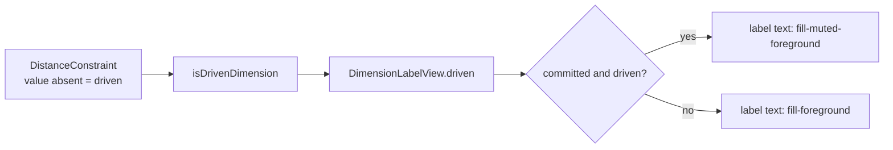

# Gray driven dimension text

Status: implemented
Refs #38
Builds on: `.ai/specs/2026-10-20-driven-and-set-dimensions.md` (driven
dimensions already exist and render in parentheses).

## 📝 TLDR

Driven dimensions are currently distinguished from set dimensions only by
parentheses and their accessible name, so the difference is easy to miss on a
busy canvas. Proposed future behaviour: a committed driven dimension label
renders in the theme's muted gray while a set dimension label stays foreground
black. Parentheses and the accessible name remain, so color is a supplementary
cue rather than the only signal.

## 📝 Problem Statement

- **Who needs it:** the solo maker reading a draft. Set and driven dimensions sit
  side by side, and the user needs to know at a glance which numbers are
  equations and which are live measurements.
- **What happens today:** every canvas dimension label uses
  `fill-foreground` (`frontend/src/components/PatternCanvas.vue:1084`), whether
  the constraint is set or driven. The driven state is conveyed by parentheses
  in the label text (`formatDimensionLabel` in `frontend/src/lib/dimensions.ts`)
  and by the `Driven` badge in the Dimensions drawer and the Properties
  inspector. On a dense canvas the parentheses are the only difference in the
  drawing itself.
- **Evidence it matters:** #38 asks for a gray driven label specifically to make
  the two states distinct. The driven/set spec deliberately used parentheses
  (decision R6), but did not add a visual-weight difference, so this is a
  follow-up to that design rather than a correction.
- **Constraint:** this is presentation only. The driven state already exists as
  the absence of `DistanceConstraint.value`; no command, geometry, API or
  persistence change is needed.

## 📝 Proposed Solution

### Options considered

| # | Option | Trade-offs | Verdict |
| - | ------ | ---------- | ------- |
| A | **Gray the committed driven canvas label only**, using the existing `muted-foreground` token | Smallest change: one class binding and focused render tests. The canvas is where set and driven labels are read side by side. The drawer and inspector already carry a textual `Driven`/`Set` badge, so they do not rely on color. | **Recommended and chosen** — Q1 resolved to A |
| B | **Gray every driven value surface**: canvas label, Dimensions drawer value and Properties inspector value | One consistent visual language across the three places a driven value appears. Cost: two more components and tests, and a gray editable form value can read as disabled, especially because the input is still editable. | Viable if the issue chooses consistency over form affordance |
| C | **Add a dedicated `--dimension-driven` theme token** and use it on every surface | Leaves room for a future driven-specific color without reusing a generic muted token. Cost: a new token and utility for one use, extra theme maintenance, no user-visible gain today. | Rejected — over-engineered for one label state |
| D | **Build nothing** and rely on parentheses plus the accessible name | No code, no contrast risk. Cost: #38 exists because the current cue is too subtle on a busy canvas. | Rejected — does not solve the reported problem |
| E | **Gray the whole dimension**: line, ticks and label | Strongest visual separation. Cost: dimension lines would compete with construction geometry, which is already drawn in muted gray and dashed, and the drawing loses legibility. | Rejected — out of scope and collides with an existing convention |

Option A is the smallest change that answers the issue and is the resolved answer
to Q1. The option-B delta below keeps the sidebar extension implementable later
without redesigning the model.

### Behaviour

1. **Committed driven label.** A driven dimension whose placement is finished
   renders its value text in `fill-muted-foreground`. The parentheses stay, and
   the accessible name remains "Driven dimension, measured … millimetres".
2. **Set label.** A set dimension keeps `fill-foreground` and renders without
   parentheses. Nothing about the dimension line, extension lines or chevrons
   changes.
3. **Placement preview.** The in-progress dimension is a driven preview, but it
   is active feedback rather than a committed reading. Its label stays
   `fill-foreground` while the preview is on screen; it turns gray once the
   dimension is placed.
4. **Editing.** Double-clicking a label opens the existing inline editor, which
   uses the normal foreground text on a background field. The gray treatment
   applies to the rendered label, not to the editor.
5. **Sidebar (option A).** The Dimensions drawer and the Properties inspector
   keep their current value text and their `Driven`/`Set` badge. This avoids
   making an editable field look disabled. If Q1 chooses option B, the same
   muted class is applied to a driven value there while the badge and input
   affordance remain.
6. **Theme.** The color comes from the existing semantic token, not a literal
   hex value, so a future dark theme inherits the same role.

## 📝 Architecture



Takeaway: the change only selects an existing Tailwind fill utility from state
the canvas already computes; no new data or contract is introduced.

### Files

- **`frontend/src/components/PatternCanvas.vue`** — bind the label text class to
  the existing `driven` and `preview` flags:
  ```html
  <text
    text-anchor="middle"
    dominant-baseline="middle"
    :class="[
      label.driven && !label.preview ? 'fill-muted-foreground' : 'fill-foreground',
      'text-[11px]',
    ]"
  >
  ```
  The label background rect, width calculation, drag target and double-click
  editor are unchanged.
- **`frontend/src/components/PatternCanvas.test.ts`** — extend the existing
  dimension rendering tests to assert the driven label text carries
  `fill-muted-foreground`, the set label carries `fill-foreground`, and the
  placement preview stays `fill-foreground`. Keep the parentheses, width and
  accessible-name assertions.
- **`docs/domain/glossary.md`** — add the muted-gray rendering to the driven
  dimension row, beside the existing "renders in parentheses" wording.
- **If Q1 chooses option B:** `frontend/src/views/EditorView.vue` (Dimensions
  drawer value) and `frontend/src/components/EntityPropertiesPanel.vue`
  (inspector value), plus their tests. No model or command change.
- **No changes** to `packages/geometry`, the API, the command contract,
  persistence, or the SVG exporter (which does not serialize dimensions).

## 📝 Data Model

None. The driven state is already represented by an absent
`DistanceConstraint.value`; this spec only reads it.

## 📝 API Contracts

None.

## 📝 UI/UX

- **Canvas label.** Driven `(160)` is muted gray; set `90` is foreground black.
  Both keep the existing 11 px text, white label background and 1 µm rounding.
- **State cues.** Parentheses, the stateful accessible name and the sidebar
  `Driven`/`Set` badge stay. The color is supplementary, so the design does not
  rely on color alone.
- **Active states.** Selection, dragging and placement are shown by the
  dimension line, handles, preview line and inline editor, not by changing the
  label color. The preview label stays foreground until placement completes.
- **Contrast.** `muted-foreground` is `oklch(0.556 0 0)` on the white
  `background` label, approximately 4.7:1. That clears WCAG AA for normal text
  (4.5:1), but only just; the implementation must not substitute a lighter gray
  without rechecking contrast.
- **Construction geometry.** Construction lines are already muted gray and
  dashed. A driven label sits on its own white rect, so it stays legible over
  them; the line/label roles remain distinct.

Prototype: `.ai/specs/assets/driven-dimension-color/mockup-01-canvas-labels.html`
(rendered to `mockup-01-canvas-labels.png`). Current-state evidence:
`assets/driven-dimension-color/current-01-driven-label.png` (driven `(160)` and
set `90` both black today) and
`assets/driven-dimension-color/current-02-dimensions-drawer.png` (the sidebar
already badges the two states).

## 📝 Edge Cases & Failure Scenarios

- **Driven label over construction geometry.** The white label background keeps
  the gray text readable; the construction line itself is not restyled.
- **Set dimension next to a driven one.** The set label stays black, so the two
  states remain distinguishable even for a user who cannot perceive the gray
  difference; parentheses and the accessible name still carry the state.
- **Preview while placing.** The preview stays foreground, so the active
  placement does not look disabled; it changes only after placement commits.
- **Inline edit.** The editor field uses normal foreground text; committing an
  empty value returns the label to gray, committing a number returns it to
  black.
- **Future theme.** A theme that makes `muted-foreground` lighter can push the
  label below 4.5:1. That is a token-level constraint, not a reason to add a
  second hard-coded color.
- **Empty or unresolvable dimension.** No label is rendered today; no new
  failure path is introduced.

## 📝 Risks & Impact Review

- **Blast radius:** one component class binding plus tests (and two more
  components only under option B). No schema, command, API or persistence
  change. Reverting is deleting the class binding.
- **Product risk:** gray can read as disabled. Parentheses, the accessible name
  and the sidebar badge mitigate it; keeping editable fields foreground under
  option A avoids the strongest form of the confusion.
- **Accessibility risk:** the chosen token passes AA only narrowly. The spec
  fixes the token rather than a literal gray, and calls out the contrast check.
- **Consistency risk:** canvas-only styling differs from the sidebar badges.
  Q1 is the decision that resolves it; option B is a contained follow-up.
- **Compatibility:** none. The SVG exporter does not include dimensions, and the
  document shape is untouched.

## ❓ Open Questions

| # | Question | Why it blocks | Recommended answer |
| - | -------- | ------------- | ------------------ |
| Q1 | Should the gray apply only to the committed canvas label (A), or also to the Dimensions drawer and Properties inspector values (B)? | It changes the acceptance criteria and the number of touched components. The canvas is where the two states are read together; the sidebar already names the state with a badge, and a gray editable field can look disabled. | **A — canvas label only.** Resolved 2026-10-20: the PR carries `spec-ready` and option A, the recommendation, is implemented. Extending the gray to the sidebar remains an option-B follow-up if #38 asks for it. |

This was the only blocking product decision; it is resolved as option A and the
spec is implemented on this branch.

## ✅ Resolved assumptions (autonomous defaults)

| # | Question | Applied default | Why | Confirm? |
| - | -------- | --------------- | --- | -------- |
| A1 | Which gray? | Reuse `muted-foreground`; add no new token | Theme-aware, already the secondary-text role, and approximately 4.7:1 on the white label | Reversible |
| A2 | Keep parentheses? | Yes; color is supplementary | Preserves the driven/set contract and does not rely on color alone | Reversible |
| A3 | Restyle the dimension line? | No; text only | The issue asks for text, and gray lines would collide with construction geometry | Reversible |
| A4 | Gray the placement preview? | No; preview stays foreground until placed | The preview is active placement feedback, and its line is already `stroke-primary` | Reversible |
| A5 | Gray the inline editor? | No; the editor keeps foreground text | An editable field should not look disabled | Reversible |
| A6 | Change the SVG export? | No | `toSvg` serializes geometry only; dimensions are not exported | Reversible |
| A7 | New visual-regression tooling? | No; assert the classes in the existing Vitest suite | The rendering contract is a class binding; a browser screenshot is evidence, not a test gate | Reversible |

## 📋 Phasing

- **Phase 1 — Canvas label.** Driven committed labels gray, set labels black,
  preview foreground; render tests and glossary wording. Ships the issue under
  the recommended option A.
- **Phase 2 — Conditional sidebar consistency (only if Q1 = B).** Apply the same
  muted value treatment to the Dimensions drawer and Properties inspector, with
  tests.
- **Phase 3 — Verification.** Contrast check and a before/after canvas capture.

## 📋 Implementation Plan

### Phase 1 — Canvas label

1. In `PatternCanvas.vue`, bind `fill-muted-foreground` on the label text when
   `label.driven && !label.preview`; keep `fill-foreground` otherwise and keep
   `text-[11px]` common. The app still renders every dimension exactly as today
   except the driven text color.
2. Extend `PatternCanvas.test.ts`: driven label text has
   `fill-muted-foreground`; set label text has `fill-foreground`; preview label
   text has `fill-foreground`; existing parentheses, width and accessible-name
   assertions still pass.
3. Update the `Driven dimension` row in `docs/domain/glossary.md` to mention the
   muted-gray rendering.
4. Run `npm run format`, `npm run typecheck`, `npm run lint`,
   `npm run format:check`, `npm test`, `npm run test:coverage` and
   `npm run build`. Coverage must stay at 100%.

### Phase 2 — Conditional sidebar consistency (only if Q1 = B)

5. Apply the same muted treatment to a driven value in the Dimensions drawer
   (`EditorView.vue`) and the Properties inspector
   (`EntityPropertiesPanel.vue`), keeping their inputs editable and their badges
   visible.
6. Add render tests for the driven and set values in both components, then
   re-run the Phase 1 gate.

### Phase 3 — Verification

7. Open a project, switch one dimension between set and driven, and confirm the
   canvas shows black `90` beside gray `(160)`, the preview stays black, and the
   labels remain readable over construction geometry.
8. Capture the before/after canvas state as PR evidence and update this spec's
   status when the decision is settled.
