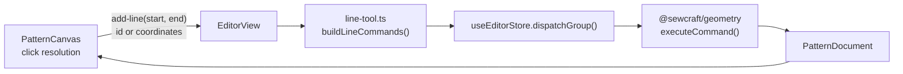

# Line tool creates its own points

Status: implemented (2026-10-20); Q1 resolved as lazy commit with one grouped undo
Refs #42
Related: 005 (canvas editor interactions), 004 (command core and undo)

## 📝 TLDR

The Line tool only accepts existing points: clicking empty canvas clears the
pending start, so a line cannot be drawn in an empty area without switching to the
Point tool first. Proposed future behaviour: a click on bare canvas becomes a new
endpoint, a click on an existing point reuses it, and the line plus any new points
commit as one undoable gesture. The `add_line` command stays unchanged; the UI
composes it from the existing `add_point` and `add_line` commands.

## 📝 Problem Statement

- **Who needs it:** the solo maker sketching a new piece from nothing. Drawing
  four edges currently takes eight Point-tool clicks plus four Line-tool pairs, and
  every new area needs a tool round-trip.
- **What happens today:** in `PatternCanvas.vue`, the `add_line` branch calls
  `selectPendingPoint(hit, 2)` (`:642-644`), which clears `pending` whenever the
  click is not on a point (`:747-751`). Only point hits are collected, and
  `commitPending` emits `add-line` with two ids (`:761-768`). `EditorView`'s
  `onAddLine` then dispatches one `add_line` (`EditorView.vue:237-239`), which
  requires both ids to exist (`packages/geometry/src/commands.ts:356-364`).
- **Evidence it matters:** issue #42 describes the exact workflow and the three
  cases it needs: empty → empty, existing → empty, empty → existing.
- **Constraint:** commands remain the only mutation path, so the UI cannot create
  entities locally; the line must still be a real `add_line`. Undo is per journal
  entry, so composing two or three commands must not turn one gesture into three
  undos.

## 📝 Proposed Solution

### Options considered

| # | Option | Trade-offs | Verdict |
| - | ------ | ---------- | ------- |
| A | **Resolve each click to an existing point or a new coordinate**, commit the points and the line as one grouped action | Keeps `add_line` unchanged, gives the issue exactly the three requested cases, one undo, no orphan points when a gesture is abandoned | **Recommended** |
| B | **Extend `add_line` with inline coordinates** (`start: id \| {x,y}`) and create points inside the command | One command; but `add_line` stops meaning "between existing points", its inverse must also delete created points, and every API consumer and test learns a union type | Rejected — changes a contract for a UI convenience |
| C | **Commit each new point immediately** on the first click, then `add_line` on the second | Simplest wiring, the point is visible at once; an abandoned start leaves an orphan point, and undo needs two or three presses | Rejected for the default; kept as Q1's alternative |
| D | **A new `add_line_with_points` command** | Atomic command and inverse; duplicates existing primitives, needs a bespoke inverse and command-spec entry for one gesture | Rejected |
| E | **Do nothing; use the Point tool first** | No new surface; leaves the issue open and keeps a two-tool workflow for every new piece | Rejected |

### Behaviour

1. **Click resolution**, in order:
   - a point under the pointer (existing hit test) is reused by id;
   - otherwise the world position is snapped with the existing `snapPoint` rules
     (nearby point, then grid); if the snapped position coincides with an existing
     point, that point is reused to avoid a duplicate;
   - otherwise the snapped position becomes a **provisional new endpoint**.
2. **First click** stores the endpoint (id or coordinates) and renders it in the
   pending style. Nothing is written to the document yet.
3. **Second click** resolves the other endpoint. If it is the same id or the same
   coordinates as the start, the click is ignored — no zero-length line.
4. **Completion** emits one `add-line` with both resolved endpoints. `EditorView`
   builds the command batch: `add_point` for each new endpoint, then `add_line`
   with the resulting ids, and applies it as **one journal entry**.
5. **Provisional feedback:** a pending start that is not yet a document entity is
   drawn as an accent point, with a dashed rubber-band line from the start to the
   snapped pointer position. Neither is committed or hit-testable.
6. **Chaining:** the Line tool stays active after completing a line (today's
   behaviour), ready for the next start.
7. **Cancelling:** switching tools, pressing Escape, or losing the pending point to
   an undo clears the pending start; a provisional start simply disappears.

### Why group the commands

The gesture is one user action. Without grouping, drawing a line in empty space
would take three Ctrl+Z presses and leave two stray points after the first one.
Grouping keeps the journal honest — one user action, one undo — and reuses the
existing snapshot in `JournalEntry.before` for the undo path.

## 📝 Architecture



Takeaway: the component resolves intent, a pure helper composes existing
commands, and the store applies the batch atomically as one undoable entry.

### New file

`frontend/src/lib/line-tool.ts` — pure, no Vue, no store:

```ts
export type LineEndpoint =
  | { kind: 'point'; id: EntityId }
  | { kind: 'new'; x: number; y: number };

/** Existing point under the snapped position, else a provisional coordinate. */
export function resolveLineEndpoint(
  document: PatternDocument,
  world: Vec2,
): LineEndpoint;

/** Same point id, or coordinates within a 0.001 mm tolerance. */
export function sameEndpoint(a: LineEndpoint, b: LineEndpoint): boolean;

/** `add_point` commands for new endpoints, then one `add_line`. */
export function buildLineCommands(
  start: LineEndpoint,
  end: LineEndpoint,
  nextId: (prefix: string) => EntityId,
): Command[];
```

It reuses `snapPoint` (`frontend/src/lib/snap.ts:42-45`), `allPoints` and the
command types from `@sewcraft/geometry`. Missing ids can never reach it because
the canvas resolves from the current document.

### Edited modules

- `frontend/src/components/PatternCanvas.vue` — replace the `pending: EntityId[]`
  state for the line tool with a single pending `LineEndpoint`; render the
  provisional point and rubber band; emit the new `add-line` payload; keep curve
  collection on the existing id-based path.
- `frontend/src/views/EditorView.vue` — `onAddLine(start, end)` calls
  `buildLineCommands` and `dispatchGroup`; the template's `@add-line` stays.
- `frontend/src/stores/editor.ts` — add `dispatchGroup(commands)`; extend
  `JournalEntry` with optional `commands`/`inverses` (keeping `command`/`inverse`
  as the last command for existing readers); replay them on redo.
- Tests for the helper, the canvas interaction, the store batch and the editor
  wiring.

## 📝 Data Model

None. `add_point` and `add_line` create the same entities as before; no schema,
field or document version changes. The journal entry grows an internal optional
`commands` list for grouped dispatch; stored projects and API payloads are
unaffected.

## 📝 API Contracts

None. No command type, param or spec version changes; `add_line` still takes two
existing point ids, and `add_point` is unchanged. The frontend composes them, so
API clients and agents keep the current contract.

The component's `add-line` emit is an internal frontend contract and changes from
`(startId, endId)` to `(start: LineEndpoint, end: LineEndpoint)`; its tests and
the single parent are updated together.

## 📝 UI/UX

- **Cursor and tool state:** unchanged — crosshair while the Line tool is active.
- **Pending start:** an existing point keeps today's accent fill; a new start is
  drawn as an accent circle with the same size as a point, so the first click is
  visibly acknowledged without writing a document entity.
- **Preview:** a dashed line from the pending start to the snapped pointer,
  `pointer-events-none`, in the muted foreground colour. It disappears on
  completion, cancellation or tool change.
- **Completion:** the new points and line appear together; the pending state
  clears and the tool stays active.
- **Click on non-point geometry** (line, curve or seam): treated as canvas —
  a free point is created at the snapped position. The new point is **not**
  constrained to the clicked geometry; adding a `point_on_line` constraint stays
  a separate action. Copy or a follow-up issue can address that if users expect
  it.
- **Accessibility:** the flow remains pointer-driven, like the existing line and
  curve tools; this spec adds no keyboard creation path. The provisional point is
  decorative (`aria-hidden`) because it is not document state, and the command
  result is the feedback.
- **Test ids:** `line-pending-point`, `line-preview`.
- **No mockup:** the change is interaction and canvas feedback, not a new screen
  or layout; a static image would not prove or materially clarify it. The states
  above are the reviewable description.

## 📝 Edge Cases & Failure Scenarios

| Scenario | Expected behaviour |
| -------- | ------------------ |
| First click on empty canvas, second on empty canvas | Two provisional points, then `add_point` ×2 + `add_line` in one entry; one undo removes all three |
| First click on an existing point, second on canvas | `add_point` for the end + `add_line`; one undo |
| First click on canvas, second on an existing point | `add_point` for the start + `add_line`; one undo |
| Both clicks on existing points | One `add_line`, exactly today's result |
| Second click resolves to the same point or same coordinates | Ignored; the pending start stays and no command is sent |
| Click near an existing point (outside the hit radius, inside snap tolerance) | Existing point is reused; no duplicate coincident point |
| Click on a line or curve | A free point is created at the snapped position, not constrained to that geometry |
| Tool switched mid-gesture, Escape, or a new document loaded | Pending start and preview clear; nothing was written |
| Undo removes the pending start's point | Pending start clears because its id no longer exists; no dangling `add_line` |
| Undo after completing a line | One undo removes the line and every point created by that gesture |
| Redo | The whole batch is replayed in order; ids are stable, so constraints and selection referencing them still resolve |
| A command in the batch fails (e.g. a vanished point) | The store applies nothing; the existing error banner shows the message |
| Zero-length line by repeated snapped coordinates | Ignored by the endpoint guard; `add_line` never receives identical endpoints |
| Curve tool | Unchanged — still four existing points; the helper is reusable later |

## 📝 Risks & Impact Review

- **Grouped dispatch touches the central store (medium).** `useEditorStore` is the
  only mutation path; a batch must apply all-or-nothing and redo must replay the
  whole list. Mitigation: build the next document locally, assign once, and test
  undo/redo and mid-batch failure.
- **Accidental point creation (medium).** A click on empty canvas now writes
  points where the old tool did nothing. The pending preview makes the first click
  explicit, and one undo reverses the gesture; there is no confirmation dialog.
- **Duplicate points near existing ones (low).** Resolution reuses the snapped
  point before creating, so the common near-miss does not leave a coincident
  point.
- **Interaction inconsistency with the curve tool (low).** Curves still require
  four existing points; this spec deliberately does not generalise. The helper is
  shaped so a later spec can reuse it.
- **No contract risk.** No command, HTTP, schema, database or export change.

## ❓ Open Questions

This is a product/behaviour decision, asked on issue #42. It does not stop the
draft design review.

| # | Question | Why it matters | Recommended answer |
| - | -------- | -------------- | ------------------ |
| Q1 | Should new endpoints be committed **when the line completes** (lazy, one undo, no orphan points), or **immediately on the first click** (visible document write, abandoned gestures leave a point)? | It decides whether a cancelled line can leave stray points and whether the first click is visible in the document rather than as a preview | Lazy commit with a grouped undo; the provisional point and rubber band give the first click immediate feedback |

## ✅ Resolved assumptions (autonomous defaults)

| # | Assumption | Why | Status |
| - | ---------- | --- | ------ |
| R1 | Reuse `add_point`/`add_line`; add no command and change no contract | Commands stay the only mutation path and API consumers are untouched | Reversible |
| R2 | New endpoints are reported as ids or coordinates; the canvas never creates entities itself | Keeps the component presentational and the command path central | Reversible |
| R3 | A gesture is one journal entry | One user action should be one undo, matching the existing journal model | Reversible |
| R4 | The first click shows a provisional point plus a dashed rubber band | The lazy default would otherwise give no feedback | Reversible |
| R5 | New points are cut geometry (not construction) and carry no new constraints | They are line endpoints; construction is a separate toggle | Reversible |
| R6 | Clicking non-point geometry behaves like canvas and creates a free point | Smallest predictable rule; constraining to the clicked edge is separate work | Reversible (pending Q1) |
| R7 | The Line tool stays active after each line, as today | Chained drawing; no new mode | Reversible |
| R8 | The curve tool is untouched | Avoids bundling a second tool change into this spec | Reversible |
| R9 | No keyboard creation path is added | The existing tools are pointer-driven; keyboard drawing is its own design | Reversible |

## 📋 Phasing

- **Phase 1 — pure endpoint resolution and command composition.** `line-tool.ts`
  with `resolveLineEndpoint`, `sameEndpoint`, `buildLineCommands`, and unit tests
  for all three requested cases plus snapping and identical endpoints.
- **Phase 2 — grouped dispatch in the store.** `dispatchGroup` with atomic apply,
  one journal entry, undo and redo replay, and failure tests.
- **Phase 3 — canvas interaction.** Pending `LineEndpoint`, provisional point and
  rubber band, new `add-line` payload, cancellation rules, component tests.
- **Phase 4 — editor wiring and verification.** `EditorView.onAddLine` uses the
  helper and grouped dispatch; view tests for one-undo behavior; full validation
  gate and a manual pass in the running app.

## 📋 Implementation Plan

### Phase 1 — Endpoint resolution and command composition

1. Add `frontend/src/lib/line-tool.ts` with the `LineEndpoint` union,
   `resolveLineEndpoint` (hit → snapped existing point → new coordinate),
   `sameEndpoint` (id equality or coordinate equality within `EPSILON`) and
   `buildLineCommands` (new points first, then the line, ids generated once).
2. Tests: existing/empty in every order; near-point snap reuses the point; grid
   snap rounds the new coordinate; identical endpoints are reported as equal;
   command list has the right shape and ids for 0/1/2 new points.

### Phase 2 — Grouped dispatch

1. Extend `JournalEntry` with optional `commands` and `inverses`; add
   `dispatchGroup(commands)` that executes the batch on a local document and
   assigns once, pushing a single entry with the pre-batch snapshot.
2. Redo replays `commands` when present and falls back to `command` otherwise.
   Tests: one entry per batch, undo restores the snapshot in one call, redo
   reapplies every command, an empty batch is a no-op, and a failing command
   leaves both document and history untouched.

### Phase 3 — Canvas interaction

1. Replace line-tool pending ids with one pending `LineEndpoint`; resolve clicks
   through `resolveLineEndpoint`; ignore a repeated endpoint.
2. Render the provisional point and the dashed preview line while pending; clear
   both on completion, Escape, tool change, document load and a vanished pending
   id.
3. Emit `add-line` with both endpoints; tests cover all four click combinations,
   the identical-endpoint guard, cancellation and the preview/test ids.

### Phase 4 — Editor wiring and verification

1. Change `EditorView.onAddLine` to build the commands and call `dispatchGroup`;
   tests assert the emitted batch, the resulting document and one-step undo.
2. Run `npm run format`, `npm run typecheck`, `npm run lint`,
   `npm run format:check`, `npm run test:coverage` (100 % for `frontend/src`) and
   `npm run build`; run Pest as a regression check.
3. In the running app, draw a line in empty space, one from an existing point and
   one to an existing point; confirm one undo removes the whole gesture and the
   tool stays active.
