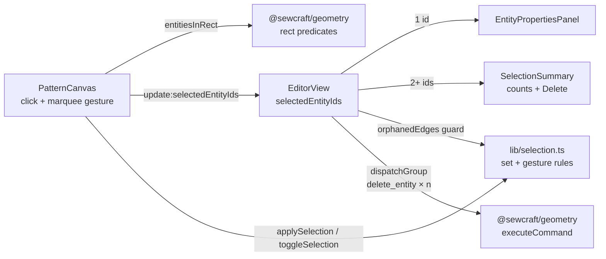

# Selecting multiple entities

Status: draft — design-only; Q1–Q3 open
Refs #50
Related: 005 (canvas editor interactions), 013 (editor workspace shell),
2026-10-20-selected-entity-properties (the single-selection inspector this extends)

## 📝 TLDR

The Select tool currently holds one entity id, so a maker editing a dense sheet
must select, inspect and delete one point or edge at a time. Proposed future
behaviour: Ctrl/Cmd+click toggles entities in an ordered selection, and a
left-to-right drag on bare canvas selects everything the rectangle touches while a
right-to-left drag selects only entities fully inside it; Ctrl/Cmd adds and
Ctrl/Cmd+Alt removes. The selection stays a frontend concern — no command, schema
or API change — while the rectangle math joins the pure geometry package and the
existing single-entity inspector is joined by a compact multi-selection summary.

## ❓ Open Questions

These are product calls, not implementation defaults. The draft applies the
recommended answer so the design is coherent, but the PR stays draft until they
are confirmed.

| #   | Question                                                                                                                                                                                                 | Recommended answer                                                                                                                                  | Why it blocks                                                                                                                                                                                                                         |
| --- | -------------------------------------------------------------------------------------------------------------------------------------------------------------------------------------------------------- | --------------------------------------------------------------------------------------------------------------------------------------------------- | ------------------------------------------------------------------------------------------------------------------------------------------------------------------------------------------------------------------------------------- |
| Q1  | Should a left-drag that starts on **bare canvas** become a marquee, moving bare-canvas pan to middle-drag and Space+drag? Or should the marquee require a modifier, leaving left-drag panning untouched?       | **Bare-canvas left-drag = marquee.** Pan stays on middle-drag, Space+drag and left-drag that starts on a line/curve (today’s behaviour there).      | It changes a documented pan path (`005-canvas-editor-interactions.md:24`) on the canvas’s largest hit area; a wrong call is a whole-app habit break.                                                                                    |
| Q2  | Does a **plain** click on an already-selected entity deselect it, as #50’s wording suggests? Or does only Ctrl/Cmd+click toggle, with a plain click collapsing the selection to that entity?                   | **Plain click keeps/collapses to that entity; Ctrl/Cmd+click toggles.** The “clicking selected entity unselects it” rule becomes the modified click. | Pointerdown on a selected point also starts a drag; deselecting on plain click would make “select a point, then move it” impossible.                                                                                                    |
| Q3  | When Delete includes a point whose dependent line/curve is **not** selected, should the UI refuse the delete and name the edges, cascade the edges in the same undo entry, or keep today’s dangling-edge behaviour? | **Refuse and name the edges** (frontend-only). A command-layer cascade is the better long-term fix, but belongs in its own spec.                     | `delete_entity` removes a point but leaves edges that reference it dangling (`packages/geometry/src/commands.ts:441-458`); a rectangle over a sketch often catches corner points, so bulk Delete could silently corrupt the document. |

## 📝 Problem Statement

- **Who needs it:** the solo maker editing a pattern with many points and edges,
  especially after duplicating a block. The Outline and Dimensions drawers are
  list-based, but the canvas still forces one-at-a-time selection.
- **What happens today:** `EditorView.vue:77` owns `selectedId`, a single
  `EntityId | null`. On the Select tool (`PatternCanvas.vue:653-660`), a point
  hit selects and starts a point drag; a line/curve hit selects and starts a pan;
  bare canvas clears the selection and pans. Middle-drag and Space+left-drag also
  pan (`PatternCanvas.vue:639-642`). There is no multi-selection state anywhere.
- **Evidence it matters:** issue #50 specifies click toggling, rectangle
  selection with two direction semantics, and additive/subtractive drags. None
  of it exists today. The single-entity sidebar inspector
  (`EditorView.vue:121`, `frontend/src/lib/entity-properties.ts:130`), Delete
  (`EditorView.vue:214-220`), `can-delete` (`:524`) and the canvas highlight are
  the consumers of the selection.
- **Constraint:** commands remain the only mutation path, so selection itself
  must not be written into the document; it is ephemeral view state. The pattern
  schema, command spec and HTTP API do not change. Rectangle math belongs in
  `@sewcraft/geometry` per `AGENTS.md` (“keep geometry math in
  `packages/geometry`”), while selection-set and gesture rules stay in the
  frontend. The new logic must be pure enough to reach the 100 % Vitest coverage
  gate without browser hit-testing.

## 📝 Proposed Solution

### Options considered

| #   | Option                                                                                                                                                                              | Trade-offs                                                                                                                                                                                                                                                       | Verdict                                                                                |
| --- | ----------------------------------------------------------------------------------------------------------------------------------------------------------------------------------- | ---------------------------------------------------------------------------------------------------------------------------------------------------------------------------------------------------------------------------------------------------------------- | -------------------------------------------------------------------------------------- |
| A   | **Ordered `selectedEntityIds` in `EditorView`, rectangle helpers in `@sewcraft/geometry`, set/gesture logic in `frontend/src/lib/selection.ts`, gesture state in `PatternCanvas`**      | One source of truth; reuses existing selection rendering, hit-test targets and `dispatchGroup`; no command/schema/API change. Cost: a fourth mutually exclusive pointer gesture, and bare-canvas pan must move to middle/Space.                                  | **Recommended**                                                                        |
| B   | **Modifier-only multi-select** — Ctrl/Cmd+click toggles, defer the marquee entirely                                                                                                   | Smallest change, no pan conflict, no rect math. Does not satisfy the drag half of #50, so the issue stays open.                                                                                                                                                    | Rejected as the destination; viable as an internal Phase 1 that ships something usable |
| C   | **A separate “Box select” tool** in the ribbon instead of overloading Select-drag                                                                                                    | Keeps left-drag panning and is discoverable. Adds a mode users must switch for a gesture every CAD tool puts on Select; still needs the same predicates and modifier semantics.                                                                                    | Rejected — more interface, less convention                                            |
| D   | **Use SVG `getBBox()` / `getIntersectionList()` for hit-testing**                                                                                                                     | Almost no geometry code. Browser-dependent, unavailable or unreliable in jsdom, ignores world/screen transforms and stroke width, and cannot be unit-tested to 100 % as a pure helper.                                                                          | Rejected — makes the core rule untestable                                              |
| E   | **Persist selection in the pattern document as a command**                                                                                                                           | Selection survives reload and is scriptable. Selection is not pattern data: it would enter the schema, command spec, API and every undo snapshot for a view concern, and concurrent agents would fight over it.                                                     | Rejected                                                                               |
| F   | **Do nothing**                                                                                                                                                                       | No risk. Leaves the exact workflow #50 describes unavailable and keeps bulk editing list-only.                                                                                                                                                                     | Rejected — the request is specific and the cost is contained                            |

### Click behaviour

| Modifier at pointerdown        | Target                | Result                                                                                       |
| ------------------------------ | --------------------- | -------------------------------------------------------------------------------------------- |
| None                           | Point                 | Selection becomes that point; the point drag starts                                           |
| None                           | Line or curve         | Selection becomes that entity; a drag from it pans, as today                                  |
| None                           | Bare canvas           | Pointerup without a drag clears the selection                                                |
| Ctrl/Cmd                       | Point, line or curve  | Toggle membership; no drag and no pan                                                         |
| Ctrl/Cmd                       | Bare canvas           | Selection unchanged; a drag starts an additive marquee                                       |
| Ctrl/Cmd+Alt or Ctrl/Cmd+Shift | Point, line or curve  | Remove from the selection if present; no drag and no pan                                      |
| Ctrl/Cmd+Alt or Ctrl/Cmd+Shift | Bare canvas           | Selection unchanged; a drag starts a subtractive marquee                                     |
| Any                            | Right button          | Ignored                                                                                      |
| Middle button or Space+left    | Anywhere              | Pan, unchanged                                                                               |

“Ctrl” means Ctrl on Windows/Linux and Cmd on macOS. Both `ctrlKey` and `metaKey`
are accepted so a Mac keyboard works either way; Cmd is the documented macOS
toggle because Ctrl+click can also open the context menu. The modifier is read
once at pointerdown so a gesture cannot change mode halfway through. Point
dragging is suppressed whenever a click changes the selection mode (Ctrl/Cmd with
or without Alt/Shift): toggling a point must not move it.

### Drag behaviour

| Start              | Modifier                       | Result                                                                 |
| ------------------ | ------------------------------ | ---------------------------------------------------------------------- |
| Point              | None                           | The selection collapses to that point and the point moves              |
| Point              | Ctrl/Cmd with or without Alt/Shift | No drag; the click rule applies                                    |
| Point              | Touch pointer                  | Point drag, unchanged                                                  |
| Line or curve      | None                           | Pan, as today                                                          |
| Line or curve      | Any modifier                   | No pan; the click rule applies                                         |
| Bare canvas        | None                           | Marquee; replaces the selection with the hits                          |
| Bare canvas        | Ctrl/Cmd                       | Marquee; adds the hits to the selection                                |
| Bare canvas        | Ctrl/Cmd+Alt or Ctrl/Cmd+Shift | Marquee; removes the hits from the selection                           |
| Anywhere           | Middle button or Space+left    | Pan, unchanged                                                         |
| Bare canvas        | Touch pointer, no modifier     | Pan, unchanged; touch keeps today’s gestures and gets no marquee       |

Collapsing to a dragged point is deliberate: a plain click on a point already
means “make this the selection”, and there is no batch-move command. Moving a
multi-point selection together is a separate spec.

### Rectangular selection

1. A drag that starts on bare canvas becomes a marquee only after the pointer has
   moved **4 screen pixels**. The activation is latched: once a marquee has
   started, moving back inside 4 px does not turn it back into a click. This
   prevents a shaky empty-canvas click from being swallowed.
2. **Direction is live:** while the pointer is right of the start, the rectangle
   is a **crossing** selection (entities fully or partially inside). Once it
   crosses to the left of the start, it becomes a **window** selection (only
   entities fully inside). The mode is re-read on every move and on release.
3. **Modifiers at pointerdown:** none replaces, Ctrl/Cmd adds, Ctrl/Cmd+Alt (or
   Ctrl/Cmd+Shift) subtracts. The alias is in v1 rather than a later phase,
   because a desktop that consumes Alt+drag would otherwise ship the subtract
   half of #50 unreachable.
4. **Preview:** the rectangle is drawn in world space with a translucent primary
   fill and a dashed primary border; candidate entities get the same primary
   highlight at reduced strength so the user sees the set before releasing.
5. **Release:** hits are merged by the pure `applySelection` helper. Replace with
   zero hits clears the selection; add/subtract with zero hits leaves it
   unchanged. Release outside the canvas still commits: the gesture owns the
   pointer via pointer capture and window listeners.
6. **Cancel:** Escape, `pointercancel`, window `blur`, or a tool change discards
   the rectangle and leaves the previous selection untouched. Delete and wheel
   zoom are ignored while the marquee is active.
7. **Touch:** today’s gestures are unchanged — a tap selects one entity, a drag
   on a point moves it, and a drag elsewhere pans. The marquee is a mouse/pen
   gesture in v1. Two-finger pan/pinch and touch additive selection are out of
   scope.

The marquee starts only from bare canvas. Dragging from a line or curve keeps
today’s pan behaviour, so box-select never competes with a possible future
“drag an entity” interaction.

### What “inside” means

| Entity     | Fully inside (window, right-to-left)                                        | Partially inside (crossing, left-to-right)                                                                                       |
| ---------- | --------------------------------------------------------------------------- | -------------------------------------------------------------------------------------------------------------------------------- |
| **Point**  | Its coordinate lies inside or on the rectangle                              | Same test                                                                                                                        |
| **Line**   | Both endpoints inside or on the rectangle                                   | Either endpoint inside, or the segment intersects any rectangle edge (including collinear overlap)                              |
| **Curve**  | All four control points inside or on the rectangle                          | The convex hull of the four control points overlaps the rectangle; the curve lies in that hull, so this never misses a curve    |

A cubic Bézier lies inside the convex hull of its control points, so “all four
control points inside” is a correct containment test. For crossing, the hull is a
superset of the curve: overlap guarantees the curve *may* be inside, but can also
select a curve whose hull clips the rectangle while the drawn curve does not.
That is a deliberate conservative choice — missing a visible curve is worse than
selecting an extra one. Testing the control polygon alone is **not** valid: a
control polygon can miss a rectangle that the curve passes through. The hull test
(is any control point inside, is any rectangle corner inside the hull, does any
hull edge cross a rectangle edge) is the v1 rule; the over-selection limitation is
documented in the edge cases and covered by a counterexample test.

Construction geometry is selectable when visible, because the canvas receives the
filtered `visibleDocument`; hidden construction is not rendered and cannot be
hit. Dimensions and seams keep their existing direct-manipulation interactions
and are **not** part of a marquee in v1.

### Selection, inspector and delete

- **Ordering:** `selectedEntityIds` is an ordered array. Replace uses document
  order (the same order as the Outline drawer); add appends new ids after the
  existing ones; subtract preserves the remaining order. Duplicates are
  impossible.
- **Sidebar:** one selected entity keeps the current `EntityPropertiesPanel`. Two
  or more show a compact `SelectionSummary` with the total, a breakdown by kind
  (“2 lines · 1 curve · 1 point”) and a Delete button. In-place property editing
  is disabled while multiple entities are selected; selection is not a bulk-edit
  surface in v1. The existing workspace summary stays visible beneath either
  panel (`EditorView.vue:587-614`), but its “Select a point, line or curve to
  inspect it” hint appears only when the selection is empty, not when two or more
  entities are selected.
- **Delete:** Delete/Backspace and the ribbon Delete remove every selected
  entity as one grouped undo entry. Before dispatching, the UI checks
  `orphanedEdges`: if a selected point has a dependent line/curve that is not
  also selected, the whole delete is refused and the error banner names the
  missing edges, including hidden construction. This prevents the UI from
  creating the dangling edges `delete_entity` already permits. Deletion clears
  the selection only after the group succeeds; a rejected command leaves the
  selection and document intact.
- **Staleness:** after undo, redo, load or any external document replacement, ids
  that no longer resolve are pruned. An empty selection falls back to the
  workspace summary. Hiding construction geometry does not clear an existing
  selection (today’s behaviour); the hidden entity simply stops being highlighted.
- **Group move is out of scope:** see the drag table above.

## 📝 Architecture



Takeaway: the canvas resolves pointer intent, `@sewcraft/geometry` owns the
rectangle predicates, a small frontend module owns the set rules and the delete
guard, and the view composes existing delete commands atomically.

### New geometry module: `packages/geometry/src/selection.ts`

Pure, framework-agnostic, exported from the package index:

```ts
export type Rect = { minX: number; minY: number; maxX: number; maxY: number };
export type RectMode = 'crossing' | 'window';

/** Visible entities hit by the rectangle, in document order. */
export function entitiesInRect(
  document: PatternDocument,
  rect: Rect,
  mode: RectMode,
): EntityId[];
```

Internally: point-in-rect (inclusive), a standard segment/rectangle clip that
handles collinear overlap, a convex hull for four control points, and a
convex-polygon/rectangle overlap test (control point inside, rectangle corner
inside the hull, or an edge crossing). No sampling, so results are deterministic
and cheap to test. Adding the module is additive: `@sewcraft/geometry` moves from
`0.6.0` to `0.7.0`, with no export removed or changed.

### New frontend module: `frontend/src/lib/selection.ts`

Pure, no Vue, no DOM, no store:

```ts
export type SelectionMode = 'replace' | 'add' | 'subtract';

/** Ctrl/Cmd adds, Ctrl/Cmd+Alt or Ctrl/Cmd+Shift subtracts, otherwise replace. */
export function selectionModeFrom(event: {
  ctrlKey: boolean;
  metaKey: boolean;
  altKey: boolean;
  shiftKey: boolean;
}): SelectionMode;

/** Right of the start is crossing; left of it is window. Screen x is enough. */
export function rectMode(startX: number, currentX: number): RectMode;

/** Ordered set arithmetic with no duplicates. */
export function applySelection(
  current: EntityId[],
  hits: EntityId[],
  mode: SelectionMode,
): EntityId[];

/** Ctrl/Cmd+click: remove when present, append when absent. */
export function toggleSelection(current: EntityId[], id: EntityId): EntityId[];

/** Edges that would be orphaned by deleting `ids`, including hidden ones. */
export function orphanedEdges(document: PatternDocument, ids: EntityId[]): EntityId[];
```

### Edited modules

- `frontend/src/views/EditorView.vue` — replace `selectedId` with
  `selectedEntityIds`; compute single-entity properties only for one id; add the
  summary branch and the zero-selection hint; guard delete through
  `orphanedEdges` and call `dispatchGroup`; `can-delete` becomes a length check;
  add an always-mounted `aria-live` selection count.
- `frontend/src/components/PatternCanvas.vue` — prop/emit become
  `selectedEntityIds`; selected styling reads a `Set`; add marquee state (start,
  current, mode, threshold latch), overlay, live preview, pointer capture and
  cancellation; ignore right-click and wheel while dragging; keep middle/Space,
  edge and touch panning and point dragging.
- `frontend/src/components/SelectionSummary.vue` (new) — presentational counts and
  Delete button; no store access.
- `frontend/src/lib/selection.ts` and `packages/geometry/src/selection.ts` (new)
  plus their test files.
- `packages/geometry/src/index.ts`, `packages/geometry/package.json` (version
  only).
- Existing tests for the canvas, editor view, sidebar and properties panel.

No file in `app/`, `routes/`, `database/`, `docs/domain/` or the command
specification changes. The pattern schema and `PatternDocument` are untouched.

## 📝 Data Model

None. Selection is not stored in `PatternDocument`, the project API or the
journal. The existing `JournalEntry` already supports grouped commands
(`frontend/src/stores/editor.ts:15-24`, `:57`), so multi-delete needs no schema
work.

## 📝 API Contracts

None on the HTTP or command surface. `delete_entity` keeps its current
single-entity semantics: it removes the entity, constraints that reference it and
its seams (`packages/geometry/src/commands.ts:441-458`). The UI refuses to create
a dangling edge rather than changing that contract. A command-layer cascade
remains a possible follow-up (Q3).

The internal component contract changes from `selectedId` / `update:selectedId`
to `selectedEntityIds` / `update:selectedEntityIds`; `PatternCanvas` is used only
by `EditorView` and its tests, which are updated in the same step. The geometry
package gains an additive export and a minor version bump; no existing export or
command payload changes.

## 📝 UI/UX

- **Selected state:** every selected point fills primary with its ring, and every
  selected line/curve uses the primary stroke at width 3 — the existing
  single-selection treatment, applied to the whole set. There is no separate
  “primary” entity.
- **Marquee:** a world-space rectangle with a low-opacity primary fill and a
  dashed primary border, `pointer-events-none`. A live candidate highlight at
  reduced primary strength distinguishes “will be selected” from “is selected”.
- **Sidebar:** one entity keeps the full inspector. Two or more replace it with
  the summary and a Delete button whose tooltip explains that a point cannot be
  deleted while an unselected edge depends on it. Zero shows the workspace
  summary and the selection hint.
- **Accessibility:** the canvas is pointer-first (`role="img"`) and v1 adds no
  keyboard way to select an entity; multi-select is therefore **not** keyboard
  accessible end to end. Do not claim otherwise. A visually hidden
  `aria-live="polite"` status, mounted outside the collapsible sidebar, announces
  “N entities selected” (“1 entity selected” when singular) whenever the count
  changes. Delete, Escape and the
  modifier chords are the documented keyboard paths; the summary states that the
  marquee is pointer-only.
- **No new chrome:** no bulk toolbar, no batch property form, no select-all
  command, no auto-scroll while dragging, and no touch-specific add/remove modes.

## ✅ Acceptance criteria

- Ctrl/Cmd+click adds an unselected entity and removes a selected one; a plain
  click replaces the selection; the issue’s “clicking selected entity unselects
  it” is satisfied by the modified click.
- A left-to-right marquee selects partially covered points, lines and curves; a
  right-to-left marquee selects only fully contained ones.
- Ctrl/Cmd+drag adds hits without clearing the current set; Ctrl/Cmd+Alt+drag and
  Ctrl/Cmd+Shift+drag remove hits; replace with zero hits clears; add/subtract
  with zero hits changes nothing.
- The marquee does not start below 4 px, is cancelled by Escape/blur/pointer
  cancel, and never starts from a line, curve, point, dimension or seam.
- Middle-drag, Space+drag and line/curve drag still pan; point drag still moves a
  point; touch keeps its current gestures (tap selects, point drag moves,
  elsewhere pans).
- Delete removes the whole selection in one undo entry, or refuses with a named
  edge when a selected point has an unselected dependent; the UI never creates a
  dangling edge.
- Two or more selected entities show the counts and Delete; one keeps the
  inspector; zero shows the hint. Undo removes stale ids.
- No command, schema, API or persisted-document change; the geometry package
  export is additive.
- `npm run format`, `npm run typecheck`, `npm run lint`, `npm run format:check`,
  `npm run test:coverage`, `npm run build` and the backend gate pass, with 100 %
  statements, branches, functions and lines.

## 📝 Edge Cases & Failure Scenarios

| Scenario                                                | Behaviour                                                                                                              |
| ------------------------------------------------------- | ---------------------------------------------------------------------------------------------------------------------- |
| Click without moving past 4 px                          | Treated as a click; a plain empty click clears, a modified empty click keeps                                             |
| Drag crosses 4 px, then returns near the start          | Stays a marquee until pointerup (latched); it does not become a click                                                   |
| Marquee replaces with no hits                           | Selection clears                                                                                                       |
| Additive or subtractive marquee with no hits            | Selection unchanged                                                                                                    |
| Right-to-left marquee over a partially covered line     | Line is not selected; only fully contained entities are                                                                 |
| Curve whose hull clips the rectangle                    | May be selected even if the drawn curve misses it; documented conservative over-selection                              |
| Curve passing through a rectangle its control polygon misses | Selected via the convex hull; a control-polygon-only test would miss it and is rejected                            |
| Escape, window blur, `pointercancel` or tool change     | Gesture is abandoned; previous selection survives                                                                      |
| Pointer released outside the canvas                     | The captured gesture commits the current rectangle; no stale marquee remains                                           |
| Wheel zoom during a marquee                             | Ignored until the gesture ends, so the rectangle cannot change under the pointer                                       |
| Undo/redo removes a selected entity                     | The missing id is pruned; an empty set returns to the workspace summary                                                |
| Hidden construction depends on a selected point         | Delete is refused and the message names the hidden edge; show construction and include it                              |
| Delete command rejects                                  | Nothing is applied, the selection stays, and the existing error banner reports the failure                              |
| Constraint tool active                                  | No selection or marquee gesture; constraint picks are unaffected                                                       |
| Touch/pen without modifiers                             | Touch keeps today’s gestures (tap selects, point drag moves, elsewhere pans); pen drag marquees                          |
| Very dense pattern                                      | Rectangle tests are O(entities) per pointer move; patterns are hundreds of entities, so no throttling in v1            |

## 📝 Risks & Impact Review

- **Navigation habit break (Q1).** Bare-canvas left-drag panning is replaced by
  the marquee; middle/Space and edge drags still pan. This is the biggest
  user-visible cost and is reversible by restoring the old pointerdown branch.
- **Delete refusal (Q3).** A point with an unselected dependent edge cannot be
  deleted in one step. That is safer than silent dangling geometry and avoids a
  command-layer change; a cascade is the better long-term fix but needs its own
  spec and command-spec update.
- **Modifier availability.** macOS Ctrl+click can open a context menu, and some
  Linux window managers consume Alt+drag. Cmd covers macOS; the Ctrl/Cmd+Shift
  alias covers desktops that swallow Alt. Neither replaces testing on the
  maintainer’s desktop.
- **Over-selection of curves.** The hull test is conservative and visible in the
  preview before release; exact Bézier clipping is rejected as disproportionate.
- **Accessibility.** Marquee selection is inherently spatial and pointer-based;
  v1 adds no keyboard canvas selection. The count announcement is not a
  substitute, and the limitation is stated in the UI.
- **Package surface.** `@sewcraft/geometry` gains a module and a minor version
  bump. It is private and additive; no command, solver residual, export or
  persisted document changes. Rollback is a frontend/package revert with no
  migration.
- **Performance.** A pointer-move recompute is linear in entity count and
  allocation-light; no measurable risk at expected pattern sizes. If it ever
  matters, coalescing to `requestAnimationFrame` is a contained follow-up.

## 📋 Phasing

- **Phase 1 — Click multi-selection and safe bulk actions.** Ordered selection
  state, Ctrl/Cmd toggling, grouped delete with the orphan guard, summary panel,
  hint fix, pruning and the live count. Ships value without the marquee and
  leaves bare-canvas panning temporarily intact.
- **Phase 2 — Rectangular selection.** Geometry rect predicates, the marquee
  gesture with direction and modifiers, live preview, pointer capture and
  cancellation.
- **Phase 3 — Hardening and docs.** Cross-gesture tests, the 005 contract update,
  the acceptance run and the full validation gate.

## 📋 Implementation Plan

**Phase 1**

1. Add `frontend/src/lib/selection.ts` with `SelectionMode`,
   `selectionModeFrom`, `applySelection`, `toggleSelection` and
   `orphanedEdges`; unit-test replace/add/subtract, toggle on and off, ordering,
   de-duplication, empty hits, the Ctrl/Cmd+Shift alias and the orphaned-edge
   guard (including hidden construction). No UI wiring yet.
2. Migrate `EditorView.vue` and `PatternCanvas.vue` from `selectedId` to
   `selectedEntityIds`, updating the prop/emit contract, the selection `Set`,
   point ring and stroke styling, the inspector lookup and `can-delete`. Keep
   today’s plain click/pan behaviour; update existing tests so the app still
   works with exactly one selected entity.
3. Implement plain/Ctrl/Cmd/Ctrl+Alt/Ctrl+Shift click semantics and the
   right-button/no-drag rules in the Select branch. Tests for each target,
   toggle on/off and the “modified click never drags” rule.
4. Guard and group Delete through `orphanedEdges`: refuse with a named edge when
   a point would orphan one, otherwise dispatch one `dispatchGroup`, clear only
   on success, and assert one journal entry plus a full undo. Update the existing
   point-delete tests that currently rely on dangling lines.
5. Add `SelectionSummary.vue`, the sidebar branch and the zero-selection hint;
   mount the `aria-live` count outside the sidebar; prune stale ids on document
   change. Test counts, the Delete event, the single-selection inspector, the
   two-plus and empty states, and the collapsed sidebar.

**Phase 2**

6. Add `packages/geometry/src/selection.ts` with `Rect`, `RectMode`,
   point/segment/polygon predicates, the convex hull and `entitiesInRect`; export
   it, bump the package minor version, and test boundaries, collinear overlap,
   the curve counterexample, construction visibility and document order.
7. Add the marquee gesture to `PatternCanvas.vue`: bare-canvas start, 4 px latch,
   live direction, modifier mode, world-space overlay, candidate preview,
   pointer capture, Escape/blur/pointercancel cancel, ignored wheel, and touch
   panning. Tests for both directions, all three modes, sub-threshold click,
   release outside the canvas and cancellation.
8. Wire the release into `EditorView` and verify the interaction between marquee,
   pan and point drag; add the interaction tests and the selection-count status
   test.

**Phase 3**

9. Update `.ai/specs/005-canvas-editor-interactions.md` for the new
   selection/pan contract (including its “Multi-select box” out-of-scope line),
   run `npm run format`, `npm run typecheck`, `npm run lint`,
   `npm run format:check`, `npm run test:coverage`, `npm run build` and the
   backend gate, and close any coverage branch the new gesture opened.

## ✅ Resolved assumptions (autonomous defaults)

| #   | Assumption                                                                                                                                                    | Rationale                                                                                                             | Reversible? |
| --- | ------------------------------------------------------------------------------------------------------------------------------------------------------------- | --------------------------------------------------------------------------------------------------------------------- | ----------- |
| R1  | Selection is ephemeral, ordered frontend state. No document, command, schema or API field.                                                                     | Selection is a view concern; persisting it would force every undo snapshot to carry it.                               | Yes         |
| R2  | Marquee-selected entity kinds are points, lines and curves from the visible document. Dimensions and seams keep their own interactions.                        | Matches the existing hit-test targets and avoids inventing dimension/seam selection semantics in this feature.         | Yes         |
| R3  | Ctrl/Cmd+click toggles; modified empty click keeps the set; the Ctrl/Cmd+Shift subtract alias ships in v1 alongside Ctrl/Cmd+Alt.                              | Standard canvas behaviour, and the alias keeps the remove gesture reachable on desktops that consume Alt+drag.        | Yes         |
| R4  | The marquee starts only on bare canvas after a 4 px latched threshold and uses the modifier captured at pointerdown.                                            | Prevents accidental boxes, keeps the mode stable mid-gesture, and preserves panning from entities.                    | Yes         |
| R5  | Crossing includes any overlap; window requires every defining point inside. Curves use their control-point convex hull, accepting conservative over-selection.  | Correct (never misses a curve) and cheap; exact Bézier clipping buys little at sewing tolerances.                      | Yes         |
| R6  | Two or more selected entities show a read-only count breakdown plus Delete; single selection keeps the full inspector; the workspace summary stays visible.       | Avoids designing bulk property editing now while giving the selection an obvious action.                              | Yes         |
| R7  | Dragging a selected point collapses the selection to that point and moves only it. Group move is a separate spec.                                               | A plain click means “select this”; there is no batch-move command, and silently moving one of several points is worse. | Yes         |
| R8  | Stale ids are pruned after document replacement; hidden construction keeps its id but loses its highlight.                                                      | Matches today’s persistence of a hidden selection and avoids surprising deselection on a visibility toggle.            | Yes         |
| R9  | Ctrl on Windows/Linux and Cmd on macOS are equivalent; Alt or Shift+Ctrl are the subtract modifiers.                                                            | Follows the filed gesture and adds a platform escape hatch without a new mode.                                        | Yes         |
| R10 | No select-all, keyboard marquee, auto-scroll, touch additive modes, two-finger pan/pinch or bulk property editing in v1; touch keeps today’s gestures.           | Keeps the spec to one capability and avoids speculative interfaces.                                                   | Yes         |
