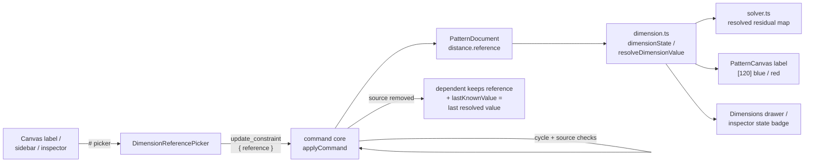

# Referenced dimensions

Status: draft — design only
Refs #47
Builds on: `.ai/specs/2026-10-20-driven-and-set-dimensions.md` (driven and set
linear dimensions) and `.ai/specs/2026-10-20-driven-dimension-color.md` (the
muted driven label).

## 📝 TLDR

A dimension's value can only be typed in today. When two lengths must stay
equal — a side seam against its matching seam, a cuff against a sleeve opening —
the maker has to remember and retype the number in every place, and one missed
edit silently breaks the pattern. Proposed future behaviour: a dimension can
**reference another dimension** instead of holding a literal. Typing `#` in a
value field opens a filtered list of the project's dimensions; picking one links
the dimension to it, renders `[120]` in blue, and the solver drives the sketch
from the source value. Editing the source updates every dependent. Removing the
source leaves its dependents visibly **broken** — red, showing the last known
value, adding no equation — until the maker re-links them or types a new value.

## 📝 Problem Statement

- **Who needs it:** the solo maker drafting a pattern with repeated or derived
  lengths. Pattern drafting is full of "this edge must equal that edge" and
  "this piece is half of that measurement" relationships; a number copied by hand
  is not a relationship.
- **What happens today:** a `distance` constraint either has a literal `value`
  (a set dimension that drives the solver) or no value (a driven measurement).
  Nothing can point at another dimension. `DistanceConstraint.value` is a plain
  number, `solver.ts` reads it directly, and the canvas, sidebar and inspector
  all edit that same number independently
  (`packages/geometry/src/types.ts:71-80`,
  `packages/geometry/src/solver.ts:175-191`,
  `frontend/src/views/EditorView.vue:684-760`).
- **Evidence it matters:** #47 describes the whole failure mode: typing a value
  into E when it should equal A, then having to find and edit every dependent
  when A changes, and having no way to tell which dimensions are related. The
  requested `#` picker, blue referenced label and red broken state are a
  relationship editor, not a formatting change.
- **Constraint:** commands remain the only mutation path, the geometry package
  stays pure, and a document without references must keep solving and rendering
  exactly as it does today. Angle references and arithmetic expressions are out
  of scope for this design.

## 📝 Proposed Solution

### Vocabulary

| Term | Meaning | Renders |
| ---- | ------- | ------- |
| **Set** | A dimension with a literal `value`; the solver holds the span at it. | `120` in foreground |
| **Driven** | A dimension with neither a value nor a reference; a live measurement. | `(120)` in muted gray |
| **Referenced** | A dimension whose value comes from another dimension. It drives the sketch while its source resolves. | `[120]` in blue |
| **Broken** | A referenced dimension whose source is missing, driven or otherwise unresolvable. It behaves like a driven dimension but keeps the last known reading. | `[120]` in red with a warning glyph |

A reference is **not** a second entity. It is another optional field on the
existing `distance` constraint, so identity, placement, selection, undo and
persistence are the ones the app already has.

### Options considered

| # | Option | Trade-offs | Verdict |
| - | ------ | ---------- | ------- |
| A | **`reference?: EntityId` on `DistanceConstraint`** — the effective value is resolved from the source at read/solve time | One persisted object, one identity, no duplicated value; chains and broken states are derived rather than stored; the solver needs a resolution pass and cycles must be rejected | **Recommended** |
| B | **Expression string** (`"#A"`, later `"#A / 2"`) with a parser and evaluator | Room for arithmetic, units and formulas later; one persisted field. Cost: a new language, parsing/validation errors, possible runaway expressions, and a much larger test surface before the basic link works | Defer — a useful follow-up once the link model is proven, not the first slice |
| C | **A `dimension_link` entity or constraint** referencing two dimensions | Explicit graph edge with its own id and lifecycle; could carry a scale factor later. Cost: a new persisted collection, new commands, and duplicate rendering/selection/undo paths for what is one field | Rejected — more surface for the same result |
| D | **Snapshot the source value when picked** | No solver or command change; the number is copied once | Rejected — it fails the issue's core requirement that later source edits update dependents |

Option A makes "referenced" literally mean "points at another dimension", and
keeps a document with no references byte-for-byte compatible.

### Behaviour

1. **Linking.** Typing `#` as the first non-whitespace character in a dimension
   value field opens a picker of eligible dimensions, filtered by the text after
   the `#`. Selecting one dispatches `update_constraint { id, reference }` (or
   `add_constraint` with `reference` for a new dimension). The row closes, the
   label becomes `[120]` in blue, and the solver re-solves with the source's
   value.
2. **Following the source.** Changing the source's value re-solves once; every
   dependent in the chain uses the new value in the same solve. There is no
   separate propagation command and no copied value to keep in sync.
3. **Manual edit breaks the link.** Typing a number into a referenced dimension
   dispatches `update_constraint { value }`, which removes the reference and
   makes it a set dimension. Clearing the field dispatches `value: null`, which
   removes the reference and makes it driven. Undo restores the link as one
   state change.
4. **Unlink without changing the number.** A **Remove reference** action
   dispatches `reference: null`; the current effective value becomes a literal
   `value`, so the sketch does not move. Removing the last equation is a separate
   action (`value: null`).
5. **Source removed or cleared.** Deleting the source constraint, deleting one of
   its points, or clearing it to driven leaves each dependent **broken**: its
   reference stays recorded, its last resolved value is captured, it contributes
   no solver residual, and it renders red. It is not silently deleted and it does
   not freeze the geometry at the last value.
6. **Re-linking.** A broken dimension can be repaired by picking a new source
   (`#` again) or by typing a value (which makes it set). A broken dimension is
   never a valid source for another reference.
7. **Chains and cycles.** A referenced dimension may itself reference another
   dimension. A link that would create a cycle — including a self-link — is
   rejected by command validation and never appears in the picker. Resolution is
   topological; a defensive read of a hand-edited cyclic document treats the
   whole cycle as broken rather than recursing forever.
8. **Same span is not a valid source.** Two distance constraints on the same
   point pair with different values would over-constrain the sketch, and with the
   same value the second is redundant. Dimensions on the same `{a, b}` pair are
   excluded from the picker and rejected by the command.
9. **Only resolvable dimensions are offered.** The picker lists dimensions with a
   finite, positive effective value: set dimensions and referenced dimensions
   whose chain resolves. Driven and broken dimensions are not offered, because a
   live measurement used as an equation would feed geometry changes back into the
   solver (Q1).

## 📝 Architecture



Takeaway: the only new persisted state is a source id and a last-known reading;
effective values, broken detection and solving are derived from the existing
document.

### Geometry package

- `types.ts` — extend `DistanceConstraint`:
  ```ts
  export type DistanceConstraint = {
    id: EntityId;
    type: 'distance';
    a: EntityId;
    b: EntityId;
    /** Literal driving length. Mutually exclusive with `reference`. */
    value?: number;
    /** Source distance constraint id. Mutually exclusive with `value`. */
    reference?: EntityId;
    /**
     * Last resolved value, kept only for a broken reference's display.
     * Never contributes a solver residual.
     */
    lastKnownValue?: number;
    orientation?: DimensionOrientation;
    offset?: number;
  };
  ```
  With `exactOptionalPropertyTypes`, build objects without the key rather than
  assigning `undefined`.
- `dimension.ts` — the state and resolution helpers shared by the solver, canvas
  and inspector:
  - `type DimensionState = 'set' | 'driven' | 'referenced' | 'broken'`.
  - `dimensionState(document, constraint)` — `set` when a literal value exists,
    `driven` when neither value nor reference exists, `referenced` when the
    reference resolves, `broken` otherwise.
  - `resolveDimensionValue(document, constraint)` — literal value, the resolved
    source value, the live measurement for a driven dimension, or
    `lastKnownValue ?? null` for a broken one. A source that is driven, broken
    or missing is **not** resolvable, so the dependent is broken rather than
    silently copying a live measurement. It takes a visited set internally so a
    cyclic document cannot recurse.
  - `isDrivenDimension` keeps its meaning: no value and no reference. Add
    `isReferencedDimension` and `isBrokenDimension`; do not overload "driven" to
    mean four states.
  - `dimensionValue` becomes the resolved effective value so every existing
    consumer (canvas, sidebar, inspector) gets the right number without a second
    code path.
- `solver.ts` — before building residuals, resolve every dimension once into a
  `Map<EntityId, number>`; a referenced dimension contributes the resolved
  number as its residual, and a broken one contributes none. The convergence
  shortcut counts only constraints with a resolved driving value. The resolution
  map is built per solve, not per residual, so a chain of length *n* costs one
  pass, not *n* passes per iteration.
- `commands.ts` — source validation, cycle rejection, orphan capture and inverse
  precision (see **API Contracts**).
- No new package dependency; bump the geometry package minor above `develop`'s
  version and refresh the lockfile.

### Frontend

- `frontend/src/lib/dimensions.ts` — one parser/serializer for the field:
  `parseDimensionEdit(input)` gains `{ kind: 'reference'; text: string }` for a
  leading `#` and `{ kind: 'unlink' }` for an explicit unlink action;
  `formatDimensionField(constraint, value)` returns `#<source>` for a referenced
  dimension and the formatted value otherwise. Keep the existing literal/driven
  rules for everything else.
- `DimensionReferencePicker.vue` — a new accessible combobox/listbox used by the
  canvas overlay and the sidebar popover. It owns filtering, keyboard navigation
  (`ArrowUp`/`ArrowDown`/`Enter`/`Escape`), the empty state and the row text; it
  emits the chosen dimension id and never mutates the document.
- `PatternCanvas.vue` — the inline editor accepts `#`; the label gets a state
  (set/driven/referenced/broken) instead of a boolean; the `<text>` class and the
  `<title>`/`aria-label` follow the state; a small warning glyph renders beside a
  broken value. The label string, width calculation and drag target stay one
  path.
- `EditorView.vue` and `EntityPropertiesPanel.vue` — the value field becomes a
  text input so it can accept `#`, plus a visible **Reference** button for mouse
  and touch users. The Dimensions drawer and the inspector show a four-state
  badge, the source id for a referenced row and a short error line for a broken
  row. Every surface dispatches the same `update_constraint`.
- No new store and no local copy of a dimension's value; the picker reads the
  live document and the command bus owns the change.

### Documentation

Update `docs/architecture/geometry-core.md` (state model and resolution),
`docs/architecture/data-model.md` (new optional fields), `docs/domain/glossary.md`
(referenced/broken) and `docs/domain/command-spec.md` / `.json` /
`config/geometry.php` at `spec_version` `0.7.0`. No HTTP route, database column or
export change: SVG export does not serialize dimensions
(`packages/geometry/src/export.ts`).

## 📝 Data Model

`PatternDocument.constraints[]` gains two optional fields on `distance`:

```jsonc
{
  "id": "e1",
  "type": "distance",
  "a": "p3",
  "b": "p4",
  "reference": "d1",
  "orientation": "aligned",
  "offset": 20
}
```

A broken dependent after `d1` is removed:

```jsonc
{
  "id": "e1",
  "type": "distance",
  "a": "p3",
  "b": "p4",
  "reference": "d1",
  "lastKnownValue": 120,
  "orientation": "aligned",
  "offset": 20
}
```

Rules:

- At most one of `value` and `reference` is present.
- `value` keeps the existing rule: finite and `> 0` when present.
- `reference` must name an existing `distance` constraint, not itself.
- `lastKnownValue` is presentation only, finite and `> 0`; it is written when a
  link is created and refreshed when its source disappears. It is never read by
  the solver.
- A referenced dimension stores no `value`; its effective value is derived. This
  avoids two sources of truth and makes "the source changed" one state change.
- `PatternDocument.schema` stays `sewcraft.pattern/0.1`: the change is additive
  to the JSON shape, like `orientation`/`offset` and the optional distance value
  before it. Older documents load unchanged; no migration is needed. Documents
  written by the new code are not downgrade-safe (an older build would read a
  referenced dimension as driven and measure the span), which is called out in
  **Risks**.

## 📝 API Contracts

### `add_constraint` — `distance`

- `value?: number` — literal set dimension, as today.
- `reference?: entity_id` — link to an existing distance dimension. Mutually
  exclusive with `value`; providing both is a validation error.
- Validation for `reference`:
  - the source exists and is a `distance` constraint;
  - the source is not the new constraint itself;
  - the source is not on the same `{a, b}` point pair;
  - the source resolves to a finite, positive effective value (not driven and
    not broken);
  - adding the edge does not create a cycle.
- The new constraint stores `reference` and `lastKnownValue` (the source's
  resolved value), never a literal `value`.
- Inverse: `remove_constraint`.

### `update_constraint`

| Field | Rule |
| ----- | ---- |
| `value: number` | Break any existing reference and set the literal value (same `> 0` rule). |
| `value: null` | Break any existing reference and make the dimension driven. |
| `reference: entity_id` | Link to that source; remove any literal `value`; validate as above and reject cycles. |
| `reference: null` | Unlink; keep the current effective value as a literal `value` so geometry does not jump. |
| `orientation` / `offset` | Presentation only, unchanged. |

- At most one of `value` and `reference` may be present in a single update;
  `reference: null` is still a reference field, so it cannot be combined with
  `value`.
- A no-op update (same link, same value) returns `inverse: null`.
- The inverse always restores the previous **state**: a link→literal edit
  inverts to the previous `reference` and `lastKnownValue`; a literal→link edit
  inverts to the previous `value`; unlink inverts to the previous `reference`.
- Clearing a source to driven or deleting it does not mutate its dependents'
  commands; it leaves their `reference` recorded and captures `lastKnownValue`
  before the source disappears (see **Cascade**).

### `remove_constraint` and `delete_entity` — cascade

- Removing a dimension captures its resolved value, then leaves every dependent's
  `reference` in place and writes that value into `lastKnownValue`. The dependent
  is now broken and contributes no residual.
- Deleting a point cascades the dimensions that reference it; their dependents
  are broken the same way. The existing `delete_entity` snapshot-undo path is
  unchanged.
- A dependent is never deleted as a side effect of removing its source; the issue
  explicitly asks for a recoverable broken state.

### Command spec sync

Update `config/geometry.php`, `docs/domain/command-spec.md` and
`docs/domain/command-spec.json` in sync at `spec_version` `0.7.0`. Both fields
are additive, so every `0.6.0` payload still applies unchanged; include a short
"Migration from 0.6.0" note.

## 📝 UI/UX

### Value field and picker

- The canvas inline editor already uses `<input type="text">`; the sidebar value
  field changes from `type="number"` to `type="text" inputmode="decimal"` so it
  can accept `#`. A **Reference** button sits beside the field for pointer and
  touch users.
- Typing `#` as the first non-whitespace character opens a listbox anchored to
  the field. Text after `#` filters by dimension id and by the formatted value
  (for example `#A`, `#12`, `#A 120`). A selected row shows
  `A · 120 mm · p1 → p2 · Horizontal`.
- Keyboard: `ArrowDown`/`ArrowUp` move the active row, `Enter` links it,
  `Escape` closes the picker and restores the previous text. `Tab` leaves the
  field and cancels the picker. The field uses `role="combobox"`,
  `aria-expanded`, `aria-controls` and `aria-activedescendant`; the list uses
  `role="listbox"` and `role="option"`.
- Eligible rows are set dimensions and referenced dimensions with a resolving
  chain, excluding self, the same point pair, and every dimension that would
  create a cycle. Empty state: "No other dimensions can be referenced."
- When the field opens on a referenced dimension it shows `#A`, not the resolved
  number, so the link is visible while editing. Committing `#A` (typed in full)
  links it; committing a number makes it set; committing empty makes it driven.
- A broken dimension opens with its last known number and a red inline note:
  "Source A is missing. Type a value or press # to re-link." There is no silent
  fallback to the measured span.

### Labels and states

| State | Label | Color | Accessible name |
| ----- | ----- | ----- | --------------- |
| Set | `120` | foreground | "Dimension 120 millimetres" |
| Driven | `(120)` | `muted-foreground` | "Driven dimension, measured 120 millimetres" |
| Referenced | `[120]` | new blue `dimension-reference` token | "Referenced dimension, 120 millimetres, from dimension A" |
| Broken | `[120]` plus warning glyph | `destructive` | "Broken reference, last known 120 millimetres; source dimension A is missing" |

- Square brackets distinguish a reference from the driven parentheses; color is
  a reinforcement, never the only cue. The broken state adds a warning glyph and
  its accessible name, so it is not color-only either.
- The blue token is a semantic theme variable (`--dimension-reference`) rather
  than a literal Tailwind color, so a future dark theme can tune it. It must
  reach at least 4.5:1 contrast against the label's background at the chosen
  shade; the implementation records the measured ratio.
- The placement preview stays foreground and driven until committed, as today.
  A referenced or broken label remains draggable and double-click editable.

### Drawer and inspector

- The Dimensions drawer and the Properties inspector show `Set`, `Driven`,
  `Referenced` or `Broken`; a referenced row shows the source id, a broken row
  shows the missing source and a **Re-link** action that opens the same picker.
- Removing a source dimension leaves the dependent rows in place with the broken
  badge; the user can repair them from either surface.
- No new full-screen UI and no change to the ribbon or tool model.

## 📝 Edge Cases & Failure Scenarios

| Scenario | Expected behaviour |
| -------- | ------------------ |
| Link to a set dimension | The dependent becomes blue `[120]`, drives the sketch from 120, and adds one residual. |
| Change the source from 120 to 130 | One solve; the dependent uses 130. If the solve fails, the whole command fails and both dimensions keep 120. |
| Link to a referenced dimension | Allowed when its chain resolves; the picker shows it; cycle checks run against the whole chain. |
| Link that would create a cycle (`A→B`, then `B→A`) | Rejected by the command and absent from the picker; no partial document change. |
| Link to itself | Rejected with a validation error; not listed. |
| Link to a dimension on the same point pair | Rejected and not listed; two equations on one span would over-constrain or duplicate. |
| Link to a driven dimension | Rejected and not listed; its value is a live measurement, not a stable equation (Q1). |
| Link to a broken dimension | Rejected; repair the source first. |
| Delete the source dimension | Dependents become broken, keep their reference id and last known value, render red, and stop driving. Undo restores the source and the links resolve again. |
| Delete a point used by the source | The source is cascade-removed; its dependents become broken the same way. |
| Clear the source to driven | Dependents become broken with the last resolved value; the source itself measures as driven. |
| Type a number into a referenced dimension | The link is removed and the dimension becomes set; undo restores the link. |
| Clear a referenced dimension to driven | The link is removed and it becomes driven; undo restores the link. |
| Unlink a referenced dimension | It becomes a set dimension at the current effective value; the sketch does not move. |
| Unlink a broken dimension with no last known value | Rejected; the user must type a value (the picker cannot invent one). |
| Solver cannot satisfy the referenced value | Existing error banner; document unchanged; the link and the source stay as they were. |
| Reload a document with a dangling reference | It loads as broken, shows the stored last known value and adds no residual; no throwing resolver. |
| Reload a hand-edited cyclic document | The cycle is detected on read and all members render broken; no recursion limit error. |
| Undo after a source value edit | The source returns to its old value and dependents resolve to it automatically. |
| Undo after a source deletion | The source returns and dependents resolve again; their last known value is refreshed on the next break. |
| Broken dimension reopened in the editor | Shows the last known number and the red note; typing a number makes it set, `#` opens the picker. |
| Source has a different orientation | The dependent copies the scalar value along its own orientation; the source's orientation is not copied. |
| Hidden dimension layer | The document, references and solving are unaffected; only rendering is hidden. |

## 📝 Risks & Impact Review

- **Protected surface (medium).** `DistanceConstraint` is re-exported from
  `@sewcraft/geometry` and `add_constraint` / `update_constraint` are command
  contracts (`BACKWARD_COMPATIBILITY.md` §2–3). The JSON change is additive, but
  the TypeScript type gains fields and the solver semantics change; the package
  minor bump and the three-way command-spec sync are required.
- **Dependency graph.** References create a graph inside `constraints[]`.
  Validation must reject cycles on write, and resolution must be cycle-safe on
  read for hand-edited or older documents. A cycle must never hang a solve.
- **Resolution cost.** Resolving a chain per residual would multiply work by
  chain length on every solver iteration. Resolve once per solve into a map and
  reuse it; add a chain-depth test.
- **Downgrade.** An older build reads a referenced dimension as driven and
  measures the span instead of driving it. Pre-release, single-user, no published
  package — accepted and called out in the PR body, matching the driven-value
  precedent.
- **Silent data loss risk.** Deleting a source must not delete dependents; the
  issue asks for a visible, recoverable broken state. The cascade tests pin this
  behavior.
- **Over-constraint by alias.** Two dimensions on the same points, or a reference
  chain that collapses onto one span, can create redundant or conflicting
  equations. Reject same-pair sources and rely on the solver's existing failure
  path for the rest.
- **Color and accessibility.** Blue and red alone are not sufficient state cues;
  the bracket shape, warning glyph and accessible names carry the meaning. The
  blue token needs a measured contrast check on the label background.
- **Undo precision.** The inverse must restore the previous link, literal and
  last-known value together. A link→literal edit that only restores `value` would
  leave a stale `reference`; tests cover each transition.
- **No export impact.** SVG export serializes geometry, not dimensions; no PDF or
  DXF implementation exists yet.
- **Arithmetic is out of scope.** `#A / 2`, units and named variables are not
  part of this design; the field is a reference picker, not an expression
  language. Option B is the future path if that need appears.

## ❓ Open Questions

These are blocking product/architecture decisions, not implementation details.
They are asked on issue #47; the draft PR stays draft until they are answered.

| # | Question | Why it blocks | Recommended answer |
| - | -------- | ------------- | ------------------ |
| Q1 | May a dimension reference a **driven** dimension (a live measurement), or only dimensions with a resolved set value? | A driven source changes whenever the geometry moves; using it as an equation feeds geometry changes back into the solver and can oscillate. It changes the resolver, the picker and the failure model. | **Only resolved set/referenced values.** A driven measurement is not a stable target; a snapshot can be typed as a literal if that is what the user wants. |
| Q2 | Are **chains** allowed (`A→B→C`), or only direct links to a literal set dimension? | Chains need cycle detection, topological resolution and a clearer broken-propagation story; one-hop links are much smaller. | **Allow chains with cycle rejection.** The picker can exclude descendants, resolution is a small graph walk, and users will naturally link a dimension that is itself linked. |
| Q3 | When a source is removed or cleared, should dependents become **broken** (red, last known, no equation) or be converted to a literal set value at the last reading? | Broken is recoverable and honest but leaves an equation missing; auto-freezing preserves the geometry but hides that the relationship is gone. | **Broken, per the issue.** The last known value is display-only; the user must re-link or type a value. |

## ✅ Resolved assumptions (autonomous defaults)

| # | Assumption | Why | Status |
| - | ---------- | --- | ------ |
| R1 | A reference is an optional `reference` field on `DistanceConstraint`, not a new entity (option A) | One identity, no duplicated value, reuse of every existing dimension surface | ⚠ NEEDS HUMAN CONFIRMATION — changes an exported type and the command contract |
| R2 | At most one of `value` and `reference` is present; a referenced dimension stores no cached value | Prevents two sources of truth; the source is the only authority | Reversible |
| R3 | Typing a number or clearing to driven breaks the link; **Remove reference** keeps the current value as a literal set dimension | A manual number is an explicit override, and unlinking should not move the sketch | Reversible |
| R4 | Referenced labels use square brackets `[120]` in blue; broken labels add a warning glyph and use the destructive token | Keeps driven parentheses distinct and avoids color-only state cues | Reversible |
| R5 | The picker excludes self, the same point pair, driven sources, broken sources and cycle-creating targets | Prevents invalid or redundant equations before dispatch | Reversible |
| R6 | `lastKnownValue` is refreshed when a link is created and when the source disappears, and is never a solver input | Broken must show the last reading without freezing geometry | Reversible |
| R7 | `PatternDocument.schema` stays `0.1`; the command spec moves to `0.7.0` | Additive document fields, changed command params | Reversible |
| R8 | Angle references, arithmetic expressions and cross-project references are out of scope | Keeps the first slice to linear dimension links; the expression option remains a follow-up | Reversible |
| R9 | A broken dimension is repaired by typing a value or linking again; it is never a valid source | Prevents broken chains from propagating silently | Reversible |

## 📋 Phasing

- **Phase 1 — Model and resolution.** Fields, state helpers, cycle-safe resolver,
  solver map; package bump. Ships a document model that solves references
  correctly before any UI uses it.
- **Phase 2 — Command contract.** Add/update/link/unlink, validation, orphan
  capture, inverse precision and the three-way spec sync at `0.7.0`. Ships the
  complete API for agents and tests.
- **Phase 3 — Rendering.** Four-state labels, blue/red tokens, warning glyph,
  widths and accessible names. Ships visible referenced and broken states.
- **Phase 4 — Editing.** `#` picker, sidebar/inspector text fields, unlink/re-link,
  undo/redo. Ships the issue's full interaction.
- **Phase 5 — Documentation and verification.** Geometry, data-model, glossary,
  command-spec docs; full gate and a manual link/edit/delete walkthrough.

## 📋 Implementation Plan

### Phase 1 — Model and resolution

1. Add `reference?` and `lastKnownValue?` to `DistanceConstraint` in
   `packages/geometry/src/types.ts`; document the mutual-exclusion invariant.
   Update construction sites that assumed only `value`.
2. Add `dimensionState`, `resolveDimensionValue`, `isReferencedDimension` and
   `isBrokenDimension` to `dimension.ts`; make `dimensionValue` return the
   resolved effective value. Tests: set, driven, referenced, broken, missing
   point, chain, cycle-safe read.
3. Build a per-solve resolution map in `solver.ts`; referenced constraints with a
   resolved value contribute a residual, broken and driven ones do not; the
   convergence shortcut counts only resolved driving constraints. Tests: a
   referenced value drives; a broken reference does not; a chain resolves once;
   a source change moves the dependent.
4. Bump the geometry package minor and refresh the lockfile; run
   `npm test -w @sewcraft/geometry` and `npm run typecheck -w @sewcraft/geometry`.

### Phase 2 — Commands

1. `applyAddConstraint`: accept `reference`, reject `value` + `reference`, validate
   source existence, type, same-pair, resolved value and cycles; store
   `lastKnownValue`, not `value`.
2. `applyUpdateConstraint`: add `reference: EntityId | null`; implement link,
   unlink-to-literal, value-breaks-link, clear-breaks-link and exact inverses.
   Tests for every transition and for `reference` + `value` rejection.
3. `applyRemoveConstraint` and `applyDeleteEntity`: capture the removed source's
   resolved value into each dependent's `lastKnownValue`, keep the dangling
   `reference`, and never delete dependents. Tests for source removal, point
   cascade and undo.
4. Add cycle detection shared by add/update; test self-link, two-node and
   three-node cycles, and a valid diamond-shaped chain.
5. Sync `config/geometry.php`, `docs/domain/command-spec.md` and
   `docs/domain/command-spec.json` at `0.7.0` with the migration note; test the
   exposed command spec still matches the PHP config.

### Phase 3 — Rendering

1. Add `formatDimensionLabel(value, state)` (or an equivalent state-aware
   formatter) and pass the four-state value through `DimensionDrawing` /
   `DimensionLabelView`; use the resolved value.
2. Add the `--dimension-reference` token and the broken warning glyph; bind
   `fill-dimension-reference` / `fill-destructive` and keep the label width,
   background, drag target and double-click editor unchanged. Tests for all four
   labels, widths, colors, accessible names and the preview.
3. Add the state badge, source id and broken note to the Dimensions drawer and
   the Properties inspector; tests for each state.

### Phase 4 — Editing

1. Extend `parseDimensionEdit` and the field formatter for `#` and the explicit
   unlink action; tests for `#`, `#A`, a number, empty, invalid text and unlink.
2. Build `DimensionReferencePicker.vue` with filtering, keyboard navigation,
   empty state and ARIA; tests for eligible rows, cycle/same-pair exclusion,
   selection, Escape and Tab.
3. Wire the canvas inline editor and the sidebar/inspector text fields to the
   picker and to `update_constraint`; wire the **Reference** / **Re-link**
   buttons. Tests for link, unlink, value-breaks-link, clear-breaks-link and
   undo/redo across each.
4. Keep the source id visible on a referenced row and the missing source visible
   on a broken row; test the drawer and inspector rendering after a source
   deletion.

### Phase 5 — Documentation and verification

1. Update `docs/architecture/geometry-core.md` (state model, resolver, solver
   map), `docs/architecture/data-model.md` (optional fields, broken state) and
   `docs/domain/glossary.md` (referenced, broken, last known).
2. Run the full gate: `npm run format`, `npm run typecheck`, `npm run lint`,
   `npm run format:check`, `npm run test:coverage` (100 % for geometry and
   frontend), `npm run build`, and the Pest coverage command. Then create A, B
   and E on canvas, link E to A, change A, delete A, undo, and capture the
   referenced/broken states.

## ✅ Acceptance criteria

- [ ] A dimension can be linked to another dimension by typing `#` and picking
      from a filtered list, or by using the Reference button.
- [ ] A referenced dimension renders `[value]` in blue, drives the sketch from
      the source, and updates when the source changes.
- [ ] Typing a number or clearing a referenced dimension breaks the link;
      **Remove reference** keeps the current value as a set dimension.
- [ ] Removing, clearing or cascade-deleting the source leaves dependents
      broken: red, last known value, no solver residual, recoverable by re-link
      or a new value.
- [ ] Chains are supported and cycles (including self-links) are rejected on
      write and safe to load on read.
- [ ] The picker excludes self, the same point pair, driven/broken sources and
      cycle-creating targets.
- [ ] Undo restores the previous value/reference/last-known state for every
      transition.
- [ ] State is conveyed by shape, glyph and accessible name, not color alone;
      the blue token meets 4.5:1 on the label background.
- [ ] The command spec is synced at `0.7.0`; existing payloads still apply.
- [ ] The full validation gate passes and coverage stays at 100 %.

## Out of scope

- Arithmetic or expressions (`#A / 2`, `#A + 10`), units and named parameters.
- Referencing angle constraints or any non-distance constraint.
- Referencing dimensions in another project or pattern.
- Cross-document or external references.
- Auto-relinking a broken dimension to a new dimension with a similar value.
- Changing a source's orientation or offset through the dependent.
- A graph view of dimension relationships.
- PDF/DXF export changes.

## Checks

```bash
npm run format
npm run typecheck
npm run lint
npm run format:check
npm run test:coverage
npm run build
docker compose run --rm app php artisan test
docker compose run --rm app vendor/bin/pint
```
