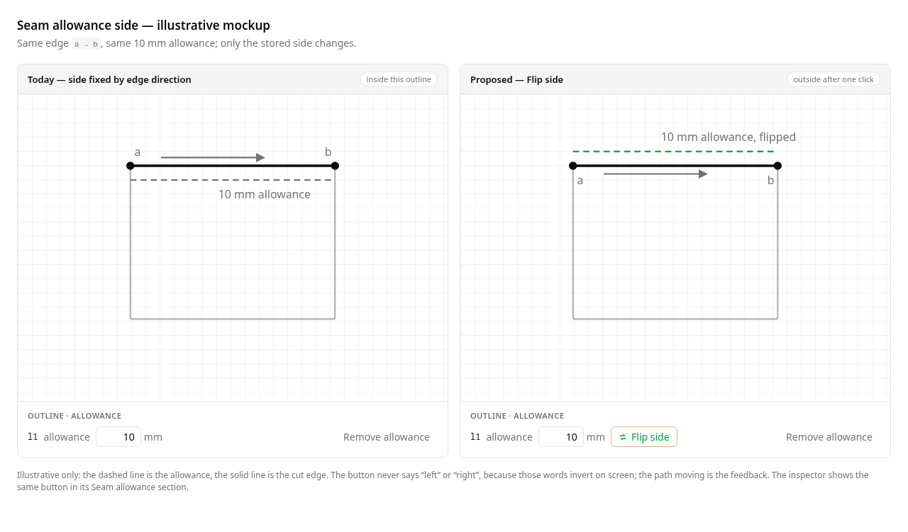

# Seam allowance side

Status: superseded (UI) by 2026-10-23-pieces-sidebar-and-selection; `side` is not authorable in the editor
Refs #39
Builds on: 007 (seam allowance), 2026-10-19-seam-allowance-sketch-tool.md
Future consumer: 008 (SVG export)

## 📝 TLDR

A seam allowance can only ever grow on one side of a cut edge: the offset is
always applied to the left of the edge's start→end direction, so the visible side
depends entirely on the order the edge was drawn and cannot be changed. Proposed
future behaviour: each attached allowance records an explicit side (`left` or
`right` of its edge direction) and the sidebar/inspector offers a **Flip side**
action that moves the dashed allowance to the other side, through the command
bus and with undo.

## 📝 Problem Statement

- **Who needs it:** the solo maker drafting a piece who wants the allowance on
  the outside of a closed outline (or on the inside, for a lining) without
  redrawing edges in a particular direction.
- **What happens today:** `Seam` stores only `{ id, edge, width }`
  (`packages/geometry/src/types.ts:90`), and `seamAllowancePath` passes the
  positive width straight to `offsetPolyline`, which offsets **left of the travel
  direction** (`packages/geometry/src/offset.ts:141-148`, `:280-300`). For a
  clockwise rectangle in screen coordinates that puts the allowance inside; for a
  counter-clockwise one it lands outside. The only way to change the result is to
  delete and recreate the edge in the opposite direction, which also breaks its
  constraints, dimensions and seams.
- **Evidence it matters:** issue #39 asks exactly for the missing control:
  "Seam allowance should have ability to switch on which side of cut edge it is
  generated." The offset primitive already supports a signed distance, so the
  model and UI are the only gaps.
- **Constraint:** commands remain the only mutation path, geometry stays
  framework-agnostic, and existing documents and payloads must keep their current
  rendering. There is no piece/loop entity yet (spec 007 notes pieces are not
  modelled), so "inside/outside" cannot be derived reliably.

## 📝 Proposed Solution

### Options considered

| # | Option | Trade-offs | Verdict |
| - | ------ | ---------- | ------- |
| A | **Store an explicit per-edge side** (`left`/`right` of the edge direction) and flip it with a panel button | Additive field, reverses with one command, no loop topology needed, matches today's left default; wording must avoid a misleading "left/right" label on screen | **Recommended** |
| B | **Signed width** (negative width = other side) | One field fewer; every consumer must treat `< 0` correctly, the width validation `> 0` and both input parsers change, and UX/export code needs `abs()` everywhere | Rejected — hides one concept inside another |
| C | **Inside/outside, derived from the enclosing loop**, with manual override | Matches sewing vocabulary and would give a sensible per-piece default later; needs loop/piece topology and winding detection that the model does not have (007 defers pieces), and is ambiguous for open edges | Rejected for now — revisit with pieces |
| D | **A separate `flip_seam_allowance` command** | Names the user gesture directly; adds a command that duplicates the existing `set_seam_allowance` shape and its inverse | Rejected — extend the setter already used for width |
| E | **Do nothing; document the direction rule** | No new surface; leaves the issue unresolved, and "redraw the edge in reverse" is destructive | Rejected |

### Behaviour

1. A `Seam` gains `side: 'left' | 'right'`, defaulting to `left` (today's
   rendering) when a stored document or an older command omits it.
2. `add_seam_allowance` accepts an optional `side`; the canvas tool keeps the
   default `left`.
3. `set_seam_allowance` accepts an optional `side` in addition to the existing
   optional-to-change `width`, so **Flip side** is one command:
   `{ id, side: current === 'left' ? 'right' : 'left' }`.
4. Rendering offsets by `+width` for `left` and `-width` for `right`; width stays
   a positive millimetre value everywhere.
5. The UI does not print "left" or "right" — in screen coordinates those words
   invert with the axis, so the control is a **Flip side** button and the moving
   dashed path is the feedback.

### Why not a new "flip" command

`set_seam_allowance` already owns "change one property of an attached allowance
without detaching it", and its inverse is the same command with the previous
values. Extending it keeps the command vocabulary small, gives Flip an undo for
free, and avoids a near-duplicate command in the API, docs and tests.

## 📝 Architecture


Takeaway: the side is one new stored field on the existing seam, and every
consumer keeps reading the same `seamAllowancePaths()` output.

### Edited modules

- `packages/geometry/src/types.ts` — `SeamSide`, optional `Seam.side`, and a
  `seamSide(seam)` accessor that applies the `left` default.
- `packages/geometry/src/offset.ts` — `seamAllowancePath` derives the signed
  distance from `seamSide` and reports the side on `SeamAllowancePath`.
- `packages/geometry/src/commands.ts` — validate `side` on `add_seam_allowance`
  and `set_seam_allowance`; carry `side` through `remove_seam_allowance`'s inverse
  and through `set_seam_allowance`'s previous-value inverse.
- `config/geometry.php`, `docs/domain/command-spec.md`,
  `docs/domain/command-spec.json` — three-way command-spec sync (v0.6.0).
- `frontend/src/views/EditorView.vue` — one `flipSeam` handler dispatching
  `set_seam_allowance`; the Outline drawer and `EntityPropertiesPanel.vue` each
  get a **Flip side** button with its own emit.
- `packages/geometry/package.json` — `0.5.0` → `0.6.0` (additive public API).
- Tests beside each: offset side, command validation/inverse, drawer and panel
  button wiring.

## 📝 Data Model

| Field | Type | Default | Notes |
| ----- | ---- | ------- | ----- |
| `Seam.side` | `'left' \| 'right'` (optional in the type) | `'left'` via `seamSide()` | Persisted in `patterns.geometry` JSON |

- **No SQL migration.** Seams live inside the existing geometry JSON column
  (`patterns`, `pattern_versions`); the change is a field inside that document.
- **Backward compatible.** Documents written before this change have no `side`
  and render on the left exactly as today. New writes always include it.
- **Schema version stays `sewcraft.pattern/0.1`.** The addition is optional and
  every 0.1 document remains valid both ways; bumping would force a rewrite of
  stored documents for no behavioural gain. Additive optional fields are recorded
  in this section rather than in a schema migration.
- **Forward compatible.** An older reader ignores `side` and renders left; it can
  misrender a right-side allowance but never corrupts the document.

## 📝 API Contracts

Command spec `0.5.0` → `0.6.0`; additive, so every v0.5 payload still applies.

```jsonc
// add_seam_allowance v0.6
{ "type": "add_seam_allowance",
  "params": { "edge": "l1", "width": 10, "side": "right" } }

// set_seam_allowance v0.6 — at least one of width/side
{ "type": "set_seam_allowance",
  "params": { "id": "seam-1", "side": "left" } }
```

- `side` accepts only `"left"` or `"right"`; anything else is a
  `CommandValidationError`.
- Omitting `side` on `add_seam_allowance` means `"left"`.
- `set_seam_allowance` requires `width` and/or `side`; an unknown seam is a
  validation error; re-applying both current values is a no-op with
  `inverse: null`.
- Inverse of `set_seam_allowance` restores **both** the previous width and side,
  so a flip is one undo. `remove_seam_allowance`'s inverse (re-add) carries the
  removed seam's side.
- No HTTP route or response shape changes; `GET /api/commands` reflects the
  version bump through `config/geometry.php`.
- `SeamAllowancePath` gains `side` for callers (canvas today, export later); the
  path geometry for an existing left seam is unchanged.

## 📝 UI/UX

Current row in the Outline drawer:

```text
l1  allowance  10 mm  [ Remove allowance ]
```

Proposed:

```text
l1  allowance  10 mm  [ Flip side ]  [ Remove allowance ]
```

- **Where:** the Outline drawer's per-edge allowance row
  (`EditorView.vue:601-630`) and the Properties inspector's Seam allowance
  section (`EntityPropertiesPanel.vue`). Both dispatch the same command.
- **What it looks like:** a secondary (ghost/outline) button with a swap icon and
  the visible label "Flip side"; the dashed allowance path moves immediately, so
  the result is visible without a toast. The button does not name left/right.
- **Accessibility:** native `<button>` with an entity-specific accessible name
  (`Flip seam allowance side for l1`); it is reachable in the normal tab order,
  Enter/Space activate it, and the canvas update is not announced as a live
  region (the button's action is the announcement).
- **Empty state:** unchanged — edges without an allowance show "No allowance"
  and the add action.
- **Hidden layer:** flipping still works while "Show seam allowance" is off; the
  stored side changes and becomes visible when the layer is shown.
- **Test ids:** `flip-seam-<edgeId>` in the Outline drawer and `entity-flip-seam`
  in the inspector.



The mockup is illustrative: it shows the same edge before and after a flip. The
sidebar row wording (width, Flip side, Remove allowance) is the proposed layout;
the canvas is a schematic, not a screenshot of working behaviour.

## 📝 Edge Cases & Failure Scenarios

| Scenario | Expected behaviour |
| -------- | ------------------ |
| Stored document has no `side` | Treated as `left`; identical rendering, no prompt or migration |
| Flip a left allowance | `set_seam_allowance {id, side:'right'}`; path mirrors across the edge; one undo restores the left side |
| Flip twice | Second command is the inverse of the first, not a no-op; the document ends where it started and history has two entries |
| `set_seam_allowance` with only `side` | Valid; width unchanged |
| `set_seam_allowance` with `side` equal to current and no width | No-op, `inverse: null` |
| Unknown `side` string (API/client bug) | `CommandValidationError`; error banner; document unchanged |
| Right-side allowance self-intersects | Existing self-intersection detection flags it in the destructive style; nothing auto-repairs |
| Flip a curve allowance | Same rule on the flattened curve; joins unchanged |
| Adjacent edges flipped differently | Allowed. Allowances are per edge and never joined at corners, so this does not create a new geometry failure, but it can look asymmetric — copy must not promise a continuous ring |
| Edge or seam deleted, then undo | Seam returns with its stored side (inverse carries it) |
| Export (008) reads a right-side seam | Out of scope here; 008 must consume `seamAllowancePath`, which already applies the side |
| Construction edge | Cannot carry an allowance (existing validation); no flip action is shown |

## 📝 Risks & Impact Review

- **Wording vs geometry (medium).** "Left/right" is edge-relative in document
  coordinates, while users see a canvas with a flipped y-axis. Mitigation: never
  display the words; use Flip side and the visible path. Whether users need
  inside/outside wording is Q1.
- **Command contract (medium).** Widening `set_seam_allowance` changes a protected
  surface (`BACKWARD_COMPATIBILITY.md` §2). It is additive, version-bumped to
  0.6.0, and synced across `config/geometry.php`, the Markdown spec and the JSON
  schema; no existing payload changes meaning.
- **Geometry API (low).** `seamAllowancePath` keeps its signature and its result
  for existing left seams; the package version and
  `docs/architecture/geometry-core.md` are updated.
- **Corner behaviour (low, pre-existing).** Per-edge offsets already meet at
  corners without a join. Flipping can make one edge disagree with its
  neighbours; this is visible, undoable, and not a regression.
- **Stored documents (low).** Missing `side` defaults to today's rendering, so no
  project changes appearance on upgrade. No database migration.
- **Export coupling (low).** Spec 008 is not implemented yet; this spec records
  that the exporter must go through `seamAllowancePath` so it inherits the side
  rather than re-deriving an offset.

## ❓ Open Questions

This is a product/scope decision, asked on issue #39. It does not stop the draft
design review.

| # | Question | Why it matters | Recommended answer |
| - | -------- | -------------- | ------------------ |
| Q1 | Is an **edge-relative flip** enough for v1, or must the control speak **inside/outside** of the piece from day one? | Inside/outside needs loop/piece topology and winding detection that spec 007 deferred (pieces are not modelled); edge-relative flip is implementable now and stays correct for open edges | Edge-relative Flip side now; add loop-aware inside/outside as a default with pieces |

## ✅ Resolved assumptions (autonomous defaults)

| # | Assumption | Why | Status |
| - | ---------- | --- | ------ |
| R1 | Side is stored per edge as `left`/`right`, defaulting to `left` | Matches today's rendering exactly and needs no topology | Reversible |
| R2 | Extend `add_seam_allowance`/`set_seam_allowance`; add no flip command | Reuses the existing setter and its inverse | Reversible |
| R3 | The control is a **Flip side** button in the Outline drawer and the inspector; no directional wording | Screen axes invert left/right, so wording would mislead | Reversible |
| R4 | New allowances still default to `left`; no auto-guess from surrounding edges | No loop detection yet; guessing would be silent and often wrong | Reversible |
| R5 | Keep pattern schema `0.1`; `side` is optional and `seamSide()` supplies the default | Additive, no stored-document rewrite | Reversible |
| R6 | Command spec and geometry package bump to `0.6.0`; docs updated in the same PR | Protected-surface rule in `BACKWARD_COMPATIBILITY.md` | Reversible |
| R7 | Width stays positive; only the offset sign depends on side | Keeps every existing width input, parser and API consumer valid | Reversible |
| R8 | SVG/PDF/DXF export stays out of scope; export must consume `seamAllowancePaths()` later | 008 is not implemented; avoids a second offset implementation | Reversible |
| R9 | No canvas-side flip action (double-click still edits width only) | Keeps the interaction model small; the panel button is discoverable | Reversible |
| R10 | No SQL migration or new column | Seams already live in the geometry JSON | Reversible |

## 📋 Phasing

- **Phase 1 — geometry model.** `SeamSide`, `seamSide()`, signed offset in
  `seamAllowancePath`, side on the returned path, tests for both sides and the
  default.
- **Phase 2 — commands and contract.** Optional `side` on add/set, validation,
  inverses carrying side, three-way command-spec sync, package and docs version
  bump, command tests.
- **Phase 3 — UI.** Flip button in the Outline drawer and the inspector, one
  handler in `EditorView`, component tests, accessible names and test ids.
- **Phase 4 — verification.** Full validation gate; manual check that a
  right-side allowance renders, flips back, and undoes in the running app.

## 📋 Implementation Plan

### Phase 1 — Geometry model

1. Add `SeamSide`, optional `Seam.side` and `seamSide()` with the `left` default;
   export them from `index.ts`. Tests: defined side wins, missing side is `left`.
2. Make `seamAllowancePath` offset by `+width` for `left` and `-width` for
   `right`, and include `side` on `SeamAllowancePath`. Tests: mirrored path for
   the same edge, unchanged path for an omitted side, curve edge on both sides.
3. Update `docs/architecture/geometry-core.md`'s seam section with the signed
   offset rule.

### Phase 2 — Commands and contract

1. Extend `AddSeamAllowanceParams`/`SetSeamAllowanceParams`; validate `side`;
   persist it on add; update both inverses to carry width and side. Tests for
   add with/without side, set-side-only, set-both, invalid side, unknown seam and
   no-op, and undo through the inverse.
2. Bump `config/geometry.php`, `docs/domain/command-spec.md` and
   `docs/domain/command-spec.json` to `0.6.0` and document the additive
   migration; bump `packages/geometry/package.json` to `0.6.0`.
3. Keep command tests at 100 % branch coverage, including every validation
   branch.

### Phase 3 — UI

1. Add a `flipSeam(seam)` handler in `EditorView.vue` that dispatches
   `set_seam_allowance` with the opposite side through `run()`; solver or
   validation failures use the existing error banner.
2. Add the **Flip side** button to the Outline drawer's attached-seam row and to
   `EntityPropertiesPanel.vue`'s Seam allowance section, with the emits and test
   ids above. Tests: button dispatches the opposite side; the row reflects the
   new document; the button is absent for construction edges and absent when no
   allowance is attached.
3. Reuse the existing seam width controls unchanged; no local side state in any
   component.

### Phase 4 — Verification

1. Run `npm run format`, `npm run typecheck`, `npm run lint`,
   `npm run format:check`, `npm run test:coverage` (100 % for geometry and
   frontend) and `npm run build`; run Pest as a regression check.
2. In the running app, attach an allowance, flip it, flip it back, undo once and
   confirm the previous side returns; confirm a legacy document without `side`
   still renders on the left.
