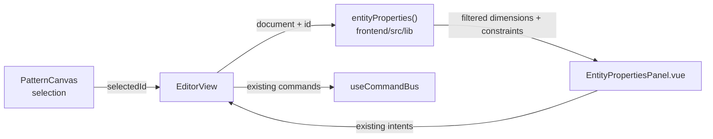
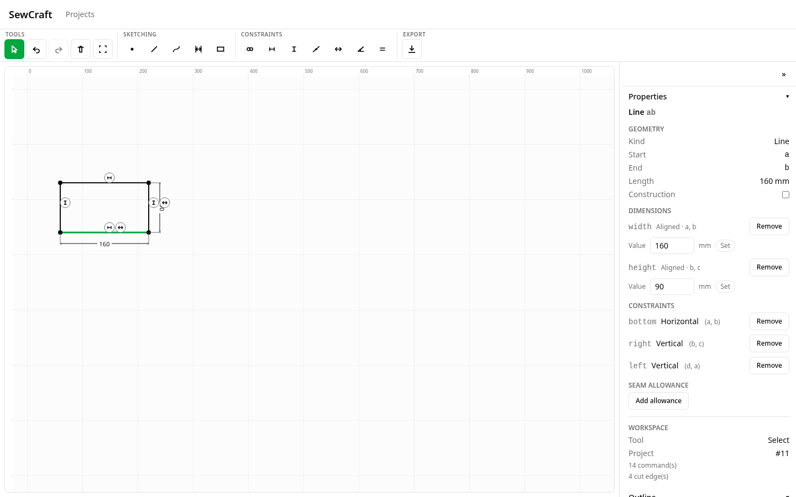
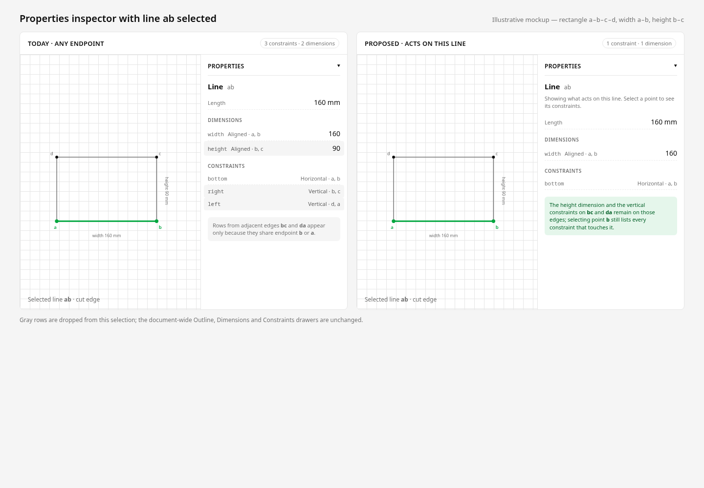
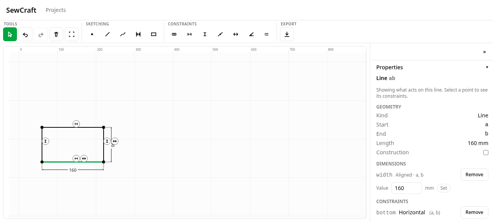

# Selected entity properties: only what acts on this edge

Status: implemented — Q1 resolved (hide endpoint-anchoring constraints)
Refs #41
Amends in part: `.ai/specs/2026-10-20-selected-entity-properties.md` (the relation
rule only; the inspector's layout and editing paths are unchanged)

## 📝 TLDR

Selecting a line currently lists every dimension and constraint that references
either of its endpoints, so a rectangle's bottom edge `ab` also shows the height
on `bc` and the vertical constraints on `bc` and `da`. Implemented behaviour:
the Properties inspector lists only the constraints and dimensions that act on
the **selected edge's own endpoint pair**, while selecting a point still shows
everything that touches that point. The change is a pure selector rule in the
frontend — no schema, command, API or persistence change. Endpoint-anchoring
constraints that involve only one endpoint are hidden on the line for v1 (Q1,
decided); selecting the point reveals them.

## 📝 Problem Statement

- **Who needs it:** the solo maker inspecting a draft. After clicking an edge they
  want to answer "what holds this edge and what is its measurement?" without
  filtering out rows for the neighbouring edges.
- **What happens today:** `frontend/src/lib/entity-properties.ts` builds the
  selected line's endpoint set and keeps every constraint where
  `constraintEntityIds(constraint).some(id => pointIds.has(id))`
  (`entity-properties.ts:96-129`). Shared corners therefore pull in adjacent
  edges. The seeded rectangle in `EditorView.vue:451-477` reproduces the report
  exactly: `ab` is held by `bottom` (`a,b`) and `width` (`a,b`), but the panel
  also shows `height` (`b,c`), `right` (`b,c`) and `left` (`d,a`).
- **Evidence it matters:** issue #41 reports the exact rectangle and lists the
  extra rows. The data is correct; the scope of the list is not. The user cannot
  tell which rows describe the selected edge and which merely share a corner.
- **Constraint:** constraints reference **point ids only**; there is no edge id on
  a constraint (`packages/geometry/src/types.ts:52-90`). Stored documents cannot
  be backfilled with "the edge this was created from", because the same
  constraint can be created from two points or from a line
  (`frontend/src/lib/constraint-tools.ts:51-59,172-188`).

### What "related" means today

For a selected line, the relation is "references at least one of my endpoints".
That is deliberately broad: it includes constraints that genuinely span two
edges, but also every constraint on a neighbouring edge that shares a corner.
The earlier selection-inspector spec chose that rule in Q2/R5 and documented a
dimension between the line's start and an unrelated point as related
(`.ai/specs/2026-10-20-selected-entity-properties.md`, since amended by this
spec). Issue #41 shows the cost of that choice; this spec narrows it.

## 📝 Proposed Solution

### Options considered

| # | Option | Trade-offs | Verdict |
| - | ------ | ---------- | ------- |
| A | **Match the constraint's referenced segment to the selected edge** in the pure selector. A two-point constraint is related when its two points are exactly the line's endpoints, order-insensitive; `point_on_line` when its line pair matches; `angle`/`equal` when either of their segments matches. Point and curve selections keep their current rule. | Smallest surface: one predicate, one consumer, no schema/command change; revert is deleting the predicate. A constraint between one endpoint and an outside point is not shown on the line (select the point instead), and a curve keeps its broader any-control-point list. | **Recommended** |
| B | **Store explicit ownership on constraints** (an edge id or provenance list) and filter by it, with a fallback for existing documents. | Exact for constraints created from a single line, but a single id cannot own `angle` (two arms), `equal` (two segments) or `point_on_line` (a point plus a line); constraints created from two points have no edge; existing documents cannot be backfilled reliably. Requires a schema/command version change and a migration policy. | Rejected for v1; possible follow-up only if single-edge ownership becomes a product requirement |
| C | **Keep the broad list and split it into "This edge" plus a collapsed "Also touches its points" section.** | Preserves discoverability, but adds UI state, count logic and tests, and the issue asks for fewer items, not a second list. It also cannot say which of two adjacent edges a shared constraint "belongs" to. | Rejected for v1; the cheap escape hatch is selecting the point |
| D | **Do nothing.** | No code risk; the reported confusion remains, users keep reading point ids to work out which rows are theirs, and the inspector's promise ("related properties") stays untrue for a selected edge. | Rejected — the fix is small and reversible |

### Chosen rule (v1)

The relation is a property of the **segment a constraint references**, not of any
shared point. The matrix is exhaustive for the current constraint types:

| Selected entity | Constraint type | Related when | On the seeded rectangle |
| --------------- | --------------- | ------------ | ----------------------- |
| Point `p` | any | the constraint references `p` (unchanged) | selecting `b` lists `width`, `height`, `bottom`, `right` |
| Line `s–e` | `coincident`, `horizontal`, `vertical`, `distance` | `{a,b}` equals `{s,e}`, either order | `ab` lists `bottom` (`a,b`) and `width` (`a,b`) |
| Line `s–e` | `point_on_line` | its line pair `{a,b}` equals `{s,e}`; the constrained point may be outside | a point constrained to `ab` is listed on `ab` |
| Line `s–e` | `angle` | either arm `{a,b}` or `{b,c}` equals `{s,e}` (`b` is the vertex) | `ab` and `bc` both list an angle between them |
| Line `s–e` | `equal` | either segment `{a1,a2}` or `{b1,b2}` equals `{s,e}` | `ab` and `cd` both list an equal-length constraint |
| Curve `p0–p3` | any | it references any of the four control points (unchanged) | a curve sharing a control point with a line still lists that line's constraint |

**Why curves keep the broad rule:** a cubic has no single edge segment; its shape
is defined by four control points, and every one of them participates. Issue #41
reports lines, and inventing a curve-specific rule now would be a second,
unvalidated design. If curves show the same clutter in use, a follow-up can
narrow them to consecutive control-point pairs without changing this spec's
line rule.

**Why `angle`, `equal` and `point_on_line` appear on both edges:** they genuinely
constrain both referenced segments. The model records no "created from" edge, so
choosing one owner would be a guess. Showing them on both is the geometric truth
and needs no metadata; a single-owner model would be option B, not a tweak.

**Consequences on the seeded rectangle:**

- `ab` → `width` (dimension) and `bottom` (constraint) only.
- `bc` → `height` (dimension) and `right` (constraint) only.
- `b` → `width`, `height`, `bottom`, `right` (every constraint touching the
  point), which is the escape hatch for endpoint-level inspection.
- The document-wide Outline, Dimensions and Constraints drawers keep listing
  everything; only the Properties inspector is selection-scoped.

### What stays the same

- No new command, no command params, no schema, no API, no database and no export
  change. The inspector still dispatches the existing commands for construction,
  seam allowance, dimension value and removals.
- The panel layout, sections, editing controls, accessibility labels and test ids
  stay as they are, except for the copy described under UI/UX.
- Point selection, curve selection and the document-wide drawers are out of scope
  and unchanged.

### UI copy

Because rows disappear, the panel says why. For a line or curve, add one muted
line under the entity header:

> Showing what acts on this line. Select a point to see its constraints.

(The noun follows the entity: *line*, *curve*; a point selection shows no hint.)
Empty states change from "No related dimensions/constraints." to "No dimensions
on this line." / "No constraints on this line." (same noun substitution). The
hint is the discoverability escape hatch; it introduces no new control and no
extra count.

## 📝 Architecture

Takeaway: only the read-side predicate changes; the write path and every
consumer of the inspector stay untouched.

### Edited files

- `frontend/src/lib/entity-properties.ts` — replace the `ownPointIds(...).some`
  filter with a type-switched `constraintActsOnEntity(constraint, entity)` and a
  small order-insensitive `samePair(a, b, s, e)` helper. The function stays
  private to this view model: `entityProperties` is its only consumer
  (`EditorView.vue:108`). If the canvas or a drawer later needs the same rule,
  extract it beside `constraintEntityIds`/`seamForEdge` in
  `@sewcraft/geometry` rather than duplicating it.
- `frontend/src/components/EntityPropertiesPanel.vue` — add the per-kind hint and
  the "on this line/curve/point" empty-state copy. No new props, emits or
  controls.
- `frontend/src/lib/entity-properties.test.ts` — replace the current "own points"
  expectations with the relation matrix; add the seeded rectangle and cross-edge
  cases.
- `frontend/src/components/EntityPropertiesPanel.test.ts` — assert the hint and
  the new empty-state copy.
- `.ai/specs/2026-10-20-selected-entity-properties.md` — update the relation
  rule, the edge case and R5/Q2 so the earlier spec no longer contradicts this
  one. The implementation ships in the same combined PR.

## 📝 Data Model

None. The rule reads the existing `PatternDocument`; no entity, constraint or seam
shape changes, and no migration is needed.

## 📝 API Contracts

None. No command, endpoint, request/response or error contract changes.

## 📝 UI/UX

No layout change: the same Dimensions and Constraints sections simply contain
fewer rows, with one explanatory line for line/curve selections.

**Current state** — the seeded rectangle with `ab` selected; the panel shows
`width` plus `height`, and `bottom` plus `right`/`left`:

**Proposed state** — illustrative before/after mockup; the left panel is today's
list and the right panel keeps only the rows that act on `ab`:

The mockup is illustrative, not evidence of working behaviour. It uses the app's
palette and the seeded rectangle, and shows the intended copy.

**Implemented state** — the same selection after the change: the hint is visible
and the list stops at `width` and `bottom`:

**Accessibility:** the hint is a plain paragraph announced with the panel; no new
focusable element, shortcut or live region. Existing list `aria-label`s already
name the entity id, and the edit controls keep their labels.

## 📝 Edge Cases & Failure Scenarios

| Scenario | Expected behaviour |
| -------- | ------------------ |
| `ab` selected in the seeded rectangle | Dimensions: `width` only. Constraints: `bottom` only. `height`, `right` and `left` are absent. |
| `bc` selected | Dimensions: `height` only. Constraints: `right` only. |
| Point `b` selected | Lists every constraint referencing `b` (`width`, `height`, `bottom`, `right`); the hint is absent. |
| Constraint authored from two points that are the line's endpoints | Shown on the line; matching is by ids, not by how it was authored. |
| Constraint between one endpoint and an outside point (`coincident a–x`, `distance a–x`, `horizontal a–x`) | Not shown on the line (Q1: hide for v1); select `a` or `x` to inspect it. |
| `angle a–b–c` (arms `ab`, `bc`) | Shown on both `ab` and `bc`. |
| `equal ab–cd` | Shown on both `ab` and `cd`. |
| `point_on_line p–ab` | Shown on `ab`; not on an unrelated line. |
| Two lines with the same endpoints (a construction guide over a cut edge) | Both show the same constraints. Constraints are point-owned, so this is expected; deleting a line does not delete them. |
| Line with a missing endpoint reference | Matching uses the stored ids; a constraint whose ids match still lists, and the panel never throws. A constraint that references the missing id on only one side is not related to the line. |
| Curve sharing control points with a line | The curve keeps the broad any-control-point list; the line keeps its strict segment list. |
| Duplicate constraints with the same endpoint pair | Both list in document order; no dedupe (unchanged). |
| Selection deleted or undone away | `entityProperties` returns `null`; the workspace summary returns (unchanged). |
| Empty relation | "No dimensions on this line." / "No constraints on this line." |

## 📝 Risks & Impact Review

- **Hidden endpoint constraints (medium, product — accepted).** Strict matching
  hides a `coincident` that anchors an edge to its neighbour when the rectangle
  uses separate corner points. Q1 decided to hide these for v1: the point
  inspector and the document-wide constraints drawer still show them, and
  selecting the point is the escape hatch. The copy makes the scope explicit.
  This is the one deliberate information loss; a collapsed **Endpoint
  constraints** section stays a follow-up only if use shows it is needed.
- **Curves stay broad (low).** A curve sharing control points with a line lists
  constraints that also touch the line. Issue #41 is about lines; narrowing
  curves without a report would be speculative. Documented as a known
  consequence, reversible in a follow-up.
- **Same-endpoint lines (low).** A construction guide over a cut edge shares the
  point pair, so both edges list the same constraints. This reflects the
  point-owned model; the spec records it so it is not reported as a bug.
- **Source-of-truth drift (medium).** The earlier selection-inspector spec and
  tests assert the broad rule. This PR updates the spec text and names the test
  expectations to change; implementation must update
  `frontend/src/lib/entity-properties.test.ts` in the same change and keep the
  100% branch gate green.
- **Reversibility (low).** The rule is one private predicate; reverting restores
  the current list. No stored data, schema, command or package version changes.
- **Scope (low).** Only the Properties inspector filters; the drawers, point
  selection and canvas remain unchanged. No new dependency or UI primitive.

## ❓ Open Questions

None. Q1 was answered by the maintainer on #41 (2026-10-20).

## ✅ Resolved questions

| # | Question | Decision | Status |
| - | -------- | -------- | ------ |
| Q1 | **Endpoint-anchoring constraints.** Should v1 hide constraints that involve only one of the selected line's endpoints (`coincident a–x`, `distance a–x`, `horizontal/vertical a–x`), or add a collapsed **Endpoint constraints** section? | **Hide them for v1** (the recommended option). Selecting the point shows the full set; the document-wide Constraints drawer still lists them. No collapsed section in this design; revisit as a follow-up only if use shows the anchor needs to be visible without changing selection. | Decided on #41, 2026-10-20 |

## ✅ Resolved assumptions (autonomous defaults)

| # | Assumption | Why | Status |
| - | ---------- | --- | ------ |
| R1 | Related = the constraint's referenced segment matches the selected line's endpoint pair, per the matrix above; not "any shared endpoint". | Addresses #41 without touching the model. | Reversible |
| R2 | `angle`, `equal` and `point_on_line` appear on both edges/segments they reference. | They genuinely constrain both; the model has no provenance to pick one owner, and option B cannot represent multi-edge ownership with a single id. | Reversible |
| R3 | Point selection keeps "any constraint referencing the point". | A point has no segment; this is the escape hatch for endpoint constraints and the current behaviour. | Reversible |
| R4 | Curve selection keeps "any control point" for v1. | A cubic has no edge segment; #41 reports lines; a curve-specific rule would be a second unvalidated design. | Reversible; follow-up if reported |
| R5 | Only the Properties inspector filters; Outline, Dimensions and Constraints drawers stay document-wide. | The issue is about the selection inspector; changing the drawers would remove information users rely on and widen the blast radius. | Reversible |
| R6 | Matching uses the stored ids, without resolving or filtering missing references. | Keeps the current dangling-reference behaviour (`h(a, gone)` still lists on the broken line), avoids unreachable defensive branches, and never throws on a partial document. | Reversible |
| R7 | The predicate stays private to `frontend/src/lib/entity-properties.ts`. | `entityProperties` is its only consumer; extracting it to geometry now would add a package API for one view. Extract when a second consumer appears. | Reversible |
| R8 | Copy adds a one-line hint for line/curve selections and changes the empty states to "on this line/curve/point"; no new controls. | Users must not think rows were deleted; the hint names the escape hatch without adding UI surface. | Reversible |
| R9 | No schema, command, API, database, package-version or export change. | The rule is read-side only; the existing commands and documents stay valid. | Reversible |

## 📋 Phasing

- **Phase 1 — relation predicate.** Replace the any-endpoint filter with the
  type-switched segment matcher; update selector tests to the matrix.
- **Phase 2 — panel copy.** Add the per-kind hint and the new empty-state copy;
  update component tests.
- **Phase 3 — source of truth.** Amend the earlier selection-inspector spec's
  relation rule, edge case and R5/Q2; verify no other spec asserts the broad
  rule.
- **Phase 4 — verification.** Run the frontend validation gate and the full
  coverage gate; the backend is untouched but runs as a regression check.

## 📋 Implementation Plan

### Phase 1 — Relation predicate

1. Add `samePair(a, b, s, e)` and `constraintActsOnEntity(constraint, entity)` to
   `frontend/src/lib/entity-properties.ts`. Use a `switch` on `constraint.type`
   so `equal` uses `(a1,a2)`/`(b1,b2)` and `point_on_line` uses `(a,b)`; never
   zip `constraintEntityIds` into "consecutive pairs".
2. Use the predicate in place of `ownPointIds(...).some(...)`; remove
   `ownPointIds` if it becomes unused. Keep the point/curve branches explicit.
3. Tests in `entity-properties.test.ts`:
   - seeded rectangle: `ab` yields exactly `width` + `bottom`; `bc` yields exactly
     `height` + `right`;
   - point `b` still yields `width`, `height`, `bottom`, `right`;
   - order-insensitive endpoint pairs (`a,b` vs `b,a`);
   - `angle` on both arms, `equal` on both segments, `point_on_line` on its line;
   - endpoint-only constraints are absent from the line and present on the point;
   - duplicate endpoint pairs keep document order;
   - the existing broken-line case still lists `h(a, gone)`;
   - curve selection keeps the any-control-point list.
   Replace the existing `axis` (`a,c`) expectation and the test name that
   encodes "own points".

### Phase 2 — Panel copy and states

1. Add a `kindNoun` computed (`point`/`line`/`curve`) and the hint paragraph for
   line/curve selections only.
2. Change the empty-state text to `No dimensions on this ${noun}.` /
   `No constraints on this ${noun}.`; keep the section headings and aria labels.
3. Component tests: hint present for a line and curve, absent for a point; empty
   states use the noun; existing rows/actions still render.

### Phase 3 — Spec of record

1. Update `.ai/specs/2026-10-20-selected-entity-properties.md`: replace the
   "any point" relation text, the "own points vs neighbours" rationale, the
   "dimension to an unrelated point" edge case, Q2 and R5 with a pointer to this
   spec.
2. Grep `.ai/specs/` for "own points" / "at least one of the entity's own points"
   and update any other stale assertion.

### Phase 4 — Verification

1. `npm run format`, `npm run typecheck`, `npm run lint`, `npm run format:check`,
   `npm run test:coverage` (100% statements, branches, functions and lines for
   `frontend/src`), `npm run build`.
2. Backend regression only: `docker compose run --rm app php artisan test`.
3. UI check in a browser with the seeded rectangle: `ab` shows `width` +
   `bottom`, `bc` shows `height` + `right`, and selecting `b` still shows the
   full point list.

### Acceptance criteria

- [ ] Selecting `ab` on the seeded rectangle lists exactly `width` and `bottom`;
      `height`, `right` and `left` are absent.
- [ ] Selecting `bc` lists exactly `height` and `right`.
- [ ] Selecting point `b` is unchanged and lists every constraint touching it.
- [ ] `angle`, `equal` and `point_on_line` appear on both segments they reference.
- [ ] A constraint between one endpoint and an outside point is absent from the
      line and present on the point (Q1 decision).
- [ ] A line/curve selection shows the hint; a point selection does not; empty
      states name the entity.
- [ ] No schema, command, API, database, package-version or export change.
- [ ] Frontend coverage stays at 100% for all four metrics; the full validation
      gate passes.
