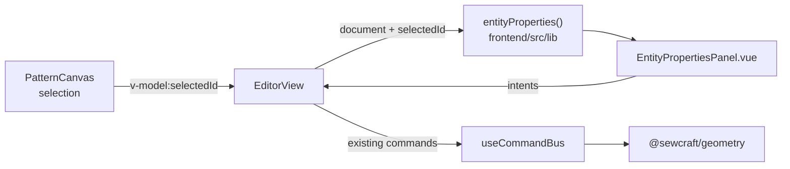

# Selected entity properties in the sidebar

Status: proposed
Refs #35
Soft dependency: #34 (driven and set dimensions) for the driven/set value
presentation. This spec works without it and shows the stored value until it lands.
Relation rule amended by `.ai/specs/2026-10-20-selected-entity-properties-scope.md`
(#41): the inspector lists constraints that act on the selected entity's own
segment, not every constraint that shares one of its points. Layout, editing paths
and the rest of this spec still apply.

## 📝 TLDR

Clicking geometry selects it — the canvas highlights it and the Properties drawer
prints its id — but the drawer cannot say what the entity actually is, what its
measurements are, which constraints act on it, or what seams it carries. Proposed
future behaviour: the Properties drawer becomes a **selection inspector** for the
one selected entity, showing its geometry, related dimensions and constraints,
and its seam allowance, with in-place editing through the same commands the
Outline and Dimensions drawers already dispatch.

## 📝 Problem Statement

- **Who needs it:** the solo maker inspecting a draft. After clicking an edge they
  need to answer "why is this here, what holds it, and how much allowance does it
  have?" without hunting through three drawers and cross-referencing point ids.
- **What happens today:** selection is a single `selectedId` owned by
  `EditorView.vue:47` and set by `PatternCanvas.vue:596-604`. The Properties
  drawer renders only the active tool, the raw selection id, the project id,
  journal length and cut-edge count (`EditorView.vue:405-431`). The related data
  lives apart: constraints in the Constraints drawer, dimensions in the
  Dimensions drawer, allowances in the Outline drawer. A selected line does not
  even show its length, its endpoints, or whether it is construction geometry.
- **Evidence it matters:** the issue asks for exactly this ("see what dimensions
  are driving this entity, what seam allowance it has"). The data is already in
  the document and every needed command already exists; only the selection-scoped
  view is missing.
- **Constraint:** commands remain the only mutation path, the panel holds no copy
  of the document, and `@sewcraft/geometry` stays untouched — its selectors
  already expose everything needed.

## 📝 Proposed Solution

### Options considered

| # | Option | Trade-offs | Verdict |
| - | ------ | ---------- | ------- |
| A | **Expand the existing Properties drawer** into a selection inspector, keeping the workspace summary underneath | Reuses the shell spec 013 established ("Properties … tool/selection properties"), one home for selection, no new drawer; the drawer gets taller and needs sections | **Recommended** |
| B | **Add a new Selection drawer** and keep Properties for the workspace summary | Clear separation, collapsible; duplicates the selection concept, adds a drawer every user must learn, and splits related information across two panels | Rejected |
| C | **Floating inspector popover over the canvas** | Near the entity; occludes the drawing, needs a new focus/escape/dismiss model, and breaks the sidebar-first layout | Rejected |
| D | **Tabs inside Properties** (Geometry / Dimensions / Constraints) | Organised for large entities; extra UI surface and hidden information for the common small selection | Rejected — sections in one scroll are enough |

### Panel content

The panel replaces the current selection rows while keeping a compact
**Workspace** summary (active tool, project, command/cut-edge counts) below it.

| Selected entity | Shown | Editable in place |
| --------------- | ----- | ----------------- |
| **Point** | id, kind, `x`, `y`, construction, fixed | construction; coordinates are read-only (drag on canvas) |
| **Line** | id, start/end point ids, measured length, construction | construction; seam allowance; related dimensions/constraints |
| **Curve** | id, `p0`–`p3` point ids, construction | construction; seam allowance; related dimensions/constraints |
| **None** | workspace summary only | — |

**Seam allowance** (line and curve only): if attached, the width input plus
Remove; if absent on a cut edge, Add allowance (default 10 mm); a construction
edge explains that allowances apply to cut edges only.

**Related dimensions** — distance constraints whose measured segment acts on the
selected entity. For a line that is its endpoint pair; for a curve it is any
constraint that references one of its control points; a point selection keeps
every dimension that references the point. The exact relation matrix is in
`.ai/specs/2026-10-20-selected-entity-properties-scope.md` (#41). Each row shows
the id, effective value (`(120)` driven / `120` set once #34 lands), orientation,
endpoints, and actions to set/clear the value (shared with #34's rules) and
Remove.

**Related constraints** — every other constraint type whose referenced segment
acts on the selected entity, using the same rule. Each row shows the id, the human
label from `constraintLabel` (`frontend/src/lib/constraint-view.ts:49-58`), its
entity ids, and Remove.

**Why segments and not just shared points:** #35 originally chose "any own point"
so a selected line would include constraints on its endpoints. Issue #41 showed
that this also pulls in every adjacent edge sharing a corner: selecting `ab` in a
rectangle listed the height on `bc` and the vertical constraints on `bc` and
`da`. The inspector now lists only constraints that act on the selected entity's
own segment; endpoint-only constraints remain reachable by selecting the point,
and constraints that genuinely span two edges (`angle`, `equal`, `point_on_line`)
appear on both.

### Interaction rules

1. Selecting an entity on the canvas (or a seam, which selects its edge) opens
   the inspector. Clicking empty canvas returns to the workspace summary.
2. Every edit dispatches an existing command through `EditorView`'s `run()`
   wrapper, so a validation or solver failure shows the existing error banner and
   the panel re-renders from the unchanged document:
   `set_construction`, `add_seam_allowance`, `set_seam_allowance`,
   `remove_seam_allowance`, `update_constraint`, `remove_constraint`.
3. No new command, no new geometry export, no schema, API or database change. If
   #34 has landed, the value editor uses its `parseDimensionEdit` /
   `dimensionValue`; otherwise it uses the stored value only.
4. The panel never mutates the document locally. It receives `document` and
   `selectedId` as props and emits intents upward.

## 📝 Architecture



Takeaway: selection-scoped reads are a pure view model over the existing document;
writes keep the existing command path unchanged.

### New files

- `frontend/src/lib/entity-properties.ts` — framework-free selector:
  ```ts
  export interface EntityProperties {
    id: EntityId;
    kind: Entity['kind'];
    construction: boolean;
    fixed: boolean | null;        // points only
    geometry: PointGeometry | LineGeometry | CurveGeometry;
    length: number | null;        // lines only, in mm
    seam: { id: EntityId; width: number } | null;
    dimensions: DimensionSummary[];
    constraints: ConstraintSummary[];
  }
  export function entityProperties(
    document: PatternDocument,
    id: EntityId | null,
  ): EntityProperties | null;
  ```
  It uses `getEntity`, `entityPoints`, `constraintEntityIds`, `seamForEdge`,
  `measureLinearDimension` and `constraintOrientation`; missing ids return `null`
  so a deleted selection degrades to the workspace summary.
- `frontend/src/components/EntityPropertiesPanel.vue` — presentational panel with
  `document`, `entity` props and typed emits (no store access).
- Colocated tests for both.

### Edited files

- `EditorView.vue` — compute `entityProperties(pattern, selectedId)`; render the
  panel in the `#properties` slot with the workspace summary below; add handlers
  that dispatch the existing commands through `run()`.
- `frontend/src/lib/editor-drawers.ts` — no change; Properties already exists and
  is open by default.
- `EditorView.test.ts` — selection and dispatch coverage.

## 📝 Data Model

None. No entity, constraint or seam shape changes; the panel reads the existing
`PatternDocument`.

## 📝 API Contracts

None. All writes use existing commands with unchanged params. #34, when it lands,
adds the optional distance value / `null` clear; this panel consumes it without
introducing another contract.

## 📝 UI/UX

- **Header:** `Point p1` / `Line l1` / `Curve c1`, with a construction badge when
  applicable.
- **Sections:** Geometry, Dimensions, Constraints, Seam allowance, Workspace. Each
  is a `<section>` with an `<h3>`; the panel is `aria-labelledby` its header so a
  screen reader announces the selected entity when focus moves in.
- **Inputs:** every field has a label naming the entity id
  (`aria-label="Allowance width in millimetres for l1"`); buttons name their
  target (`Remove dimension d1`, `Add allowance to l1`) rather than repeating
  "Remove" six times.
- **Empty state:** no selection → workspace summary with a short "Select a point,
  line or curve to inspect it" hint.
- **Degenerate state:** a selected id that no longer exists (deleted, or undone
  into a different document) → workspace summary, no error.
- **Density:** the existing `ScrollArea` keeps the drawer usable; sections stack
  and stay collapsed only if the user collapses the whole drawer (spec 013 keeps
  drawers independently collapsible; no new nested accordions).
- **Test ids:** `entity-properties`, `entity-kind`, `entity-length`,
  `entity-dimension-<id>`, `entity-constraint-<id>`, `entity-seam`,
  `entity-add-seam`, `entity-remove-seam`, `entity-construction`.

## 📝 Edge Cases & Failure Scenarios

| Scenario | Expected behaviour |
| -------- | ------------------ |
| Nothing selected | Workspace summary, no inspector sections |
| Selected entity deleted | Selection clears (existing `deleteSelected`); panel returns to summary |
| Undo restores the entity | It is visible on canvas but not re-selected; no stale panel |
| Construction edge selected | Seam actions hidden/disabled with an explanation, construction toggle available |
| Point selected | No seam section; constraints and dimensions referencing the point |
| Line with a distance between its endpoints | Appears as a dimension row with the measured length |
| Dimension or constraint between the line's start and an unrelated point | Not shown on the line; select the point to inspect it. Cross-edge constraints (`angle`, `equal`, `point_on_line`) still appear on both referenced segments. See #41's scope spec. |
| Seam width `0`, negative or text | Reuse `parseSeamWidth`; invalid edit snaps back, no command |
| Dimension value invalid | Shared parser rejects; no command |
| Solver rejects a value | Error banner; panel shows the unchanged document |
| Long constraint list | Scrolls inside the drawer; no truncation of ids |
| Fixed point | `fixed` shown read-only; coordinates read-only |
| Selection changes while an input is focused | Blur commits first (existing input behaviour); the new entity renders after the document change |

## 📝 Risks & Impact Review

- **Duplicated edit surfaces (low).** Outline, Dimensions and the inspector can
  all edit allowances and dimension values. They must dispatch the same commands
  and read from the document — no local drafts. The spec forbids cached values.
- **Scope creep into geometry editing (medium).** Point coordinates, line
  endpoints and fixed flags are shown read-only in v1. Making them editable needs
  `move_point`/a new re-point command and turns the inspector into a second
  drafting surface; asked as Q1 rather than assumed silently.
- **Dependency on #34 (low).** Without it the panel shows stored values for set
  dimensions; with it, driven values render in parentheses. The selector can
  isolate that difference in one helper.
- **Accessibility (low).** Section headings and explicit labels are part of the
  acceptance criteria, not follow-up work.
- **No contract or migration risk.** No package, command, schema, API or database
  change.

## ❓ Open Questions

These are product/scope decisions, asked on issue #35. They do not stop the draft
design review.

| # | Question | Why it matters | Recommended answer |
| - | -------- | -------------- | ------------------ |
| Q1 | Should point coordinates (and line/curve control-point references) be **editable** in the inspector, or read-only with canvas dragging as the edit path? | Editable coordinates are a second drafting surface and need new commands/tests; read-only keeps v1 small | Read-only in v1; drag on canvas |
| Q2 | Does "related" mean constraints on the entity's **own points**, or a wider neighbourhood (e.g. constraints on adjacent edges)? | Determines how large and explainable the lists are | Resolved by #41: match the constraint's referenced segment to the selected entity, not any shared point. Point selections keep any constraint that references the point. See `.ai/specs/2026-10-20-selected-entity-properties-scope.md`. |
| Q3 | Should dimensions be editable in this panel, or only listed with an action that jumps to the Dimensions drawer? | Duplicate edit surfaces vs. extra navigation | Editable inline — the issue asks to edit related properties, and one command serves both |
| Q4 | Is multi-selection in scope? | The editor holds a single `selectedId`; multi-select is a separate interaction and model change | No — single selection now, multi-select as separate work |

## ✅ Resolved assumptions (autonomous defaults)

| # | Assumption | Why | Status |
| - | ---------- | --- | ------ |
| R1 | Expand the **Properties** drawer; add no new drawer | Spec 013 defines Properties as the selection/tool home; least new surface | Reversible |
| R2 | Single selection only, matching `selectedId` | Multi-select is a separate interaction change | Reversible |
| R3 | Show all three entity kinds; allow construction toggles on all, seams on line/curve only | Matches what the document and commands support | Reversible |
| R4 | Editable v1: construction toggle, seam add/edit/remove, dimension value, remove dimension/constraint. Read-only: coordinates, endpoints, fixed flag | Reuses existing commands; avoids inventing a re-point command | Reversible (pending Q1) |
| R5 | Related dimensions/constraints = those whose referenced segment acts on the selected entity (line endpoint pair; curve control-point reference); point selections keep any constraint referencing the point. Amended by #41's scope spec | Addresses the adjacent-edge clutter reported in #41; dimensions stay listed separately | Reversible |
| R6 | Workspace summary stays below the inspector | Keeps tool/project/command counts visible, no information removed | Reversible |
| R7 | No new command, geometry export, schema, API or database change | Everything needed already exists | Reversible |
| R8 | Reuse `constraintLabel`, `measureLinearDimension`, `constraintOrientation`, `seamForEdge` and `parseSeamWidth` | Canonical helpers; no parallel logic | Reversible |
| R9 | Missing selected id degrades to the workspace summary | Deletion and undo must not leave a broken panel | Reversible |

## 📋 Phasing

- **Phase 1 — selector.** Pure `entityProperties` view model with tests for all
  three kinds, seams, dimensions, constraints and missing ids.
- **Phase 2 — read-only panel.** `EntityPropertiesPanel` rendering geometry,
  related lists and seam state; wired into the Properties drawer.
- **Phase 3 — editing.** Construction, seam width/add/remove, dimension value and
  removals dispatch existing commands; solver errors use the banner.
- **Phase 4 — verification.** Component and view tests, accessibility pass on
  labels/headings, full validation gate.

## 📋 Implementation Plan

### Phase 1 — Selector

1. Add `entity-properties.ts` with typed geometry variants and the related-list
   derivation. Tests: point (with fixed flag), line (length + endpoints), curve
   (four control points), construction edge seam, missing id → `null`, a
   constraint referencing only another entity is excluded, a distance between the
   line's endpoints is classified as a dimension.
2. Confirm 100 % branch coverage for the selector, including the null/missing
   reference paths.

### Phase 2 — Read-only panel

1. Add `EntityPropertiesPanel.vue`: header, Geometry, Dimensions, Constraints,
   Seam allowance sections; empty/degenerate states; accessible labels and test
   ids listed above.
2. Render it in `EditorView.vue`'s `#properties` slot when an entity is selected,
   with the existing workspace summary below. Tests: selection switches the panel
   content; clearing selection restores the summary; a deleted selection degrades
   cleanly.

### Phase 3 — Editing

1. Wire construction toggles to `set_construction` and seam actions to
   `add_seam_allowance` / `set_seam_allowance` / `remove_seam_allowance`;
   invalid widths snap back through `parseSeamWidth`.
2. Wire dimension value edits and removals to `update_constraint` /
   `remove_constraint`; use #34's shared parser when present. Tests: each command
   is dispatched with the right params; a solver error leaves the document
   unchanged and shows the banner; the panel updates after the edit.
3. Test that the same value edited in the inspector and in the Dimensions drawer
   follows one path (no local state).

### Phase 4 — Verification

1. Component tests cover every section and action; `EditorView.test.ts` covers
   selection wiring and dispatch.
2. Run `npm run format`, `npm run typecheck`, `npm run lint`,
   `npm run format:check`, `npm run test:coverage` (100 % for `frontend/src`) and
   `npm run build`. The backend is untouched; run Pest as a regression check.
3. No contract docs change because no contract changes. If #34 lands first,
   update the dimension row's copy to use its driven/set vocabulary.
