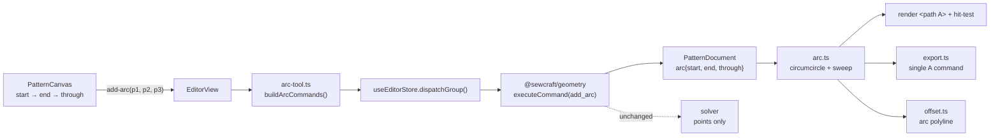

# Arc sketching (arc tool)

Status: implemented — Q1 (three-point arc) and Q2 (a separate `arc` kind) resolved as recommended
Refs #53
Related: 002 (geometry core primitives), 005 (canvas editor interactions), 008 (SVG
export), 2026-10-20-corner-rounding-tool (derived Bézier arcs), 2026-10-21-circle-sketching (#52)

## 📝 TLDR

The sketch model has no arc: a curved edge is either a cubic Bézier or, for a
rounded corner, a derived Bézier arc. "Sketch an arc" therefore has no direct
representation, no radius and no way to select or export a true circular arc.
Proposed future behaviour: an **Arc** tool where the user clicks a start point, an
end point and then a point on the arc (the bulge); the arc is stored as an `arc`
entity referencing those three points, and its circle, radius, angles and SVG arc
are all derived. The three points remain ordinary solver variables, so no solver
change is required.

## 📝 Problem Statement

- **Who needs it:** the maker sketching a curved seam — a scoop pocket, a princess
  seam, a curved waistband — who needs a real circular arc rather than a hand-tuned
  Bézier, and the agent authoring commands that should express "arc through these
  three points".
- **What happens today:** `Entity` is `point | line | curve`
  (`packages/geometry/src/types.ts:20-45`). The Curve tool requires four existing
  points and produces a cubic Bézier: smooth, but not circular, with no radius and
  no way to say "this arc has radius 80 mm". A rounded corner produces a derived
  Bézier arc that the user cannot draft independently
  (`.ai/specs/2026-10-20-corner-rounding-tool.md:27,55`), and that spec records
  "arcs and tangency" as future work.
- **Evidence it matters:** issue #53 asks for arc sketching. The corner-round spec
  had to add a Bézier workaround for the same missing primitive, and its Option B
  ("first-class `ArcEntity` plus tangency constraints") was deferred explicitly.
- **Constraints:** commands are the only mutation path (`AGENTS.md`, rule 1);
  points are the only solver variables (`types.ts:8-11`); units are millimetres in
  a y-down coordinate space (the canvas maps world y straight to screen y,
  `frontend/src/lib/viewport.ts:26-31`), and SVG export is true-to-scale
  (`packages/geometry/src/export.ts:135-200`).
- **Why this is ambiguous:** "sketch an arc" can mean a three-point arc, a
  centre/start/end arc, or a smoothed Bezier. The options below are the brainstorm
  output; Q1 is the product call this spec cannot make for the maintainer.

## 📝 Proposed Solution

### Options considered

| #   | Option                                                                                                                                                                     | Trade-offs                                                                                                                                                                                                                                                                                                            | Verdict                                                                                                                     |
| --- | -------------------------------------------------------------------------------------------------------------------------------------------------------------------------- | --------------------------------------------------------------------------------------------------------------------------------------------------------------------------------------------------------------------------------------------------------------------------------------------------------------------- | --------------------------------------------------------------------------------------------------------------------------- |
| A   | **Three-point arc**: `start`, `end` and a `through` point on the arc; the circle, centre, radius and angles are derived                                                                               | No invariant to maintain, so constraints on the three points keep the arc valid automatically; the gesture is a sketch-first start→end→bulge; exact circular geometry for rendering/export. Cost: radius and centre are derived, so radius dimensioning and direct radius editing need a derived centre (deferred); near-collinear points give a huge radius                                                 | **Recommended**                                                                                                             |
| B   | **Centre + start + end** with an automatically created `equal` constraint between `(centre,start)` and `(centre,end)`, plus a sweep flag                                                     | Radius is the centre→start distance, so a radius dimension is natural and the radius is directly draggable; the arc is circular by construction. Cost: the tool creates an implicit constraint the user did not ask for, deleting/moving points needs cleanup rules, the sweep flag is a second source of direction, and the arc can flip when the centre is dragged through the chord | Viable later; heavier than the issue asks for                                                                                |
| C   | **Bake to a cubic Bézier** (`CurveEntity`), computed from the three clicks                                                                                                  | Reuses every consumer with no new kind; ships fastest and is good enough for a cut edge (corner-round precedent). Cost: not circular, no radius, no arc-aware dimension, export approximates, and the user cannot tell an arc from a curve afterwards                                       | Rejected — it is the workaround the corner-round spec already had to accept, not a fix for the primitive                     |
| D   | **Full circle/arc primitive shared with #52**, where an arc is a circle with start/end angles                                                                                | One entity family, one renderer and one selection path; arcs become a natural extension of circles. Cost: couples the two PRs, needs a partial-sweep representation and a closed-flag distinction, and the circle spec must land first                                  | Rejected as the default; this is Q2 and can supersede Option A if the maintainer prefers one primitive                        |
| E   | **Build nothing**; keep using four-point Bézier curves                                                                                                                      | No new surface; the gap stays, radius-based drafting stays impossible, and #52/#53 both inherit the workaround                                                                                                                                                     | Rejected — the existing workaround is exactly what makes arcs and circles hard today                                          |

### Behaviour

1. **Tool.** A new `add_arc` entry in the Sketching ribbon group next to Curve and
   Circle. It stays active after committing an arc and is cancelled by Escape, a
   tool change or a document load.
2. **Clicks.** Click 1 is `start`, click 2 is `end`, click 3 is `through` — a point
   on the arc between them. Each click resolves like the Line tool: an existing
   point under the pointer is reused by id, otherwise the snapped world position
   becomes a provisional point.
3. **Preview.** After click 2 the canvas shows a dashed arc from `start` to `end`
   through the snapped pointer; before click 2 it shows the straight chord. The
   preview uses the same `arcGeometry` as the committed entity, so what is shown is
   what is stored.
4. **Commit.** The gesture emits one `add-arc` event with three endpoints; the
   editor builds `add_point` commands for new endpoints followed by one `add_arc`,
   applied as **one journal entry**. One undo removes the arc and the points it
   created.
5. **Guards.** A third click collinear with `start` and `end` (sagitta below
   `MIN_BULGE`, 0.001 mm) is ignored and the tool shows the hint "pick a point off
   the line". A repeated click on the same point, or `start === end`, is likewise
   ignored; no command is sent.
6. **Selection.** The arc is one entity selected by its **stroke**; the start,
   end and through points remain independently selectable points.
7. **Properties.** Kind "Arc" plus read-only derived **Radius**, **Included angle**
   and **Arc length** in millimetres/degrees. Direct radius editing is out of scope
   in v1 (see Resolved assumptions R6).
8. **Construction.** Cut geometry by default; the existing `set_construction` makes
   it a dashed guide excluded from cut edges and export.
9. **Seam allowances.** Allowed: the arc flattens to a polyline with the same
   segment convention as curves, so the existing offset path works and the seam
   side follows the start→end direction. This deliberately differs from rounded
   corners, which reject seams because the round is regenerated, not because an
   arc cannot be offset.
10. **Constraints.** No new constraint type and no tangency in v1. Existing
    constraints on the three points move the arc; the arc itself is never a solver
    variable.

### Why three points

The three points *are* the arc, so there is nothing to keep consistent: no radius
to reconcile with endpoints, no implicit constraint, no sweep flag that can
disagree with the geometry. That fits the project's rule that points are the only
solver variables, and it gives the sketch-first gesture the issue asks for. The
price is that the radius is derived, which is why radius editing and a radius
dimension belong to a follow-up that can introduce a derived centre point (the
corner-round feature already establishes derived points as a pattern).

## 📝 Architecture



Takeaway: the arc is a reference-based entity, the circular maths lives in one
pure module, and the solver, undo, selection and offset pipelines keep their
current shape.

### New files

- `packages/geometry/src/arc.ts` — pure circular-arc maths:
  ```ts
  export interface ArcGeometry {
    center: Vec2;
    radius: number;
    /** Angles in radians, measured in the document's y-down frame. */
    startAngle: number;
    endAngle: number;
    /** Signed swept angle; negative means the arc runs the other way. */
    sweep: number;
    largeArc: boolean;
  }
  /** The circle through start/end/through, or null when the points are (near) collinear. */
  export function arcGeometry(
    document: PatternDocument,
    arc: ArcEntity,
  ): ArcGeometry | null;
  /** Flattened points from start to end, including both endpoints. */
  export function arcPoints(geometry: ArcGeometry, start: Vec2, end: Vec2, segments?: number): Vec2[];
  /** SVG arc parameters for a `path` `A` command. */
  export function svgArcCommand(geometry: ArcGeometry, start: Vec2, end: Vec2): string;
  export const MIN_BULGE = 0.001;
  ```
- `frontend/src/lib/arc-tool.ts` — three-click gesture helper mirroring
  `line-tool.ts`: resolve endpoints, reject a collinear third point, and build the
  command batch.
- `frontend/src/lib/drafting.ts` — the small shared endpoint resolver extracted
  from `line-tool.ts` (`resolveDraftingEndpoint`, `sameDraftingEndpoint`) so Line,
  Circle and Arc do not each reimplement snapping and point reuse.

### Edited modules

- `packages/geometry/src/types.ts` — `ArcEntity`, widen `Entity`.
- `packages/geometry/src/document.ts` — `entityPoints` (`:91`) returns
  `[start, through, end]`; `cutEdges` (`:61`) widened; `bounds` (`:114`) includes
  arc extrema, not just the three points.
- `packages/geometry/src/commands.ts` — command union/dispatch (`:256`),
  `applyAddArc` next to `applyAddCurve` (`:506`), validation, and seam-allowance
  handling for arcs in `applyAddSeamAllowance` (`:977`).
- `packages/geometry/src/selection.ts` — `entitiesInRect` (`:129`) uses the arc's
  bounding box (conservative window/crossing semantics, like curves use their hull).
- `packages/geometry/src/export.ts` — one `<path d="M … A …">` per arc with
  `data-entity-id`/`data-kind`, honouring the construction flag (`:96`).
- `packages/geometry/src/offset.ts` — `edgePolyline` (`:265`) flattens arcs via
  `arcPoints`, so seams work; circles stay unsupported.
- `frontend/src/lib/editor-tools.ts`, `editor-ribbon.ts`, `ribbon-icons.ts` — tool,
  group entry and glyph.
- `frontend/src/components/PatternCanvas.vue` — three-click state machine, preview,
  hit target (`data-kind="arc"`), test ids.
- `frontend/src/views/EditorView.vue` — `onAddArc` through `dispatchGroup`.
- `frontend/src/lib/entity-properties.ts`, `frontend/src/components/EntityPropertiesPanel.vue`
  — arc geometry, "Arc" noun, read-only radius/angle/length.
- `frontend/src/lib/line-tool.ts` and the new `circle-tool.ts` — switch to the
  extracted endpoint resolver (no behaviour change).
- `config/geometry.php`, `docs/domain/command-spec.md`,
  `docs/domain/command-spec.json`, `docs/architecture/data-model.md`,
  `docs/architecture/geometry-core.md` — contract and geometry-doc sync.

## 📝 Data Model

```ts
export interface ArcEntity {
  id: EntityId;
  kind: 'arc';
  /** Start of the arc, in traversal order. */
  start: EntityId;
  /** End of the arc, in traversal order. */
  end: EntityId;
  /** A point on the arc between start and end; fixes the bulge and the sweep. */
  through: EntityId;
  construction: boolean;
}
```

- **Derived:** circumcentre, radius, start/end angles, signed sweep, large-arc flag,
  arc length and bounding box. All recomputed on read; none stored.
- **Invariant:** `start`, `end`, `through` are three distinct points, not collinear
  within `MIN_BULGE`. Creation validates it; later constraint solves can break it,
  and consumers degrade (see Edge Cases).
- **Schema:** `PatternDocument.schema` stays `sewcraft.pattern/0.1`; the change is
  additive to `entities[]`, and older documents load unchanged. A pre-feature build
  loads a document containing arcs but silently drops them from render/export
  (unknown kind resolves to `null`); the JSON survives.
- **No migration:** JSON in `patterns.geometry`; no database change.
- **Sensitive data:** none.

## 📝 API Contracts

One new command in the existing envelope:

### `add_arc`

Create a circular arc through three existing points. `construction` defaults to
`false`.

- params: `start: entity_id`, `end: entity_id`, `through: entity_id`,
  `construction?: bool`
- validation: all three ids resolve to distinct, non-derived points; `start ≠ end`;
  `through` is at least `MIN_BULGE` (0.001 mm) off the start→end chord; re-applying
  a command whose id already exists is a no-op.
- inverse: `delete_entity`.
- `spec_version` bumps `0.7.0 → 0.8.0` (rebase to `0.9.0` if #52's circle command
  lands first). Additive: no existing command or param changes. All three
  command-spec files are updated in the same PR.
- No HTTP route change; `GET /api/commands` picks the entry up from config.

## 📝 UI/UX

- **Cursor:** crosshair while the Arc tool is active, as for Line and Curve.
- **Click feedback:** after click 1 a provisional start marker and a rubber-band
  chord; after click 2 the dashed arc preview follows the pointer, drawn from
  `arcGeometry` so the committed result matches exactly.
- **Hint:** a collinear or repeated third click is ignored and a canvas-local
  status overlay (`role="status"`, test id `arc-hint`) shows "pick a point off the
  line" until the pointer leaves the chord.
- **Commit feedback:** arc and any new points appear together; the tool stays
  active; the pending state clears.
- **Selected state:** primary-colour stroke, thickened; construction arcs dashed and
  muted.
- **Hit area:** the arc's stroke only (`fill="none"`), so the region between the
  arc and its chord stays free for drawing.
- **Properties:** kind "Arc"; read-only Radius (mm), Included angle (degrees) and Arc
  length (mm); shared constraint section. No seam section change — seams are
  supported and edited exactly like a curve's.
- **Accessibility:** pointer-driven like the existing tools; the preview is
  `aria-hidden`; the committed arc is exposed through the selection summary and
  properties panel.
- **Test ids:** `arc-pending-start`, `arc-pending-end`, `arc-preview`, `arc-hint`.
- **No mockup:** three-click canvas interaction plus read-only derived values; a
  static image would not prove the gesture, the preview or the collinear guard.

## 📝 Edge Cases & Failure Scenarios

| Scenario                                              | Expected behaviour                                                                                                                     |
| ----------------------------------------------------- | -------------------------------------------------------------------------------------------------------------------------------------- |
| Third click collinear with start and end              | Ignored, no command, hint "pick a point off the line"; the pending start/end stay                                                      |
| Third click within `MIN_BULGE` but not exactly on it   | Same rejection — a 0.001 mm sagitta is below drafting tolerance                                                                        |
| Shallow but valid arc                                 | Accepted; radius can be very large, which is correct geometry and exports as a huge `A` radius                                         |
| Start and end on the same point                      | Ignored; no zero-length arc                                                                                                            |
| Reusing existing points for all three clicks         | One `add_arc`, no new points                                                                                                           |
| New points mixed with reused points                  | `add_point` for each new id, then `add_arc`; one undo                                                                                  |
| Escape / tool change / document load mid-gesture      | Pending clicks and preview clear; nothing written                                                                                      |
| Undo after commit                                     | One undo removes the arc and every point it created                                                                                    |
| Redo                                                  | The batch replays in order; ids still resolve                                                                                          |
| Constraints later make the three points collinear     | The arc becomes invalid: render, export and bounds skip it, properties shows an "invalid — points are collinear" state, no crash        |
| Start/end angle crosses the ±π seam                   | Sweep and large-arc flags are computed from the signed swept angle, so the rendered arc is the one passing through `through`           |
| A referenced point is deleted                         | `delete_entity` keeps today's behaviour: constraints on the point cascade, the arc stays and is skipped by render/export/bounds         |
| Seam allowance on an arc                              | Allowed; the offset follows the flattened arc and the side follows start→end                                                           |
| Seam allowance on a circle                            | Still rejected (no direction for a closed loop) — unchanged by this spec                                                               |
| Marquee window / crossing                             | Window selects the arc only when its bounding box is inside; crossing when the box overlaps (conservative, like curves)                 |
| Fit view / SVG export                                 | Extents include the arc's cardinal points inside the sweep, not just start/end/through                                                 |
| Arc spanning nearly a full circle                     | Valid while start ≠ end; `largeArc=1` with the matching sweep renders the long way round                                               |
| Old build opens a document containing an arc          | The document loads and keeps the entity; that build's render/export silently omit it                                                  |
| Circle tool (if #52 lands)                            | Unaffected; shared endpoint resolution only, no entity coupling                                                                        |

## 📝 Risks & Impact Review

- **New entity kind and derived maths (medium).** `Entity` is a closed union used by
  exhaustive switches; a missed branch is a silent omission or crash. The circular
  maths (circumcentre, y-down sweep sign, large-arc boundary) is the kind of code
  that looks right and renders the wrong half of a circle. Mitigation: one pure
  `arc.ts` with tests for the four quadrants, sweep signs, the ±π seam, a large arc
  and collinearity; a golden SVG assertion for a known arc.
- **Invalid state after solving (medium).** Constraints can flatten the three
  points, and the command layer cannot prevent that (the arc is not a constraint).
  Every consumer must treat `arcGeometry === null` as "skip", never as "throw"; the
  properties panel needs the explicit invalid state.
- **Bounding-box maths (medium).** `bounds()` is derived from points
  (`document.ts:114`); arc extrema extend beyond them, so a naive implementation
  clips export and "fit". Tests must cover an arc whose cardinal point is outside
  the three points.
- **Shared endpoint helper refactor (low).** Extracting `resolveDraftingEndpoint`
  touches the Line tool, which is already shipped. It is a pure move with the
  existing tests kept green; the refactor earns its place by preventing a third copy.
- **Compatibility (low).** A pre-feature build silently omits arcs from render and
  export while preserving the JSON; no migration is needed and no stored document
  contains arcs yet.
- **Scope creep risk (low–medium).** Radius dimensions, tangency and centre-based
  arcs are deliberately deferred. Adding any of them now turns this into a solver
  design; they are named follow-ups rather than silent omissions.
- **No contract removal.** Command envelope, routes, solver signatures and schema
  strings are unchanged apart from the additive command and entity kind.

## ❓ Open Questions

Asked on issue #53. These decide the representation and the shared primitive; the
draft is reviewable with the recommendations, but implementation should wait for
Q1.

| #   | Question                                                                                                                                                                                                                       | Why it matters                                                                                                                                                                                                                                                                  | Recommended answer                                                                                                                                                          |
| --- | ------------------------------------------------------------------------------------------------------------------------------------------------------------------------------------------------------------------------------ | ------------------------------------------------------------------------------------------------------------------------------------------------------------------------------------------------------------------------------------------------------------------------------- | --------------------------------------------------------------------------------------------------------------------------------------------------------------------------- |
| Q1  | **Representation:** three-point arc (`start`, `end`, `through`, everything derived — Option A), centre/start/end with an implicit equal-distance constraint (Option B), or baked Bézier curves (Option C)?                      | It sets the data model, the number of points an arc owns, whether the tool creates hidden constraints, and whether a radius can be dimensioned or edited later. A wrong call here is a schema and gesture rewrite, not a tweak.                                                  | **Option A.** No invariant to break, no implicit constraints, fully parametric under the point-only solver, and exact circular export. Radius editing becomes a follow-up with a derived centre. |
| Q2  | **Entity family:** an `arc` kind of its own, or one circular primitive shared with #52 (for example a `circular` entity with a closed flag, or an arc whose endpoints may coincide)?                                              | The same decision is asked on #52. One family shares rendering/selection and makes the two issues one design; two kinds let each ship independently but duplicate a small amount of maths and hit-testing.                                                                       | **Two kinds** (`arc` here, `circle` from #52) sharing arc/circle maths. If the maintainer prefers one primitive, this spec should be rebased on the circle design and its phasing reduced. |

## ✅ Resolved assumptions (autonomous defaults)

| #   | Assumption                                                                                                       | Why                                                                                                          | Status     |
| --- | ---------------------------------------------------------------------------------------------------------------- | ------------------------------------------------------------------------------------------------------------ | ---------- |
| R1  | The arc stores three point references; centre, radius, angles and extents are always derived                      | Keeps points as the only solver variables and avoids a second source of truth                                | Reversible |
| R2  | One additive `add_arc` command `{ start, end, through, construction? }`, idempotent, inverse `delete_entity`      | Matches `add_line`/`add_curve` and the command-core rule                                                     | Reversible |
| R3  | Points plus arc commit as one grouped batch, one undo                                                             | Same gesture model as the Line tool; an abandoned gesture leaves nothing                                    | Reversible |
| R4  | Click order is start → end → through                                                                              | The arc preview needs both endpoints before the bulge can be shown                                           | Reversible |
| R5  | Arcs are cut geometry by default and toggle with the existing `set_construction`                                   | Consistent with lines and curves                                                                             | Reversible |
| R6  | Radius editing and radius/diameter dimensions are deferred; properties shows derived values read-only            | Radius needs a derived centre and likely a `radius` constraint — a solver design, not a gesture detail       | Reversible |
| R7  | No tangency or arc-aware constraints in v1; no new constraint type                                                | Tangency is a solver project on its own; the issue asks for sketching                                        | Reversible |
| R8  | Seam allowances are allowed on arcs via polyline flattening; side follows start→end                                | The existing offset path already works on polylines; an arc has a direction, unlike a closed circle          | Reversible |
| R9  | Creation rejects a sagitta below `MIN_BULGE` (0.001 mm); later invalid arcs are skipped by consumers              | Unit-consistent guard against infinite radii; constraints cannot be blocked, so consumers must degrade       | Reversible |
| R10 | `spec_version` bumps the current minor by one (`0.7.0 → 0.8.0` today; rebase if #52 lands first)                  | Additive command, no breaking change; only one bump at a time                                                | Reversible |
| R11 | SVG export uses one `A` command; bounds include arc extrema                                                       | True-to-scale export and correct fit view                                                                    | Reversible |
| R12 | The endpoint resolver is extracted from `line-tool.ts` into a shared helper                                       | Prevents a third copy across Line, Circle and Arc; pure move covered by existing tests                       | Reversible |
| R13 | No mockup or screenshot is committed                                                                              | Canvas gesture plus derived read-only values; a static image would not clarify the design                    | Reversible |

## 📋 Phasing

- **Phase 1 — geometry core.** `ArcEntity`, entity union, `arc.ts` maths,
  `add_arc` validation/inverse, bounds, `cutEdges`, selection, export and offset
  flattening, with tests for sweep signs, the ±π seam, large arcs, collinearity and
  extents.
- **Phase 2 — command contract.** Three command-spec files, data-model doc,
  geometry-core doc, `spec_version` bump and backend test.
- **Phase 3 — canvas interaction.** Tool/ribbon/glyph, shared endpoint resolver,
  three-click state machine, preview, collinear guard and hint, grouped commit,
  component tests.
- **Phase 4 — properties and verification.** Read-only derived values, invalid-arc
  state, view tests, and a manual pass in the running app.

## 📋 Implementation Plan

### Phase 1 — Geometry core

1. Add `ArcEntity` and widen `Entity`; `entityPoints` returns `[start, through, end]`.
2. Add `arc.ts`: circumcentre from the perpendicular bisectors, signed sweep and
   large-arc flag from the through point, `arcPoints`, `svgArcCommand`, `MIN_BULGE`;
   tests for each quadrant, both sweep directions, the ±π seam, a large arc, a
   shallow arc, collinear and coincident points.
3. Add `add_arc` to the union, dispatch and `applyAddArc`: distinct drafting points,
   non-collinear, idempotent re-apply, `delete_entity` inverse; delete a referenced
   point and confirm consumers skip the arc.
4. Extend `bounds` with cardinal points inside the sweep; widen `cutEdges`; add arc
   handling to `entitiesInRect` (bounding box) and `edgePolyline` (flattening); tests
   for each, including a cardinal point outside the three points.
5. Render one `<path A>` with `data-entity-id`/`data-kind` in the cut or construction
   layer; export tests assert the `A` command, the large-arc/sweep flags and the
   skipped invalid arc.

### Phase 2 — Command contract

1. Add the command to `config/geometry.php`, bump `spec_version`, and mirror it in
   `docs/domain/command-spec.json` and `docs/domain/command-spec.md`.
2. Document `arc` in `docs/architecture/data-model.md` and the sweep convention in
   `docs/architecture/geometry-core.md`; add the backend `GET /api/commands` test.

### Phase 3 — Canvas interaction

1. Extract the shared endpoint resolver from `line-tool.ts` into
   `frontend/src/lib/drafting.ts`; keep the Line tests green and reuse it in the new
   `arc-tool.ts`.
2. Add `arc-tool.ts` with endpoint resolution, the collinearity guard and
   `buildArcCommands`; unit tests for every click combination and the degenerate
   cases.
3. Add the tool to `editor-tools.ts`, the Sketching ribbon group and the icon map.
4. Wire the canvas state machine: pending start/end, chord then arc preview, hint on
   a collinear click, commit through `add-arc`, cancellation, hit target; component
   tests including the stroke-only hit area and test ids.

### Phase 4 — Properties and verification

1. Extend `entity-properties.ts` and `EntityPropertiesPanel.vue` with the arc
   geometry, "Arc" noun, read-only radius/angle/length, and the invalid-arc state.
2. Wire `EditorView.onAddArc` through `dispatchGroup`; view tests assert one journal
   entry and one-step undo.
3. Run `npm run format`, `npm run typecheck`, `npm run lint`,
   `npm run format:check`, `npm run test:coverage` (100 % for `packages/geometry/src`
   and `frontend/src`), `npm run build`, and the backend coverage command from
   `AGENTS.md`.
4. In the running app: draw arcs in all four orientations, a shallow arc and a nearly
   full arc; verify the preview matches the commit, the collinear hint, seam
   allowance, fit view, SVG export and one-step undo; then constrain the three points
   into collinearity and confirm the arc degrades without errors.
