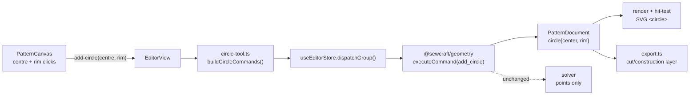

# Circle sketching (circle tool)

Status: draft — design review; Q1–Q2 open
Refs #52
Related: 002 (geometry core primitives), 005 (canvas editor interactions), 008 (SVG
export), 2026-10-20-line-tool-point-creation (grouped gesture), 2026-10-21-arc-sketching (#53)

## 📝 TLDR

Today the sketch model has only points, line segments and cubic Bézier curves, so a
circle can be drawn only as four hand-placed curves and is never a circle: it has
no radius, no single selectable edge and no true SVG export. Proposed future
behaviour: a **Circle** tool where the first click sets the centre and the second
sets the radius; the circle is stored as a `circle` entity that references those
two points, its radius is the distance between them, and it renders and exports as
a true circle. Points stay the only solver variables, so no solver or constraint
change is needed.

## 📝 Problem Statement

- **Who needs it:** the solo maker sketching a pattern who needs round features —
  a circular pocket, a drill/marking hole, a curved yoke reference — and the agent
  authoring commands that should be able to express "a circle of radius R at C"
  without approximating it as four curves.
- **What happens today:** `Entity` is `point | line | curve`
  (`packages/geometry/src/types.ts:20-45`). The only way to make a circle is four
  `add_curve` entities sharing eight points placed by hand; the result is
  approximate, has four selectable edges, no radius value, and a seam allowance or
  dimension sees four unrelated curves. The Curve tool additionally requires four
  existing points, so a circle costs twelve clicks.
- **Evidence it matters:** issue #52 asks for exactly this capability. The
  corner-round spec had to introduce a Bézier arc precisely because no circular
  primitive exists (`.ai/specs/2026-10-20-corner-rounding-tool.md:27,55`), and it
  records "arcs and tangency" as future work — the same gap #53 names for arcs.
- **Constraints:** commands are the only mutation path (`AGENTS.md`, rule 1);
  points are the only solver variables (`types.ts:8-11`); SVG export is layer-based
  and true-to-scale in millimetres (`packages/geometry/src/export.ts:135-200`).
- **Why now:** circles are the smallest circular primitive and the natural first
  step before arcs (#53); the shared math and the entity-family decision are easier
  to settle once.

## 📝 Proposed Solution

### Options considered

| #   | Option                                                                                                                                                                                          | Trade-offs                                                                                                                                                                                                                                                                                     | Verdict                                                                                                                            |
| --- | ----------------------------------------------------------------------------------------------------------------------------------------------------------------------------------------------- | ---------------------------------------------------------------------------------------------------------------------------------------------------------------------------------------------------------------------------------------------------------------------------------------------- | ---------------------------------------------------------------------------------------------------------------------------------- |
| A   | **Circle entity referencing a centre point and a rim point**; radius derived as their distance                                                                                                  | Radius is a real geometric quantity but stays a *consequence* of point positions, so the existing solver, dimension tool, drag and undo paths work unchanged; one new entity kind and one additive command; radius editing needs one small rule (move the rim point). Cost: new kind touches every exhaustive `entity.kind` switch | **Recommended**                                                                                                                    |
| B   | **Circle entity storing `{ center, radius }`** where radius is a number                                                                                                                          | Simplest data and direct radius editing; but the solver only moves points, so the radius becomes a static value that cannot be driven by a dimension or kept consistent when other constraints move the centre. Would need a new solver variable type and a `radius` constraint — a solver redesign | Rejected for v1; the natural follow-up once the solver supports scalar variables                                            |
| C   | **Four cubic Bézier curves** (no new entity kind), generated by a wizard                                                                                                                        | Reuses renderer, exporter, selection and commands unchanged and ships fastest; but the shape is approximate (~0.027 % error, as corner-round documents), it is four edges for selection/seams/dimensions, radius edits must regenerate eight points, and it still cannot be exported as a `<circle>` | Rejected as the default; this is today's manual workflow, merely automated                                                          |
| D   | **A circle as a closed curve entity** (`CurveEntity` with a `closed` flag, four Béziers under the hood)                                                                                          | One new flag instead of a kind, approximate like C, but every consumer of `p0..p3` must learn what `closed` means and a closed cubic cannot express a true radius                                                                                                                                | Rejected — a flag that changes curve meaning is harder to reason about than a kind                                                 |
| E   | **Build nothing**; keep drawing circles with the Curve tool                                                                                                                                    | No new surface; the gap stays, and every future circular feature (arcs, circular seams, radius dimensions) inherits the workaround                                                                                                                       | Rejected — the issue and #53 both depend on a circular primitive                                                                   |

### Behaviour

1. **Tool.** A new `add_circle` entry in the Sketching ribbon group, between Curve
   and Dimension. It behaves like the Line tool: it stays active after a commit
   and is cancelled by Escape, a tool change or a document load.
2. **First click — centre.** Snapping follows the Line tool's resolution: an
   existing point under the pointer is reused by id; otherwise the snapped world
   position becomes a provisional centre (grid or nearby-point snap, as
   `frontend/src/lib/snap.ts` already does).
3. **Second click — radius.** The second click resolves the rim point the same way.
   The radius is `|rim − centre|`, so the circle follows the pointer between the
   clicks as a dashed preview.
4. **Commit.** The gesture emits one `add-circle` event; the editor builds
   `add_point` commands for any new endpoints followed by one `add_circle`, and
   applies the batch as **one journal entry** (the grouped dispatch added for the
   Line tool). One undo removes the circle and every point it created.
5. **Guards.** A second click at the centre, or within `MIN_RADIUS` (0.001 mm) of
   it, is ignored — no zero-radius circle and no command. A repeated click on the
   same existing point is likewise ignored.
6. **Selection.** The circle is one entity. Clicking its **stroke** selects it;
   clicking inside the disk selects nothing, so the interior stays free for
   drawing and marquee work. The centre and rim points remain independently
   selectable points (they are document entities).
7. **Properties.** The panel shows kind "Circle" plus a derived **Radius** value.
   In v1 the radius field is editable: a new value moves the rim point along the
   current centre→rim direction with one `move_point` (when a driving distance
   dimension exists between the two points, that dimension's value is updated
   instead so the solver stays authoritative). Radius and the two point
   references are the only new fields.
8. **Dimensions.** No new constraint type. The existing Dimension tool measures
   centre→rim like any point pair, so a user can pin the radius with an ordinary
   `distance` dimension (driving or driven).
9. **Construction.** A circle is cut geometry by default and can be toggled with
   the existing `set_construction`; construction circles render dashed and are
   excluded from cut/export like construction lines.
10. **Seam allowances.** Not supported on circles in v1: `add_seam_allowance`
    rejects a circle with a clear message (same precedent as rounded corners,
    `packages/geometry/src/commands.ts:1002-1007`). Offsetting a circle is a real
    algorithm decision, not a flag.

### Why a centre plus a rim point

The rim point is not decoration: it keeps the radius inside the existing model.
Every value the solver knows is a point coordinate, so `radius = |rim − centre|`
is automatically parametric — dragging either point, or a constraint moving them,
updates the circle with no new solver code. It also gives the radius an ordinary
`distance` dimension, which means the Dimension tool, the driven/set/reference
dimension rules and the properties panel all work without a special case. The cost
is that a circle is not a single scalar variable, which is exactly the trade-off
Option B defers.

## 📝 Architecture



Takeaway: the only new data is a reference-based entity; solving, undo and
exporting reuse the existing pipeline, and the radius is never stored.

### New files

- `packages/geometry/src/circle.ts` — pure helpers:
  ```ts
  export interface CircleGeometry {
    center: Vec2;
    rim: Vec2;
    radius: number;
  }
  /** The circle's centre, rim point and radius, or null when a reference or radius is invalid. */
  export function circleGeometry(
    document: PatternDocument,
    circle: CircleEntity,
  ): CircleGeometry | null;
  /** A closed polyline approximation for export-free consumers (offset, tests). */
  export function circlePoints(center: Vec2, radius: number, segments?: number): Vec2[];
  export const MIN_RADIUS = 0.001;
  ```
- `frontend/src/lib/circle-tool.ts` — pure gesture helper, mirroring
  `line-tool.ts`: resolve centre/rim endpoints (reusing the existing point,
  otherwise a snapped coordinate), reject a degenerate radius, and build the
  command batch (`add_point` first, then `add_circle`).

### Edited modules

Every exhaustive `entity.kind` switch must handle `circle`; TypeScript will point
at each one:

- `packages/geometry/src/types.ts` — `CircleEntity`, widen `Entity`.
- `packages/geometry/src/document.ts` — `entityPoints` (`:91`), `cutEdges`
  (`:61`, return type widened to `(Line | Curve | Circle)[]`), `bounds` (`:114`,
  circle extents).
- `packages/geometry/src/commands.ts` — `add_circle` in the command union and
  dispatch (`:256`), `applyAddCircle` next to `applyAddCurve` (`:506`), and an
  explicit circle rejection in `applyAddSeamAllowance` (`:977`).
- `packages/geometry/src/selection.ts` — `entitiesInRect` (`:129`): a circle is
  inside a window rect when its **bounding box** is contained; crossing keeps
  overlap semantics against that box.
- `packages/geometry/src/export.ts` — a `<circle cx cy r>` element in
  `renderEntities` (`:96`) with `data-entity-id`/`data-kind`, honouring the
  construction flag.
- `packages/geometry/src/offset.ts` — `edgePolyline` (`:265`) must not treat a
  circle as a curve; it returns `null` for a circle in v1.
- `frontend/src/lib/editor-tools.ts`, `editor-ribbon.ts`, `ribbon-icons.ts` — tool,
  group and glyph.
- `frontend/src/components/PatternCanvas.vue` — tool state machine, preview,
  hit target (`data-kind="circle"`), test ids.
- `frontend/src/views/EditorView.vue` — `onAddCircle` wiring through
  `dispatchGroup`.
- `frontend/src/lib/entity-properties.ts`, `frontend/src/components/EntityPropertiesPanel.vue`
  — geometry variant, `KIND_NOUNS` entry, radius field.
- `config/geometry.php`, `docs/domain/command-spec.md`,
  `docs/domain/command-spec.json`, `docs/architecture/data-model.md` — contract
  sync for the new entity kind and command.

## 📝 Data Model

```ts
export interface CircleEntity {
  id: EntityId;
  kind: 'circle';
  /** Centre point; a normal solver variable. */
  center: EntityId;
  /** A point on the circumference; its distance from the centre is the radius. */
  rim: EntityId;
  construction: boolean;
}
```

- **Derived:** radius `|P_rim − P_center|`, bounding box `center ± radius`.
- **Not stored:** radius, angles, circumference — storing them alongside movable
  points would give the document two sources of truth.
- **Schema:** `PatternDocument.schema` stays `sewcraft.pattern/0.1`; the change is
  additive to `entities[]`, and older documents load unchanged. A document
  *containing* a circle is still loadable by an older build, but that build's
  renderer/export silently drop the unknown entity (it falls through the curve
  branch and resolves to `null`); the JSON is preserved, so nothing is lost.
- **No migration:** `patterns.geometry` is JSON; no database column changes.
- **Sensitive data:** none.

## 📝 API Contracts

`POST` command batches accept one new command (name and envelope are the existing
`{ id, type, params, issuedAt? }`):

### `add_circle`

Create a circle from two existing points. `construction` defaults to `false`.

- params: `center: entity_id`, `rim: entity_id`, `construction?: bool`
- validation: both ids resolve to points; they are distinct and not corner-round
  derived points; `center ≠ rim` and `|rim − center| ≥ MIN_RADIUS` (0.001 mm);
  re-applying a command whose id already exists is a no-op.
- inverse: `delete_entity`.
- `spec_version` in `config/geometry.php` bumps `0.7.0 → 0.8.0`; the command is
  additive, so no existing command or param changes. The three command-spec files
  and the data-model doc are updated in the same PR.
- No HTTP route change; `GET /api/commands` picks the new entry up from config.

## 📝 UI/UX

- **Cursor:** crosshair while the Circle tool is active, as for Line and Curve.
- **Preview:** from the first click, a dashed circle centred on the pending centre
  with radius to the snapped pointer, in the muted foreground colour and
  `pointer-events-none`. No document write until the second click.
- **Commit feedback:** circle, centre and rim appear together; the tool stays
  active; the pending state clears.
- **Selected state:** the circle uses the existing primary-colour stroke and
  thickened width; construction circles render dashed/muted.
- **Hit area:** the circle's stroke only (the SVG element is `fill="none"`), so a
  click in the interior neither selects nor blocks drawing inside the circle.
- **Properties:** kind label "Circle", derived **Radius** in millimetres with the
  same field precision as other numeric fields, and the shared seam/constraint
  sections where they apply (no seam section for circles in v1).
- **Accessibility:** the flow is pointer-driven like the existing tools; the
  preview is `aria-hidden`; the committed entity is exposed through the same
  selection summary and properties panel as other entities.
- **Test ids:** `circle-pending-center`, `circle-preview`.
- **No mockup:** this is canvas interaction and one numeric field, not a new
  screen or layout; a static image would not prove the gesture or the
  stroke-only hit area. The states above are the reviewable description.

## 📝 Edge Cases & Failure Scenarios

| Scenario                                             | Expected behaviour                                                                                                                            |
| ---------------------------------------------------- | --------------------------------------------------------------------------------------------------------------------------------------------- |
| Second click on the centre, or within 0.001 mm of it | Ignored; preview stays, no command, no zero-radius circle                                                                                     |
| Both clicks on existing points                       | One `add_circle`, no new points                                                                                                               |
| First click empty, second on an existing point       | `add_point` for the centre + `add_circle`; one undo                                                                                           |
| Click near an existing point inside snap tolerance   | Existing point reused; no duplicate coincident point                                                                                          |
| Escape / tool change / document load mid-gesture     | Pending centre and preview clear; nothing written                                                                                             |
| Undo after commit                                    | One undo removes the circle and every point created by the gesture                                                                            |
| Redo                                                 | The batch is replayed in order; the circle's ids still resolve                                                                                |
| Rim dragged onto the centre                          | The circle degenerates to radius 0: render and export skip it, properties shows `0`; no crash. A drag that leaves the document is still one undo |
| A referenced point is deleted                        | `delete_entity` keeps today's behaviour (the point goes, constraints on it cascade, the entity stays and is skipped by render/export/bounds)    |
| Set a construction circle                            | Renders dashed/muted and is excluded from cut edges and export                                                                                 |
| Add a seam allowance to a circle                     | Rejected with "seam allowances need a line or curve edge" — no silent offset attempt                                                          |
| Circle inside a marquee window / crossing            | Window selects it when its bounding box is fully inside; crossing selects when the box overlaps                                               |
| Fit view / SVG export                                | The viewBox and `fit` account for the full circle bounding box, not just its two points                                                       |
| A driving distance dimension between centre and rim  | Radius field edits that dimension's value; the solver moves the rim and every dependent dimension follows                                      |
| Circle with a missing referenced point               | Skipped by render, export and bounds, like a dangling line today                                                                              |
| Old build opens a document containing a circle       | The document loads and keeps the entity, but that build's renderer/export silently omit the circle (unknown kind falls through the curve path) |

## 📝 Risks & Impact Review

- **New entity kind across the geometry package (medium).** `Entity` is a closed
  union consumed by exhaustive switches (commands, document, selection, export,
  offset, properties, canvas). Missing one is a silent skip or a crash, not a type
  error, wherever the switch has a default. Mitigation: TypeScript's `never`
  checks in exhaustive switches, a test per consumer, and the 100 % coverage gate —
  every new branch needs an exercising test.
- **Bounding-box maths (medium).** `bounds()` currently derives from point
  coordinates (`document.ts:114`); a circle extends `radius` beyond both points, so
  a naive implementation clips exports and "fit". The circle's four cardinal
  extremes must feed the bounds, with a test where the rim point is axis-aligned
  and another where it is diagonal.
- **Compatibility (low).** A build from before this feature loads a document with
  circles but silently omits them from render and export; the entity survives in
  JSON, so reopening in an updated build restores it. That is a forward-render gap,
  not a migration: no stored document contains circles yet, and the app is
  self-hosted single-user. If a schema bump is preferred, it is a separate
  decision, not part of this design.
- **Radius editing semantics (low).** Moving the rim point is a proxy for a radius
  variable; with a driving dimension in place, updating the dimension value is the
  correct path. Choosing the wrong one leaves the field fighting the solver. The
  rule is explicit in Behaviour 7 and covered by tests.
- **Seam allowances (low).** Explicit rejection keeps the offset algorithm out of
  scope and avoids a new algorithm decision hiding in a tool change.
- **No contract removal.** Command envelope, HTTP routes, solver signatures and
  stored schemas are unchanged apart from the additive command and entity kind.

## ❓ Open Questions

Asked on issue #52. These are product/model calls; the draft is reviewable with
the recommendations below, but implementation should not start until Q1 is
answered.

| #   | Question                                                                                                                                                                                                                                                                                                          | Why it matters                                                                                                                                                                                                                                                         | Recommended answer                                                                                                                                  |
| --- | ----------------------------------------------------------------------------------------------------------------------------------------------------------------------------------------------------------------------------------------------------------------------------------------------------------------- | ---------------------------------------------------------------------------------------------------------------------------------------------------------------------------------------------------------------------------------------------------------------------- | --------------------------------------------------------------------------------------------------------------------------------------------------- |
| Q1  | **Entity family:** should a circle be its own `circle` kind, or should circles and arcs (#53) share one circular primitive (for example an `arc` entity whose two endpoints may coincide, or a `circular` entity with a `closed` flag)?                                                                          | It decides the document schema, the command set, and how much of the rendering/selection/export code is shared. One kind means the two specs must land together or in a fixed order; two kinds duplicate a little math but let each ship independently and evolve (arcs later need a sweep flag, circles never do). | **Two kinds** (`circle` now, `arc` from #53) sharing `circleGeometry`/arc math in `packages/geometry`. If the maintainer prefers one kind, the arc spec becomes a prerequisite and #52 should be rebased on it. |
| Q2  | **Gesture:** is **centre then radius** the right way to sketch a circle, or should it be **two diameter points** / **three points on the circumference** (the CAD "3-point circle")?                                                                                                                            | It fixes the tool's click sequence, the points a circle owns (2 vs 3), and whether the radius has a natural handle. Centre→radius is the fastest and gives a draggable radius; three-point avoids needing a centre decision but creates a derived centre and no direct radius handle.                                                    | **Centre then radius.** Two solver points, an obvious radius handle, and the radius is the distance dimension users already understand.            |

## ✅ Resolved assumptions (autonomous defaults)

| #   | Assumption                                                                                                  | Why                                                                                                       | Status    |
| --- | ----------------------------------------------------------------------------------------------------------- | --------------------------------------------------------------------------------------------------------- | --------- |
| R1  | Radius is derived from the centre→rim distance; it is never stored                                          | Keeps points as the only solver variables; no solver change and no second source of truth                  | Reversible |
| R2  | One new `add_circle` command with `{ center, rim, construction? }`, idempotent, inverse `delete_entity`     | Matches the existing additive-command pattern (`add_line`, `add_curve`) and the command-core rule          | Reversible |
| R3  | The UI creates points with `add_point` and the circle as a grouped batch, one undo                          | Reuses the Line tool's grouped dispatch; an abandoned gesture leaves nothing                              | Reversible |
| R4  | Circles are cut geometry by default and toggle with the existing `set_construction`                         | Consistent with lines and curves; construction circles are guides                                         | Reversible |
| R5  | Selection targets the stroke, not the disk                                                                  | Keeps the interior usable for drawing and matches CAD conventions                                          | Reversible |
| R6  | Radius editing in v1 moves the rim point, or updates a driving centre↔rim dimension when one exists         | Smallest behaviour that makes the field useful without a solver change                                     | Reversible |
| R7  | No new constraint type; a radius is an ordinary `distance` dimension between centre and rim                 | The Dimension tool and driven/set rules already cover it; a `radius` constraint is future work             | Reversible |
| R8  | Seam allowances on circles are rejected in v1                                                               | Offsetting a circle is a separate algorithm decision, as with rounded corners                              | Reversible |
| R9  | `spec_version` bumps `0.7.0 → 0.8.0`, no schema-string bump                                                 | The command is additive; the pattern schema version describes the document, not the command set            | Reversible |
| R10 | No mockup or screenshot is committed                                                                        | Canvas gesture plus one numeric field; a static image would not clarify the design                         | Reversible |

## 📋 Phasing

- **Phase 1 — geometry core.** `CircleEntity`, entity union, `circle.ts` helpers,
  `add_circle`, validation, inverse, construction toggle, bounds, `cutEdges`,
  selection, export and offset guards, with 100 % unit coverage.
- **Phase 2 — command contract.** `config/geometry.php`,
  `docs/domain/command-spec.md`, `docs/domain/command-spec.json`,
  `docs/architecture/data-model.md`, spec-version bump and backend test.
- **Phase 3 — canvas interaction.** Tool definition and ribbon entry, preview,
  hit target, grouped commit, cancellation, component tests.
- **Phase 4 — properties and verification.** Radius field and editing rule,
  construction styling, `KIND_NOUNS`, view tests, and a manual pass in the running
  app.

## 📋 Implementation Plan

### Phase 1 — Geometry core

1. Add `CircleEntity` and widen `Entity`; update `entityPoints` to return
   `[center, rim]`.
2. Add `circle.ts` with `circleGeometry`, `circlePoints` and `MIN_RADIUS`; tests for
   a valid circle, a missing reference, a zero radius, and the cardinal points.
3. Add `add_circle` to the command union, `applyCommand` and `applyAddCircle`:
   distinct drafting points, finite radius above `MIN_RADIUS`, idempotent re-apply,
   `delete_entity` inverse.
4. Widen `cutEdges`; add circle extents to `bounds`; cover an axis-aligned and a
   diagonal rim, and a degenerate circle.
5. Add circle handling to `entitiesInRect` (window by bounding box, crossing by
   overlap) and to `edgePolyline`/`applyAddSeamAllowance` as explicit `null`/error;
   tests for both.
6. Render a `<circle data-entity-id data-kind="circle">` in the cut or construction
   layer; extend export tests for cut, construction and degenerate circles.

### Phase 2 — Command contract

1. Add the command entry to `config/geometry.php`, bump `spec_version`, and add the
   matching `docs/domain/command-spec.json` entry and `command-spec.md` section.
2. Document `circle` in `docs/architecture/data-model.md`; add a backend spec test
   that `GET /api/commands` exposes the new entry and the bumped version.

### Phase 3 — Canvas interaction

1. Add the `add_circle` tool to `editor-tools.ts`, the Sketching ribbon group and
   the icon map; tests for the ribbon item and its label.
2. Add `frontend/src/lib/circle-tool.ts` with endpoint resolution, the degenerate
   radius guard and `buildCircleCommands`; unit tests for every click combination.
3. Wire the canvas state machine: pending centre, dashed preview, commit through
   `add-circle`, Escape/tool-change/document-load cancellation, `data-entity-id`
   hit target; component tests including the stroke-only hit area.

### Phase 4 — Properties and verification

1. Extend `entity-properties.ts` and `EntityPropertiesPanel.vue` with the circle
   geometry, "Circle" noun and radius field; tests for display, editing via
   `move_point`, and editing through a driving dimension.
2. Wire `EditorView.onAddCircle` through `dispatchGroup`; view tests assert one
   journal entry and one-step undo.
3. Run `npm run format`, `npm run typecheck`, `npm run lint`,
   `npm run format:check`, `npm run test:coverage` (100 % for `packages/geometry/src`
   and `frontend/src`), `npm run build`, and the backend coverage command from
   `AGENTS.md`.
4. In the running app: draw a circle from empty canvas, from existing points and
   onto an existing point; verify the preview, stroke-only selection, radius edit,
   construction toggle, fit view, SVG export and one-step undo.
