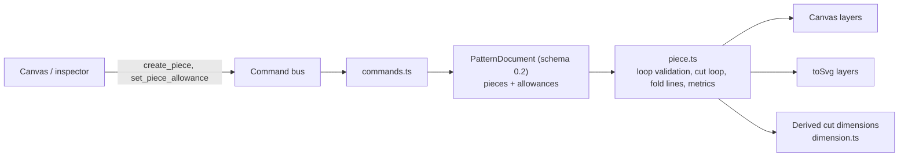

# Pieces, allowance kinds and cut dimensions

Status: implemented (PR #56; spec and implementation on one branch)
Builds on: 007 (seam allowance, superseded), 008 (SVG export), 2026-10-20-seam-allowance-side
Supersedes: the per-edge `Seam` as the owner of an allowance

## 📝 TLDR

A **piece** becomes a first-class closed loop of edges. Each edge of a piece can
carry one **allowance** with a `kind` (**seam**, **single fold**, **double fold**)
and a `width` that means the **finished** width. The piece derives two loops: the
**stitch loop** (the sketch geometry you sew on / finish at) and the **cut loop**
(each edge offset by its own distance and joined at every corner). The cut loop
is what the SVG exports and what you cut; a double fold adds a **fold line** at
the finished width. **Cut dimensions** measure the cut loop and are always
derived and read-only: the stitch dimension drives them, never the reverse.

Reference case: a 200 × 200 piece with a 10 mm single-fold allowance on three
edges and none on the fourth cuts as **220 × 210** and shares the fourth edge;
with a double fold on the same three edges it cuts as **240 × 220** and carries a
fold line exactly on the 220 × 210 outline.

## 📝 Problem Statement

- **Who needs it:** the solo maker drafting a pouch or a hemmed panel, who needs
  to know the fabric rectangle before touching scissors, and needs the line to
  cut on rather than the line to sew on.
- **What happens today:**
  - Allowances are per edge, owned by `seams: Seam[]` in the document
    (`packages/geometry/src/types.ts:196`); there is no piece or loop concept.
  - `seamAllowancePaths` offsets **each edge in isolation**
    (`packages/geometry/src/offset.ts:323-335`), so neighbouring allowances never
    meet at a shared corner, and the side is an arbitrary `left`/`right`
    (`types.ts:133-147`) because there is no loop to derive "outward" from. The
    seam-side spec parked exactly this (`2026-10-20-seam-allowance-side.md`, Q1).
  - The download carries no allowance at all: `downloadSvg` calls
    `toSvg(pattern, { construction })` (`frontend/src/views/EditorView.vue:396`)
    and `SvgExportOptions.seamAllowance` defaults to `[]`
    (`packages/geometry/src/export.ts:30-37`).
  - The `cut` layer means "every non-construction entity"
    (`export.ts:109-131`, `document.ts:64-71`) — i.e. the stitch line — so the
    exported geometry is what you sew, not what you cut.
  - The page box comes from `bounds(document)` (`document.ts:125`), computed from
    points, arcs and circles only, so even if allowances were passed they would
    be clipped.
  - Dimensions are point-pair distance constraints (`types.ts:88-122`,
    `dimension.ts:66-76`), and cut geometry has no point entities, so the cut
    outline cannot be measured at all.
- **Constraint:** commands remain the only mutation path, `@sewcraft/geometry`
  stays pure, the solver is **not** touched, and existing drawings keep
  rendering.

## 📝 Proposed Solution

### Vocabulary (to add to `docs/domain/glossary.md`)

| Term              | Meaning                                                                                       |
| ----------------- | --------------------------------------------------------------------------------------------- |
| **Piece**         | A closed loop of existing cut edges that is cut from fabric; carries name, quantity, allowances. |
| **Stitch loop**   | The piece boundary as drawn: what you sew on, or the fold at a finished edge.                   |
| **Cut loop**      | The stitch loop offset outward per edge by its allowance, joined at every corner.               |
| **Allowance**     | A per-edge strip on a piece: `kind` (seam / single / double) plus a finished `width`.            |
| **Finished width**| The visible width of the seam or hem; the cut distance is derived from it.                      |
| **Fold line**     | The turn line a double fold needs, at the finished width inside the cut line.                    |
| **Cut dimension** | A read-only dimension measuring the cut loop; derived from the stitch span plus allowances.      |

### Options considered

**Where a piece lives**

| # | Option | Trade-offs | Verdict |
| - | ------ | ---------- | ------- |
| A | Persisted `pieces: Piece[]`, each an ordered closed list of existing edge ids, allowances stored per edge | Additive; a stable home for name, quantity, allowances and dimension anchors; needs a schema bump and loop validation | **Recommended** |
| B | Derive loops on read from shared endpoints, persist nothing | No schema change; but no place for quantity or a name, every read re-derives, and a dimension anchor has nothing stable to point at | Rejected — pieces must be authored |
| C | A piece owns copies of its boundary entities | Breaks "the entity is the geometry, commands mutate entities", duplicates constraints and dimensions | Rejected |
| D | Keep per-edge `seams` and only join the offsets at corners | Smallest change; leaves outward manual, gives no per-piece bounding box, area, quantity or anchor | Rejected — cannot answer "how much fabric" |

**What `width` means**

| # | Option | Trade-offs | Verdict |
| - | ------ | ---------- | ------- |
| A | `width` = **finished** width; cut distance derived (`w` for seam/single, `2w` for double) | The number a maker actually thinks in, and 10 / 20 mm falls out of one field | **Recommended** |
| B | `width` = **cut** distance; fold line and finished width derived (`w/2` for double) | Keeps today's `Seam.width` meaning unchanged, but makes the user compute 20 for a 10 mm hem and mislabels the visible hem | Rejected |

**Kinds**

| # | Option | Trade-offs | Verdict |
| - | ------ | ---------- | ------- |
| A | `kind: 'seam' \| 'single' \| 'double'` | Seam and single produce the same band but mean different things: one is sewn, the other is folded, so the mark on the finished edge differs; double adds the fold line | **Recommended** |
| B | Only `'single' \| 'double'` | One value fewer, but hems and seams lose their distinction in the drawing and the data | Rejected |
| C | Keep `Seam.side` and add `kind` alongside | Leaves the arbitrary side next to a loop-derived outward direction, so two sources of truth can disagree | Rejected — `side` is dropped |

**Cut dimensions**

| # | Option | Trade-offs | Verdict |
| - | ------ | ---------- | ------- |
| A | A separate `derived_distance` constraint anchored to piece loop vertices, computed on read, no solver residual, own `derived` state | Reuses `dimensionGeometry` for layout; cannot corrupt the solver; a deleted anchor reuses the existing `broken` state without storing a stale reading | **Recommended** |
| B | Extend `DistanceConstraint` with `derivedFrom` | Fewer types, but mixes "has an equation" and "has none" in one shape and forces every validator and solver branch to know the difference | Rejected |
| C | Auto-annotate every piece's cut bounding box | Zero UI; but you cannot choose the span that matters, and the inspector already reports the box as a metric | Rejected for v1 |
| D | Let a cut dimension drive by solving for the allowance width | Feels direct; but the distribution across the sides touching the span is ambiguous whenever widths differ | Rejected — see Behaviour 11 |

### Behaviour

1. **Pieces.** A piece is created from a selection of cut edges that form one
   closed chain: at least 3 edges, `edges[i].end` coincident with
   `edges[i+1].start` and the last with the first, no duplicate edge, no
   construction edge, no circle. An edge belongs to at most one piece. The stored
   `edges` array is the loop order and is the single source of truth for outward
   direction.
2. **Allowances.** A `Piece.allowances` entry is `{ edge, width, kind? }`.
   `width` is the finished width in millimetres and must be `> 0`; `kind` is
   omitted for `'seam'` (the default). A loop edge with no entry has **no**
   allowance, which is how a shared edge is expressed — no zero-width entries.
3. **Cut distance.** `seam` and `single` offset the edge by `width`; `double`
   offsets it by `2 × width`. The finished width is the only width stored, so a
   change of `kind` moves the cut line without retyping a number.
4. **Outward.** Outward is away from the loop interior and is derived from the
   loop's winding. Nothing in the model or the UI asks for a side; `Seam.side`
   is dropped, its meaning being recoverable from the loop.
5. **Cut loop.** For every loop vertex, offset each adjacent edge by its own
   distance and join the two offset lines at their intersection (miter). A
   vertex where one adjacent edge has no allowance joins on that edge's original
   line, which is what makes a shared edge coincide with the cut line. The loop
   is emitted as one closed path (`… Z`).
6. **Join fallback.** A miter whose length exceeds `miterLimit` (already in
   `offset.ts`) falls back to a bevel; a self-intersecting result is reported
   through the existing `findSelfIntersections` and rendered as an error, never
   silently straightened.
7. **Fold line.** `double` adds one dashed line at the finished width inside the
   cut line — i.e. the offset loop at `width`, which for a uniformly doubled
   piece is exactly the single-fold cut outline. `seam` and `single` add no
   internal line; their finished edge is the stitch loop itself.
8. **Rendering.** Cut loop solid, stitch loop thin, fold lines dashed, allowance
   band optional as a filled tint, errors in the destructive colour. Every
   derived loop is recomputed from the document (memoised per document identity),
   never stored.
9. **Export.** Layers: `cut` (piece cut loops, always), `stitch` (default on),
   `fold` (default on), `construction` (default off). `width`/`height` in mm and
   the `viewBox` come from the union of cut loops plus padding, not from
   `bounds(document)`. Each cut path carries `data-piece`; the metadata comment
   gains per-piece finished and cut sizes plus quantity.
10. **Piece metrics.** The inspector reports, per piece: finished width × height,
    cut width × height, cut area, allowance area, quantity. These answer "cut
    220 × 210" without any annotation on the sheet.
11. **Cut dimensions.** A cut dimension is a `derived_distance` between two loop
    vertices of one piece. Its value is computed from the resolved cut loop on
    every read, adds no solver equation, and is **read-only** in v1: the editor
    field explains that the number follows the stitch dimension and the
    allowances. Typing a value into it is out of scope (it would have to rewrite
    the stitch dimension or an allowance width, and is ambiguous when the span
    touches edges with different widths). A missing piece or edge leaves the
    dimension `broken` with no number to show, exactly like a dangling reference;
    a cut dimension never captures a stale `lastKnownValue`.
12. **Legacy documents.** A 0.1 document's `seams` are adopted on load: every
    closed chain of seam-carrying edges becomes one piece with those allowances
    as `kind: 'seam'` and the stored width, and `side` is discarded. Seams on
    edges that do not close a loop keep the legacy dashed rendering through a
    deprecated `seams` field until 0.3.

### Why outward stops being a choice

`Seam.side` existed because an isolated edge has no inside. Once the edges are
an ordered closed loop, winding answers it exactly, and the answer cannot
disagree with anything else in the document. That removes a control, a field and
a class of "the allowance went the wrong way" bugs at the same time.

## 📝 Architecture



### Geometry package

- **`offset.ts`** — add `offsetVariablePolyline(points, distances, options)`:
  one signed distance per segment, miter/bevel joins, `findSelfIntersections`
  reused. `offsetPolyline` becomes a thin wrapper passing one distance for every
  segment, so 007's behaviour and tests are unchanged.
- **`piece.ts` (new)** — `pieceEdges`, `validatePiece`, `pieceCutLoop`,
  `pieceFoldLines`, `pieceCutVertex` (for anchors), `pieceMetrics`
  (finished box, cut box, cut area by the shoelace rule on the flattened loop,
  allowance area), `pieceCutBounds`, `basicPieceForLoops` (loop discovery used by
  the migration).
- **Curves and arcs** — loop edges are flattened through the existing
  `edgePolyline`, so a corner between two curves is a miter of two straight
  flattened ends, consistent with 007. Cut extents on arcs and circles are exact;
  a cubic's offset is not a cubic, so bounds and area samples use
  `FLATTEN_SEGMENTS` with a stated tolerance (0.05 mm).
- **`export.ts`** — layers take piece geometry; the `cut` layer is the closed cut
  loops; `viewBox` from cut bounds; per-piece metadata.
- **`dimension.ts`** — a `derived` state; `resolveCutSpan` produces two points and
  feeds the existing `dimensionGeometry` unchanged.

### Frontend

- `PatternCanvas.vue` / `canvas-render.ts` — cut, stitch, fold and band layers
  built from piece geometry; the per-edge seam layer stays only for legacy edges.
- `editor-ribbon.ts` — a **Create piece** action enabled for a valid closed
  selection, and an allowance editor (kind + finished width) in the properties
  drawer, replacing `seam-width.ts`'s per-edge width for loop edges.
- `dimensions.ts` — creation of a cut dimension from two loop vertices; the value
  field is read-only with its reason.
- `stores/editor.ts` `load()` — run the schema migration next to
  `normalizeCornerRounds`.

## 📝 Data Model

```ts
export const PATTERN_SCHEMA = 'sewcraft.pattern/0.2';

export const ALLOWANCE_KINDS = ['seam', 'single', 'double'] as const;
export type AllowanceKind = (typeof ALLOWANCE_KINDS)[number];

export interface Allowance {
  edge: EntityId;
  /** Finished (visible) width in millimetres; must be > 0. */
  width: number;
  /** Omitted means `seam`. */
  kind?: AllowanceKind;
}

export interface Piece {
  id: EntityId;
  /** Optional; the UI falls back to "Piece 1". */
  name?: string;
  /** Ordered, closed loop of line/curve/arc ids. */
  edges: EntityId[];
  /** Allowances for loop edges; an edge with no entry has none. */
  allowances: Allowance[];
  /** How many to cut; omitted means 1. */
  quantity?: number;
}

export interface PatternDocument {
  schema: PatternSchema;
  units: 'mm';
  entities: Entity[];
  constraints: Constraint[];
  pieces: Piece[];
  /**
   * Deprecated legacy allowances for edges that close no loop. Read-only,
   * rendered as before, removed in 0.3.
   */
  seams?: Seam[];
  cornerRounds?: CornerRound[];
}
```

```ts
/** One end of a cut dimension, addressed by loop vertex rather than by point id. */
export interface CutAnchor {
  edge: EntityId;
  /** The loop vertex at this edge's start or end. */
  at: 'start' | 'end';
}

export interface DerivedDistanceConstraint {
  id: EntityId;
  type: 'derived_distance';
  /** Both anchors must belong to this piece. */
  piece: EntityId;
  a: CutAnchor;
  b: CutAnchor;
  orientation?: DimensionOrientation;
  offset?: number;
  /** Optional stored reading for a broken anchor. v1 never writes it. */
  lastKnownValue?: number;
}
```

Derivation, for the record:

```ts
export function allowanceDistance(allowance: Allowance): number {
  return allowance.kind === 'double' ? allowance.width * 2 : allowance.width;
}
```

**Migration 0.1 → 0.2** (`normalizeDocument`, called from the load path):
`seams` whose edges form a closed chain become one `Piece` per chain with
`kind: 'seam'` and the stored width; `side` is dropped; seams on open chains stay
in the deprecated `seams` field; `pieces: []` is added to documents that have
none; `schema` is written as `0.2`. The migration is one-way, recorded in
`BACKWARD_COMPATIBILITY.md`. `createEmptyDocument()` gains `pieces: []`.

## 📝 API Contracts

`spec_version` 0.9.0 → **0.10.0**, kept in sync across `config/geometry.php`,
`docs/domain/command-spec.json` and `docs/domain/command-spec.md`.

### `create_piece`

- params: `edges: entity_id[]` (ordered, closed), `name?: string`,
  `quantity?: int ≥ 1`
- validation: ≥ 3 edges; each is an existing non-construction line/curve/arc;
  no duplicates; consecutive edges share a point; last meets first; no edge already
  in another piece
- inverse: `delete_piece` for the new piece

### `update_piece`

- params: `id: entity_id`, `name?: string`, `quantity?: int ≥ 1`
- inverse: the same command with the previous values

### `delete_piece`

- params: `id: entity_id`
- cascade: removes the piece's `derived_distance` dimensions
- inverse: `null`; the journal's document snapshot restores it, the same way
  `delete_entity` does (`frontend/src/stores/editor.ts`)

### `set_piece_allowance`

- params: `piece: entity_id`, `edge: entity_id`, `width?: number > 0`,
  `kind?: 'seam' | 'single' | 'double'`, or `remove: true`
- validation: the edge is in that piece's loop; `width` present and `> 0` when the
  allowance is being set
- inverse: the same command with the previous width/kind, or `remove` when the
  edge previously had none

### `add_derived_dimension`

- params: `piece: entity_id`, `a: { edge, at }`, `b: { edge, at }`,
  `orientation?: 'aligned' | 'horizontal' | 'vertical'`, `offset?: number`
- validation: both edges are in the piece, anchors are distinct, the two points
  are not coincident
- inverse: `remove_constraint`

`remove_constraint` and `update_constraint` accept a `derived_distance`:
`update_constraint` may change `orientation` and `offset` only; a `value` or
`reference` is rejected because the dimension drives nothing.

`add_seam_allowance`, `remove_seam_allowance` and `set_seam_allowance` stay in the
spec as the legacy path for edges outside any piece, marked deprecated, and are
removed in 0.3.

## 📝 UI/UX

- **Create piece** sits next to the selection tools: it is enabled when the
  current selection is one closed chain of cut edges, and reports the specific
  break otherwise ("edge 12 does not connect to edge 14").
- **Allowance editor** for the selected edge or the whole piece: a kind control
  (**none / seam / single fold / double fold**) and a finished-width field
  defaulting to 10 mm. Changing kind moves the cut line live; changing the width
  moves both the cut line and the fold line.
- **Inspector piece card**: name, quantity, finished W×H, cut W×H, cut area, and
  the list of loop edges with their allowances. The cut size is the answer to
  "what do I cut" and needs no dimension.
- **Canvas**: cut loop solid, stitch thin, fold dashed, band toggle, errors in the
  destructive colour. A selected allowance edge highlights its band.
- **Dimensions**: a cut dimension reads `220 cut` in its own colour and a tooltip
  that names the driving stitch span; the value field is read-only. The existing
  set / driven / referenced / broken styling is untouched.

## 📝 Edge Cases & Failure Scenarios

| Scenario | Expected |
| -------- | -------- |
| Selection does not close | `create_piece` rejected, naming the first edge that fails to connect |
| Same edge twice, or edge already in another piece | Rejected |
| Construction edge in the selection | Rejected, edge named |
| One loop, one edge with no allowance | Cut loop coincides with the stitch loop on that edge (the shared-edge case) |
| Adjacent allowances of different widths at a corner | Offset lines intersected; no averaging, no gap |
| Concave corner where the miter exceeds `miterLimit` | Bevel, reported in the geometry result |
| Allowance wider than the edge, or a self-intersecting offset | Cut loop still produced, flagged and rendered as an error; export warns |
| Double fold on a short or concave edge | Doubled offset, same guard, flagged earlier than a single fold |
| Double fold on a uniformly allowed loop | Fold line equals the single-fold cut outline (invariant, tested) |
| Circle in a piece | Rejected in v1 with an explicit message (offsetting a closed curve needs a different join model) |
| Piece edge deleted | `delete_entity` cascades: the piece and its cut dimensions go with it |
| Piece deleted | Its cut dimensions go with it; the journal restores both |
| Cut anchor's edge deleted | The dimension is `broken`, shows no number, adds no equation |
| Quantity `0` or negative | Rejected |
| 0.1 document with seams on a closed chain | Becomes a piece with those allowances, same rendering plus joined corners |
| 0.1 document with seams on an open chain | Stays on the legacy dashed path |
| Missing piece or document in an API payload | Rejected by the same validation as other constraints |

## 📝 Risks & Impact Review

| Risk | Impact | Mitigation |
| ---- | ------ | ---------- |
| Pattern schema bump to 0.2 | Older clients cannot read new documents | Self-hosted single-user app; one-way migration documented in `BACKWARD_COMPATIBILITY.md`; migration tested against a 0.1 fixture |
| Export contract change | 008's tests assert `cut` = every non-construction entity; `docs/architecture/export.md` describes exactly that | Rewrite the layer description and the tests in the same PR; call the change out in the spec's checks |
| Variable offset is branch-heavy | 100 % coverage gate is the real cost of this spec | Phase 1 test list enumerates every corner kind and width combination before the feature is wired up |
| Derived geometry recomputed per render | Canvas cost on large documents | Memoise by document reference in the frontend; the pure functions stay cheap |
| Two allowance paths during migration | Legacy `seams` and `pieces` can disagree | `seams` is read-only after load and the renderer prefers pieces; removal scheduled for 0.3 |
| Solver risk | None: no equations are added or removed | Derived dimensions are rejected by the solver by type |

## ❓ Open Questions

| # | Question | Options | Current lean |
| - | -------- | ------- | ------------ |
| Q1 | Does the shared edge of a hemmed piece need a visible "cut on fold" mark, or is the coincident cut/stitch line enough? | A mark is a new annotation kind; coincidence is already visible | Coincidence for v1, mark later with grainline |
| Q2 | May a cut dimension span two different pieces? | Same-piece only is simpler and covers "cut 220 × 210" | Same piece only in v1 |
| Q3 | After pieces land, do `add_seam_allowance` and friends survive for open edges, or disappear at 0.2? | Keeping them costs one legacy path | Keep as deprecated until 0.3 |
| Q4 | Should a piece support interior cutouts (holes) in a later version? | A second loop per piece is a small model change but a different cut-path contract | Out of scope, noted |
| Q5 | Do exported sheets need the cut dimensions printed (annotation layer), or is the inspector enough? | Annotation adds text to a cut sheet that a plotter must ignore | Inspector only in v1 |

## ✅ Resolved assumptions (autonomous defaults)

- `width` is the **finished** width everywhere; the cut distance is derived.
- `kind` defaults to `seam`; hems are `single` or `double`.
- Outward direction comes from the loop; `Seam.side` is retired.
- Cut dimensions are derived and read-only in v1.
- 0.1 documents migrate per closed loop; open chains keep the legacy path.
- Quantity lives on the piece even though layout is out of scope.
- A fold line exists only for a double fold.
- Circle pieces and interior cutouts are out of scope.

## 📋 Phasing

1. Geometry core: variable offset, loop validation, cut loop, fold lines, metrics.
2. Model, commands and migration.
3. Canvas and inspector.
4. Export.
5. Derived cut dimensions.
6. Documentation and gate.

## 📋 Implementation Plan

### Phase 1 — Geometry core

1.1 Add `offsetVariablePolyline` to `packages/geometry/src/offset.ts`, reusing
    the miter/bevel logic and `findSelfIntersections`; make `offsetPolyline`
    delegate. Tests: equal distances reproduce the current output exactly
    (regression), mixed distances, zero distance, both corner senses, miter
    limit fallback, self-intersection.
1.2 Add `packages/geometry/src/piece.ts`: `validatePiece`, `pieceEdges`,
    `pieceCutLoop`, `pieceFoldLines`, `pieceCutVertex`, `pieceMetrics`,
    `pieceCutBounds`, `basicPieceForLoops`. Tests: closure and rejection cases,
    the reference rectangle (220 × 210 with one shared edge), uniform and mixed
    widths, double fold (240 × 220 with the fold line on 220 × 210), curve and
    arc loop edges, tolerance bounds.
1.3 Export the new module from `index.ts`; keep every function pure.
1.4 Reach 100 % statements, branches, functions and lines for the new code.

### Phase 2 — Model, commands and migration

2.1 `types.ts`: `AllowanceKind`, `Allowance`, `Piece`, `DerivedDistanceConstraint`,
    `CutAnchor`, `PATTERN_SCHEMA = '0.2'`, `pieces` on the document, `seams`
    demoted to deprecated-optional.
2.2 `normalizeDocument` migration + `createEmptyDocument`; wire into
    `frontend/src/stores/editor.ts` `load()` beside `normalizeCornerRounds`.
    Tests: a 0.1 fixture with a closed seam chain and an open chain; idempotence.
2.3 `commands.ts`: `create_piece`, `update_piece`, `delete_piece`,
    `set_piece_allowance`, `add_derived_dimension`, plus `derived_distance`
    visibility in `remove_constraint` / `update_constraint`. Validation, inverses,
    cascade on `delete_entity` and `delete_piece`. Tests for every rejection.
2.4 Sync `config/geometry.php`, `docs/domain/command-spec.json` and
    `docs/domain/command-spec.md`; bump `spec_version` to `0.10.0`; add a
    migration note; keep the legacy seam commands documented as deprecated.

### Phase 3 — Canvas and inspector

3.1 Render cut, stitch, fold and band layers from piece geometry; keep the seam
    layer only for legacy `seams`.
3.2 **Create piece** ribbon action with validation feedback; selection of a
    closed chain.
3.3 Allowance editor (kind + finished width) in the properties drawer for one
    edge or the whole piece, dispatched through `set_piece_allowance`.
3.4 Piece card in the sidebar: name, quantity, finished and cut sizes, area,
    per-edge allowances.
3.5 Vitest coverage for every branch (validity states, kind changes, removal).

### Phase 4 — Export

4.1 `export.ts`: piece-driven layers (`cut` always; `stitch`, `fold`,
    `construction` optional), closed cut paths, `data-piece`, views from cut
    bounds, per-piece metadata, quantity.
4.2 `EditorView.downloadSvg` passes piece geometry; export dialog gets layer
    toggles, defaulting to cut + stitch + fold.
4.3 Tests: closure (`Z`), allowance included in bounds, layer separation, legacy
    document rendering, metadata contents.
4.4 Rewrite the layer contract in `docs/architecture/export.md`.

### Phase 5 — Derived cut dimensions

5.1 `dimension.ts`: `derived` state, `resolveCutSpan` via `pieceCutVertex`, reuse
    of `dimensionGeometry`; `dimensionState`, label text and colour.
5.2 Creation gesture from two loop vertices on the selected piece; read-only
    value field naming the driving span and allowances.
5.3 Broken handling when a piece or edge disappears; tests for the reference
    values (220 and 210, then 240 and 220 after switching to double).
5.4 Ensure the solver never sees a `derived_distance`.

### Phase 6 — Documentation and gate

6.1 `docs/domain/glossary.md`, `docs/architecture/export.md` (layer contract),
    `docs/architecture/standards.md` if naming changed.
6.2 `BACKWARD_COMPATIBILITY.md`: schema 0.2, one-way migration, deprecated seams.
6.3 `ROADMAP.md`: tick "Pieces (closed profiles) as a first-class entity"; note
    fabric layout still deferred.
6.4 Mark 007 superseded with a pointer to this spec, and record the outcome in a
    `.ai/runs/` note at implementation time.
6.5 Run the full gate below.

## ✅ Acceptance criteria

- [x] A 200 × 200 piece with a 10 mm allowance on three edges and none on the
      fourth produces exactly a 220 × 210 cut loop sharing the fourth edge.
- [x] The same piece with `double` on those edges produces 240 × 220 with a fold
      line exactly on 220 × 210.
- [x] The cut loop is one closed, corner-joined path with no gaps or double
      offsets at shared vertices.
- [x] The exported `cut` layer contains only cut loops, each closed, and the
      `viewBox` includes allowance geometry.
- [x] Stitch and fold layers are exported and individually optional; construction
      stays off by default.
- [x] A cut dimension reads 220 and 210 from the reference piece, updates when a
      width or kind changes, adds no solver equation, and is read-only.
- [x] Deleting a piece edge or the piece removes or breaks dependent cut
      dimensions without leaving a stale number on screen.
- [x] A 0.1 document with a closed seam chain loads as one piece with the same
      rendering plus joined corners; an open chain still renders dashed.
- [x] 100 % statements, branches, functions and lines across
      `packages/geometry/src`, `frontend/src` and backend `app/`.
- [x] `npm run lint`, `npm run format:check`, `npm run typecheck` and the Pest
      suite pass; command spec, config and docs are in sync at `0.10.0`.

## Out of scope

- Fabric requirement, layout and nesting (ROADMAP phase 5). `quantity` is stored
  so a later estimate can be built on the cut bounds.
- PDF tiled export and DXF (010, 011), tiling and registration marks.
- Dimension annotations inside the SVG (an `annotation` layer that a plotter must
  ignore).
- Darts, notches, grainline, cut-on-fold marks, interior cutouts.
- Topstitch and turn-under lines, fold direction (always inward).
- Editable derived dimensions and driving an allowance from a cut dimension.
- Circle or closed-arc pieces.

## Checks

```bash
npm test -w @sewcraft/geometry
npm test
npm run test:coverage
npm run lint
npm run format:check
npm run typecheck
docker compose exec app php artisan test
```
