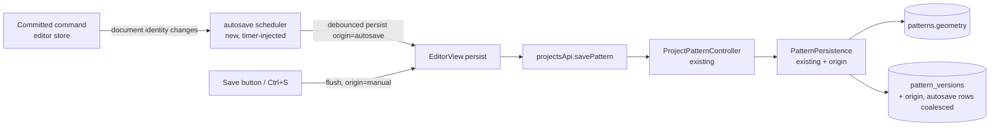

# Autosave

Status: draft — design review
Refs #69
Builds on: `2026-10-23-project-save-and-upgrades.md` (explicit save, checkpoints,
conflicts), `docs/architecture/api.md`, `docs/architecture/data-model.md`

## 📝 TLDR

The editor persists a pattern only when the maker clicks **Save** or presses
<kbd>Cmd/Ctrl</kbd>+<kbd>S</kbd>; closing a tab, losing power or a failed save
loses every edit since the last click. Proposed future behaviour: the working
copy **autosaves** shortly after the maker stops editing, every save state stays
visible in the save bar, and <kbd>Cmd/Ctrl</kbd>+<kbd>S</kbd> still writes
immediately. Autosave writes are coalesced in history — the latest autosave
snapshot plus every explicit save — so continuous drafting cannot flood
`pattern_versions`.

## 📝 Problem Statement

- **Who needs it:** the maker drafting a pattern for a session of dozens of
  edits. Drafting is exploratory: lines are drawn, dimensions typed, corners
  rounded, then undone and redone. Requiring a manual save turns every crash,
  reload or closed tab into lost work.
- **What happens today:** `EditorView.onKeyDown` reacts to Cmd/Ctrl+S only
  (`frontend/src/views/EditorView.vue:972-979`); `save()` refuses when the
  document is clean and otherwise calls `persist(editor.savedVersion)`
  (`EditorView.vue:1196-1202`). `persist` writes one document snapshot through
  `PUT /projects/{id}/pattern` and marks the sent snapshot clean
  (`EditorView.vue:1162-1194`, `frontend/src/stores/editor.ts:183-193`). The
  `beforeunload` and route guards only warn (`EditorView.vue:1258-1268`).
  Nothing writes without that click.
- **Evidence it matters:** #69 asks for exactly this — "Projects should autosave
  if any changes happened, also, ctrl+s should save".
- **What the design already anticipated:** the save spec resolved Q1 as
  "explicit Save in v1, with **autosave + checkpoint distinction as a
  follow-up** (option B)" and Q2 as "every successful save appends one
  checkpoint, deduped when unchanged"
  (`.ai/specs/2026-10-23-project-save-and-upgrades.md:340-341`). The server
  already stores the document as an opaque snapshot, dedupes an unchanged
  document without appending a checkpoint, and detects concurrent writers with
  an expected-version token (`app/Services/PatternPersistence.php:70-157`). This
  spec adds the missing writer, not a new persistence model.
- **It reopens one recorded decision:** Q2 of the save spec also promised history
  stays meaningful "without pruning" until a history surface exists
  (`2026-10-23-project-save-and-upgrades.md:341`, echoed in
  `docs/architecture/data-model.md:45-48`). A writer that fires every few seconds
  makes that promise untenable, so this spec proposes pruning **autosave rows
  only** and records the reversal here and in the data-model doc instead of
  quietly contradicting it.

### Scope note

The spec covers one capability: **a background writer that persists the working
copy and recovers without the maker present**. Automatic retry/backoff and the
lifecycle flush are part of that writer's reliability contract — a background
write that silently fails is not autosave. They are not offered as separate
improvements to the manual save button, whose behaviour stays as it is.

## 📝 Proposed Solution

### Options considered

| # | Option | What it costs | Verdict |
|---|--------|---------------|---------|
| A | Autosave through the existing save path; every changed autosave appends a checkpoint | Frontend-only, no migration. But a drafting session with a 1.5 s debounce creates a full document snapshot every few seconds, so `pattern_versions` grows without bound and history becomes noise | Rejected — unbounded storage and unreadable history |
| B | **Autosave writes the working copy as a coalesced autosave checkpoint** — keep only the newest autosave row, keep every manual save and upgrade archive | One `origin` column on `pattern_versions`, one optional request field, pruning in the existing transaction. Version tokens, 409 handling and dedupe stay exactly as they are | **Recommended** |
| C | A separate draft column/endpoint (`PATCH .../pattern/draft`) loaded in preference to the document | No history pollution, but two stored documents, two load paths, and a recovery rule for "draft newer than document" that the upgrade flow must also understand | Rejected for v1 — more states than the problem needs |
| D | Do nothing; rely on Save + the unload warning | Zero work. Every crash or closed tab still loses the session | Rejected — this is the reported problem |

### Behaviour

| Event | Result |
|-------|--------|
| A committed command changes the document | Start/refresh a 1.5 s idle timer; a 10 s maximum wait forces a write during continuous editing |
| Idle timer fires | Write the current snapshot with `origin: "autosave"` and `expected_version: savedVersion` |
| Another edit arrives while a write is in flight | The in-flight response marks only the snapshot it sent as clean; the newer document stays dirty and is scheduled again |
| <kbd>Cmd/Ctrl</kbd>+<kbd>S</kbd> or **Save** | Cancel the pending timer, write immediately with `origin: "manual"` |
| Tab hidden or page unloading | Best-effort `keepalive` flush when the payload fits the browser budget; otherwise the existing unload guard stays the safety net |
| Save fails with a network error or 5xx | Autosave shows `Save failed — retrying`; retry after 2 s, then 4, 8, 16, capped at 30 s, until a write succeeds or the document is clean |
| Save fails with a permanent error (422, e.g. the 2 MB cap) | Autosave stops in a terminal `error` state; it retries only after the document changes or the maker clicks Save |
| Save returns `409` | Autosave **pauses**, the save bar states that the project changed elsewhere; the existing Reload/Overwrite dialog opens only on an explicit Save, never by itself |
| A conflict is resolved by Reload or Overwrite | The pending pause clears and autosave re-arms against the new `savedVersion`; work that reloaded away is never written over the loaded document |
| Save returns `404` | Stop autosaving and enter the existing load-error state |
| Document is read-only, an upgrade is pending, or a dialog is open | No autosave; the upgrade flow keeps full control of what is written |
| No change since the last save | No request (the existing dedupe would discard it anyway) |

### Scheduling and lifecycle

- Autosave is a small, timer-injected module (`frontend/src/lib/autosave.ts`) so
  debounce, maximum wait, in-flight coalescing and cancellation are unit-tested
  without mounting the editor. `EditorView` owns the wiring: a `watch` on the
  document schedules, the explicit save path flushes, and unmount cancels.
- The store already exposes what the scheduler needs: `isDirty` compares document
  identity, `savedVersion` is the expected-version token, and `markSaved` records
  the exact snapshot that was sent (`frontend/src/stores/editor.ts:40-52,
  183-193`). `markSaved` gains the write origin so the bar can say "Autosaved".
  No second state store is introduced.
- One writer is enough for the scheduler: **`EditorView` calls `persist`**. The
  Save button and the keyboard shortcut call the same function, so origin is the
  only difference between an autosave and a manual save.
- The unload guard stays. Autosave narrows the window in which it fires; it does
  not remove the last-resort warning.

## 📝 Architecture



Takeaway: the write path is unchanged; autosave only decides *when* the existing
`persist` runs and *how many* history rows a burst of edits leaves behind.

## 📝 Data Model

| Change | Detail |
|--------|--------|
| `pattern_versions.origin` | `string(16)`, default `'manual'`; values `manual` and `autosave`. Existing rows become `manual`. Upgrade archives, conflict overwrites and explicit saves write `manual`; scheduling-driven writes write `autosave` |
| Retention | In the same transaction that appends an `autosave` row, delete earlier `autosave` rows of that pattern. Manual rows (including upgrade archives) are never pruned |
| Version numbers | Remain `max(version) + 1` under the pattern row lock. Pruning leaves gaps in the sequence, so a version is a **token**, not a count. `(pattern_id, version)` stays unique |
| Index | None added in v1. Pruning filters by `pattern_id` and `origin`; one pattern's autosave rows number at most two while the transaction holds the lock |

Nothing else changes: `patterns.geometry` is still one working-copy snapshot and
the document schema (`sewcraft.pattern/0.2`) does not move.

## 📝 API Contracts

`PUT /api/projects/{project}/pattern` gains one optional request field; the
response is unchanged.

```jsonc
{
  "document": { "schema": "sewcraft.pattern/0.2", "units": "mm", "…": "…" },
  "expected_version": 12,
  "expected_schema": "sewcraft.pattern/0.1", // unchanged: upgrade writes only
  "origin": "autosave"                      // new, optional: "manual" | "autosave"
}
```

Validation: `origin` is `in:manual,autosave`; omitted means `manual`, so every
existing client keeps today's checkpoint-per-save behaviour. `409` and its
`current_version`/`saved_at` body are unchanged. An unchanged document still
appends nothing, whatever the origin.

## 📝 UI/UX

The save bar keeps its position and gains two states; no modal is added. The
controller needs three small additions the plan carries: `SaveState` gains
`paused` and `error`, `markSaved` records the origin of the write it acknowledged
(`manual` or `autosave`), and `EditorView`'s `saveBarState` computes the new
priority `paused > saving > error > dirty/failed > saved`.

| State | Text | Notes |
|-------|------|-------|
| `new` | New pattern — not saved yet | unchanged |
| `dirty` | Unsaved changes | while the debounce is running |
| `saving` | Saving… | same for manual and autosave |
| `saved` | Saved 12:03 / Autosaved 12:03 | word comes from the origin stored with the last successful write |
| `failed` | Save failed — retrying | transient failure; assertive live region; Save retries now |
| `error` | Save failed | terminal failure (422); no automatic retry until the document changes |
| `paused` | Save paused — changed elsewhere | appears after an autosave `409`; Save opens the existing conflict dialog |

Accessibility: the status stays a `role="status"` region (`polite` for saving and
saved, `assertive` for `failed`, `error` and `paused`), and `paused` does not steal
focus or open a dialog while the maker is typing. The Save button is enabled when
the state is `new`, `dirty`, `failed`, `error` or `paused`; it stays disabled only
while a write is in flight (`saving`) and when the document is clean — matching
today's `canSave` rule with the two new states added.

## 📝 Edge Cases & Failure Scenarios

| Scenario | Behaviour |
|----------|-----------|
| Undo after an autosave | The undone document differs from the saved snapshot and is autosaved in turn; history shows the latest autosave, not every intermediate step |
| Rapid drag with dozens of commands per second | One write after the drag (idle timer), or at the 10 s ceiling for a continuous gesture |
| Autosave `409` then the user keeps editing | Further autosaves stay paused; edits remain in memory, the dirty dot stays visible, and an explicit Save resolves it |
| Losing network mid-session | Failed state and retries; on reconnect the next attempt writes the latest document |
| Payload above the browser's `keepalive` budget on page hide | Flush is skipped (the request would be dropped anyway) and the unload guard remains the backstop |
| Document too large for the 2 MB API cap | Existing 422 path; autosave enters the terminal `error` state and retries only after the document changes |
| Two tabs on the same project | Whichever writes second gets `409`; the loser pauses and offers Reload/Overwrite |
| Read-only older schema or pending upgrade | No autosave until the modal is resolved |
| Project deleted in another tab | `404` stops autosave and shows the existing load-error state; no further writes |
| Empty document on a never-saved project | First committed change creates the pattern server-side and marks the project saved; an untouched new editor writes nothing |

## 📝 Risks & Impact Review

| Risk | Severity | Mitigation / limit |
|------|----------|--------------------|
| History silently loses intermediate autosave snapshots | Medium — this is a product decision about what history means, and it reverses the predecessor's "no pruning" promise | Autosave rows are explicitly labelled and only the newest is kept; every manual save is preserved. Rollback: stop pruning and keep all rows — the column already distinguishes them |
| Write amplification and storage growth | Medium | 1.5 s idle + 10 s ceiling, unchanged-document dedupe, and one retained autosave row per pattern |
| Autosave overwrites work from another tab | High if unguarded | Autosave always sends `expected_version`; `409` pauses instead of forcing. The force path (`expected_version: null`) remains explicit-Save-only |
| Data loss on unload still possible for very large documents | Medium | Bounded: the unload guard remains; the window is reduced to the in-flight request |
| `origin` column migration on existing databases | Low | Additive with a default; older application code ignores the column and keeps working |
| Behaviour change for API consumers that assume one checkpoint per write | Low | Default stays `manual`; only clients that opt into `origin: "autosave"` see coalescing |

Rollback: revert the frontend wiring (autosave stops, explicit saves behave as
today); the column and its default are inert without the request field.

## 📝 Resolved assumptions (autonomous defaults)

| # | Question | Applied default | Why | Confirm? |
|---|----------|-----------------|-----|----------|
| Q1 | Does an autosave write add a history checkpoint, replace the previous autosave, or write no history at all? | Coalesced: keep the newest autosave row, never prune manual rows | Keeps history meaningful and storage bounded while preserving every deliberate save; still uses one write path and the existing version token | ⚠ NEEDS HUMAN CONFIRMATION — it defines what history retains |
| Q2 | How often does autosave write? | 1.5 s idle debounce, 10 s maximum wait | Long enough to batch a gesture, short enough to protect a pause; both are constants and trivially tunable | Reversible |
| Q3 | Does a never-saved project autosave its first change? | Yes — the first committed change creates the pattern | Otherwise a maker can still lose a whole first session; no write happens on an untouched document | Reversible |
| Q4 | What does autosave do on `409`? | Pause and show it in the save bar; the Reload/Overwrite dialog opens only on an explicit Save | A modal during typing is hostile; the resolution is still explicit and reuses the existing dialog | Reversible |
| Q5 | Retry policy on transient failure? | Exponential backoff 2/4/8/16 s, capped at 30 s, until success or a clean document | Survives a short outage without a request storm; no unbounded queue | Reversible |
| Q6 | Flush on tab hide/unload? | Best-effort `keepalive` flush within the browser budget, then the existing unload guard | Best protection available without a service worker or a second write protocol | Reversible |
| Q7 | Autosave while an upgrade is pending or the document is read-only? | Never | Writing a normalised or partially-migrated document would bypass the archive-before-upgrade contract | Reversible |

Q1 keeps this PR a draft: merging it decides that autosave snapshots are
transient history, not restore points.

## 📋 Phasing

- **Phase 1 — Persistence contract.** `origin` column, request validation,
  coalescing in `PatternPersistence`, docs. No behaviour change until the client
  opts in.
- **Phase 2 — Autosave engine.** Timer-injected scheduler and its tests; wire it
  into `EditorView` with debounce, ceiling, in-flight coalescing and explicit
  flush.
- **Phase 3 — States and failure handling.** Save-bar `paused`/`error`/retry
  states, backoff, conflict pause and resume, lifecycle flush, accessibility;
  docs and full gate.

## 📋 Implementation Plan

**Phase 1 — Persistence contract**

1. Add the `pattern_versions.origin` migration and fillable/cast on the model.
   Test: an existing row reads `manual`; a save without `origin` writes `manual`.
2. Range-check `origin` in `SavePatternRequest` (default `manual`). Test: invalid
   value is `422`; omitted value is accepted.
3. Teach `PatternPersistence::save` to tag the appended row and delete older
   `autosave` rows in the same transaction. Tests: two autosave writes leave one
   autosave row; manual rows survive; version numbers stay monotonic with gaps;
   unchanged document appends nothing; `409` still fires for a stale token.
4. Update `docs/architecture/api.md` and `docs/architecture/data-model.md`,
   including replacing the "without pruning" sentence with the autosave-only
   rule. Shippable: explicit save behaves exactly as before.

**Phase 2 — Autosave engine**

5. Add `frontend/src/lib/autosave.ts`: `schedule()`, `flush()`, `cancel()`,
   injected timers and callbacks. Tests cover debounce reset, maximum wait,
   coalescing while a write is in flight, and cancellation.
6. Wire the scheduler into `EditorView`: watch the document, skip read-only,
   dialog-open, clean and not-ready states, flush on explicit save and unmount.
   Tests: one write for a burst; explicit Save cancels the timer; edits during a
   write are written again; no autosave in read-only or while a dialog is open.
7. Create-on-first-change for a never-saved project; test that an untouched
   editor writes nothing.

**Phase 3 — States and failure handling**

8. Extend `SaveState`/`SaveBarState` with `paused` and `error`, carry the write
   origin through `markSaved`, and apply the `paused > saving > error > dirty/
   failed > saved` priority. Tests: each state's copy, the priority order, the
   live-region mode and the Save-button availability.
9. Classify failures: transient (network/5xx → `failed` with backoff), permanent
   (422 → `error`, no retry until the document changes), missing (404 → existing
   load-error state). Tests with fake timers for the delay ladder and every stop
   condition.
10. Pause on `409` without setting the dialog, let explicit Save open the existing
    dialog, and re-arm autosave once Reload or Overwrite succeeds. Tests: pause,
    no spontaneous modal, resume after reload, resume after overwrite.
11. Flush on `visibilitychange`/`pagehide` within the browser budget; test the
    budget branch and the fallback.
12. Run the full validation gate (`npm run format`, `typecheck`, `lint`,
    `format:check`, `test:coverage`, `build`, backend Pest at `--min=100`, Pint)
    and record results.

## ✅ Acceptance criteria

- [ ] A committed change is written without any user action after the debounce
      window, and the save bar reflects autosave, failure and pause states.
- [ ] Cmd/Ctrl+S and **Save** still write immediately and produce a manual
      checkpoint.
- [ ] A burst of autosaves leaves one retained autosave row and never prunes a
      manual checkpoint.
- [ ] A concurrent writer produces a paused autosave, not a silent overwrite and
      not a spontaneous modal.
- [ ] Read-only, upgrade-pending and dialog states never autosave.
- [ ] Coverage stays 100% for the new scheduler, the view wiring and the backend
      changes.
