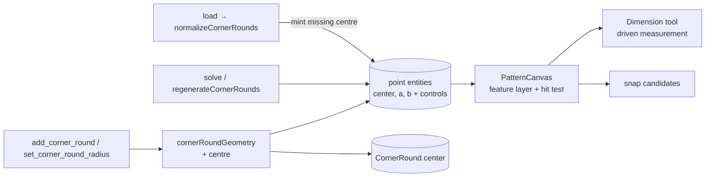
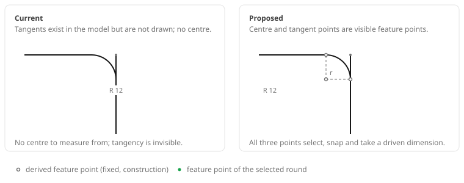

# Corner round feature points

Status: draft — design review
Refs #73
Builds on: `2026-10-20-corner-rounding-tool.md` (round command and derived
geometry), `2026-10-23-feature-group-and-piece-corner-rounds.md` (rounds inside
pieces)

## 📝 TLDR

Rounding a corner trims both lines, inserts a tangent arc and silently mints two
derived tangent points — but those points are hidden, and nothing represents the
**centre of the radius**. The maker cannot select or measure where the arc turns,
cannot read or dimension its centre, and can only infer where the curvature
begins. Proposed future behaviour: every corner round creates a **derived centre
point** in addition to its existing tangent points, and all three render as small
construction feature points that can be selected, snapped to and measured.
They stay derived: dragging or deleting one edits the round, never the geometry
out of tangency.

Scope: this is two shippable slices deliberately bundled because #73 frames them
as one gap — making the existing tangent points visible (canvas only) and adding
the centre (geometry + normalisation). The second slice is what needs the data
model; the first could merge alone.

## 📝 Problem Statement

- **Who needs it:** the maker tuning a rounded neckline, pocket corner or cuff,
  and anyone adding a dimension from the curve to a seam. The radius is a design
  decision that is checked against a measurement — "the curve must start 40 mm
  above the shoulder" — and that measurement needs real anchors.
- **What happens today:**
  - `add_corner_round` creates two tangent points, two Bézier control points and
    the arc (`packages/geometry/src/commands.ts:1441-1526`); the `CornerRound`
    record stores the sharp corner, the two ends (line, anchor, tangent), the
    controls and the arc — but **no centre**
    (`packages/geometry/src/types.ts:206-236`).
  - The tangent and control points are filtered out of the rendered point layer
    (`visiblePoints` calls `isCornerRoundDerived`,
    `frontend/src/components/PatternCanvas.vue:406-412`); only square drag
    handles appear, and only while the round is hovered or selected
    (`PatternCanvas.vue:464-478, 2938-2975`). The points themselves are never
    shown or pickable as entities.
  - No centre exists: `cornerRoundGeometry` returns the tangents, controls,
    tangent distance and angle only (`packages/geometry/src/corner-round.ts:58-107`),
    so no dimension, constraint, selection or export can reference a radius
    centre.
  - The tangent points are already snap candidates (`PatternCanvas.vue:1270-1273`
    passes every point), so they are reachable invisibly — which is worse than
    not being reachable: the maker snaps to a point they cannot see.
- **Evidence it matters:** #73 asks for both halves — "there should be also a
  centerpoint created at the radius center, and points where line becomes
  radius". The second half exists in the model but is absent from the canvas,
  which is why it reads as missing.

## 📝 Proposed Solution

### Options considered

| # | Option | Trade-off | Verdict |
|---|--------|-----------|---------|
| A | Add only the centre point, derived and hidden like the tangents | Smallest change, but the maker still cannot see where the radius starts or where its centre is; leaves half of #73 unanswered | Rejected |
| B | **Add a persisted derived centre point and render the centre plus both tangents as visible, selectable, snappable construction feature points** | One optional field and one entity id per round; adds a few small dots to the canvas. Keeps every invariant: the points are regenerated from radius and lines, never authored | **Recommended** |
| C | Make the centre and tangents editable handles (drag the centre to move the arc, drag a tangent to change the radius) | Matches circle centre/rim editing, but every drag must re-derive the two lines and the radius, can break tangency, and duplicates the existing radius editing paths (label, sidebar, tangent handles) | Rejected for v1 — a separate interaction model, not a feature point |
| D | Build nothing; keep the radius label and tangent handles | Zero work. The centre remains impossible to reference and the tangent points remain invisible | Rejected — this is the reported gap |

### What a "feature point" means here

A feature point is **derived geometry with an entity identity**:

| Property | Centre | Tangents |
|----------|--------|----------|
| Entity | `point`, id `${round.id}:center` | `point`, ids `${round.id}:a` / `${round.id}:b` (existing) |
| Position | Recomputed from corner, lines and radius on every commit | Same |
| Flags | `fixed: true`, `construction: true` | `fixed: true`, `construction` follows the rounded lines |
| Rendered | Small hollow construction dot, always | Small hollow dot, always; square drag handle stays on selection |
| Selectable | Yes — selects the round's feature point | Yes |
| Draggable | No; a drag selects without moving | No; the existing tangent handle changes the radius |
| Deletable | Only by removing the round (deleting the point removes the round) | Same |
| Loop member | Never; it is not added to any piece edge | Existing loop behaviour is unchanged |
| Export | Not exported (the SVG exporter skips point entities) | Not exported |

### Centre geometry

With corner `C`, unit line directions `uA`, `uB`, interior angle `θ` and radius
`r`:

- tangent distance `d = r / tan(θ/2)` (already computed as
  `tangentDistance`)
- centre `O = C + normalize(uA + uB) · (r / sin(θ/2))`
- equivalently `O = T_A + r · n_A`, where `n_A` is the inward unit normal of
  line A — a useful check on the result, not a second trigonometric path

`cornerRoundGeometry` returns the centre alongside `tangentA`/`tangentB`, so the
existing single source of derived geometry stays single.

### Rendering and interaction

- A new `corner-round-feature-layer` renders the centre and both tangents from
  the document, independent of hover, with `data-entity-id` so existing hit
  testing, selection and snapping apply unchanged.
- Feature dots are drawn **before** the draggable point layer so radius handles
  and other authored points stay on top; 3 mm radius in world units,
  `fill-background` with a `stroke-muted-foreground` ring, promoted to the primary
  colour when their round is selected.
- `onPointerDown` in select mode selects a derived point but does not start a
  drag when `isCornerRoundDerived` is true — the existing `move_point` rejection
  message stays as a backend guard, but normal use never triggers it.
- Attaching a dimension between a feature point and another point is a driven
  measurement (no typed value). Typing a value on a fixed anchor still fails
  through the existing solver rejection; this spec does not add a new editor for
  that case.

## 📝 Architecture

Takeaway: the geometry package remains the only producer of the centre; the
canvas and tools consume an ordinary point entity, so no new command or renderer
concept is introduced.

## 📝 Data Model

| Change | Detail |
|--------|--------|
| `CornerRound.center?: EntityId` | Optional so documents written before this change load unchanged. New rounds always set it |
| Derived entity | `{ id: "<round-id>:center", kind: "point", x, y, construction: true, fixed: true }`. Id is deterministic, so regeneration and reload are idempotent |
| Normalisation | `normalizeCornerRounds` **mints** the centre for a kept round that lacks one. It never rewrites an existing centre's coordinates on load: regeneration after the next commit is the only writer, which keeps the component's "validate loaded features without moving geometry" rule. It runs only on the frontend load path (`frontend/src/stores/editor.ts:130`) |
| Deletion | `cornerRoundsForEntity` and `isCornerRoundDerived` include `round.center`, so deleting the point removes its round (the existing derived-point cascade) and `move_point` rejects it |
| Document schema | Stays `sewcraft.pattern/0.2` — the field is additive and the entity is optional. Older builds render the centre as one extra fixed construction point and ignore the field; no round breaks |
| Export / API | No change: points are not exported, and the document is stored as an opaque snapshot |

## 📝 API Contracts

No HTTP change and no new command. The existing corner-round commands keep
their parameters, but the **documented derived-entity contract** grows:

- `docs/domain/command-spec.md` lists the deterministic derived ids
  (`<id>:a`, `<id>:b`, `<id>:c1`, `<id>:c2`, `<id>:arc`) and the entities
  `remove_corner_round` deletes; both gain `<id>:center`.
- `docs/architecture/geometry-core.md` defines `isCornerRoundDerived` as "arc,
  tangent or control point" and lists the derived ids; both descriptions gain the
  centre.
- `GET /api/commands` serves the command spec, so the published contract reflects
  the new derived id after the spec document is updated.

## 📝 UI/UX

- **Always visible:** every committed round shows three small hollow dots — the
  centre and both tangency points. This is the discoverability fix the issue
  asks for; it is not tied to hover or to the Round tool.
- **Selection:** clicking a feature dot (or the round's label/handles) selects it;
  the three dots of the selected round switch to the primary colour. Dragging a
  dot does not move it.
- **Measurement:** with the Dimension tool, clicking the centre and any other
  point creates the usual driven dimension; with the Cut dimension tool the
  feature points are ordinary points, so piece-corner pick rules still apply.
- **Accessibility:** the dots are `aria-hidden="true"` pointer affordances, like
  every other canvas point — the canvas has no keyboard point selection today.
  The accessible path to the round stays the radius label, sidebar and tangent
  handles, which keep their existing names; the spec does not claim the dots are
  announced to assistive technology.
- **Clutter limit:** a document with many rounds shows many dots. V1 accepts
  this with a muted 3 mm mark in world units (one step smaller than the 4 mm
  authored point, and like it scaled by the viewport); a per-document "show
  derived points" toggle is deferred.

Asset: `assets/2026-10-23-corner-round-feature-points/feature-points.svg` shows
the current and proposed canvas for the same rounded corner.

Prototype: `assets/2026-10-23-corner-round-feature-points/feature-points.svg`
(static, illustrative — it does not prove working behaviour).

## 📝 Edge Cases & Failure Scenarios

| Scenario | Behaviour |
|----------|-----------|
| Radius edited from the label, sidebar or tangent drag | Centre, tangents, controls and arc all move together in the same regeneration |
| Round inside a piece | The centre is not added to the piece loop; stitch and cut loops are unchanged |
| Round removed | The centre entity is removed with the arc, tangents and controls |
| Centre point deleted directly | `delete_entity` cascades to `remove_corner_round`, so the round disappears rather than surviving without a centre |
| Round loaded from an older document | The centre is minted on load; the round stays valid and the document is saved with it on the next write |
| Round already invalid (missing anchor, dropped by normalisation) | No centre is minted for a dropped round; its persisted entities stay static |
| Two rounds on adjacent lines | Each keeps its own centre and tangents; tangency distances still cannot overlap (`regenerateCornerRounds` guard) |
| Constraint or dimension typed with a value on a feature point | Existing solver rejection; no new command path |
| Derived point id already in use in a hand-edited document | `add_corner_round` rejects the derived id, as it already does for tangent and control ids |

## 📝 Risks & Impact Review

| Risk | Severity | Mitigation / limit |
|------|----------|--------------------|
| Canvas clutter on heavily rounded patterns | Low | Small muted dots and no label per dot; a visibility toggle is the documented follow-up |
| A mixed-version document (an old tab wrote after the deploy) | Medium | The older build does not know `:center`, so it renders the centre as an authored point and can drag it anywhere; this build then mints nothing but also does not repair it until the next regeneration. Accepted for a single-build self-hosted app: reloading the stale tab before editing is the mitigation, and the next radius edit restores the point |
| A stale `:center` coordinate in a hand-edited document | Low | Regeneration after the next commit rewrites it; load deliberately does not move geometry |
| Older builds reading a document that carries a centre | Low | Additive field; export ignores points, and no round invariant depends on the centre |
| New ids change document equality and tests | Low | Ids are deterministic; existing documents gain one entity once, at load |
| Users expect the dots to be draggable | Low | A drag selects without moving; the radius label and tangent handles remain the editing affordances |

## 📝 Resolved assumptions (autonomous defaults)

| # | Question | Applied default | Why | Confirm? |
|---|----------|-----------------|-----|----------|
| Q1 | Are the feature points derived or editable? | Derived and fixed; editing stays on the radius | Preserves tangency and the existing single regeneration path; editable handles are a larger interaction model | Reversible |
| Q2 | Are the tangent points newly created, or only made visible? | They already exist and are made visible; only the centre is new | No new command, and no existing document changes shape — the honest state of the code | Reversible |
| Q3 | Always visible, or only on selection? | Always visible | The issue is about the points being missing; hiding them again on hover would not fix discoverability | Reversible |
| Q4 | Does the centre belong to a piece loop or cut geometry? | No; construction only | It is not on the cut line, and adding it would change stitch/cut loops | Reversible |
| Q5 | Is the centre persisted or computed at render time? | Persisted as an optional `center` id plus its entity | Measurement and selection need a stable entity id, not a transient overlay | Reversible |
| Q6 | Does the document schema version move? | No | Additive optional field; a bump would make older clients read-only for no compatibility gain | Reversible |

## 📋 Phasing

- **Phase 1 — Geometry.** Centre in `cornerRoundGeometry`, creation in
  `add_corner_round`, regeneration, deletion cascade, normalisation of older
  documents. Fully testable without the canvas.
- **Phase 2 — Canvas.** Feature-point layer, styling, selection-without-drag,
  snapping and dimension picks; visual tests at the component level.
- **Phase 3 — Docs and evidence.** Data-model/architecture notes, the asset and
  the validation gate.

## 📋 Implementation Plan

**Phase 1 — Geometry**

1. Extend `CornerRoundGeometry`/`cornerRoundGeometry` with the centre, computed
   from the existing angle and tangent distance. Tests: 90°, acute and obtuse
   corners; centre is equi-distant from both lines and `r` from each tangent.
2. Create `${round.id}:center` in `add_corner_round`, include it in the derived-id
   collision check, and add `center` to the persisted round. Tests: entity flags;
   duplicate-id rejection.
3. Regenerate the centre in `regenerateCornerRounds` and remove it in
   `remove_corner_round`. Tests: radius change moves the centre; removal leaves no
   orphan point; solve keeps the centre on the arc.
4. Extend `cornerRoundsForEntity`/`isCornerRoundDerived` to the centre. Tests:
   `move_point` rejects it; `delete_entity` removes the round; the centre is not a
   piece loop vertex.
5. Mint the centre in `normalizeCornerRounds`; never rewrite an existing
   coordinate. Tests: an old round loads with a centre; a dropped round gets
   none; a second load is a no-op; a stored coordinate is left untouched.

**Phase 2 — Canvas**

6. Add the feature-point layer with centre and tangent dots, `data-entity-id`
   and `aria-hidden`; assert count, positions and selected styling. Tests:
   render, selection promotion, no dots for unrounded corners.
7. Suppress drag for derived points in select mode. Test: pointer drag selects
   without emitting `move-point`; authored points still drag.
8. Verify snapping and Dimension-tool picks on a feature point. Tests: snap
   candidate hits the centre; a dimension between the centre and a point emits the
   expected anchors.

**Phase 3 — Docs and evidence**

9. Update `docs/architecture/data-model.md` (derived point and the optional
   field), `docs/domain/command-spec.md` (derived ids and removal) and
   `docs/architecture/geometry-core.md` (`isCornerRoundDerived`, derived ids and
   the normalisation rule).
10. Add the before/after asset and re-run the full validation gate
    (`npm run format`, `typecheck`, `lint`, `format:check`, `test:coverage`,
    `build`, backend Pest at `--min=100`, Pint).

## ✅ Acceptance criteria

- [ ] Adding a corner round creates a derived centre point at the radius centre,
      in addition to the two tangent points.
- [ ] Centre and tangents are visible on the canvas, selectable, snappable and
      usable as dimension anchors, and cannot be dragged out of tangency.
- [ ] Changing the radius moves the centre and tangents; removing the round
      removes all three; deleting any one of them removes the round.
- [ ] Documents written before this change load without a schema bump and gain
      the centre once.
- [ ] Piece stitch/cut loops and SVG export are unchanged.
- [ ] Coverage stays 100% for every new branch in the geometry package, the
      canvas component and its lib helpers.
