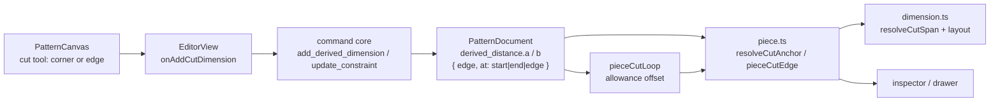

# Cut dimensions between points and edges

Status: draft — design review; Q1–Q4 on #72 are blocking
Refs: [#72 — cut dimensions from line to line and point - line](https://github.com/slawekniewiadomski/sew-craft/issues/72)
Builds on: `.ai/specs/2026-10-23-cut-dimension-tool.md` (amended by this spec),
`.ai/specs/2026-10-22-pieces-and-allowance.md` and
`.ai/specs/2026-10-23-default-piece-seam-allowance.md`
Command spec: `0.11.0` today; this proposal moves to the next minor (`0.12.0`)
Pattern schema: Q4 — keep `0.2`, or take the next version after the reserved
`0.3` seam removal

## 📝 TLDR

A Cut dimension currently measures **corner to corner**, or one edge's own length
by expanding that edge to its two corners. It cannot measure a corner against an
edge, or the gap between two edges, so the maker cannot annotate a piece's cut
width between a seam and a fold or between two parallel seams.

Proposed future behaviour: a cut anchor becomes either a **loop vertex** (as
today) or a whole **straight piece edge**. A corner-to-edge dimension measures
the perpendicular distance from the cut corner to the cut edge's supporting line;
an edge-to-edge dimension measures the perpendicular from the first cut
segment's midpoint to the second cut line. The constraint stays read-only and
derived: its number is recomputed from the cut loop and never reaches the solver.
This PR is the spec-only stage of the feature branch; after `spec-ready`,
implementation continues here, per `AGENTS.md`.

## 📝 Problem Statement

- **Who needs it:** the maker annotating a piece's **cut** measurements. The
  useful numbers are often between features, not between corners: the cut width
  between a seam line and a fold, or the gap between two parallel cut edges.
  #72 names all three combinations: edge → edge, corner → edge and edge → corner.
- **What happens today:** `CutAnchor` is `{ edge, at: 'start' | 'end' }` and
  `pieceCutVertex()` resolves only those two loop vertices from the cut loop.
  `add_derived_dimension` validates each anchor with `requireCutAnchor()`, which
  accepts only `start` and `end`. The canvas expands a clicked piece edge to its
  two endpoints (`startCutDimensionPlacement(piece.id, {edge, at:'start'},
  {edge, at:'end'})`), so an edge can never be one end of a measurement.
- **The workaround is not equivalent:** placing a corner-to-corner dimension
  between the two ends of an edge gives the edge's length, not the perpendicular
  gap to another edge. Measuring a corner against an edge has no corner-to-corner
  equivalent at all when the foot lies inside the edge.
- **Why the cut loop, not the stitch loop:** a cut dimension's existing contract
  is the allowance-offset boundary. `pieceCutLoop()` applies the per-edge
  cut-distance offset (`2 × width` for a double fold); the measured value must
  follow that geometry, not the finished seam.
- **Constraints:** read-only derived measurement, no solver equation, commands
  remain the only mutation path, stored documents keep loading, no new tool.

## 📝 Proposed Solution

### Vocabulary

| Term | Meaning |
| ---- | ------- |
| **Cut vertex** | A vertex of the piece's cut loop, addressed by `{ edge, at: 'start' \| 'end' }` as today. |
| **Cut edge** | A whole straight loop edge, addressed by `{ edge, at: 'edge' }`. Its geometry is the **edge's own cut segment**, from the outgoing offset point at the source edge's start to the incoming offset point at its end — not the join's other-side point. |
| **Cut line** | The infinite line through that cut segment; the source line plus its cut-distance offset (width, or 2× width for a double fold). |
| **Point → edge** | Perpendicular distance from a cut vertex to a cut line. |
| **Edge → edge** | Perpendicular from the first cut segment's midpoint to the second cut line. |
| **Parallel at pick time** | `|cross(unitA, unitB)| ≤ sin(0.5°)`; anti-parallel directions count as parallel. |

### Options considered

| # | Option | Trade-offs | Verdict |
| - | ------ | ---------- | ------- |
| A | **Add `at: 'edge'` to `CutAnchor`** | Smallest change: one stored value, the existing `piece`/`a`/`b` shape, one resolver, the existing rendering, dragging and dedupe. Cost: `at` now means "a vertex or the whole edge"; an older build reads `edge` as `end` (Q4) | **Recommended** |
| B | **Discriminated anchor** — `{ kind: 'vertex', edge, at } \| { kind: 'edge', edge }` | The two cases are explicit in the type and cannot be confused. Cost: rewrites the stored anchor shape, every `CutAnchor` consumer and a real schema migration; more churn for two extra cases | Rejected for v1 — the resolver and the reason helper already make the distinction |
| C | **New `derived_edge_distance` constraint type** | Keeps `derived_distance` untouched; an older build's `derived_constraints` filter would skip the new type. Cost: duplicates state, value, rendering, drag, dedupe and inspector rows; an older build's `constraintEntityIds` has no case for the new type and can throw during the solver pre-check or a delete | Rejected — not actually forward-safe |
| D | **Separate top-level edge-dimension collection** | An older build ignores the field, so it cannot misread the anchor. Cost: a parallel collection with its own delete/inspector/render paths; an older save drops the field (data loss, not a wrong number) | Rejected for v1 — too much surface for a read-only annotation |
| E | **Build nothing** | No code, no risk. | Rejected — #72 asks for the missing combinations and the current corner-only model cannot express them |

Option A wins because the entity, piece scope, derived measurement and editing
gestures are unchanged; only the anchor resolver and the validation grow. The
per-edge cut segment already exists in the offset result, so an edge anchor is a
view of data the cut loop computes today.

### Behaviour

1. **Anchors.** Each end of a cut dimension is a cut vertex or a straight cut
   edge of the **same piece**. Vertex-to-vertex stays exactly as today.
2. **Point → edge.** Let `P` be the vertex and `E` the edge, whatever the stored
   `a`/`b` order. The span is `P` and its perpendicular foot on `E`'s cut line.
   The stored order is kept for identity, but the span is normalized to
   vertex-first so reversing the picks does not flip the dimension line.
3. **Edge → edge.** At pick time both cut edges must be parallel within 0.5°.
   The pair is **canonicalized by piece edge order**: the edge earlier in
   `piece.edges` is `A`, the other is `B`, so the stored pick order does not
   change the value or the offset. The span is A's cut-segment midpoint and its
   foot on B's cut line (`B`'s normal). The parallel check is a pick-time guard,
   not a stored invariant: if a later edit rotates the pair out of parallel, the
   same midA → lineB measurement still resolves instead of disappearing.
4. **Straight source edges only.** An edge anchor requires the source entity to
   be a `line`. A curve's or arc's cut segment is a chord, not the curve, so it
   would measure the wrong geometry; the canvas and the command reject it.
5. **Measuring.** A cut dimension with an edge anchor is always **aligned**; the
   value is the absolute length of the resolved span. Vertex-to-vertex keeps its
   current `aligned`/`horizontal`/`vertical` choice. This is normative: the
   preview forces aligned, the inspector hides the axis for an edge anchor, the
   command rejects an explicit axis, and rendering ignores a stored axis.
6. **Read-only.** No value, reference or solver equation is added. The number is
   recomputed from the cut loop on every read, so an allowance change, a corner
   round or a geometry edit updates it without a command.
7. **Dedupe.** Two anchors that address the same pair (in either order) update
   the existing dimension's orientation/offset instead of adding a duplicate.
   Canonicalizing the span makes a reversed re-placement idempotent. An edge
   anchor and a pair of vertex anchors on that same edge are different
   measurements and are not deduped into each other.
8. **Deletion.** Deleting the piece, or an anchored edge (which deletes its
   piece), removes the dimension. Deleting a loop **point** leaves the piece in
   place, so the dimension stays and becomes **broken**; it is not silently
   removed. A line with a corner round cannot be deleted until the round is
   removed, as `delete_entity` already requires.

## 📝 Architecture



Takeaway: the cut loop remains the only geometry source; the new work is an
anchor resolver that returns a vertex or the edge's own offset segment, shared by
the command, the canvas and the inspector.

### Geometry package

- `types.ts` — `CutAnchor.at` gains `'edge'`; the rest of the anchor and
  `DerivedDistanceConstraint` are unchanged.
- `piece.ts` —
  - `pieceCutEdge(document, piece, edge)` returns the edge's **own** cut
    segment, or `null` for a missing piece/edge, a non-`line` source, a
    degenerate segment or a non-resolving cut loop. It must not reuse
    `pieceCutVertex` for both ends: at a bevel join that returns the previous
    edge's offset point. With
    `s = loop.naturalStart[edgeIndex]` and
    `e = (s + loop.spans[edgeIndex]) % cut.vertices.length`, the segment is
    `cut.points[cut.vertices[s].end - 1]` (outgoing at the natural start) →
    `cut.points[cut.vertices[e].start]` (incoming at the natural end). This is
    exactly the source line plus `leftNormal(direction) * allowanceDistance`, so
    it is independent of the adjacent allowance, the join style and a corner
    round. Tests pin a miter join, a bevel/miter-limit join, a collinear 180°
    split with unequal widths, a corner round and a reversed loop edge.
  - `pieceCutVertex` keeps resolving `start`/`end` and returns `null` for
    `at: 'edge'` instead of coercing it to `end`; test the defensive branch.
  - `resolveCutAnchor(document, piece, anchor)` → `{ kind, point?, segment? } |
    null`, where a vertex anchor carries its cut point and an edge anchor
    carries its cut segment. The span resolver computes the midpoint.
- `dimension.ts` — `resolveCutSpan` switches on the anchor kinds:
  - vertex-vertex: unchanged;
  - vertex-edge / edge-vertex: vertex + foot on the edge's cut line, normalized
    vertex-first;
  - edge-edge: canonical A → midA → foot on B's cut line.
  Return `null` when the span length is `≤ 1e-9` mm, so a dynamic zero span
  reports **broken** instead of a `0` reading. Do not return `null` merely
  because the pair is no longer parallel; the midA → lineB value is still
  defined. `measureCutDimension`/`derivedDimensionGeometry` then work on the
  resolved span and force aligned for edge anchors.
- Export one shared `cutAnchorIssue(document, piece, a, b)` helper returning a
  reason (`missing`, `not-straight`, `different-piece`, `same-anchor`,
  `not-parallel`, `zero-span`) plus the resolved span. The command maps reasons
  to validation errors and the canvas maps the same reasons to hints; one
  predicate, two renderings.
- `migration.ts` — depends on Q4. If the schema stays 0.2, unchanged. If the
  feature takes a later schema, add a dedicated branch for the previous version;
  do **not** fall a 0.2 document into the 0.1 seam-adoption branch.

### Frontend

- `PatternCanvas.vue` — `cutDimensionPending` carries a corner or edge anchor;
  a straight piece edge starts or completes an edge anchor instead of always
  expanding to its two vertices. Straight piece edges gain a subtle
  eligible-edge highlight while the cut tool is active, alongside the corner
  ring. The preview forces aligned for edge anchors. Hints come from
  `cutAnchorIssue` so the canvas and the command cannot drift.
- `frontend/src/lib/pieces.ts` — `sameAnchor`/`findDerivedDimension` already
  compare `{ edge, at }`, so they cover the new value; add `anchorForEdge` and
  the same-piece/canonical-order helper.
- `EditorView.vue` — the cut-dimension drawer row uses the same alarm; hide or
  disable the orientation control for an edge anchor and make
  `onDimensionOrientationEdit` unreachable for it.
- `frontend/src/lib/entity-properties.ts` — `CutDimensionSummary.anchors` prints
  `edge:at`; an edge anchor reads `e1:edge`. The inspector lists the dimension
  on the selected edge because it matches `anchor.edge`. A point deletion leaves
  the row visible as broken.
- `frontend/src/components/EntityPropertiesPanel.vue` — the cut row stays
  read-only (remove only); no value field.
- No new component, tool, icon or route.

### Documentation

- `docs/architecture/data-model.md` — the anchor kinds, the edge's own cut
  segment, and the Q4 schema decision.
- `docs/architecture/geometry-core.md` — cut-edge resolution, the bevel rule and
  the span cases.
- `docs/domain/command-spec.md`, `docs/domain/command-spec.json`,
  `config/geometry.php` — `add_derived_dimension` anchor rules and the next
  `spec_version`, in sync. The JSON/PHP `cut_anchor` type string must expose
  `at: start|end|edge` (it currently only carries the string `cut_anchor`), and
  `tests/Feature/CommandSpecTest.php` asserts the new version.
- `docs/domain/glossary.md` — cut edge, cut line, point-to-edge cut dimension,
  cut-distance offset.
- `BACKWARD_COMPATIBILITY.md` — the new anchor value, the older-build behaviour
  that Q4 chooses, and the point-vs-edge deletion difference.
- `.ai/specs/2026-10-23-cut-dimension-tool.md` — mark **amended**: the one-click
  edge shortcut, the old hints and the old acceptance criterion are superseded
  by this spec. Update its tests in the implementation.

## 📝 Data Model

```ts
interface CutAnchor {
  edge: EntityId;
  /**
   * `start`/`end` address a cut-loop vertex; `edge` addresses the whole
   * straight cut edge's own offset segment.
   */
  at: 'start' | 'end' | 'edge';
}

type DerivedDistanceConstraint = {
  id: EntityId;
  type: 'derived_distance';
  piece: EntityId; // both anchors must belong to this piece
  a: CutAnchor;
  b: CutAnchor;
  orientation?: DimensionOrientation; // aligned when either anchor is `edge`
  offset?: number;
  lastKnownValue?: number; // never written by v1
};
```

- No new entity, field or table; one enum value is added.
- **Schema (Q4).** `0.3` is reserved for the legacy-seam removal documented in
  `BACKWARD_COMPATIBILITY.md`, so this feature must not consume it. Two honest
  choices remain:
  - keep `0.2`: an older build accepts the document, reads `edge` as `end`,
    renders a wrong number **and can edit/save that misread**;
  - take the next schema after `0.3` (e.g. `0.4`): an older build opens the
    document read-only with an upgrade notice. It still **renders** the anchor
    as `end` (the canvas does not check `readOnly` for cut dimensions), but it
    cannot persist the misread.
  Neither option is a clean refusal. Q4 asks which risk the project accepts; the
  spec does not silently pick one.
- If a later schema is chosen, add a dedicated previous-version branch in
  `normalizeDocument`; the current function sends every non-current schema into
  the 0.1 seam-adoption path, which would rewrite a 0.2 document.

## 📝 API Contracts

### `add_derived_dimension`

- params: `piece`, `a`, `b`, `orientation?`, `offset?` (unchanged shape).
- Each anchor must name an edge in `piece.edges` and `at` must be `start`,
  `end` or `edge`.
- A vertex anchor must resolve to a cut-loop vertex; an edge anchor must name a
  straight `line` edge and resolve to a non-degenerate **edge's own** cut
  segment.
- The two anchors must be different. Reject `{ edge: E, at: 'edge' }` paired
  with `{ edge: E, at: 'start' | 'end' }` by **anchor identity**, not by a
  cut-line distance (a bevel join makes the vertex point differ from the edge's
  own line). Reject the same edge twice.
- Edge-to-edge requires the two cut lines to be parallel by
  `|cross(unitA, unitB)| ≤ sin(0.5°)` (anti-parallel accepted) at creation time.
- The resolved span must be greater than `1e-6` mm; a smaller span is
  `zero-span`. The read path returns `null` for a span `≤ 1e-9` so a dynamic
  zero span reports broken rather than `0`.
- `orientation` may be `aligned`, `horizontal` or `vertical` only for
  vertex-to-vertex; with an edge anchor it must be `aligned` or omitted.
- `offset` must be finite when present.
- inverse: `remove_constraint`.

### `update_constraint`

- `orientation`/`offset` only, as today. `horizontal`/`vertical` are rejected
  when either anchor is an edge anchor.
- `value` and `reference` stay rejected for `derived_distance`.
- Anchors are immutable; replacing one is remove + add.

### `remove_constraint` / `delete_entity` / `delete_piece`

- `delete_piece` removes its cut dimensions.
- Deleting an anchored **edge** removes the piece, so the dimension goes with
  it; a line with a corner round must have the round removed first.
- Deleting a loop **point** leaves the piece and the dimension in place; the
  dimension becomes broken (no reading, inspector row visible).
- `remove_constraint` is unchanged.

### Command spec sync

No new command and no envelope change; the constraints on
`add_derived_dimension` widen. All three files move to the next minor
(`0.12.0` from today's `0.11.0`), expose `at: start|end|edge` in the
`cut_anchor` type description and update `CommandSpecTest`. The package version
moves with them.

## 📝 UI/UX

### Picking

```
[Cut dimension] armed
  corner ring on every piece loop vertex; straight piece edges are eligible
  pick 1: a corner or straight edge of a piece → pending anchor
  pick 2: corner or straight edge of the same piece → placement starts
  click: place → add_derived_dimension
```

- The two picks may be any combination: corner → corner, corner → edge,
  edge → corner, edge → edge.
- An edge's **own** length is measured by its two corners; the one-click edge
  shortcut is removed, which is the behaviour change Q2 asks about. This is its
  own commit so the additive anchor model can land and be reverted separately.
- `Escape`, a tool change or a click on empty canvas clears the pending anchor
  and its hint.

### Hints

The cut tool already has a live region; the hints come from `cutAnchorIssue`:

| Situation | Text |
| --------- | ---- |
| Tool armed, no pick | `Pick a corner or a straight edge of one piece.` |
| First anchor pending | `Pick the second anchor on the same piece.` |
| First pick is not on a piece | `Pick a corner or a straight edge of a piece.` |
| Second pick is on another piece | `Both anchors must belong to the same piece.` |
| Second pick is a curve or arc | `Pick a straight edge.` |
| Two non-parallel edges | `Pick two parallel edges.` |
| Same anchor, or a vertex on its own edge | `The anchors must be different.` |
| Zero span | `The anchors must be different.` |

The live region announces each rejection without moving focus.

### Rendering and editing

- The resolved span drives the existing layout: the **dimension line is drawn
  across the gap**, and the **extension lines run from the measured point/foot
  parallel to the edge**. No new label style or colour.
- A corner → edge dimension runs from the corner to its foot on the edge, with
  the extension lines along the edge.
- An edge → edge dimension runs from the first cut segment's midpoint to its foot
  on the second cut line; the extensions run along each edge.
- No axis control for edge anchors; vertex-to-vertex keeps today's presentation.
  The inspector hides the control and rendering ignores a loaded axis.
- The cut dimension stays read-only: drag to reposition, delete, no value field.
- The inspector row shows `e1:edge → e2:edge`; selecting an edge lists the cut
  dimensions that anchor to it.

## 📝 Edge Cases & Failure Scenarios

| Scenario | Expected behaviour |
| -------- | ------------------ |
| Corner lies on the picked edge's cut line | Rejected as a zero span; hint says the anchors must be different. |
| Same edge picked twice, or its vertex plus its own edge | Rejected by anchor identity. |
| Two parallel edges, same cut line | Rejected as a zero gap. |
| Two non-parallel edges at pick time | Rejected with the parallel hint; no partial document change. |
| Edges rotate non-parallel after placement | Still resolves as midA → lineB; not marked broken. |
| Near-parallel edges (≤ 0.5°) | Accepted; the gap is measured from the canonical first midpoint to the second cut line. |
| Anti-parallel edges (180°) | Accepted as parallel. |
| Bevel/miter-limit join | The edge's own cut segment uses its outgoing/incoming points, not the neighbouring edge's offset; test pins the value. |
| Collinear 180° split with unequal widths | The edge's own cut segment is on its own offset line; test pins it. |
| Corner round on the edge | The edge's own cut segment follows the trimmed source line; the anchor still resolves. |
| Reversed loop edge | The natural start/end mapping still yields the edge's own segment. |
| Foot outside the drawn cut segment | Accepted; the dimension still measures to the cut line. |
| Curve or arc edge | Rejected with `Pick a straight edge.` |
| Different pieces | Rejected; a cut dimension stays within one piece. |
| Vertex moves onto the edge line after placement | The span becomes `≤ 1e-9`; the canvas draws nothing and the inspector reports broken, not `0`. |
| Allowance changed after placement | The value recomputes from the new cut loop; no command rewrites the dimension. |
| Piece or anchored edge deleted | The dimension is removed with the piece. |
| Loop point deleted | The piece stays, the dimension stays and reports broken. |
| Line with a corner round deleted | `delete_entity` asks to remove the round first; then the edge/piece deletion removes the dimension. |
| Undo a placement | Removes the dimension; undo of a deletion restores it with its anchors. |
| Dimension already on the same anchor pair | Deduped; only orientation/offset update; reversed picks are idempotent after canonicalization. |
| Previous-version document | See Q4: unchanged if 0.2 stays; a dedicated relabel if a later schema is taken. |
| Previous-version build opens the new document | It opens read-only with an upgrade notice (if a later schema) or as an editable 0.2 document (if 0.2 stays). In both cases it **renders** `edge` as `end`; Q4 owns that risk. |

## 📝 Risks & Impact Review

- **Protected surface (medium).** `CutAnchor` and `DerivedDistanceConstraint` are
  exported from `@sewcraft/geometry`; `add_derived_dimension` is a command
  contract; one stored anchor value changes meaning. The package minor bump, the
  three-way command-spec sync and the compatibility note are required.
- **A schema bump is not a clean refusal.** The older build opens an unknown
  schema read-only but still renders cut dimensions; its `pieceCutVertex`
  ternary reads `edge` as `end`. A bump prevents the misread from being
  **edited and saved**, not from being displayed. Q4 must choose between that
  read-only misrender and the editable 0.2 misread.
- **Bevel joins are the sharp edge.** The two cut points at a join are not the
  same point for a bevel; using `pieceCutVertex` for an edge anchor would tilt
  the measured line and make the parallel test unreliable. The edge's own
  outgoing/incoming pair is the only correct source, and it needs a bevel
  fixture, not just a miter square.
- **Point deletion is not edge deletion.** `constraintEntityIds` returns `[]`
  for `derived_distance`, so a deleted loop point leaves the piece and the
  dimension broken; only the piece/edge cascade removes it. The API, the
  inspector and the tests must say so.
- **Order and dedupe.** `findDerivedDimension` is order-insensitive but the span
  was not; canonicalizing edge-edge by piece edge order and vertex-edge to
  vertex-first makes a reversed re-placement idempotent. Tests cover both
  directions.
- **Shared reason helper.** A null-returning resolver cannot produce the
  distinct command errors and canvas hints. One exported `cutAnchorIssue` with a
  reason keeps them in sync; tests pin every reason.
- **Zero-span read path.** `derivedDimensionState` would report `derived` for a
  zero span and the drawer would show `0`; `resolveCutSpan` must return null at
  `≤ 1e-9` so the existing broken state is used.
- **Command-spec exposure.** The JSON/PHP `cut_anchor` entry is only a string;
  without extending it, an agent reading `GET /api/commands` would not learn
  about `at: 'edge'`. The sync includes the type description and a
  `CommandSpecTest` assertion.
- **Superseded spec.** The implemented cut-dimension spec still documents the
  one-click edge shortcut and the old hints; it must be marked amended and its
  tests updated, or the repo carries two contradictory contracts.
- **Gesture change is separable.** Removing the one-click edge length is a
  breaking UX change gated on Q2; keep it in its own commit so the additive
  anchor model can land and be reverted independently.
- **No solver or export impact.** `solveDocument` filters `derived_distance`;
  SVG export serializes geometry, not annotations.
- **Mockups.** The interaction is a two-pick gesture and hint text; the spec
  carries the ASCII flow and the hint table. No committed mockup: the configured
  `agent-browser` provider is not installed and no shared test-env descriptor is
  present, so a visual would be an illustration, not evidence.

## ❓ Open Questions

These are blocking product/UX/architecture decisions, asked on #72. The draft PR
stays draft until they are answered; the rest of the design is written under the
recommended answers so it can be reviewed as a coherent whole.

| # | Question | Why it blocks | Recommended answer |
| - | -------- | ------------- | ------------------ |
| Q1 | Should an **edge-to-edge** cut dimension measure the **cut loop** (allowance offset, `2 × width` for a double fold) or the **stitch loop**? | The two numbers differ by the allowances and answer different questions; the resolver, the label and the acceptance tests depend on it. | **Cut loop**, consistent with the tool's name and the existing corner-to-corner dimension. A stitch measurement belongs to the regular Dimension tool (#71). |
| Q2 | How does the tool take a **whole edge as an anchor** without losing today's one-click edge length? | Today a click on a piece edge immediately measures that edge; if an edge can also be an anchor, the same click means two things. The answer changes the canvas state machine, its tests and the already-implemented spec. | **Unified two-pick gesture**: every cut dimension picks two anchors, then places. An edge's own length is measured by its two corners. One rule for all combinations; the cost is one extra click. Alternatives: `Shift`-click for an edge anchor (hidden gesture), or a Corner/Edge mode in the ribbon (more UI). |
| Q3 | May a cut dimension span **two pieces**? | The current model stores one `piece` and both anchors must be on its loop; cross-piece support would need a different identity, validation and broken-state story. | **Same piece only** for this slice. Cross-piece cut dimensions are a separate feature; the existing `piece` field keeps the model honest. |
| Q4 | How should the document version advertise `at: 'edge'`, given `0.3` is reserved for the legacy-seam removal? | A 0.2 document lets an older build misread `edge` as `end` and **edit/save** that misread. A later schema opens it read-only with an upgrade notice, but the older build still **renders** the wrong vertex; it is not a clean refusal. A separate collection would be ignored (no misread) but older saves would drop it. | **Take the next schema after the reserved 0.3 (e.g. 0.4) and sequence behind the seam removal**, so a downgrade blocks edits/saves. If shipping now matters more than downgrade safety, keep 0.2 and accept the editable misread. Do not consume 0.3 alone. |

## ✅ Resolved assumptions (autonomous defaults)

| # | Assumption | Why | Status |
| - | ---------- | --- | ------ |
| R1 | Add `at: 'edge'` to `CutAnchor` (option A) rather than a discriminated anchor, a new constraint type or a separate collection | One stored shape, one resolver, one renderer; the edge's own cut segment is already computed by the offset | ⚠ NEEDS HUMAN CONFIRMATION — changes an exported type and stored anchor semantics |
| R2 | An edge anchor resolves to the edge's **own** outgoing→incoming cut segment, not to `pieceCutVertex` at both ends | A bevel join's two points differ; reusing the vertex resolver would tilt the measured line | Reversible |
| R3 | Edge anchors are straight source `line` entities only; curves and arcs are a follow-up | A curve's cut segment is a chord, so a "line" measurement would be wrong | Reversible |
| R4 | Edge-edge is canonicalized by piece edge order; vertex-edge is normalized vertex-first | Makes a reversed re-placement idempotent with the existing unordered dedupe | Reversible |
| R5 | The 0.5° parallel rule is pick-time only; a later drift keeps the midA → lineB measurement | A read-only derived dimension should not disappear or become an angle | Reversible |
| R6 | Edge anchors are `aligned` only; vertex-to-vertex keeps all three axes | An axis gap between two edges has no single definition | Reversible |
| R7 | Deleting a loop point leaves the dimension broken; deleting the piece/edge removes it | `constraintEntityIds` is empty for derived dimensions; only the piece cascade removes them | Reversible |
| R8 | One shared `cutAnchorIssue` reason helper drives both command errors and canvas hints | A null resolver cannot tell "not straight" from "not parallel"; two copies would drift | Reversible |
| R9 | The command spec moves to the next minor (`0.12.0`); the package moves with it; the schema is Q4 | The anchor value is a contract change; the schema needs its own decision | ⚠ NEEDS HUMAN CONFIRMATION — the schema choice is Q4 |
| R10 | The one-click edge shortcut removal is a separate commit; cross-piece, curved anchors and stitch-loop cuts are out of scope | Keeps the additive model revertible and the slice to #72's combinations | Reversible |

## 📋 Phasing

- **Phase 1 — Anchor model and geometry.** `at: 'edge'`, the edge's own cut
  segment, the anchor resolver, span resolution, the zero-span read guard and
  the schema decision. A hand-built document with an edge anchor resolves and
  renders.
- **Phase 2 — Commands.** Validation, the shared reason helper, orientation
  rules, dedupe/canonicalization and the command-spec sync. The API and agents
  can create the new dimensions.
- **Phase 3 — Canvas.** Edge/corner picks, the eligible-edge highlight, the live
  preview and hints. The one-click shortcut removal is its own commit.
- **Phase 4 — Inspector and failure states.** Anchor labels, the hidden axis,
  broken rows, point-deletion behaviour and the amended old spec.
- **Phase 5 — Documentation and verification.** Docs, compatibility note, full
  gate and a manual walkthrough of all three combinations.

## 📋 Implementation Plan

### Phase 1 — Anchor model and geometry

1. Add `'edge'` to `CutAnchor.at` with a doc comment; update every exhaustive
   switch/fixture the compiler reports, and make `pieceCutVertex` return `null`
   for `at: 'edge'`; test the defensive branch.
2. Add `pieceCutEdge` with the outgoing/incoming endpoints (not two
   `pieceCutVertex` calls); test a miter square, a bevel/miter-limit join, a
   collinear 180° split with unequal widths, a corner round, a reversed edge and
   a non-line source.
3. Add `resolveCutAnchor` and extend `resolveCutSpan` for the three cases,
   canonicalization and the `≤ 1e-9` null guard; test both pick orders, a dynamic
   zero span, a non-parallel drift and a foot outside the segment.
4. Decide Q4, then either leave `normalizeDocument` unchanged or add the
   dedicated previous-version branch; test a previous-version document with a
   legacy seam on a closed loop and a relabel that does not add `seams`.

### Phase 2 — Commands

1. Add `cutAnchorIssue` returning a reason plus the span; test every reason.
2. Extend `requireCutAnchor` and `applyAddDerivedDimension`: anchor kinds,
   straight-edge rule, same-piece rule, same-edge identity (edge + its own
   vertex), distinct-anchor rule, zero-span rule, parallel rule and aligned-only
   orientation; map reasons to messages and test each one.
3. Extend `update_constraint` orientation validation for edge anchors; test
   accepted/rejected edits and the read-only value/reference rejection.
4. Extend `findDerivedDimension`/`sameAnchor` coverage and the canonical order;
   test `e1→e2` then `e2→e1` and the two identity cases.
5. Sync the three command-spec files at `0.12.0`, expose
   `at: start|end|edge` in the `cut_anchor` type description, bump the package
   version and update `CommandSpecTest`; test `GET /api/commands` plus an
   edge-anchored payload.

### Phase 3 — Canvas

1. Make `cutDimensionPending` carry a corner/edge kind and accept a straight
   edge as a first or second pick; test all four combinations and the
   curve/arc reject.
2. Add the eligible-edge highlight, the hints from `cutAnchorIssue` and the
   `Escape`/tool-change clear; test each reason and that a cancelled gesture
   emits nothing.
3. Resolve the preview through the new span logic and force aligned for edge
   anchors; test the preview value and that no axis is offered.
4. Wire `onAddCutDimension` to the new resolver and canonical dedupe; test reuse
   of an existing dimension on the same anchors, both orders.
5. Remove the one-click edge shortcut in its own commit and update the affected
   tests and the amended spec.

### Phase 4 — Inspector and failure states

1. Update the cut-dimension anchor label, hide the orientation control for an
   edge anchor and ignore a loaded axis; test both.
2. Test the broken paths: delete a loop point, move a vertex onto the edge line,
   rotate a pair non-parallel (still resolves), and undo.

### Phase 5 — Documentation and verification

1. Update `docs/architecture/data-model.md`,
   `docs/architecture/geometry-core.md`, `docs/domain/glossary.md`,
   `docs/domain/command-spec.md|json`, `config/geometry.php`,
   `BACKWARD_COMPATIBILITY.md` and the amended
   `.ai/specs/2026-10-23-cut-dimension-tool.md`.
2. Run the full gate and walk through all three combinations on the canvas:
   place, drag, change an allowance, delete a point and an edge, and undo.

## ✅ Acceptance criteria

- [ ] A cut dimension can measure a corner against a straight edge, in either
      order, and reports the perpendicular distance to the edge's own cut line.
- [ ] A cut dimension can measure two parallel straight edges and reports the
      perpendicular from the canonical first midpoint to the second cut line.
- [ ] Bevel joins, collinear 180° splits, corner rounds and reversed loop edges
      resolve the edge's own cut segment; tests pin each.
- [ ] Curves/arcs, non-parallel edges, zero spans, different pieces, a vertex on
      its own edge and axis orientations on edge anchors are rejected with a
      specific message and no document change.
- [ ] The value follows allowance, geometry and corner-round changes because it
      is recomputed from the cut loop; no solver equation is added.
- [ ] Dragging, removal, canonical dedupe and the selected-edge inspector row
      work for the new anchors; a reversed re-placement is idempotent.
- [ ] Deleting the piece/edge removes the dimension; deleting a loop point
      leaves it broken; a dynamic zero span reports broken, not `0`.
- [ ] The one-click edge shortcut removal is its own commit and the implemented
      cut-dimension spec is marked amended.
- [ ] The command spec is synced at the next minor and exposes
      `at: start|end|edge`; existing payloads still apply.
- [ ] The Q4 schema choice is recorded and the downgrade behaviour is documented
      honestly (read-only misrender or editable misread).
- [ ] The full validation gate passes and coverage stays at 100 %.

## Out of scope

- Curves and arcs as edge anchors.
- Cross-piece cut dimensions.
- Stitch-loop cut dimensions (regular dimensions cover the finished geometry).
- Three-anchor or chain cut dimensions.
- Automatic cut dimensions between every pair of parallel edges.
- Value/reference editing for cut dimensions; they stay derived.
- A separate edge-dimension collection (option D).
- PDF/DXF export changes; annotations are not exported.

## Checks

```bash
npm run format
npm run typecheck
npm run lint
npm run format:check
npm run test:coverage
npm run build
docker compose run --rm --no-deps -e DB_CONNECTION=sqlite -e DB_DATABASE=:memory: \
  app sh -c "composer install --no-interaction && php artisan test --coverage --min=100"
docker compose run --rm --no-deps app sh -c "composer install --no-interaction && vendor/bin/pint"
```
