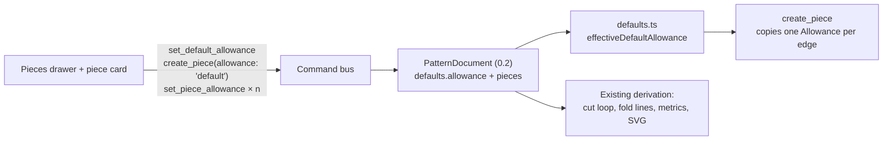

# Default piece seam allowance

Status: draft — design review; Q1–Q3 are open and asked on the issue
Refs #64
Builds on: 2026-10-22-pieces-and-allowance (pieces and per-edge allowances),
2026-10-23-pieces-sidebar-and-selection (Pieces drawer and the shared piece card),
2026-10-23-project-save-and-upgrades (draft PR #65, not yet merged — how the
document persists)
Related: 007 (superseded), 2026-10-20-seam-allowance-side (superseded)

## 📝 TLDR

Every new piece starts with **no allowances**, so a seven-edge piece means seven
identical "Seam / 10 mm" entries before it can be cut. Proposed future behaviour:
a **project default allowance** — **10 mm seam out of the box** — stored in the
pattern document, copied onto every edge when a piece is created, plus a
**piece-level "All edges" control** for a whole-piece override and the existing
per-edge rows for exceptions. Existing pieces are never rewritten by a default
change. The 10 mm fallback already exists in the piece card but is only reached
when an edge is switched from None to a kind
(`frontend/src/components/PiecePanel.vue:44`); nothing persists or applies it
automatically.

## 📝 Problem Statement

- **Who needs it:** the maker drafting several pieces from one design, where the
  same allowance (typically 10 mm) applies to most edges of most pieces. Also the
  agent authoring commands, which currently has to emit one
  `set_piece_allowance` per edge after every `create_piece`.
- **What happens today:**
  - `create_piece` builds `{ id, edges, allowances: [] }`
    (`packages/geometry/src/commands.ts:1717-1724`): a fresh piece carries no
    allowances at all.
  - The only way to add one is per edge: the piece card lists one kind select and
    one width input per loop edge and emits `set_piece_allowance`
    (`frontend/src/components/PiecePanel.vue:198-235`,
    `frontend/src/views/EditorView.vue:804-820`). There is no bulk action.
  - `DEFAULT_ALLOWANCE_WIDTH = 10` is a component constant used when an edge
    changes from None to Seam/Single/Double
    (`frontend/src/components/PiecePanel.vue:44,65`). It is not project data, is
    not configurable and does not survive a reload.
  - `PatternDocument` has no place for a default
    (`packages/geometry/src/types.ts:240-262`), and nothing in the Projects page
    or the editor edits one.
- **Evidence it matters:** #64 asks for exactly this in two lines: "Project
  should have default seam allowance set to 10mm; each piece should have it set
  as in project, or per piece." The 10 mm value is already the piece card's
  fallback, so today the product knows the number but forgets it on every piece.
- **Constraints:** commands remain the only mutation path (`AGENTS.md`, rule 1);
  `@sewcraft/geometry` stays pure and framework-agnostic; allowances stay per
  edge unless Q1/Q3 changes that; stored documents must keep loading
  (`BACKWARD_COMPATIBILITY.md`, surface 5); units stay millimetres and the
  allowance `width` stays the **finished** width; coverage stays at 100 % for
  `packages/geometry/src` and `frontend/src`.
- **Why it is ambiguous:** the issue does not say whether changing the project
  default should update pieces that already exist, whether "project" means the
  pattern document or the Projects row, or whether "per piece" is one value for
  the whole piece or per-edge control. Those are Q1–Q3; the design below is the
  recommended shape under each and stays provisional until they are answered.

## 📝 Proposed Solution

### How other pattern tools shape this

Seamly2D/Valentina and CLO3D both expose a **default seam allowance for new
pieces** and a **per-piece value** with per-edge exceptions. That shape — a
default for creation, a piece value, per-edge exceptions — is what this spec
follows. Whether the default should also be a live link that updates pieces
already drafted is the part the issue leaves open, and it is Q1.

### Options considered

| #   | Option                                                                                                                                                                                                   | Trade-offs                                                                                                                                                                                                                                                                                                                              | Verdict     |
| --- | -------------------------------------------------------------------------------------------------------------------------------------------------------------------------------------------------------- | --------------------------------------------------------------------------------------------------------------------------------------------------------------------------------------------------------------------------------------------------------------------------------------------------------------------------------------- | ----------- |
| A   | **Snapshot on creation.** The default lives in the document; `create_piece` copies it onto every loop edge; the piece card gets an "All edges" bulk control plus the existing per-edge rows. Changing the default affects only pieces created afterwards | Smallest model change: `Allowance` is untouched, an absent per-edge entry keeps meaning "no allowance", existing documents and pieces are byte-identical, and undo is the existing command inverse. Cost: a default change does not follow existing pieces; the user re-applies per piece (one click)                                                                                                       | **Recommended** |
| B   | **Live inheritance.** An edge with no explicit entry resolves to the piece default, then to the project default; an explicit `none` opts out | "As in project" becomes literally true: one change updates every inheriting piece. Cost: the meaning of an absent `Allowance` changes (today it means *no allowance*), so a tri-state (`inherit` / `none` / explicit) is needed, existing documents need a migration, every derivation (cut loop, fold lines, metrics, export) reads a new resolver, and a per-edge edit silently breaks the inheritance link | Rejected for v1 — a schema-level change to a meaning, for behaviour Q1 may not want |
| C   | **UI-only preference.** Keep `DEFAULT_ALLOWANCE_WIDTH` and store a project-wide width in `localStorage`; the card pre-fills it | No document, command or schema change at all. Cost: the value does not travel with the project, is invisible to export/agents and to another browser, and does not satisfy "project should have" it                                                                                                                                    | Rejected — not project data                                                |
| D   | **Build nothing.** Keep typing 10 mm per edge, or use the existing None→Seam fallback | Zero work. Cost: the reported repetition stays, and #64 stays open                                                                                                                                                                                                                                                                      | Rejected — this is the workaround the issue asks to replace                |

### Decision: where the default lives

Q2 asks whether "project" means the Projects row or the pattern document. The
recommended answer is the **pattern document**, because the default is consumed
by `create_piece` inside `@sewcraft/geometry`, must travel with the saved
document and its checkpoints, and is used by export metadata. A Projects column
would add a migration (a `risk-high` surface per `BACKWARD_COMPATIBILITY.md`,
surface 4), an API field, a resource change and a second source of truth to keep
in sync with the document. In v1 there is one pattern per project (draft #65),
so the document *is* the project's design; a later multi-pattern feature can
copy the default onto the project if that scope is wanted.

### Behaviour

1. **Effective default.** The document may carry
   `defaults.allowance = { width, kind? }`, or `null` for "no default". A
   document that has no `defaults` — every document stored before this change —
   resolves to the built-in **10 mm seam**, the same number the piece card
   already falls back to. `normalizeDocument` writes the field on load so a save
   persists it; that migration is one-way and idempotent.
2. **Editing the default.** `set_default_allowance` sets, changes or clears it.
   `width` is the finished width and must be a finite number `> 0`; `kind`
   defaults to `seam`; `remove: true` clears the default. The inverse restores
   the previous preset; an identical set is a no-op.
3. **Creation.** `create_piece` gains
   `allowance?: 'default' | 'none' | { width, kind? }`. `'default'` copies the
   effective default onto **every** loop edge (one `Allowance` per edge, all
   `kind: 'seam'` unless the default says otherwise); `'none'` reproduces
   today's empty list; an explicit preset copies that preset. **Absent means
   `'none'`**, so every existing API/agent payload and test behaves exactly as
   before. The editor's Create piece action (ribbon and drawer empty state)
   sends `'default'`.
4. **Per piece.** The piece card gains an **All edges** row: kind select, width
   input and **Apply**. Apply dispatches one `set_piece_allowance` per loop edge
   as a single `dispatchGroup` — one journal entry, all-or-nothing — or one
   `remove` per edge when kind is **None**. This is the "or per piece" override:
   it never touches another piece and stores no new field.
5. **Per edge.** The existing rows stay and remain the exception path. Removing
   one edge's allowance is how a cut-on-fold edge stays on the fold; it keeps
   working exactly as today.
6. **No retroactivity.** Changing or clearing the default never rewrites an
   existing piece. A change affects only pieces created afterwards. If Q1
   chooses live inheritance instead, phase 1's `effectiveDefaultAllowance`
   resolver is where that behaviour would be added.
7. **Derivation.** Rendering, metrics, fold lines, cut dimensions and SVG export
   read `Piece.allowances` exactly as today. The default is not rendered and is
   not exported; it exists only to seed a piece.
8. **Undo.** Every step is a command: default edits, creation (with its copied
   allowances, through `delete_piece`), and bulk applies. Undo/redo restores the
   exact previous document, including the default.
9. **Persistence.** The default is part of `PatternDocument`, so it saves and
   checkpoints with the pattern under #65's design. No new endpoint, table or
   API field. Until #65 lands the whole document is still in memory; this change
   is no worse than the status quo.
10. **Documents.** Schema string stays `sewcraft.pattern/0.2`: the field is
    optional and additive, the precedent set by `cornerRounds`. No existing
    field changes meaning; stored documents load unchanged (they gain the
    default in memory and on their next save).

### Why the default does not rewrite existing pieces

A project default that silently changes a cut outline after the maker has
already adjusted a piece's fold edge is a destructive surprise, and it would
make a bulk "apply" ambiguous the moment an edge had been fine-tuned. Snapshot
keeps the change reversible (delete and recreate a piece, or re-apply), keeps
the existing per-edge model intact, and leaves the schema string alone. The cost
— one click to apply a new default to an existing piece — is the trade-off Q1
asks the maintainer to accept or reject.

## 📝 Architecture

| Module                                                   | Change                                                                                                                                  |
| -------------------------------------------------------- | --------------------------------------------------------------------------------------------------------------------------------------- |
| `packages/geometry/src/types.ts`                         | `AllowancePreset`, `PatternDefaults`; `PatternDocument.defaults?`                                                                       |
| `packages/geometry/src/defaults.ts` (new)               | `DEFAULT_ALLOWANCE_PRESET` (10 mm seam), `effectiveDefaultAllowance(document)`, `normalizeDefaults(document)`                            |
| `packages/geometry/src/commands.ts`                      | `set_default_allowance`; `create_piece` gains `allowance`; validation, apply, inverse                                                   |
| `packages/geometry/src/migration.ts`                     | `normalizeDocument` calls `normalizeDefaults` for a current document and for the 0.1 → 0.2 path                                          |
| `packages/geometry/src/document.ts`                      | `createEmptyDocument()` starts with the built-in preset                                                                                  |
| `config/geometry.php`, `docs/domain/command-spec.{md,json}` | New command and `create_piece` param, `spec_version` 0.11.0, kept in sync                                                              |
| `docs/architecture/data-model.md`, `BACKWARD_COMPATIBILITY.md` | Record the additive document field and the load-time default                                                                       |
| `frontend/src/lib/allowance-defaults.ts` (new)           | `defaultAllowanceSummary(document)`, `uniformAllowance(piece)` view models                                                               |
| `frontend/src/views/EditorView.vue`                      | Default row in the Pieces drawer; Create piece sends `'default'`; bulk apply handler                                                    |
| `frontend/src/components/PiecePanel.vue`                 | "All edges" row emitting `set-all-allowances`; existing per-edge rows unchanged                                                         |



**Takeaway:** the default is read only by `create_piece`; everything downstream
keeps reading materialised `Piece.allowances`, so no renderer, exporter or
solver path changes.

## 📝 Data Model

```ts
/** The allowance copied onto a new piece; `width` is the finished width. */
export interface AllowancePreset {
  width: number;
  /** Omitted means `seam`. */
  kind?: AllowanceKind;
}

export interface PatternDefaults {
  /** `null` means new pieces start with no allowance. Absent resolves to the built-in 10 mm seam. */
  allowance: AllowancePreset | null;
}

export interface PatternDocument {
  schema: PatternSchema;
  units: 'mm';
  entities: Entity[];
  constraints: Constraint[];
  pieces: Piece[];
  /** Optional and additive; documents written before it resolve to `DEFAULT_ALLOWANCE_PRESET`. */
  defaults?: PatternDefaults;
  seams?: Seam[];
  cornerRounds?: CornerRound[];
}
```

```ts
export const DEFAULT_ALLOWANCE_PRESET: AllowancePreset = { width: 10, kind: 'seam' };

/** The preset a new piece should copy, or `null` when the project default is off. */
export function effectiveDefaultAllowance(document: PatternDocument): AllowancePreset | null {
  if (document.defaults === undefined) return DEFAULT_ALLOWANCE_PRESET;
  return document.defaults.allowance;
}
```

`normalizeDefaults` accepts a stored `defaults` value and returns a valid
`PatternDefaults`: an unknown kind or a non-finite/`<= 0` width falls back to
the built-in preset; a missing object resolves to the built-in preset; `null`
is preserved as "no default". It returns the caller's object unchanged when
`defaults` is already present and valid, so `normalizeDocument` keeps its
identity guarantee for current documents. `normalizeDocument` applies it for
both the current-schema and legacy paths, so a loaded document always has a
resolvable default. Nothing is written back into `Piece.allowances` by the
migration.

## 📝 API Contracts

`spec_version` `0.10.0` → **`0.11.0`**, kept in sync across `config/geometry.php`,
`docs/domain/command-spec.json` and `docs/domain/command-spec.md`.

### `set_default_allowance` (new)

- params: `width?: number`, `kind?: 'seam' | 'single' | 'double'`,
  `remove?: bool`
- behaviour: writes `document.defaults.allowance`; `kind` omitted means `seam`;
  `remove: true` writes `null` and takes no width or kind
- validation: width finite and `> 0`; kind in the known set; `remove` alone
- inverse: `set_default_allowance` restoring the stored preset, or `remove: true`
  when it was `null`
- idempotent: an unchanged preset is a no-op with a `null` inverse

### `create_piece` (extended)

- params: `edges: entity_id[]` (ordered, closed), `name?: string`,
  `quantity?: int ≥ 1`, `allowance?: 'default' | 'none' | { width: number, kind?: 'seam' | 'single' | 'double' }`
- behaviour: `'default'` copies the effective default onto every edge in
  `edges` order; `'none'` or an absent param keeps today's empty list; an object
  copies that preset
- validation: unchanged loop rules; preset width finite and `> 0`; unknown kind
  rejected
- inverse: `delete_piece` (which removes the copied allowances with the piece)

No HTTP route changes. The command spec test
(`tests/Feature/CommandSpecTest.php`) gains the new command and the extended
param.

## 📝 UI/UX

**Pieces drawer** gains one row above the piece list:

```
┌ Pieces ──────────────────────────────┐
│ Default allowance  [Seam      ▾] [10] mm │
│ Applied to new pieces.               │
│ ──────────────────────────────────── │
│ Piece 1                  ×1          │
│ 220 × 210 mm finished · 240 × 230 cut│
│ …                                    │
│ [ Create piece ]  New pieces get 10 mm seam │
└──────────────────────────────────────┘
```

- Kind options: Seam / Single fold / Double fold / **None**. None clears the
  default (`remove: true`) and disables the width input; the hint becomes "New
  pieces start with no allowance."
- The width input accepts the same values as the per-edge input
  (`parseAllowanceWidth`), so an invalid value snaps back without a command.
- The Create piece button hint states the effective default, so an automatic
  allowance is never a surprise.

**Piece card** gains one row above the per-edge list:

```
┌ Piece 1 ─────────────────────────────┐
│ … metrics …                          │
│ Allowances                           │
│ All edges  [Seam ▾] [10] mm [Apply]  │
│            Mixed — 2 of 6 edges differ │
│ ──────────────────────────────────── │
│ ab  [Seam ▾] [10] mm                 │
│ bc  [None ▾] [   ] mm                │
└──────────────────────────────────────┘
```

- When every edge shares one allowance, the row shows that value; otherwise it
  shows the project default and a **Mixed** pill. Apply always writes the row's
  value to every edge (None removes all).
- Per-edge rows keep their current controls and test ids.
- Accessibility: labelled selects/inputs (`Default allowance kind`,
  `Default allowance width`, `Allowance for all edges …`), the mixed state
  announced in text, and the Apply button disabled when the value is invalid or
  the piece has no edges.
- New test ids: `default-allowance-kind`, `default-allowance-width`,
  `default-allowance-none`, `piece-all-kind`, `piece-all-width`,
  `piece-all-apply`, `piece-all-mixed`. The create hint reuses the existing
  create button's test id.

No mockup image is committed: the change is one compact row in an existing
drawer and the shared piece card, and no test-env descriptor/browser provider is
installed in this run. The wireframes above are the design reference.

## 📝 Edge Cases & Failure Scenarios

| Case                                                    | Behaviour                                                                                                                         |
| ------------------------------------------------------- | --------------------------------------------------------------------------------------------------------------------------------- |
| Default cleared, then Create piece                      | The piece has no allowances, exactly like today                                                                                   |
| Default set to 10 mm double fold                        | Each edge gets `kind: 'double', width: 10`; the cut line moves 20 mm, the fold line sits at 10 mm                                 |
| Piece created with the default, then one edge removed    | That edge joins the neighbouring cut line at the stitch line; the other edges keep their strip                                  |
| Default changed after a piece exists                     | Nothing happens to that piece; the drawer hint says "Applied to new pieces" (Q1 decides whether this is the accepted answer)      |
| Default invalid in a hand-edited document                | Load falls back to the built-in 10 mm seam; the editor never shows a zero or negative width                                       |
| Bulk apply on a piece with a rounded corner              | Once the #63 rule lands, `set_piece_allowance` may reject a change that leaves the round's two edges unequal; the group aborts, the piece is unchanged, and the card shows the command's message |
| Bulk apply with a dangling edge entity                   | The stored edge list drives the group, so the allowance entry is written like any other; derived geometry degrades as it already does |
| Undo after Create piece                                  | `delete_piece` removes the piece and every copied allowance in one step                                                           |
| A 0.1 document with adopted pieces                      | The adopted pieces keep their seam allowances; the new default exists but is not applied retroactively                            |

## 📝 Risks & Impact Review

- **Surprise allowance on a fold edge (medium, product).** Applying 10 mm to
  every edge of a new piece adds a strip to an edge the maker intended to cut on
  the fold. Mitigation: the default is visible in the drawer, the Create piece
  hint names it, clearing the default is one click, and removing one edge is one
  click. Q1/Q3 confirm the model.
- **"I changed the default and nothing happened" (medium, product).** Snapshot
  semantics are the recommended reading, but the issue's "as in project" can be
  read as live. The drawer copy says "Applied to new pieces"; Q1 asks explicitly
  and the PR stays draft until answered.
- **Storage scope (medium, reversible).** A pattern-document default is per
  pattern, not per project row. With one pattern per project today they are the
  same; a multi-pattern feature would need a copy or a fallback. No data is lost
  either way.
- **Command contract (low).** `set_default_allowance` is additive and
  `create_piece`'s new param defaults to the old behaviour, so every existing
  payload still applies. `spec_version` moves to 0.11.0 and all three files are
  updated in one phase.
- **Stored document (low).** An optional additive field, no meaning change, no
  schema-string bump; `normalizeDefaults` is idempotent and covered by an old
  fixture. A document written by this build still loads in a 0.2 build (which
  ignores `defaults`).
- **Persistence dependency (low).** Until #65 merges, the default lives only for
  the session, like every other document change.
- **Coverage (low).** The resolver, normaliser, command validation and inverse,
  the view models and the group handler are small and branchy; each guard is a
  test, so the 100 % gate needs no ignore comment.

## ❓ Open Questions

Asked on issue #64. The PR is a draft until these are answered.

| #   | Question                                                                                                                                                                                                                                                     | Why it matters                                                                                                                                                                                                                                                       | Recommended answer                                                                                                                                              |
| --- | ------------------------------------------------------------------------------------------------------------------------------------------------------------------------------------------------------------------------------------------------------------ | -------------------------------------------------------------------------------------------------------------------------------------------------------------------------------------------------------------------------------------------------------------------- | --------------------------------------------------------------------------------------------------------------------------------------------------------------- |
| Q1  | **How should a default change reach pieces that already exist?** A: only new pieces get it (snapshot); existing pieces keep their values and are changed per piece. B: every piece edge without an explicit value follows the default live.                    | It decides the data model (materialised allowances vs a tri-state resolver), whether changing a setting rewrites cut outlines, and how much of the derivation code has to learn about inheritance. It is the difference between an additive field and a schema-meaning change | **A.** Smallest blast radius, preserves the existing "absent entry means none" rule, and keeps every stored document valid. Add "apply to all pieces" later if the maintainer wants it |
| Q2  | **Is the default a project setting or a pattern-document setting?** A: `PatternDocument.defaults.allowance`. B: a `projects.default_seam_allowance` column with an API field.                                                                                | A document field travels with the design, needs no migration and is what `create_piece` reads; a project column is the literal reading of "project" and would share across future patterns, at the cost of a DB migration, an API change and a second source of truth | **A.** One pattern per project in v1, no schema migration, and the value saves with the document. Revisit when a project can own several patterns                    |
| Q3  | **What does "per piece" mean?** A: one piece-level **All edges** value plus per-edge exceptions, nothing new stored. B: per-edge only; the default just pre-fills the edges. C: a persisted piece-level allowance with precedence over per-edge entries.       | It decides whether the piece card gains a bulk control and whether a new field is stored. A is the smallest surface that matches "or per piece" without a precedence rule; B leaves the reported repetition for whole pieces; C stores a second allowance source | **A.** A bulk apply over the existing command, one journal entry, and the per-edge rows stay the exception path. No new persisted field                                 |

## ✅ Resolved assumptions (autonomous defaults)

Only reversible implementation calls are defaulted here; Q1–Q3 are product
decisions and stay open above.

| #   | Assumption                                                                                                                     | Why                                                                                                                                                          | Status     |
| --- | ------------------------------------------------------------------------------------------------------------------------------ | ------------------------------------------------------------------------------------------------------------------------------------------------------------ | ---------- |
| R1  | The built-in default is 10 mm, kind `seam`                                                                                      | The issue names 10 mm, and the piece card already falls back to the same number (`PiecePanel.vue:44`)                                                        | Reversible |
| R2  | `width` is the finished width, like `Allowance.width`; a double fold cuts twice it                                              | Reuses the existing allowance vocabulary and `allowanceDistance`                                                                                             | Reversible |
| R3  | The field is optional and additive; the schema string stays `0.2`; `normalizeDocument` fills it on load                        | Follows the `cornerRounds` precedent and `BACKWARD_COMPATIBILITY.md` surface 5, which requires a load-time path only for anything more than an additive field | Reversible |
| R4  | `create_piece`'s `allowance` param is optional and absent means `none`                                                          | Keeps every existing command payload, API caller and test byte-for-byte compatible                                                                           | Reversible |
| R5  | `set_default_allowance` is a new command and the spec moves to `0.11.0`                                                         | Commands are the only mutation path; an additive command still needs the three-way sync per `BACKWARD_COMPATIBILITY.md` surface 2                              | Reversible |
| R6  | The piece-level control is a UI group of existing `set_piece_allowance` commands, not a new command                             | One journal entry, all-or-nothing, no new contract; reuses a tested command                                                                                   | Reversible |
| R7  | No "apply to all pieces" bulk action in v1                                                                                      | It is the first thing to add if Q1 confirms snapshot; ship the smaller surface now                                                                          | Reversible |
| R8  | The default is edited in the Pieces drawer, not on the Projects page                                                            | It governs pieces and lives beside them; no new route or page surface                                                                                        | Reversible |
| R9  | Existing pieces are untouched by the migration; only the document gains `defaults`                                              | Avoids rewriting user work during a load                                                                                                                     | Reversible |
| R10 | No mockup images are committed                                                                                                  | The UI delta is one row and a bulk control; no browser provider or test-env descriptor is installed in this run                                              | Reversible |

## 📋 Phasing

- **Phase 1 — Model and normalisation.** `AllowancePreset`, `PatternDefaults`,
  the built-in preset, `effectiveDefaultAllowance`, `normalizeDefaults`, and the
  `PatternDocument` field, with old-fixture tests.
- **Phase 2 — Commands.** `set_default_allowance` and the `create_piece`
  `allowance` param, including inverses; command-spec sync and `spec_version`
  0.11.0.
- **Phase 3 — Editor UI.** The default row in the Pieces drawer, Create piece
  sending `'default'`, and the piece card's "All edges" group.
- **Phase 4 — Verification.** A manual pass over creation, editing, undo,
  double folds, fold edges and the rounded-corner interaction; screenshots if a
  provider is available at implementation time.

Each phase leaves the app working: Phase 1 adds pure functions and a default
that nothing consumes; Phase 2 adds commands and spec entries; Phase 3 wires
the controls; Phase 4 verifies.

## 📋 Implementation Plan

### Phase 1 — Model and normalisation

1. Add `AllowancePreset` and `PatternDefaults` to `types.ts`, and `defaults?` to
   `PatternDocument`.
2. Add `defaults.ts` with `DEFAULT_ALLOWANCE_PRESET`,
   `effectiveDefaultAllowance` and `normalizeDefaults`; test absent → 10 mm seam,
   explicit preset, `null`, unknown kind, non-finite/`<= 0` width, and
   idempotency.
3. Add the preset to `createEmptyDocument()` and call `normalizeDefaults` from
   both `normalizeDocument` paths; add a 0.2 fixture without `defaults` and
   assert the pieces and allowances are unchanged while the default resolves.

### Phase 2 — Commands

1. Add the `set_default_allowance` command type, metadata, validation, apply and
   inverse; test set, change, remove, invalid width/kind, no-op and undo.
2. Extend `create_piece` with `allowance`; test `'default'` (one allowance per
   edge, loop order), `'none'`, an explicit preset, an absent param (no
   allowances), and the `delete_piece` inverse.
3. Bump `spec_version` to `0.11.0` in `config/geometry.php`,
   `docs/domain/command-spec.json` and `docs/domain/command-spec.md`; extend
   `tests/Feature/CommandSpecTest.php` with the new command and param.
4. Update `docs/architecture/data-model.md` (document field) and
   `BACKWARD_COMPATIBILITY.md` (current-state note).

### Phase 3 — Editor UI

1. Add `frontend/src/lib/allowance-defaults.ts` with
   `defaultAllowanceSummary(document)` and `uniformAllowance(piece)`;
   test the built-in, stored, `null`, uniform and mixed cases.
2. Add the **Default allowance** row to the Pieces drawer slot in
   `EditorView.vue`, dispatching `set_default_allowance`; test kind, width,
   None/invalid input and the create hint.
3. Send `allowance: 'default'` from every Create piece handler (ribbon and
   drawer empty state); test the command payload and one-step undo.
4. Add the **All edges** row to `PiecePanel.vue` with a `set-all-allowances`
   emit; in `EditorView`, build the `dispatchGroup` (set or remove per edge) and
   test uniform, mixed, None and a rejected group leaving the piece unchanged.

### Phase 4 — Verification

1. Manual pass: create a rectangle piece → every edge has 10 mm seam and the cut
   box is +20 mm; change the default to 15 mm → the old piece stays at 10 mm and
   a new piece gets 15 mm; set the default to None → a new piece has none;
   switch the default to a 10 mm double fold → the new cut is +20 mm with a
   fold line at 10 mm; remove one edge's allowance → the cut line joins on that
   edge; undo/redo each step.
2. Once #63 lands, round a piece corner and run **All edges**; confirm a
   rejected group leaves the piece and its allowances unchanged and surfaces the
   command's message.
3. Once #65 lands, save, reload and confirm the default and the pieces survive
   the round trip.
4. Capture the drawer row and the piece card for the implementation PR if a
   browser provider is available; do not commit mockups here.
