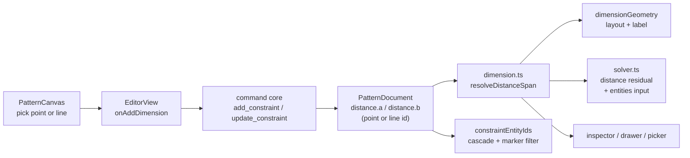

# Dimensions between points and lines

Status: draft — design review; Q1–Q4 on #71 are blocking
Refs: [#71 — Dimensions - line to line line to point](https://github.com/slawekniewiadomski/sew-craft/issues/71)
Builds on: `.ai/specs/2026-10-20-driven-and-set-dimensions.md`,
`.ai/specs/2026-10-20-referenced-dimensions.md` and
`.ai/specs/2026-10-19-movable-linear-dimensions.md`
Command spec: `0.11.0` today; this proposal adds anchor rules and moves to the
next minor (`0.12.0`)
Pattern schema: stays `sewcraft.pattern/0.2` in this slice; Q4 covers the
downgrade limit (`0.3` is reserved for the legacy-seam removal)

## 📝 TLDR

Today the Dimension tool measures **point to point**: a line click is only a
shortcut for that line's two endpoints, and the command layer rejects anything
that is not a drafting point. A maker therefore cannot dimension a seam to a
seam, or a point to a seam, without drawing helper points and doing the maths by
hand.

Proposed future behaviour: each end of a linear dimension becomes an **anchor**
that is either a point or a straight line. A point-to-line dimension measures the
perpendicular distance from the point to the line; a line-to-line dimension
measures the perpendicular from the first line's midpoint to the second line.
The same `distance` constraint keeps its identity, reference chain and rendering;
only its anchors become polymorphic. This PR is the spec-only stage of the
feature branch; after `spec-ready`, implementation continues here, per
`AGENTS.md`.

## 📝 Problem Statement

- **Who needs it:** the maker drafting pieces where one feature is defined by its
  distance from another: a seam line to a fold, a notch to a seam, the gap
  between two parallel seam lines. The issue names all three combinations:
  point → line, line → point and line → line.
- **What happens today:** a dimension can only join two `PointEntity` ids.
  `packages/geometry/src/dimension.ts` resolves `constraint.a` and `constraint.b`
  through `pointById()`, so a line id yields no span and no annotation;
  `commands.ts` calls `requireDraftingPoint()` for every `add_constraint` entity;
  `solver.ts` rejects any constraint id that is not in the point map; and
  `PatternCanvas.onDimensionPointer()` expands a line hit to `line.start` /
  `line.end`, so a line is never an anchor.
- **The workaround is lossy:** a helper point on the target line is an extra
  entity that must be constrained (`point_on_line`, and usually a perpendicular)
  or it drifts; deleting the dimension does not remove it. The measurement then
  depends on the helper's position rather than on the line itself.
- **Evidence it matters:** #71 asks for exactly these combinations. The
  point-to-line `point_on_line` residual already exists in the solver, which
  proves the geometry is native to the model rather than a new concept.
- **Constraints:** commands remain the only mutation path, the geometry package
  stays pure, existing stored documents keep loading, and no new tool or command
  is introduced.

## 📝 Proposed Solution

### Vocabulary

| Term | Meaning |
| ---- | ------- |
| **Anchor** | One end of a linear dimension: a point id or a straight line id. |
| **Point → point** | Today's dimension. Measures the distance between the two points. |
| **Point → line / line → point** | The point and its perpendicular foot on the line's infinite supporting line. The stored order does not change the value: the span is always point → foot. |
| **Line → line** | The **canonical first** line's midpoint and its perpendicular foot on the second line's infinite supporting line. Canonical order is by entity id, so the stored pick order does not change the value. |
| **Span** | The two positions a dimension draws and measures between. |
| **Parallel at pick time** | The two line directions satisfy `|cross(unitA, unitB)| ≤ sin(0.5°)`. Anti-parallel directions (180°) count as parallel. |

### Options considered

| # | Option | Trade-offs | Verdict |
| - | ------ | ---------- | ------- |
| A | **Extend `distance` anchors** — `a`/`b` stay `EntityId` and may name a point or a line; the entity kind selects the anchor type | One dimension concept, one reference chain, one renderer, one set of states, no new command type. Cost: `a`/`b` become polymorphic and every reader needs a kind-aware resolver; an older build throws on a line id (Q4) | **Recommended** |
| B | **New `point_line_distance` and `line_line_distance` constraint types** | Explicit fields and no overload of `distance`; existing documents untouched. Cost: three dimension types that all need set/driven/referenced/broken states, reference eligibility, layout, dragging, picker rows and command validation — a large duplicated surface for one concept | Rejected for v1 — the duplication buys clarity the resolver already provides |
| C | **Virtual projected points** — create a construction point on the line, constrain it with `point_on_line`, then add a normal distance | Reuses every existing path without touching the solver. Cost: each dimension mints persistent entities, the projection must be kept perpendicular as the line moves, undo/delete must clean up the helper, and documents grow with plumbing that is not user geometry | Rejected — it turns one annotation into a constraint subgraph |
| D | **Build nothing** | No code, no risk. | Rejected — seam-to-seam and point-to-seam dimensions are ordinary drafting needs and #71 asks for them |

Option A wins because a dimension is already "a distance between two geometric
references"; widening the reference from point to point-or-line is the smallest
change that answers the issue. The polymorphic `a`/`b` cost is contained by one
resolver that every existing consumer funnels through
(`resolveSpan` → `dimensionGeometry`, `measureLinearDimension`,
`dimensionOffsetForPointer`).

### Behaviour

1. **Picking.** Each of the two picks is a point or a straight line; the gesture
   is Q2. Two points reproduce today's dimension exactly. Curves, arcs and
   circles are not anchors in v1 and are rejected with a hint.
2. **Point ↔ line.** Let `P` be the point anchor and `L` the line anchor,
   whatever the stored `a`/`b` order. The span is `P` and its perpendicular foot
   on `L`'s **infinite supporting line** (Q3). The stored order is kept for
   identity and dedupe, but rendering normalizes to point → foot. The foot may
   fall outside the drawn segment; it still renders, with the usual extension
   line.
3. **Line ↔ line.** At pick time both anchors must be parallel within 0.5°. The
   pair is **canonicalized by entity id** (the lower id is `A`), so a reversed
   re-placement dedupes to the same value and offset. The span is the
   **canonical first line's midpoint** and its foot on the **second line**
   (`B`'s normal), so the value is `|perp(midA, lineB)|`. The parallel check is a
   pick-time guard, not a stored invariant: if a later edit rotates the pair out
   of parallel, the dimension still resolves as midA → lineB instead of
   disappearing. A set line-line dimension constrains only that perpendicular
   offset; it does not constrain either line's rotation, because a distance is
   not an angle (Q1).
4. **Measuring.** A dimension with at least one line anchor is always
   **aligned**: the value is the absolute length of the resolved span. The
   horizontal/vertical axes stay point-to-point only because "the horizontal
   distance between two lines" has no single meaning. This is normative: the
   canvas forces `aligned`, the drawer hides the axis control, the command
   rejects an explicit axis, and rendering ignores a stored axis.
5. **Driving.** A driven dimension adds no solver equation, exactly as today. A
   set dimension adds `|perpendicular distance| − value`; the residual is
   side-agnostic, matching the existing absolute `distance` residuals. Moving a
   point or translating a line re-solves; rotating a line about the measurement
   midpoint leaves a perpendicular gap unchanged, which is correct.
6. **References.** A point-to-line or line-to-line dimension can reference any
   resolved linear dimension, and can itself be a source; the linked quantity is
   a scalar, so the anchor kinds do not matter. The same-anchor guard is a
   **duplicate-dimension guard**, not an over-constraint rule: a referenced
   dimension adds no equation, and two different anchor pairs can resolve to the
   same span without id comparison catching it.
7. **Editing.** Value editing, the `#` reference picker, double-click editing,
   dragging and removal all work unchanged: they operate on the resolved span and
   the constraint id, not on the anchor kind.
8. **Deletion.** Deleting a point or line used as an anchor cascades the
   dimension through `constraintEntityIds`. A line that still has a corner round
   cannot be deleted directly (`delete_entity` asks to remove the round first);
   once the round is gone, the line deletion cascades the dimension. Deleting a
   referenced source leaves dependents broken as today.

## 📝 Architecture



Takeaway: the document keeps one `distance` constraint; the new work is a single
anchor resolver shared by rendering, measurement, commands and the solver, plus
an additive solver input so the residual can see line endpoints.

### Geometry package

- `types.ts` — `DistanceConstraint` keeps `a: EntityId` / `b: EntityId`. No new
  stored field; anchors are interpreted by entity kind. Add an exported
  `DimensionAnchor` helper type if the implementation needs one.
- `dimension.ts` — split the point-only `resolveSpan` into:
  - `lineEndpoints(document, id)` → the two endpoint positions of a straight
    line, or `null`;
  - `resolveAnchor(document, id)` → `{ kind, point?, segment? }`, where a point
    anchor carries a position and a line anchor carries its endpoints; the
    midpoint is computed by the span resolver, not by the anchor;
  - `resolveDistanceSpan(document, constraint)` → `{ a: Vec2; b: Vec2 }` for all
    three combinations, plus the anchor kinds for callers that must hide the
    axis choice;
  - `measureDistanceDimension(document, constraint)` → absolute span length for
    line anchors, orientation-aware for point-to-point.
  Keep `measureLinearDimension(document, a, b, orientation)` for its line-length
  caller in `entity-properties.ts`; update the dimension-preview caller in
  `PatternCanvas.vue` and `EditorView.onAddDimension`.
  `dimensionGeometry`, `dimensionOffsetForPointer` and the dimension caller
  delegate to the new resolver and ignore a stored axis when a line is an
  anchor. Return `null` when the resolved span is `≤ 1e-9` mm, so a dynamic zero
  span is unresolved rather than a `0` reading.
- Export one shared `distanceAnchorIssue(document, a, b)` helper returning a
  reason (`missing`, `not-a-line`, `not-parallel`, `point-on-line`,
  `coincident`, `zero-length`) plus the resolved span. The command maps reasons
  to validation errors and the canvas maps the same reasons to hints; one
  predicate, two renderings.
- `document.ts` — `constraintEntityIds(distance)` keeps returning `[a, b]`, now
  meaning "anchors"; add `constraintPointIds(constraint)` so the solver validates
  only point anchors against the point map. `delete_entity` already cascades
  through `constraintEntityIds`, so line anchors are covered.
- `solver.ts` — **input contract:** `solve` needs the line entities to resolve a
  line anchor. Add an optional `entities` input (fourth parameter or a context
  object) without changing existing point-only call sites; `solveDocument` passes
  `document.entities`. A line anchor with no entities input is a caller bug and
  throws a clear error. Pre-check: point anchors must exist in the point map;
  each line anchor must exist in the line map and both endpoint points must exist.
  Residuals:
  - point → point: unchanged;
  - point ↔ line: `|cross(dir, point − start) / |dir|| − value`, normalized so
    order does not matter;
  - line ↔ line: `|cross(dirB, midA − startB) / |dirB|| − value`;
  - driven dimensions contribute nothing; a zero-length line skips the residual
    (with a `|| 1` guard like `point_on_line`) instead of producing `NaN`; a
    missing line or endpoint is caught by the pre-check.
- `migration.ts` — **unchanged** in this slice. The schema stays `0.2`; the
  downgrade limit is Q4. No 0.3 migration, no relabel and no `options` change to
  `normalizeDocument`.

### Frontend

- `PatternCanvas.vue` — `dimensionPending` becomes a small anchor list (id +
  kind) instead of `EntityId[]`; `startDimensionPlacement` carries the two
  anchors; the preview and the offset follow the resolved span and are forced to
  `aligned` for line anchors. `EditorView.onAddDimension` keeps its
  `findDistanceConstraint` dedupe and uses the anchor-aware measurement.
- Add a dimension hint overlay and live region (the Dimension tool has none
  today; the arc and cut tools do). Rejections announce there.
- `EditorView.vue` — hide/disable the dimensions-drawer orientation select for
  a line-anchored dimension, and make `onDimensionOrientationEdit` unreachable
  for it. Sanitize a loaded/hand-edited axis by rendering aligned.
- `lib/entity-properties.ts` — `constraintActsOnEntity` for a line entity
  currently matches only `samePair(constraint.a, constraint.b, start, end)`;
  add the line-id anchor check so selecting a line lists a dimension that
  anchors to it.
- `lib/constraint-view.ts` — `constraintMarkers` skips a distance whose anchor
  is a line because the line id is not in the point map. That is acceptable
  (the dimension layer renders it), but it must be explicit and tested.
- `lib/dimensions.ts` — `DimensionPlacement` stays `{ a, b, orientation,
  offset }`; a line anchor is just an id. The reference-picker label prints the
  two raw ids (`<a> → <b>`); the wording needs an anchor label so a line id does
  not read as a point.
- **Scope:** the generic constraint **Distance** mode in
  `lib/constraint-tools.ts` is unchanged and remains point-to-point; it expands a
  line pick to its endpoints. The new picks belong to the Dimension tool. This
  divergence is explicit and out of scope (see Out of scope).
- No new component, tool, icon or route.

### Documentation

- `docs/architecture/constraint-solver.md` — the new solver input, pre-check and
  residuals.
- `docs/architecture/geometry-core.md` — anchor resolution and span rules.
- `docs/architecture/data-model.md` — `distance.a`/`b` may name a point or line;
  the schema stays 0.2 and the downgrade limit (Q4).
- `docs/domain/command-spec.md`, `docs/domain/command-spec.json`,
  `config/geometry.php` — `add_constraint` anchor rules and `spec_version`
  `0.12.0`, in sync; the JSON `$id` and `schema` fields too.
- `docs/domain/glossary.md` — point-to-line, line-to-line, anchor, supporting
  line, pick-time parallel.
- `BACKWARD_COMPATIBILITY.md` — the new anchor meaning, the unchanged schema and
  the older-build failure mode.
- `packages/geometry/package.json` — minor version bump for the solver input and
  anchor-aware exports.

## 📝 Data Model

No new entity, field or table; no schema move in this slice.

```ts
// unchanged shape; a/b may now name a point or a line
type DistanceConstraint = {
  id: EntityId;
  type: 'distance';
  a: EntityId; // point or line
  b: EntityId; // point or line
  value?: number;
  reference?: EntityId;
  lastKnownValue?: number;
  orientation?: DimensionOrientation; // aligned when a line is an anchor
  offset?: number;
};
```

- `PATTERN_SCHEMA` stays `sewcraft.pattern/0.2`; existing documents are
  untouched and no migration runs.
- The line-anchor meaning is additive inside 0.2. A build that predates the
  feature accepts the document schema, then fails in the solver on a line id; a
  downgrade is therefore not supported for a document that uses line anchors.
  The failure is loud rather than silently wrong, and Q4 asks whether that
  single-build trade-off is acceptable here.
- `0.3` remains reserved for the legacy-seam removal documented in
  `BACKWARD_COMPATIBILITY.md`; this spec must not consume it.

## 📝 API Contracts

### `add_constraint` — `distance`

- `entities: [anchor, anchor]`, where each anchor is a point id or a straight
  line id. The arity stays 2.
- Point + point: unchanged; `orientation` may be `aligned`, `horizontal` or
  `vertical`.
- Point + line or line + line: `orientation`, when present, must be `aligned`
  (or omitted). `horizontal`/`vertical` are rejected for these spans.
- Line + line: at pick time both lines must exist, be straight, have distinct
  endpoints, be parallel by `|cross(unitA, unitB)| ≤ sin(0.5°)` (anti-parallel
  accepted) and resolve to a span greater than `1e-6` mm. "Coincident" is a span
  at or below that epsilon.
- Point + line: the point must not lie on the line's supporting line (span
  `≤ 1e-6` mm is rejected).
- `value`/`reference` rules are unchanged; a reference may point at any resolved
  `distance` dimension regardless of its anchor kinds, and same-anchor sources
  are rejected as duplicates.
- Validation errors name the offending anchor and the rule, for example
  `distance: curves, arcs and circles are not line anchors`,
  `distance: lines must be parallel`, `distance: the point lies on the line`,
  `distance: the lines are coincident`.
- inverse: `remove_constraint`.

### `update_constraint`

- `orientation` edits follow the same rule: `horizontal`/`vertical` are rejected
  when either anchor is a line.
- `value`/`reference`/`offset` edits are unchanged.
- Anchors themselves are immutable; replacing one is remove + add, as today.

### `remove_constraint` / `delete_entity`

- Unchanged. Deleting an anchor point or line cascades the dimension through
  `constraintEntityIds`; a line with a corner round must have the round removed
  first, as `delete_entity` already requires.
- Deleting a referenced source leaves dependents broken.

### Command spec sync

`add_constraint` gains anchor rules but no new command and no envelope change.
All three files move to the next minor (`0.12.0` from today's `0.11.0`); the JSON
`$id` and `schema` fields and the package version move with them.

## 📝 UI/UX

### Picking

```
[Dimension] armed
  pick 1: point or line   → pending anchor, hint "Pick the second anchor"
  pick 2: point or line   → placement starts, dimension line follows pointer
  click: place             → add_constraint
```

- A line pick no longer immediately measures that line's own length; its two
  endpoint points are still pickable and give the same result. This is the
  gesture change Q2 asks about.
- `Escape`, a tool change or a click on empty canvas before the first pick
  clears the pending anchor and its hint.

### Hints

The Dimension tool has no hint overlay today; add one with a live region.
Five messages, not three:

| Situation | Text |
| --------- | ---- |
| Tool armed, no pick | `Pick a point or a line.` |
| First anchor pending | `Pick the second anchor.` |
| Second pick is a curve/arc/circle | `Pick a point or a straight line.` |
| Two non-parallel lines | `Pick two parallel lines — use Angle for a corner.` |
| Point on the line | `The point lies on the line.` |
| Two coincident lines | `The lines are coincident.` |

The live region announces each rejection without moving focus.

### Rendering and editing

- The resolved span drives the existing layout: extension lines from the anchor
  and its foot, chevrons, label at the midpoint, drag strip. No new label style.
- The axis is **aligned** for every line anchor: the drawer hides the select, the
  preview never offers another axis, and a loaded axis is rendered as aligned.
- Double-click, `#` reference editing, drag and delete are unchanged.
- The inspector row shows the two anchor ids and the value; selecting a line
  lists the dimensions that anchor to it (including a line anchor, not only a
  dimension whose two points are the line's endpoints).
- `constraintMarkers` does not draw an icon for a line-anchored distance; the
  dimension layer is its renderer.

## 📝 Edge Cases & Failure Scenarios

| Scenario | Expected behaviour |
| -------- | ------------------ |
| Point exactly on the line | Command rejects the zero span; hint `The point lies on the line.` |
| Two identical or coincident lines | Rejected as a zero gap; hint `The lines are coincident.` |
| Two non-parallel lines at pick time | Rejected with the parallel hint; no partial document change. |
| Lines rotate non-parallel after placement | Still resolves as midA → lineB; not marked broken, and the value stays a perpendicular distance. |
| Near-parallel lines (≤ 0.5°) | Accepted; the gap is measured from the first midpoint to the second line. |
| Anti-parallel lines (180°) | Accepted as parallel; the absolute perpendicular is measured. |
| Foot outside the drawn segment | Accepted; the dimension still measures to the infinite supporting line. |
| Zero-length line entity | Rejected at creation; if it becomes zero-length later, the solver skips the residual instead of producing `NaN` and the dimension has no layout. |
| Line loses an endpoint point | The solver's pre-check reports a clear error; the document is not persisted. |
| Curve, arc or circle picked | Rejected in v1 with the straight-line hint. |
| `horizontal`/`vertical` sent for a line anchor | Command rejects it; the drawer never offers it; rendering ignores it. |
| Delete the anchor line | Cascades the dimension after any corner round on that line is removed. |
| Delete an endpoint point of the anchor line | The line is removed with the point, then the dimension cascades. |
| Delete the referenced source | Dependents become broken and keep their last known value, as today. |
| Undo a placement | Removes the dimension; undo of a deletion restores it with its anchors. |
| A 0.2 document without line anchors | Loads unchanged; no migration and no relabel. |
| A 0.2 build opens a document with a line anchor | The solver reports an unknown point for the line id; a downgrade is not supported (Q4). |
| Solver cannot satisfy a set dimension | Existing failure banner; the document is not persisted. |
| Dimension already on the same anchor pair | `findDistanceConstraint` reuses it and updates presentation only, as today. |
| Reversed re-placement on the same line pair | Deduped by unordered ids; the canonical A/B order keeps the value and offset unchanged. |
| Anchor moved so the span becomes zero | The span is unresolved (`null`); the dimension draws nothing and the inspector reports no value, not `0`. |
| Two different anchor pairs resolve to the same span | Allowed; the same-anchor guard is a duplicate guard, not a geometric check. |

## 📝 Risks & Impact Review

- **Protected surface (medium).** `DistanceConstraint` is exported from
  `@sewcraft/geometry`; `add_constraint` is a command contract; `solve` gains an
  input. The stored field shape is unchanged, but the meaning of `a`/`b` widens.
  The package minor bump, the command-spec sync and the compatibility note are
  required.
- **Solver input is a real contract change.** `solve` currently receives only
  points; a line residual needs the line's endpoints. Adding an optional
  `entities` input is additive at the call site but changes the documented
  contract. Tests must cover a line anchor with no entities input, a missing
  endpoint and a zero-length line.
- **Downgrade.** A document with a line anchor cannot be solved by a pre-feature
  build; the failure is a clear unknown-point error rather than silent wrong
  geometry. The schema is not bumped, because 0.3 is reserved (Q4). If a clean
  refusal is required, this feature must ship after the 0.3 seam removal at 0.4.
- **Solver conditioning.** The perpendicular residual is stable for parallel
  lines, but line-line driving can move four points; because the sketch is
  under-constrained, LM settles to the nearest solution as it already does for
  `point_on_line`. The residual does not constrain rotation, which is correct for
  a distance. Tests pin translation, rotation about the midpoint, a near-parallel
  pair and a failed solve.
- **Absolute residuals.** `|perp| − value` has a kink at zero. A valid dimension
  has a positive value and starts away from zero, so the numerical Jacobian is
  well defined; a zero-span pick is rejected before it becomes a constraint.
- **Duplicate guard.** `referenceCandidates`/`validateReference` compare anchor
  ids for the same-pair rule. A referenced dimension adds no equation, so this is
  a duplicate guard; two different anchor pairs that resolve to the same span are
  not caught, and that is acceptable for this slice.
- **Shared reason helper and zero-span read.** A null resolver cannot produce the
  distinct command errors and canvas hints, so one exported
  `distanceAnchorIssue` drives both. A dimension whose anchors move onto each
  other resolves to a zero span; it must render nothing and report no value, not
  `0`.
- **Cascade.** `constraintEntityIds` is the single cascade key. Returning anchor
  ids for `distance` is what makes line deletion work; the solver's point-map
  pre-check must not treat those ids as points.
- **Inspector and markers.** `constraintActsOnEntity` currently matches a line
  only by its endpoint pair, so a line anchor would be invisible in the
  inspector until it is updated. `constraintMarkers` will skip a line anchor; the
  dimension layer still draws it. Both need explicit tests.
- **Generic Distance mode.** The constraint tool remains point-to-point; a user
  who wants a line anchor must use the Dimension tool. This is a deliberate scope
  limit, not an accidental inconsistency.
- **No export impact.** SVG export embeds `PATTERN_SCHEMA`, which stays 0.2, so
  no export test changes.
- **Mockups.** The interaction is a two-pick gesture and hint text; the spec
  carries the ASCII flow and the hint table. No committed mockup: the configured
  `agent-browser` provider is not installed and no shared test-env descriptor is
  present, so a visual would be an illustration, not evidence.

## ❓ Open Questions

These are blocking product/UX/architecture decisions, asked on #71. The draft PR
stays draft until they are answered; the rest of the design is written under the
recommended answers so it can be reviewed as a coherent whole.

| # | Question | Why it blocks | Recommended answer |
| - | -------- | ------------- | ------------------ |
| Q1 | What does **line to line** mean? | The residual, the rendering and the rejection rules differ: a perpendicular from the first midpoint to the second line, a segment-to-segment distance, and an axis gap are three different measurements. | **Perpendicular from the first line's midpoint to the second line, with a 0.5° parallel guard at pick time.** If the pair drifts, the same formula still resolves. The value does not constrain rotation, because a distance is not an angle. |
| Q2 | How does the tool take a **line as an anchor** without losing today's one-click line length? | Today a line click immediately measures that line's length; if a line can also be an anchor, the same click means two things. The answer changes the canvas state machine and its tests. | **Unified two-pick gesture**: every dimension picks two anchors, then places. A line's own length is measured by its two endpoints. One rule for all combinations; the cost is one extra click. Alternatives: `Shift`-click for a line anchor (hidden gesture), or a Line mode in the ribbon (more UI). |
| Q3 | Does **point ↔ line** measure to the infinite line or stop at the drawn segment? | The value and the foot position differ when the perpendicular falls beyond the segment ends, which is common for short seam edges. | **Infinite supporting line**, the CAD convention; pattern lines are conceptual and a foot outside the drawn segment is still the true offset. The alternative clamps the foot to the nearest endpoint and turns a perpendicular into an end distance. |
| Q4 | How should the document advertise line anchors, given `0.3` is reserved for the legacy-seam removal? | A pre-feature build accepts the 0.2 schema and then fails in the solver on a line id — a loud failure. A schema bump would give a clean refusal, but it would either consume the reserved 0.3 or need a coordinated 0.3/0.4 release. | **Keep 0.2 for this slice and accept the downgrade limit** (loud solver error; single-build self-hosted app). If a clean refusal is required, sequence this feature after the 0.3 seam removal and take 0.4. Do not consume 0.3 alone. |

## ✅ Resolved assumptions (autonomous defaults)

| # | Assumption | Why | Status |
| - | ---------- | --- | ------ |
| R1 | Extend `distance` with polymorphic anchors (option A) rather than add constraint types | One reference chain, one renderer, one state model; the smallest surface that answers #71 | ⚠ NEEDS HUMAN CONFIRMATION — changes an exported type and the stored anchor meaning |
| R2 | Anchor kind is inferred from the referenced entity, with no new `aKind`/`bKind` field | No redundant state to keep in sync; an id names exactly one entity kind | Reversible |
| R3 | Only straight `line` entities are anchors in v1; curves, arcs and circles are a follow-up | The issue asks for lines; an arc's perpendicular offset needs a different resolver and rendering | Reversible |
| R4 | Point ↔ line normalizes to point → foot regardless of stored order; line ↔ line is canonicalized by entity id and uses midA → lineB | One definition per shape, independent of pick order; a reversed re-placement still dedupes | Reversible |
| R5 | The parallel rule is pick-time only; a later drift keeps the midA → lineB measurement | A set distance should not silently disappear or become an angle; it constrains an offset, not a rotation | Reversible |
| R6 | Line anchors are `aligned` only; horizontal/vertical are rejected and hidden | An axis gap between two lines has no single definition | Reversible |
| R7 | `solve` gains an optional `entities` input; the package minor version moves; the command spec moves to the next minor (`0.12.0`) | The residual cannot resolve a line from `points` alone; the public geometry surface changes | ⚠ NEEDS HUMAN CONFIRMATION — a solver API change |
| R8 | The pattern schema stays `0.2`; `0.3` stays reserved; no migration runs | Avoids consuming the documented seam-removal version and keeps this slice reversible | ⚠ NEEDS HUMAN CONFIRMATION — the downgrade limit is Q4 |
| R9 | The generic constraint Distance mode stays point-to-point; only the Dimension tool gains line anchors | Keeps the issue's scope to the Dimension tool; unifying the two is a separate change | Reversible |
| R10 | Curves/arcs/circles, cross-pattern dimensions, line-to-line angles and automatic helper points are out of scope | Keeps the first slice to the three combinations in #71 | Reversible |

## 📋 Phasing

- **Phase 1 — Anchors and measurement.** Anchor resolver, span resolution,
  measurement and the aligned rule. Driven point-line and line-line dimensions
  resolve and render from a hand-built document.
- **Phase 2 — Solver and commands.** Solver input, pre-check, perpendicular
  residuals, validation, cascade, command-spec sync. Set dimensions work through
  the API and agents.
- **Phase 3 — Canvas.** Two-pick state machine, live preview, hints and the
  dimension live region. The issue's gesture works end to end.
- **Phase 4 — Editing surfaces.** Reference picker wording, inspector line
  listing, drawer axis hiding, marker behaviour and the failure states.
- **Phase 5 — Documentation and verification.** Docs, compatibility note, full
  gate, manual walkthrough of all three combinations.

## 📋 Implementation Plan

### Phase 1 — Anchors and measurement

1. Add `lineEndpoints` and `resolveAnchor` in `packages/geometry/src/dimension.ts`
   for point and straight-line ids; test point, line, missing and unsupported
   kinds.
2. Add `resolveDistanceSpan` for point-point, point-line (both orders) and
   line-line spans, including the infinite-line foot and the canonical midA →
   lineB rule; test the foot outside the segment, a reversed line pair, a
   dynamic zero span (null), a zero-length line and a missing line.
3. Add `measureDistanceDimension`; keep `measureLinearDimension` for line
   lengths and route the dimension preview and `onAddDimension` through the new
   helper; test that existing point-point layouts and values are unchanged.
4. Make the dimension geometry, offset and orientation inference ignore a stored
   axis and force `aligned` when a line is an anchor; test horizontal and
   vertical parallel pairs and a horizontal point-line pair.

### Phase 2 — Solver and commands

1. Add the optional `entities` input to `solve`, build the line map, validate
   point and line anchors and their endpoint points; test a line anchor without
   entities, a missing endpoint and a zero-length line.
2. Add the point-line and line-line residuals with the `|| 1` guard; test at rest,
   after a point move, after a translation, after a rotation about the midpoint,
   a near-parallel pair and a non-converging case.
3. Extend `constraintEntityIds`/`constraintPointIds` and the solver pre-check so
   line ids are not validated against the point map; test that a line anchor does
   not throw and a missing point still does.
4. Add `distanceAnchorIssue` returning a reason plus the span, then extend
   `applyAddConstraint` validation: point-or-line entities, the 0.5° parallel
   rule (anti-parallel accepted), the 1e-6 mm zero-span rule, aligned-only
   orientation and reference eligibility; map reasons to messages and test each
   one.
5. Extend `update_constraint` orientation rules and the remove/delete cascade;
   test orientation rejection, a line with a corner round and deleting an anchor
   line.
6. Sync `config/geometry.php`, `docs/domain/command-spec.md` and
   `docs/domain/command-spec.json` at `0.12.0` (including `$id`/`schema`) and
   bump `packages/geometry/package.json`; test `GET /api/commands` and a
   point-line payload.

### Phase 3 — Canvas

1. Replace `dimensionPending: EntityId[]` with an anchor list and add the
   point-or-line pick rules; test point→point, point→line, line→point and
   line→line, and the rejected curve/arc/circle.
2. Add the hints, the pending-anchor highlight, the dimension live region and the
   `Escape`/tool-change clear; test each hint and that a cancelled gesture emits
   nothing.
3. Resolve the preview through the new span resolver and force `aligned`; test
   the preview value and that no axis is offered.
4. Wire `onAddDimension` to the anchor-aware measurement and dedupe; test reuse
   of an existing dimension on the same anchors.

### Phase 4 — Editing surfaces

1. Update the inspector/drawer anchor label and the `#` picker row so a line id
   does not read as a point; test each rendering.
2. Add the line-id anchor check to `constraintActsOnEntity`; test that selecting
   a line lists a dimension that anchors to it.
3. Hide/disable the drawer orientation select for a line anchor and ignore a
   loaded axis in rendering; test both.
4. Confirm value, reference, drag, double-click and delete still dispatch the
   same commands for line-anchored dimensions; test each transition and undo.
5. Confirm `constraintMarkers` skips a line-anchored distance without throwing;
   test the marker list.

### Phase 5 — Documentation and verification

1. Update `docs/architecture/constraint-solver.md`,
   `docs/architecture/geometry-core.md`, `docs/architecture/data-model.md`,
   `docs/domain/glossary.md`, `BACKWARD_COMPATIBILITY.md` and the command spec.
2. Run the full gate and walk through all three combinations on the canvas:
   place, set a value, reference, drag, delete an anchor and undo.

## ✅ Acceptance criteria

- [ ] A dimension can join a point and a straight line, in either order, and
      reports the perpendicular distance to the infinite line.
- [ ] A dimension can join two parallel straight lines and reports the
      perpendicular from the first midpoint to the second line.
- [ ] Non-parallel lines, curves/arcs/circles, zero spans and axis orientations
      on line anchors are rejected with a specific message and no document
      change.
- [ ] A set dimension drives the sketch to the perpendicular value; a driven one
      adds no equation; both follow point moves and line translations.
- [ ] Reference linking, the `#` picker, dragging, double-click editing and
      deletion work for the new anchor kinds.
- [ ] A reversed re-placement is idempotent (canonical A/B), and a dynamic zero
      span is unresolved rather than `0`.
- [ ] Selecting a line lists the dimensions that anchor to it; the drawer hides
      the axis for a line anchor.
- [ ] Deleting an anchor line cascades the dimension after any corner round is
      removed; deleting a source leaves dependents broken as today.
- [ ] A 0.2 document without line anchors loads unchanged; a document with a
      line anchor is documented as not downgradeable (Q4).
- [ ] The command spec is synced at the next minor; existing point-only payloads
      still apply.
- [ ] The full validation gate passes and coverage stays at 100 %.

## Out of scope

- Curves, arcs and circles as line anchors.
- Three or more anchors, ordinate dimensions, or a chain dimension tool.
- Measuring an angle between non-parallel lines (the Angle constraint owns that).
- Cross-pattern or cross-project dimensions.
- Automatic gap dimensions between every pair of parallel lines.
- A new ribbon tool, keyboard modifier or sub-mode beyond what Q2 chooses.
- Line anchors in the generic constraint **Distance** mode (`constraint-tools.ts`).
- A pattern-schema bump and a 0.3/0.4 migration (Q4).
- PDF/DXF export changes; annotations are not exported.

## Checks

```bash
npm run format
npm run typecheck
npm run lint
npm run format:check
npm run test:coverage
npm run build
docker compose run --rm --no-deps -e DB_CONNECTION=sqlite -e DB_DATABASE=:memory: \
  app sh -c "composer install --no-interaction && php artisan test --coverage --min=100"
docker compose run --rm --no-deps app sh -c "composer install --no-interaction && vendor/bin/pint"
```
