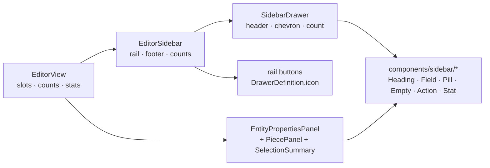

# Editor sidebar readability

Status: implemented
Amended 2026-10-25: the **View** drawer is removed. Display toggles moved to an
icon-only display menu in the canvas's bottom-right corner (per-project,
persisted) and export-layer options moved into an `Export SVG` dialog opened
from the ribbon. The assembly canvas has its own display menu for its layers.
The remaining collapsible drawer stack was then replaced by rail tabs
(`2026-10-25-sidebar-panel-tabs.md`): one section visible at a time, no drawer
headers and no per-section open state.
Builds on: 013-editor-workspace-shell (the sidebar shell, drawers and rail),
2026-10-23-pieces-sidebar-and-selection (Pieces drawer, Outline selection),
2026-10-20-selected-entity-properties (the per-entity inspector)
Related: 2026-10-19-ribbon-icon-groups (the glyph registry the rail reuses)

## 📝 TLDR

The sidebar is now the editor's whole non-canvas surface, but it renders every
level of information with one type scale, one weight and one colour. Drawer
headers look exactly like content rows, raw entity ids lead every row, labels and
values share `text-sm text-muted-foreground`, every Outline row ends in a
full-width text button, and the default-open Properties drawer opens with the
project id and a command count. Proposed future behaviour: give the sidebar a
small **design contract** — six shared primitives plus a two-step type scale with
tabular numerals — demote ids to trailing metadata, move workspace stats into a
status footer, turn row actions into compact icon buttons, and rebuild the
collapsed rail as an icon rail with one button per drawer.

## 📝 Problem Statement

- **Who needs it:** the solo maker working in the editor for a whole drafting
  session. The canvas is where they draw; the sidebar is where they read and
  change what they drew, and it is read dozens of times per session.
- **What happens today:**
  - **Every level reads the same.** A drawer header is `text-sm font-medium`
    (`SidebarDrawer.vue:22-28`) — the same size as the content below it — and the
    only separation between drawers is a hover tint.
  - **Muted is used for values, not just labels.** `dt` and `dd` are frequently
    both `text-muted-foreground` (`EntityPropertiesPanel.vue:320-353`,
    `EditorView.vue:1276-1282`), so there is no value to scan for.
  - **Ids lead.** Outline, Dimensions, Constraints and the inspector open every
    row with `font-mono text-muted-foreground` (`EditorView.vue:1236`, `1278`,
    `1422`; `EntityPropertiesPanel.vue:294`). `ab` is the row's title and the only
    distinct token in it.
  - **A wide text button in every row.** `Make construction` / `Make cut edge`
    (`EditorView.vue:1260-1262`) and `Remove` (`EditorView.vue:1283-1290`,
    `1428-1435`) wrap the row at 320 px, and the same verb repeats down the list.
  - **Developer stats at the top of the first panel.** With nothing selected the
    Properties drawer shows `Tool`, `Project #3`, `14 command(s)` and
    `6 cut edge(s)` (`EditorView.vue:1142-1169`). It reads as a diagnostics panel,
    and it shows nothing useful when something *is* selected either.
  - **The View drawer mixes two kinds of toggle.** Display toggles (Show
    construction / allowances / constraints / dimensions) and export-layer toggles
    (Include construction / stitch layer / fold lines) are interleaved in one flat
    list (`EditorView.vue:1441-1476`).
  - **The collapsed rail is empty.** 40 px wide with a single `«` button
    (`EditorSidebar.vue:104-119`).
- **Evidence it matters:** the before/after mockup authored for this spec (see
  _UI/UX_) renders the same 320 px drawer twice. The density problem is
  typographic and structural, not one bad control: every drawer has to be read one
  row at a time because nothing in a row says what to read first.
- **Constraints:** commands stay the only mutation path; no `@sewcraft/geometry`,
  command-spec, schema or API change; every existing `data-testid` keeps working
  unless listed under _Test churn_; 100 % coverage is a hard gate, so every new
  branch ships with a test.

## 📝 Proposed Solution

Three passes, shipped together on one branch and one PR, cheapest first. Pass 1 is
CSS only, pass 2 changes markup, pass 3 adds behaviour.

**What the market does.** Editors that solve this problem converge on the same two
moves: a two-column label/value grid where the label is muted and small and the
value carries the weight (Figma's right panel, Blender's N-panel, FreeCAD's
property editor), and rows named by what they *are* rather than by an internal id.
That is the direction here — a scale of two steps rather than a new visual
language.

### Decision: where workspace stats live

| # | Option | Trade-offs | Verdict |
| - | ------ | ---------- | ------- |
| A | **A status footer pinned under the scroll area**, one muted line, keeping `workspace-summary` and `active-tool` in the DOM and visible | Stats stop competing with the selection; no test churn; costs ~32 px of height and disappears when collapsed (as everything does today) | **Recommended — chosen** |
| B | A seventh `workspace` drawer, closed by default | Consistent with the drawer model; ~10 tests that read `active-tool` must open the drawer first, for no product gain | Rejected |
| C | Delete the block and update the tests | Cleanest DOM; loses the cut-edge count, which is shown nowhere else | Rejected |

### Decision: where drawer state lives

| # | Option | Trade-offs | Verdict |
| - | ------ | ---------- | ------- |
| A | **Keep the open/closed `ref` inside `EditorSidebar`** and let the rail open a drawer itself | Rail behaviour needs no `EditorView` change; the state already survives a collapse | **Recommended — chosen** |
| B | Lift drawer state into `EditorView` | One more prop/emit pair for no behaviour change; only needed once drawer state is persisted | Rejected |

### Decision: row actions

| # | Option | Trade-offs | Verdict |
| - | ------ | ---------- | ------- |
| A | **A compact icon button, muted but always visible, with a tooltip and `aria-label`** | Removes the wrapping and the repeated verb; discoverable, keyboard reachable, touch safe | **Recommended — chosen** |
| B | Icon revealed only on row hover / focus | Smallest rows; hides the affordance from anyone who does not already know it exists | Rejected |
| C | Keep the text buttons, just shrink them | No new primitive, still one wide verb per row and still wraps at 240 px | Rejected |

### Decision: how a row is named

| # | Option | Trade-offs | Verdict |
| - | ------ | ---------- | ------- |
| A | **Human label leads, id follows as `font-mono text-2xs` metadata** | Rows read as `Line a → b` rather than `ab`; needs the kind and endpoints in the `edges` view model | **Recommended — chosen** |
| B | Id only, restyled | Cheapest; keeps the row unreadable for anyone who did not create the id | Rejected |
| C | Hide the id behind a tooltip | Loses the debug affordance users rely on to match canvas labels to rows | Rejected |

### The design contract

Recorded in `docs/architecture/standards.md` under _Sidebar UI contract_, so a
future drawer has one scale to follow.

**Type scale** — a new `--text-2xs` theme token (`0.6875rem` / `1rem`) gives the
`text-2xs` utility:

| Role | Classes | Where |
| ---- | ------- | ----- |
| Drawer header | `text-2xs font-semibold uppercase tracking-[0.06em] text-muted-foreground`, hover `text-foreground` | `SidebarDrawer` trigger |
| Sub-section heading | the same, plus `mb-1.5` | Geometry, Dimensions, Constraints, Display, Export |
| Field label | `text-2xs text-muted-foreground` | every `dt` / `<label>` |
| Field value | `text-[13px] font-medium tabular-nums text-foreground` | every `dd` / read-only value |
| Object title | `text-[13px] font-semibold` | inspector header, piece name |
| Metadata | `font-mono text-2xs text-muted-foreground` | ids, endpoints, source refs |
| Secondary sentence | `text-2xs leading-snug text-muted-foreground` | hints, empty-state text |

Rules: `text-muted-foreground` is only ever a **label or metadata**, never the
value being read; numbers use `tabular-nums`; the unit is a separate `text-2xs`
muted span, never inside the number; nothing in the sidebar goes below 11 px.

**Six primitives**, all in `frontend/src/components/sidebar/`:

| Component | Props | Renders |
| --------- | ----- | ------- |
| `SidebarHeading.vue` | `label`, `count?` | the sub-section heading row, with an optional muted count |
| `SidebarField.vue` | `label`, default slot | one `<dt>`/`<dd>` pair, so callers keep their `<dl>` semantics |
| `Pill.vue` | `tone: 'neutral' \| 'accent' \| 'danger'`, default slot | the one chip used by construction tags, quantity, allowance width and dimension state |
| `SidebarEmpty.vue` | `message`, `hint?`, `icon?` | a centred muted empty state with an optional action slot |
| `SidebarAction.vue` | `icon`, `label`, `disabled?` | the compact icon button: ghost `Button` at 28 px, tooltip, `aria-label` |
| `SidebarStat.vue` | — (slot only) | the one-line status footer row |

`buttonVariants` gains `size: 'icon-sm'` (`h-7 w-7 rounded-sm`), because
`size="icon"` is 36 px and too large for a list row.

### Pass 1 — typographic and density pass (CSS only)

1. **Drawer headers** (`SidebarDrawer.vue`): 11 px caps, semibold, muted, a
   `border-b` hairline, `px-3 py-2`, an optional count badge on the right from a
   new `count?: number` prop (hidden when `0` or `undefined`), and the text glyph
   replaced by a 10 px chevron that rotates 90° when open. The header keeps
   `data-testid="drawer-toggle-<id>"` and its label text.
2. **Sticky headers:** the trigger is `sticky top-0 z-10 bg-background`, so a long
   Dimensions list keeps its section name while it scrolls.
3. **Two-step type scale** everywhere in the sidebar per the table above: `dt`
   muted `2xs`, `dd` `13px` medium with `tabular-nums`, ids `font-mono 2xs`.
   Applied in `EntityPropertiesPanel.vue`, `PiecePanel.vue`,
   `SelectionSummary.vue` and every `EditorView.vue` slot.
4. **Section rhythm:** drawer body `px-3 pb-3`, sub-sections `space-y-3`, list rows
   `space-y-2`, and dimension/constraint rows separated by `border-t` rather than
   whitespace alone.
5. **Selected rows read as an edge:** `border-l-2 border-primary` plus an 8 %
   primary tint and `rounded-r-sm`, so selected and hover stop looking the same
   (today both are `bg-accent`).
6. **Empty states:** every drawer uses `SidebarEmpty` instead of a bare muted
   sentence. Properties with no selection becomes `Nothing selected` plus
   `Select a point, line, curve, arc or circle on the canvas.`

### Pass 2 — structural pass

7. **Status footer.** The `Workspace` section leaves the Properties drawer and
   becomes `SidebarStat` in `EditorSidebar.vue`, pinned under the `ScrollArea`, fed
   by a `stats` slot from `EditorView`. It keeps `data-testid="workspace-summary"`
   and the `active-tool` test id, and keeps the `N command(s)` / `N cut edge(s)`
   text format the tests assert.
8. **Outline rows** carry kind and endpoints. `edges` gains `kind` and a `label`
   such as `a → b` (from each entity's anchor ids), rendered as `Line` + mono
   `a → b`, an allowance `Pill` (`10 mm` accent when the edge belongs to a piece,
   dashed neutral `no allowance` otherwise), and a `SidebarAction` with
   `data-testid="outline-construction-<id>"` whose tooltip and `aria-label` read
   `Make construction` / `Make cut edge`.
9. **Dimensions rows:** the value input is the primary element — widened to
   `w-24`, `h-7`, `text-sm font-medium tabular-nums`; the id and entity pair move
   above it as `2xs` metadata; the state `Pill` sits beside the input; `Remove`
   becomes a `SidebarAction` keeping `data-testid="remove-dimension-<id>"`.
10. **Constraints rows:** the human label leads (`Horizontal`), the id trails,
    entities are `2xs`, and `Remove` becomes a `SidebarAction` keeping
    `data-testid="remove-constraint-<id>"`.
11. **Pieces rows split into two lines:** `Front` plus a `×2` pill, then
    `220 × 210 mm finished · 240 × 230 mm cut` at `2xs`. The expanded card sits in
    a bordered container so expansion reads as a card, not indentation.
12. **View drawer splits into `Display` and `Export`** sub-sections with
    `SidebarHeading`; every toggle keeps its `data-testid`.
13. **Inspector header** becomes kind glyph + kind + mono id + `Construction` pill;
    the scope hint drops to `2xs`.

### Pass 3 — rail and counts

14. **Drawer definitions gain an icon.** `DrawerDefinition` gets
    `icon: RibbonIconName`; `EDITOR_DRAWERS` maps Properties → `select`,
    Pieces → `piece`, Outline → `line`, Dimensions → `dimension`,
    Constraints → `constraints` (new glyph), View → `eye` (new glyph).
15. **Collapsed rail.** The 40 px strip becomes a 48 px rail of six 28 px ghost
    icon buttons, each with a tooltip and `aria-label="Open <drawer> drawer"`;
    clicking one expands the sidebar, opens that drawer and leaves the others as
    they were. Expand and collapse keep `sidebar-expand` / `sidebar-collapse`
    (superseded: `2026-10-26-top-bars-reduction.md` moves the one toggle to the
    editor ribbon as `sidebar-toggle`).
16. **Counts.** `EditorView` passes `counts: Partial<Record<DrawerId, number>>` to
    `EditorSidebar`, which forwards each drawer's count: properties = selection
    size, pieces = `pieces.length`, outline = `edges.length`, dimensions =
    `dimensions.length`, constraints = `otherConstraints.length`, view = none.

## 📝 Architecture

Frontend only. No geometry, command-core, PHP, schema, API or export change.



Takeaway: the six primitives are the only new surface; every existing component
keeps its role and loses its ad-hoc classes to them.

| File | Change |
| ---- | ------ |
| `frontend/src/assets/main.css` | add the `--text-2xs` token |
| `frontend/src/components/ui/button/variants.ts` | add the `icon-sm` size |
| `frontend/src/components/sidebar/SidebarHeading.vue` | new |
| `frontend/src/components/sidebar/SidebarField.vue` | new |
| `frontend/src/components/sidebar/Pill.vue` | new |
| `frontend/src/components/sidebar/SidebarEmpty.vue` | new |
| `frontend/src/components/sidebar/SidebarAction.vue` | new |
| `frontend/src/components/sidebar/SidebarStat.vue` | new |
| `frontend/src/components/SidebarDrawer.vue` | heading, chevron, count, sticky, hairline |
| `frontend/src/components/EditorSidebar.vue` | rail, status footer slot, `counts` prop |
| `frontend/src/lib/editor-drawers.ts` | `icon` per drawer |
| `frontend/src/lib/ribbon-icons.ts` | `constraints`, `eye` glyphs |
| `frontend/src/lib/pieces.ts` | `pieceTitleLine` / `pieceSizeLine` helpers |
| `frontend/src/views/EditorView.vue` | drawer slots restyled, Outline kind/label, counts, stats slot |
| `frontend/src/components/EntityPropertiesPanel.vue` | header, field scale, empty state, pills |
| `frontend/src/components/PiecePanel.vue` | field scale, pills, card boundary |
| `frontend/src/components/SelectionSummary.vue` | field scale, `SidebarAction` delete |
| `docs/architecture/standards.md` | new _Sidebar UI contract_ section |
| `.ai/specs/assets/editor-sidebar-readability/` | the before/after mockup |

## 📝 Data Model

No change. Everything here is presentation: no document field, no command, no
`localStorage` key. `selectedEntityIds`, `selectedPieceId` and drawer open state
stay component state.

## 📝 API Contracts

No change. `spec_version` stays `0.10.0`.

## 📝 UI/UX

- **Hierarchy.** Three visible levels in the sidebar: drawer header (caps, muted),
  sub-section heading (caps, muted), field label / value pair. Nothing else.
- **Numbers.** Every measurement is `tabular-nums`, right-aligned in its row, with
  the unit as a separate muted `2xs` span. Sizes never truncate mid-unit.
- **Ids.** Always `font-mono text-2xs text-muted-foreground`, always after the
  human label, never a row's only distinct token.
- **Actions.** One compact icon button per row maximum, tooltip on hover and focus,
  always visible, always in the tab order.
- **Pills.** One shape, three tones: neutral (construction, quantity), accent
  (allowance width on a piece edge), danger (broken dimensions).
- **Empty states.** Centred, muted, one sentence plus an optional action; every
  drawer has one, including Properties with nothing selected.
- **Narrow sidebar.** At the 240 px minimum a drawer header stays on one line: the
  label truncates, the count badge does not.
- **Rail.** 48 px wide, six icon buttons top-aligned with a tooltip each; the
  collapse button is the rail's last item.
- **Accessibility.** Drawer headers keep `aria-expanded`; every icon action has an
  `aria-label` and a tooltip with the same text; rail buttons are named
  `Open <drawer> drawer`; selected rows keep `aria-current`; state pills keep
  `data-dimension-state`; no control becomes hover-only, so the tab order stays as
  it is today. All text is at least 11 px, and `text-muted-foreground` on
  `background` stays at 4.54:1 — AA for normal text.
- **Before / after.** `mockup-01-sidebar.html` renders the current sidebar and the
  proposal side by side with the same content, annotated by change.

Prototype: `.ai/specs/assets/editor-sidebar-readability/mockup-01-sidebar.html`

## 📝 Edge Cases & Failure Scenarios

| Scenario | Expected |
| -------- | -------- |
| Count is `0` or undefined | No badge rendered; the header keeps its full width |
| Sidebar at 240 px with a long drawer label | Label truncates with an ellipsis; chevron and badge stay visible |
| Nothing selected | Properties shows `Nothing selected`; the footer still reports tool and counts |
| Nothing selected while a piece is selected | Pieces still marks its row; Properties stays empty |
| Long Dimensions list scrolled | The drawer header sticks to the top of the scroll area; its hairline travels with it |
| Rail button for an already-open drawer | Sidebar expands; that drawer's state is unchanged; nothing closes |
| Collapse while a drawer is open | State is retained; expanding restores it, as today |
| Rail clicked at 240 px | Expands to the last width, clamped as today |
| Edge whose piece was removed | Allowance pill falls back to dashed neutral `no allowance` |
| Dimension in `broken` state | Pill uses the danger tone; the inline `Source … is missing` sentence stays `2xs` |
| A row action focused by keyboard | Tooltip opens on focus; the button follows its row label in tab order |
| New glyph name typo | Type error — `DrawerDefinition.icon` is typed `RibbonIconName` |
| Very long piece name | Truncates on line one; the quantity pill never wraps away |

## 📝 Risks & Impact Review

| Risk | Impact | Mitigation |
| ---- | ------ | ---------- |
| Test-only churn from changed markup | Two tests match the construction button by text, one asserts the `▾`/`▸` glyph | Listed under _Test churn_; every other `data-testid` is preserved verbatim |
| Sticky headers inside `ScrollArea` | reka-ui's viewport can clip a sticky child | Verified early in Phase 2; if it clips, fall back to a static header and keep the hairline |
| Six new components for a styling change | Coverage is a hard gate and `.vue` tests add up | Each primitive has at most one branch (tone map, optional badge, optional icon); tests are short and colocated |
| A design contract nobody follows | Drift back to ad-hoc classes | Recorded in `standards.md`, and every drawer is migrated here so no untouched example remains |
| Density changes hurt touch use | Rows get tighter | Row actions stay 28 px, no action becomes hover-only, the canvas is untouched |
| An icon rail is less discoverable than a labelled list | Users may not recognise `eye` / `constraints` | A tooltip on every rail button; the rail only appears when the user collapses |
| Restyling the inspector changes its edit flow | Silent behaviour change | Only markup and classes change; every emit and test id stays, and the existing inspector tests are the guard |
| Two new ribbon glyphs | `ribbon-icons.test.ts` asserts the exact key set | Update the list in the same commit |

**Reversibility.** Frontend layout and markup only: `git revert` restores the
previous UI, and nothing persists except the existing sidebar width and collapsed
state. No protected surface from `BACKWARD_COMPATIBILITY.md` is touched.

### Test churn (explicit)

- `SidebarDrawer.test.ts:20-29` asserts the header text contains `▾` / `▸`; it
  becomes a chevron-element assertion.
- `EditorView.test.ts:865` and `:2545` find `Make construction` / `Make cut edge`
  by button text; they switch to `outline-construction-<id>`.
- `ribbon-icons.test.ts:8` gains `constraints` and `eye`.
- `EditorView.test.ts:2353-2461` keep passing unchanged, because the split piece
  row still renders `×2`, `<size> finished` and `Piece N` as text.

## 📋 Phasing

1. **Design contract and primitives** — tokens, `icon-sm`, the six components and
   their tests.
2. **Pass 1, typographic** — drawer headers, type scale, rhythm, selection edge,
   empty states across every drawer.
3. **Pass 2, structural** — status footer, Outline kind/labels, dimension and
   constraint rows, Pieces lines, View split, inspector header.
4. **Pass 3, rail and counts** — drawer icons, two glyphs, rail behaviour, counts.
5. **Docs and gate** — `standards.md` section, spec status, full validation, PR
   screenshots of every drawer at 240 and 560 px.

## 📋 Implementation Plan

### Phase 1 — Design contract and primitives

1.1 Add `--text-2xs: 0.6875rem` and its `--line-height: 1rem` to the `@theme`
block in `frontend/src/assets/main.css`; add `icon-sm: 'h-7 w-7 rounded-sm'` to
`buttonVariants`.
1.2 Add `SidebarHeading.vue` (label, optional count); cover label-only and
label+count.
1.3 Add `SidebarField.vue` rendering a `dt`/`dd` pair inside the caller's `dl`,
with a default value slot and an optional `mono` flag; cover both.
1.4 Add `Pill.vue` with a three-tone class map; cover every tone and leave no
unreachable branch.
1.5 Add `SidebarEmpty.vue` with optional hint and action slot; cover
message-only, message+hint and message+action.
1.6 Add `SidebarAction.vue` wrapping `Button variant="ghost" size="icon-sm"` plus
`Tooltip`; props `icon`, `label`, `disabled`; `aria-label` = `label`; emits
`click`. Cover enabled, disabled and focus tooltip.
1.7 Add `SidebarStat.vue` and its test.

### Phase 2 — Typographic pass

2.1 Restyle the `SidebarDrawer.vue` trigger (caps, muted, hairline, sticky,
chevron rotation) and add the `count` prop with the hidden-when-zero rule; update
`SidebarDrawer.test.ts` to assert the chevron element and badge presence rather
than glyph text.
2.2 Apply the type scale in `EntityPropertiesPanel.vue`: `SidebarField` for every
`dt`/`dd`, `Pill` for the construction tag and dimension states, `SidebarHeading`
for Geometry/Dimensions/Constraints, `2xs` for hints. Keep every test id and emit.
2.3 Apply the type scale in `PiecePanel.vue` and `SelectionSummary.vue`; give the
piece card a bordered boundary.
2.4 Selected-row treatment in `EditorView.vue` for Outline rows (dimensions and
constraints follow in Phase 3): 2 px primary left edge plus tint, `aria-current`
retained.
2.5 Replace every drawer's bare muted sentence with `SidebarEmpty`, including the
new Properties empty state; update the tests that asserted the old strings.

### Phase 3 — Structural pass

3.1 Move the Workspace block into a `stats` slot rendered by `EditorSidebar.vue`
below the `ScrollArea`; keep `workspace-summary` and `active-tool`, and keep the
`N command(s)` / `N cut edge(s)` text.
3.2 Extend the `edges` view model in `EditorView.vue` with `kind` and `label`
(`a → b`), and rebuild the Outline row: glyph, kind, mono endpoints, allowance
pill, `SidebarAction` with `data-testid="outline-construction-<id>"`. Update the
two text-matched tests.
3.3 Rebuild dimension rows: metadata line, widened tabular input, `Pill` state,
`SidebarAction` remove, `border-t` separators. Keep every existing test id.
3.4 Rebuild constraint rows the same way.
3.5 Split piece rows into title and size lines via `pieceTitleLine` and
`pieceSizeLine` in `pieces.ts`, with tests for named, unnamed and broken pieces;
wrap the expanded card in a bordered container.
3.6 Split the View drawer into `Display` and `Export`.
3.7 Restyle the inspector header (glyph, kind, mono id, construction pill) and drop
the scope hint to `2xs`.

### Phase 4 — Rail and counts

4.1 Add `constraints` and `eye` glyphs to `RIBBON_ICONS`; update the exact key
list in `ribbon-icons.test.ts`.
4.2 Add `icon: RibbonIconName` to `DrawerDefinition` and the six mappings;
type-checking catches a bad name. Extend `editor-drawers.test.ts`.
4.3 Add the `counts?: Partial<Record<DrawerId, number>>` prop to `EditorSidebar`
and the matching `count` per drawer; test present, absent and zero.
4.4 Rebuild the collapsed branch as the icon rail: one button per drawer that
expands and opens its drawer, plus expand/collapse with their existing test ids.
Cover expand-and-open, expand-with-drawer-already-open and tooltip naming.

### Phase 5 — Docs and gate

5.1 Add the _Sidebar UI contract_ section to `docs/architecture/standards.md`
(scale table, rule set, primitive list) and set this spec's status.
5.2 Run the full gate below; capture screenshots of all six drawers at 240 px and
560 px for the PR.

## ✅ Acceptance criteria

- [ ] A two-step type scale with tabular numerals is applied to every sidebar
      surface; `text-muted-foreground` is used only for labels and metadata.
- [ ] Drawer headers are visually distinct from content, show a count, carry a
      hairline and stay visible while their content scrolls.
- [ ] Ids are trailing `2xs` mono metadata in every sidebar row; Outline rows read
      as a kind, an endpoint pair and an allowance state.
- [ ] Every row action is a compact, always-visible icon button with a tooltip and
      an accessible name; no sidebar row exceeds one row height at 240 px.
- [ ] Workspace stats live in a status footer, and Properties shows a real empty
      state when nothing is selected.
- [ ] The View drawer separates display toggles from export-layer toggles.
- [ ] The collapsed sidebar is an icon rail with one button per drawer that expands
      the sidebar and opens that drawer.
- [ ] Every pre-existing `data-testid` still resolves, except the three churn
      points listed under _Test churn_.
- [ ] No document, command, schema, geometry, API or `localStorage` contract
      changed.
- [ ] 100 % statements, branches, functions and lines stay green across
      `packages/geometry/src`, `frontend/src` and backend `app/`.

## Out of scope

- A filter or search box in Dimensions/Constraints/Outline. The lists are a few
  dozen rows at most today; a filter needs its own search model, empty-filter state
  and result-count wording, and is better judged once real drawings get long.
- Reordering, grouping or collapsing individual rows inside a drawer.
- Drag-and-drop, context menus, or moving any editor action out of the ribbon.
- A dark theme, a second token set, or any change to the existing palette.
- Any change to canvas rendering, the command bus, the geometry package or export.
- Mobile layout work beyond the existing collapse behaviour.

## 📝 Resolved assumptions (autonomous defaults)

| # | Question | Applied default | Why | Confirm? |
| - | -------- | --------------- | --- | -------- |
| Q1 | Where do workspace stats go? | Status footer under the scroll area, keeping both test ids | No test churn, no seventh drawer, and stats stop competing with the selection | Reversible |
| Q2 | Are row actions hover-only? | No — muted but always visible with a tooltip | Discoverability and touch use beat a few pixels of density | Reversible |
| Q3 | Does a zero count show a badge? | No | `0` in a badge is noise; the drawer's empty state already says it | Reversible |
| Q4 | New type token or arbitrary values? | `--text-2xs` in the theme | One place to change the scale, and `text-2xs` reads better than `text-[11px]` | Reversible |
| Q5 | Is the rail per-drawer or just an expand button? | One icon button per drawer | Turns a dead strip into navigation; tooltips cover recognition | Reversible |
| Q6 | Does the dimension input grow, or does a readout get added? | The input becomes the readout | A separate large number would duplicate the editable value | Reversible |
| Q7 | Do the new glyphs live in `RIBBON_ICONS`? | Yes | One registry, and `DrawerDefinition.icon` then type-checks against it | Reversible |
| Q8 | Is a filter box part of this work? | No, deferred with a stated reason | It needs its own search model and empty-filter state; scope stays one capability | Reversible |

## Checks

```bash
npm run format
npm run typecheck
npm run lint
npm run format:check
npm run test:coverage
npm run build
docker compose run --rm --no-deps -e DB_CONNECTION=sqlite -e DB_DATABASE=:memory: app sh -c "composer install --no-interaction && php artisan test --coverage --min=100"
docker compose run --rm --no-deps app sh -c "composer install --no-interaction && vendor/bin/pint"
```

## Files

- `frontend/src/assets/main.css`, `frontend/src/components/ui/button/variants.ts`
- `frontend/src/components/sidebar/{SidebarHeading,SidebarField,Pill,SidebarEmpty,SidebarAction,SidebarStat}.vue`
- `frontend/src/components/{SidebarDrawer,EditorSidebar,EntityPropertiesPanel,PiecePanel,SelectionSummary}.vue`
- `frontend/src/lib/{editor-drawers,ribbon-icons,pieces}.ts`
- `frontend/src/views/EditorView.vue`
- `docs/architecture/standards.md`
- colocated `*.test.ts` for every changed file
