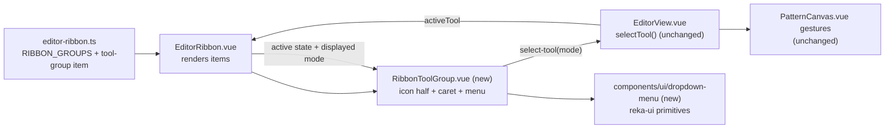

# Grouped sketch tools — one rectangle control with a mode menu

Status: **implemented** — Q1 = A (split control) and Q2 = A (no persistence) were
accepted with `spec-ready`; implementation continued on PR #70. The shadcn-vue
`dropdown-menu` wrappers are authored in the registry style over the already
installed `reka-ui`, because the CLI's dependency install is blocked in this
environment. Refs #68
Related: `.ai/specs/2026-10-23-rectangle-tool.md` (the three gestures this groups;
its Q3 chose three buttons "for v1"), `.ai/specs/2026-10-19-ribbon-icon-groups.md`
(the icon-only, named-group ribbon), PR #66 (draft: moves Round corner into a new
Features group), PR #61 (shipped rectangle sketching).

## 📝 TLDR

The Sketching ribbon carries three separate controls — **Rectangle**, **Centre
rectangle** and **3-point rectangle** — for what the maker thinks of as one tool
with three ways to place it. Issue #68 asks for them under one button with a
dropdown. Proposed behaviour: a **split tool control**. The icon half arms the
mode currently shown and is highlighted whenever any rectangle mode is active; the
caret half opens a small menu listing all three modes, with the armed one checked.
Picking a mode arms it immediately and becomes the icon half's face. The ribbon
data gains a reusable `tool-group` item kind, so later families (and the Features
group proposed in PR #66) can group the same way. This is a frontend presentation
change: the three tools, their canvas gestures, commands, document schema and API
are untouched.

## 📝 Problem Statement

- **Who needs it:** the maker drafting on the canvas, and the reader scanning the
  ribbon for "draw a rectangle". Three adjacent rectangle glyphs look like three
  different shapes rather than three ways to place one shape.
- **What happens today:** `RIBBON_GROUPS` lists `toolItem('add_rectangle')`,
  `toolItem('add_center_rectangle')` and `toolItem('add_3point_rectangle')` as
  peer items in the Sketching group
  (`frontend/src/lib/editor-ribbon.ts:106-112`). Each renders as its own square
  button with a tooltip (`frontend/src/components/EditorRibbon.vue:92-107`). The
  group now holds ten controls, and the ribbon wraps on a narrow desktop.
- **Evidence it matters:** #68 states the ask directly — "We have 3 variants of
  rectangle - i want to have them all under one button with dropdown". The
  rectangle spec anticipated this: its Q3 offered "one button plus a mode picker"
  as the alternative, recommending three buttons only because consolidating "is a
  visible UI change that deserves its own review"
  (`.ai/specs/2026-10-23-rectangle-tool.md`, Q3). #68 is that review.
- **Constraints:** commands remain the only mutation path, but nothing here
  mutates; `@sewcraft/geometry` is untouched; every new branch needs a test to
  hold the 100 % coverage gate; shadcn-vue components live under
  `frontend/src/components/ui` and are added with
  `npx shadcn-vue@latest add <component>`; `reka-ui@^2.11.0` is already a
  dependency (`frontend/package.json`), so a menu primitive adds no new package.
- **Why it is ambiguous:** "one button with dropdown" does not say what a click on
  the button itself should do, nor whether the chosen variant should be remembered
  after a reload. Those are Q1 and Q2. It also does not say whether grouping
  should be a rectangle-only arrangement or a ribbon capability; that is resolved
  below as an implementation call.

## 📝 Proposed Solution

### Options considered

| #   | Option                                                                                                                                                                                                 | Trade-offs                                                                                                                                                                                                                                                                                                                                                                     | Verdict                                                                                             |
| --- | ------------------------------------------------------------------------------------------------------------------------------------------------------------------------------------------------------ | -------------------------------------------------------------------------------------------------------------------------------------------------------------------------------------------------------------------------------------------------------------------------------------------------------------------------------------------------------------------------------- | --------------------------------------------------------------------------------------------------- |
| A   | **Split control (recommended):** icon button arms the mode it shows; attached caret opens a menu of the three modes; no extra click for the common case                                                | One control, one obvious glyph, and the keyboard/mouse path to a non-default mode is two clicks. Cost: two hit targets side by side, and the small caret needs its own accessible name and tooltip. The icon half's face changes with the last armed mode, so the ribbon is not a fixed picture                                      | **Recommended**                                                                                     |
| B   | **Single menu button:** the whole button always opens the menu; picking a mode arms it                                                                                                                  | Simplest possible control and no split-target ambiguity; the current mode can still be shown in the glyph. Cost: every rectangle, including the default one, costs two clicks, which is the most frequent action in the group                                                                                    | Rejected for v1; it is the fallback if Q1 finds the two-target shape too subtle                      |
| C   | **Press-and-hold flyout:** click arms the shown mode, long-press or hover peeks the other two                                                                                                         | Zero extra chrome when collapsed. Cost: long-press is not discoverable, is awkward with a mouse, has no keyboard path, and needs timer state; a menu is the conventional desktop pattern                                                                                                                            | Rejected                                                                                            |
| D   | **Click cycles modes:** one button, each click advances the mode                                                                                                                                    | One target and no menu code. Cost: unreachable modes are invisible, the button changes meaning under the pointer, and the pointer is already reserved for the drawing gesture — the opposite of the issue's "with dropdown"                                                | Rejected                                                                                            |
| E   | **Build nothing:** keep three buttons                                                                                                                                                                  | No work, and nothing regresses. Cost: the ribbon keeps growing by one control per variant, and the issue's ask — one entry point per shape family — stays unmet                                                                                                                          | Rejected — this is the state the issue asks to change                                               |

### Behaviour (under the recommended answers)

1. **Shape.** The three Sketching items become one `tool-group` item rendering a
   **split control**: a square icon button (`size="icon"`, existing `Button`) and,
   attached on its right, a narrow caret button with a divider. Both are 28 px
   tall, matching the rest of the ribbon; the caret is at least 20 px wide so it
   stays clickable.
2. **Face.** The icon half shows the glyph of the **displayed mode** — the mode it
   would arm. Initially `add_rectangle` (diagonal). While a rectangle mode is the
   active tool, the displayed mode follows it, so the icon half shows what is
   armed.
3. **Primary click.** Arms the displayed mode through the existing
   `select-tool` event. The current toggle rule still applies: clicking the icon
   half while its mode is already active returns to `select`
   (`frontend/src/views/EditorView.vue:494`). No new event, no new store state.
4. **Caret click.** Opens a menu under the control listing all three modes as
   radio items with their existing glyphs and labels — Rectangle, Centre
   rectangle, 3-point rectangle — the displayed mode marked `aria-checked`. The
   menu opens on click and on `ArrowDown`/`ArrowUp` from the caret, and focus moves
   into it.
5. **Choosing a mode.** Arms that tool immediately, closes the menu, and makes it
   the displayed mode. Choosing the already-armed mode is idempotent (it stays
   armed; it does not toggle back to Select), because choosing from a radio menu
   is a selection, not a toggle.
6. **Dismissal.** Outside click, `Escape`, `Tab`, or any tool change while the
   menu is open closes it without altering the armed tool. `Escape` closes only
   the menu and returns focus to the caret, so it never reaches the canvas's
   `Escape` handler that resets the tool.
7. **Active state.** The icon half uses the existing active/ghost variants: it is
   highlighted when `activeConstraint == null` and the active tool is any member
   of the group. The caret never shows the active variant; it may show an open
   state while the menu is up.
8. **Status bar.** `activeToolLabel` keeps naming the precise mode ("Rectangle",
   "Centre rectangle", "3-point rectangle"), so the status bar still says which
   gesture is armed (`frontend/src/views/EditorView.vue:448-450`).
9. **Read-only.** A read-only document disables both halves, the same rule as
   every other tool; the menu cannot open.
10. **Placement.** The menu is positioned below the control, left-aligned to the
    icon half, with a viewport-edge flip when the ribbon is scrolled or the control
    sits near the right edge. It renders above the canvas (the ribbon has no
    `overflow: hidden`), so no portal is required.
11. **Nothing else moves.** Canvas gestures, previews, test ids used by
    `PatternCanvas`, the command batch and every document-facing surface are
    unchanged.

### Ribbon data model

`RibbonItem` gains one additive variant:

```ts
export interface RibbonToolGroupItem {
  kind: 'tool-group';
  /** The control's data-testid, e.g. `tool-rectangle`. */
  id: string;
  /** Group caption/tooltip noun, e.g. `Rectangle`. */
  label: string;
  /** The mode the icon half shows by default. */
  primary: RibbonToolItem;
  /** Modes offered by the menu, `primary` included. */
  items: RibbonToolItem[];
}

export type RibbonItem =
  | RibbonToolItem
  | RibbonConstraintItem
  | RibbonActionItem
  | RibbonToolGroupItem;
```

The Sketching group then lists `toolGroup('rectangle', 'Rectangle', [...] )` in
place of the three `toolItem` entries. `EDITOR_TOOLS` and `TOOL_ICONS` are
untouched — all three tool ids still exist and must stay total, so a future mode
is still a one-line addition to a typed record.

### Architecture



Takeaway: one new presentational component and one additive ribbon item kind; the
editor store, the canvas and the geometry package are not in the path.

### New files

- `frontend/src/components/RibbonToolGroup.vue` — props `{ item: RibbonToolGroupItem,
  activeTool: EditorTool, readOnly?: boolean }`, emits `select-tool`. Owns the
  displayed-mode state (`activeTool` when it is a member, otherwise the last armed
  mode, otherwise `item.primary`), the menu open state and the split-button markup.
- `frontend/src/components/RibbonToolGroup.test.ts` — the behaviour table below as
  tests.
- `frontend/src/components/ui/dropdown-menu/**` — generated by
  `npx shadcn-vue@latest add dropdown-menu` (uses the installed `reka-ui`), plus
  its own test beside the wrapper, following `ui/button` and `ui/separator`.

### Edited modules

- `frontend/src/lib/editor-ribbon.ts` — the `RibbonToolGroupItem` variant, a
  `toolGroup()` helper, and the Sketching group's entry (one group instead of
  three items).
- `frontend/src/components/EditorRibbon.vue` — render `kind === 'tool-group'`
  through `RibbonToolGroup`, forward its `select-tool`, and widen `isActive` to
  treat a group as active when any member is.
- `frontend/src/lib/ribbon-icons.ts` — one `chevron-down` glyph (12 × 12 box) for
  the caret, added to `RibbonIconName`.
- Tests beside each of the above; `EditorRibbon.test.ts`'s control count and label
  list change from 25 controls to 24 (three buttons become a pair).
- `.ai/specs/2026-10-23-rectangle-tool.md` — its Status note and Q3/UI/UX wording
  record that the ribbon surface is now grouped while the gestures stand.

### Not edited (and why)

- `packages/geometry/src/**` — no geometry, command, solver or export change.
- `frontend/src/views/EditorView.vue`, `PatternCanvas.vue`, `editor-tools.ts`,
  `stores/editor.ts` — the tool ids, events and gestures are unchanged.
- `config/geometry.php`, `docs/domain/command-spec.md` / `.json`,
  `docs/architecture/data-model.md` — no command or document change.
- `docs/architecture/standards.md` — the component follows the documented
  shadcn-vue and `cn()` conventions; no new rule is introduced.

## 📝 Data Model

No change. Grouping is a way to draw existing controls; the document, its
`schema` string and `spec_version` are untouched, and nothing is persisted about
the ribbon or the last used mode.

## 📝 API Contracts

No new command, route or parameter. The only contract that moves is internal and
presentational:

- `RibbonItem` gains `RibbonToolGroupItem` (additive union member).
- `EditorRibbon` keeps emitting `select-tool` with an `EditorTool`; a group emits
  the same event as the button it replaces, so `EditorView.selectTool` is
  unchanged.
- `data-testid` contract: the icon half is `tool-rectangle` with
  `data-mode="<EditorTool>"`; the caret is `tool-rectangle-modes`; each menu item
  keeps the existing ids (`tool-add_rectangle`, `tool-add_center_rectangle`,
  `tool-add_3point_rectangle`), so existing test ids remain addressable once the
  menu is open.

## 📝 UI/UX

**Before** (Sketching group, 10 controls):

```
Sketching
[•] [／] [⌒] [◜] [○] [▭] [▭•] [▭∠] [↔] [✂]
                      ↑ Rectangle, Centre rectangle, 3-point rectangle
```

**After** (9 controls; the rectangle family is one entry):

```
Sketching
[•] [／] [⌒] [◜] [○] [▭|⌄] [↔] [✂]
                       └─ caret opens:
                          ✓ ▭  Rectangle
                            ▭• Centre rectangle
                            ▭∠ 3-point rectangle
```

- **Icon half tooltip:** the displayed mode's label, e.g. "Centre rectangle".
  **Caret tooltip and accessible name:** "Rectangle modes".
- **Glyph:** reuse the three existing rectangle glyphs (one per mode); the caret
  adds `chevron-down`. No new pictogram is invented for the family.
- **Selected/hover/focus:** icon half inherits the ribbon's existing variants and
  focus ring; the caret shares the caret button styles of the ribbon, with a
  visible focus ring. The open menu highlights items on hover and keyboard focus.
- **Accessibility:** caret carries `aria-haspopup="menu"` and `aria-expanded`;
  menu items are `menuitemradio` with `aria-checked` on the displayed mode; focus
  moves into the menu on open and returns to the caret on `Escape`; arrow keys,
  `Home`/`End`, `Enter`/`Space` work as the shadcn-vue menu provides. The icon
  half keeps `aria-pressed` like every other tool button.
- **Narrow width:** the ribbon wraps by group, so the pair never splits; the menu
  may overlap the canvas, which is expected.
- **Mockup:** none committed. The static layout above is unambiguous for a
  two-target control, and no browser provider is installed in this environment
  (`agent-browser` is absent, no `.ai/qa/test-env` descriptor), so a rendered
  visual cannot be captured and verified. The implementation PR can capture the
  real ribbon before/after.

### Behaviour table

| Interaction                                    | Result                                                                                   |
| ---------------------------------------------- | ---------------------------------------------------------------------------------------- |
| Click icon half, no rectangle mode active      | Displayed mode armed; icon half highlighted                                              |
| Click icon half, its mode already active       | Returns to `select` (existing toggle rule)                                              |
| Click caret                                    | Menu opens; focus moves to the displayed mode's item                                     |
| Choose a different mode                        | That tool is armed, menu closes, icon half shows its glyph, status bar names it           |
| Choose the displayed mode                       | Tool stays armed; menu closes; no toggle back to `select`                                |
| Click icon half while a different mode is active | The displayed mode *is* the active mode (rule 2), so this toggles back to `select`      |
| `Escape`, outside click, `Tab`, tool change    | Menu closes; armed tool unchanged; `Escape` returns focus to the caret and does not reset the tool |
| Read-only document                             | Both halves disabled; menu cannot open                                                   |
| Ribbon near the right viewport edge            | Menu flips to stay fully visible                                                         |

## 📝 Edge Cases & Failure Scenarios

| Scenario                                                     | Expected behaviour                                                                                     |
| ------------------------------------------------------------ | -------------------------------------------------------------------------------------------------------- |
| Menu open, user presses `Escape`                             | Menu closes, focus returns to the caret, active tool untouched; canvas reset does not fire               |
| Menu open, user clicks the canvas                            | Menu closes on outside click; the click is not also delivered as a drawing click in the same event       |
| Menu open, active tool changed from elsewhere (e.g. keyboard) | Menu closes; displayed mode follows the new active tool if it is a member                                |
| Keyboard-only user                                           | `Tab` reaches the caret, `Enter`/`Space`/`ArrowDown` opens, arrows move, `Enter` arms, `Escape` closes   |
| Very narrow ribbon                                           | The pair stays together; the menu may cover canvas; no horizontal clipping                                |
| Read-only document with an armed rectangle before saving     | Both halves disable; the armed mode cannot be changed until the document is editable again               |
| A fourth rectangle mode is added later                       | Add it to `EDITOR_TOOLS`, `TOOL_ICONS` and the group's `items`; the menu and tests are data-driven        |
| Group item with a single member                              | Not used in v1 and not special-cased: the menu renders whatever `items` holds, so a one-member group would show a one-item menu; adding one is a data change plus a test |
| Old test ids                                     | `tool-add_rectangle` etc. still resolve once the menu is rendered open                                    |

## 📝 Risks & Impact Review

- **Discoverability of the two hidden modes (medium, product).** One glyph now
  stands for three gestures. Mitigation: the caret is visible at all times, the
  menu names each mode, the tooltip names the armed one, and the status bar keeps
  the precise name. This cost is the issue's explicit request; Q1 is where to
  reject it.
- **Split-target ambiguity (medium, usability).** Users may hit the caret while
  meaning to draw. Mitigation: caret is a distinct, divided, labelled target of at
  least 20 × 28 px; Q1 option B removes the ambiguity at the cost of a click per
  rectangle.
- **New generated UI surface (low).** `dropdown-menu` adds shadcn-generated files
  under `ui/`; the dependency (`reka-ui`) is already installed, so the lockfile
  does not move. Each wrapper is exercised by the ribbon tests, keeping the 100 %
  coverage gate reachable.
- **Conflict with PR #66 (low, process).** The draft Features-group spec edits
  `editor-ribbon.ts` and `EditorRibbon.vue` too. The changes touch different group
  entries and different item kinds; whoever lands second rebases. No semantic
  overlap: Round corner moves to Features, rectangles stay in Sketching.
- **Superseded decision (low, docs).** `2026-10-23-rectangle-tool.md` records Q3 =
  three ribbon buttons. This spec supersedes only that surface decision; the three
  gestures, their commands and their tests stand. The implementation updates that
  spec's status and UI/UX wording so the two documents do not disagree.
- **Keyboard and focus regressions (low).** A menu that swallows `Escape` or
  traps focus would break the canvas. Tests cover `Escape` return-to-caret,
  outside click and `Tab`.
- **Compatibility (none).** No document, command, API, route or storage change;
  no migration, nothing to roll back. Removing the grouping later restores three
  buttons with the same tool ids.

## ❓ Open Questions

Asked on #68. The PR stays a draft until these are answered.

| #   | Question                                                                                                                                                                                                                                                         | Why it matters                                                                                                                                                                                                                                                       | Recommended answer                                                                                                                                                                      |
| --- | ---------------------------------------------------------------------------------------------------------------------------------------------------------------------------------------------------------------------------------------------------------------- | ---------------------------------------------------------------------------------------------------------------------------------------------------------------------------------------------------------------------------------------------------------------------- | --------------------------------------------------------------------------------------------------------------------------------------------------------------------------------------- |
| Q1  | **What should a click on the button itself do?** A: arm the displayed mode, caret opens the menu (split control). B: the whole button opens the menu, picking always arms. C: the button always arms the diagonal rectangle, the caret picks another mode. | This is the control's whole ergonomics. A makes the common case one click but introduces a second, small target; B is unambiguous but costs a click for every rectangle; C makes the most-used mode predictable but silently overrides a deliberately chosen mode. | **A.** It satisfies "one button with dropdown" while keeping drawing a rectangle a single click. The caret is a normal, labelled split-button affordance                                  |
| Q2  | **Should the chosen rectangle mode be remembered?** A: no — reset to the diagonal rectangle when the editor loads. B: yes — per browser (`localStorage`). C: yes — stored in the project document.                                                              | Remembering changes what the next session's first click does; not remembering surprises a maker who always drafts from a centre point. B is invisible but machine-specific and adds persistence with no schema home; C puts a UI preference into a shareable document, so two people opening the same project would inherit each other's ribbon. | **A for v1.** No persistence: the displayed mode resets to diagonal on load, and the mode follows the active tool within a session. B can be added later without a document change |

## ✅ Resolved assumptions (autonomous defaults)

Only reversible implementation calls are defaulted here; Q1 and Q2 are product
decisions and stay open above.

| #   | Assumption                                                                                                                                  | Why                                                                                                                    | Status     |
| --- | ------------------------------------------------------------------------------------------------------------------------------------------- | ---------------------------------------------------------------------------------------------------------------------- | ---------- |
| R1  | Grouping is a ribbon-data capability (`tool-group` item kind), not a rectangle-only component                                                | The Sketching group and the proposed Features group both need it; one additive union member costs little and avoids two bespoke layouts | Reversible |
| R2  | Only rectangles are grouped in v1                                                                                                           | The issue names rectangles; Line/Curve/Arc are distinct tools, not variants of one another                              | Reversible |
| R3  | No new command, tool id, schema, route or `spec_version` change                                                                              | The three tools already exist; only their presentation changes                                                          | Reversible |
| R4  | The menu is non-modal, closes on outside click / `Escape` / `Tab` / tool change, and returns focus to the caret                              | Matches desktop menu convention and keeps the canvas reachable                                                          | Reversible |
| R5  | The menu items keep the existing tool `data-testid`s; the split control is `tool-rectangle` with `data-mode`                                 | Preserves every existing id the tests and tooling already use, while giving the new target a stable, mode-aware id      | Reversible |
| R6  | The caret uses one new `chevron-down` glyph in the existing 12 × 12 icon set                                                                 | The ribbon draws all icons from one typed record; a text glyph would break the icon-only rule                           | Reversible |
| R7  | The displayed mode follows the active tool, else the last mode armed in this session, else diagonal                                          | Keeps the icon half honest about what a click will arm without adding store state                                       | Reversible |
| R8  | Choosing the displayed mode from the menu does not toggle the tool off                                                                        | A radio menu expresses selection; toggling would make a deliberate choice cancel the tool                               | Reversible |
| R9  | No other ribbon group, label, order or action changes                                                                                        | Keeps the change reviewable and avoids colliding with PR #66's Features group                                           | Reversible |
| R10 | No mockup is committed; the static layout above is the design evidence                                                                       | No browser provider or test-env descriptor is installed, so a rendered visual could not be captured or verified          | Reversible |

## 📋 Phasing

- **Phase 1 — Data model.** `RibbonToolGroupItem`, the `toolGroup()` helper and the
  grouped Sketching entry, with ribbon-data tests.
- **Phase 2 — Control.** The shadcn-vue `dropdown-menu` files, `RibbonToolGroup`
  and its behaviour tests, the caret glyph, and the `EditorRibbon` wiring.
- **Phase 3 — Verification.** Full gate, keyboard/read-only/narrow-width pass in
  the running app, and the rectangle-spec wording update.

Each phase leaves the app working: Phase 1 changes an unused-in-render data shape
behind the existing three buttons (or renders them as before), Phase 2 swaps them
for the pair, Phase 3 proves nothing else moved.

## 📋 Implementation Plan

### Phase 1 — Ribbon data

1. Add `RibbonToolGroupItem` to the union and a `toolGroup(id, label, primary,
   items)` helper in `editor-ribbon.ts`.
2. Replace the three rectangle `toolItem` entries with one group entry; keep the
   item order (after Circle) and the group label.
3. Update `editor-ribbon` tests: the Sketching group contains the group item, its
   `items` are the three rectangle tools in gesture order, and `primary` is
   `add_rectangle`.

### Phase 2 — Control

1. Add the dropdown-menu component with `npx shadcn-vue@latest add dropdown-menu`
   and a test beside the wrapper.
2. Add `chevron-down` to `ribbon-icons.ts`.
3. Build `RibbonToolGroup.vue`: displayed-mode resolution, split-button markup,
   primary `select-tool` emit, menu items with `menuitemradio` and `aria-checked`,
   focus return on close, disabled state for read-only.
4. Wire it into `EditorRibbon.vue`: render by `kind`, widen `isActive` for groups,
   forward `select-tool`.
5. Tests: the whole behaviour table, plus ribbon-level counts (24 controls, label
   list, group active state, read-only, menu keyboard paths).

### Phase 3 — Verification and docs

1. Run `npm run format`, `npm run typecheck`, `npm run lint`,
   `npm run format:check`, `npm run test:coverage` (100 % for
   `packages/geometry/src` and `frontend/src`), `npm run build`; the geometry
   package is untouched, but the run includes the backend coverage command from
   `AGENTS.md`.
2. In the running app: draw with the default mode; switch to the centre and
   3-point modes from the menu; check the toggle-to-select rule; `Escape` closes
   the menu without resetting the tool; keyboard-only pass; read-only document;
   narrow viewport; verify the three canvas gestures still behave exactly as
   before.
3. Update `.ai/specs/2026-10-23-rectangle-tool.md` (Status note, Q3 verdict and
   UI/UX ribbon paragraph) to point at this spec for the grouped surface.

## ✅ Acceptance Criteria

- [x] Sketching shows one rectangle control (icon half + caret) instead of three
      buttons, and the ribbon tests reflect 24 top-level controls.
- [x] The icon half arms the displayed mode, and shows the active mode's glyph
      while any rectangle mode is armed.
- [x] The caret opens a menu listing Rectangle, Centre rectangle and 3-point
      rectangle with the displayed one checked; choosing one arms it and closes.
- [x] `Escape`, outside click, `Tab` and tool changes close the menu without
      changing the armed tool; `Escape` returns focus to the caret.
- [x] Read-only disables both halves; keyboard-only users can reach and operate
      every mode.
- [x] All three gestures, their commands and previews are unchanged; 100 %
      coverage, lint, format, typecheck and build pass.
