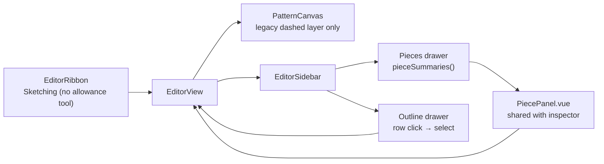

# Pieces sidebar, Outline selection and allowance authoring retirement

Status: proposed
Builds on: 2026-10-22-pieces-and-allowance (pieces and per-edge allowances),
2026-10-20-selected-entity-properties (the per-entity inspector)
Supersedes (UI only): 2026-10-19-seam-allowance-sketch-tool and
2026-10-20-seam-allowance-side
Related: 007 (seam allowance, superseded by pieces)

## 📝 TLDR

Pieces are now the cutting unit, but the editor still presents the legacy
per-edge seam as an authorable feature: the ribbon carries a **Seam allowance**
sketch tool, the canvas allows double-click width editing, and the Outline and
Properties drawers expose width, flip and remove controls. At the same time there
is no way to browse pieces, and Outline rows cannot select their entity. Proposed
future behaviour: **retire the legacy allowance authoring UI** (the seam model
and its read-only rendering stay so old documents still load), **add a Pieces
drawer** that lists every piece and opens its existing card, and make **Outline
rows select their entity** with the same modifier semantics as the canvas.

## 📝 Problem Statement

- **Who needs it:** the solo maker working with pieces. After creating a piece
  the allowances that matter are the piece's, but the editor keeps offering a
  second, per-edge way to add an allowance that is not tied to a loop and does
  not derive a cut outline.
- **What happens today:**
  - The ribbon's Sketching group still ends with **Seam allowance**
    (`frontend/src/lib/editor-ribbon.ts:97-109`), and the tool attaches legacy
    `seams` per edge (`frontend/src/views/EditorView.vue:694-737`).
  - The dashed legacy seam is double-click editable through `SeamWidthEditor`
    (`frontend/src/components/PatternCanvas.vue:2062-2076`), and the Outline and
    Properties drawers expose width, flip and remove controls
    (`frontend/src/views/EditorView.vue:1159-1224`,
    `frontend/src/components/EntityPropertiesPanel.vue:917-1001`).
  - Allowances for a piece are editable only when one of the piece's edges is
    selected: the piece card lives inside `EntityPropertiesPanel.vue` and has no
    other home. With no selection there is no list of pieces at all.
  - Outline rows are a label plus controls. There is no click target that selects
    the entity, so the only way to select `ab` is to find it on the canvas.
- **Evidence it matters:** the pieces spec deliberately kept the legacy commands
  as a deprecated path until 0.3 (`.ai/specs/2026-10-22-pieces-and-allowance.md`,
  Q3), but the UI kept the legacy path as a **primary** action. The maintainer
  asked for the retirement, a Pieces section, and Outline selection in the
  current session.
- **Constraints:** commands remain the only mutation path; `@sewcraft/geometry`
  stays pure and untouched; the document schema and command spec do **not**
  change in this work.

## 📝 Proposed Solution

Three UI changes ship together on one branch and PR.

### Decision: how far the removal goes

| # | Option | Trade-offs | Verdict |
| - | ------ | ---------- | ------- |
| A | **Retire the authoring UI only.** Legacy `seams` remain in schema 0.2, render read-only for documents with open chains, and the three seam commands stay deprecated in the command spec | No schema or contract break; old drawings keep rendering; one dead command path remains documented as deprecated | **Recommended — chosen** |
| B | Remove `Seam`, `seams`, the seam commands, offset paths and export support, and bump the schema to 0.3 | Cleanest model; a schema bump, command-spec break and a much larger test rewrite inside a sidebar change | Rejected for now — keep as separate cleanup when 0.3 is due |

### Decision: where the piece card lives

| # | Option | Trade-offs | Verdict |
| - | ------ | ---------- | ------- |
| A | **A dedicated Pieces drawer** listing every piece, expanding the shared piece card inline | Discoverable without a selection; keeps Properties for the selected entity; one more drawer | **Recommended — chosen** |
| B | Put the piece list inside the Outline drawer | One drawer fewer; mixes two different hierarchies and grows an already busy drawer | Rejected |
| C | Only show the piece card when an entity is selected (today) | No new surface; cannot browse pieces and repeats the current gap | Rejected |

### Decision: what clicking a piece selects

| # | Option | Trade-offs | Verdict |
| - | ------ | ---------- | ------- |
| A | **Highlight the piece and open its card**, keeping entity selection separate | Delete and property edits never act on a loop by accident; the canvas band already communicates the selection | **Recommended — chosen** |
| B | Select all loop edges | Reuses the existing multi-selection; Delete would target the loop's edges and the properties panel would show the generic multi-selection summary | Rejected |

### Behaviour

1. **No allowance tool.** `add_allowance` disappears from `EditorTool`,
   `EDITOR_TOOLS`, the ribbon tool map and the Sketching group. The `allowance`
   glyph is removed from `RIBBON_ICONS` because nothing else uses it. Clicking
   the tool's old position does nothing; there is no replacement tool.
2. **No legacy allowance authoring.** The canvas keeps the dashed legacy seam
   layer only; its hit layer, `SeamWidthEditor`, double-click handler and
   `add-allowance` emit are removed. The Outline shows an attached legacy seam as
   read-only text (`Allowance 10 mm`) with no width/flip/remove controls. The
   Properties inspector loses its **Seam allowance** section entirely.
3. **Legacy documents keep rendering.** A document with `seams` on edges outside
   any piece still draws the dashed offset path under the existing presentation
   toggle. Nothing in the model, migration, commands or export changes; the
   command spec keeps the three seam commands marked deprecated.
4. **Toggle rename.** The View drawer's "Show seam allowance" becomes **Show
   allowances**, bound to `showAllowances` with `data-testid="show-allowances"`.
   It still controls both the piece allowance band and the legacy dashed layer.
5. **Pieces drawer.** A new `pieces` drawer joins the sidebar directly after
   Properties and is open by default. It lists every document piece as a row:
   name or `Piece N`, quantity, finished size and cut size. A row with no name
   uses its 1-based position, matching the existing "Piece 1" fallback.
6. **Piece selection.** Clicking a row sets an ephemeral `selectedPieceId`,
   expands that row's full piece card, and highlights the piece on the canvas
   through the existing band. Clicking the selected row again collapses it and
   clears the selection. Selecting a piece clears the entity selection. Selecting
   an entity on the canvas or in the Outline clears `selectedPieceId`.
7. **One piece card.** The card currently embedded in `EntityPropertiesPanel.vue`
   is extracted into `PiecePanel.vue` and used by both the drawer and the
   inspector. It receives a `PieceSummary` and emits `update-piece`,
   `set-piece-allowance` and `remove-piece`; no logic is duplicated.
8. **Drawer empty state.** With no pieces the drawer says `No pieces yet.` and
   offers **Create piece**, disabled unless the current selection is a valid
   closed cut chain (the same closed-chain gate as the ribbon action). The ribbon
   action stays.
9. **Outline selection.** The id and summary text of each Outline row become a
   button. A plain click replaces the selection, Ctrl/Cmd-click toggles the
   entity, and Ctrl/Cmd+Shift or Ctrl/Cmd+Alt subtracts it, reusing
   `selectionModeFrom`, `toggleSelection` and `applySelection`. The selected row
   is highlighted and exposes `aria-current="true"`.
10. **Controls stay independent.** The allowance width input, construction
    button and any other row control do not select the entity; only the label
    button does.
11. **Allowances remain editable per piece.** The piece card is the only
    allowance editor. An edge with no piece still shows `No allowance` in the
    Outline and cannot receive one until it belongs to a piece.

## 📝 Architecture

Frontend-only. No geometry, command-core, PHP, schema or export change.



| File | Change |
| ---- | ------ |
| `frontend/src/lib/editor-tools.ts` | Drop `add_allowance` |
| `frontend/src/lib/editor-ribbon.ts` | Drop the tool map entry and ribbon item |
| `frontend/src/lib/ribbon-icons.ts` | Drop the unused `allowance` glyph |
| `frontend/src/components/PatternCanvas.vue` | Drop the seam hit layer and its editor; keep the dashed seam layer; add `selectedPieceId` |
| `frontend/src/components/SeamWidthEditor.vue` | Delete with its test |
| `frontend/src/components/EntityPropertiesPanel.vue` | Remove the seam section and seam emits; render `PiecePanel` |
| `frontend/src/lib/entity-properties.ts` | Drop the `seam` field and seam imports |
| `frontend/src/lib/allowance-width.ts` | Replaces `seam-width.ts` for the piece editor's parsing |
| `frontend/src/components/PiecePanel.vue` | New shared card extracted from the inspector |
| `frontend/src/lib/pieces.ts` | Add `pieceSummaries(document)` |
| `frontend/src/lib/editor-drawers.ts` | Add the `pieces` drawer |
| `frontend/src/views/EditorView.vue` | Seam handlers removed; `selectedPieceId`, Pieces slot, Outline selection |

## 📝 Data Model

No change. `PatternDocument` keeps schema `sewcraft.pattern/0.2`, `pieces` and
the deprecated `seams`. `selectedPieceId` is component state, never stored in the
document or journal. No migration, no command and no export contract changes.

## 📝 API Contracts

No change. `spec_version` stays `0.10.0`. `add_seam_allowance`,
`remove_seam_allowance` and `set_seam_allowance` remain valid deprecated
commands for payload compatibility; this work only removes their UI. The
documentation notes that they have no editor surface.

## 📝 UI/UX

- **Ribbon.** The Sketching group becomes Point, Line, Curve, Arc, Circle,
  Dimension. The Tools and Constraints groups are unchanged.
- **Pieces drawer.** Rows read like
  `Front panel · ×2 · 220 × 210 mm finished · 240 × 230 mm cut`, with a chevron
  or similar affordance for expansion. The expanded card is the existing
  name/quantity/size/area/allowance editor plus **Remove piece**. `aria-expanded`
  tracks the row; the panel is not nested inside the row button.
- **Outline.** The id is a monospace button with a visible hover and focus ring;
  the selected row is tinted like the canvas selection. Legacy allowances read
  `Allowance 10 mm`; piece edges read `In piece p1 · seam 10 mm`; unowned edges
  read `No allowance`. The construction button stays at the row's end.
- **View.** `Show allowances` replaces `Show seam allowance`. All other toggles
  are unchanged.
- **Accessibility.** The Outline id button has an accessible name such as
  `Select entity ab`; Ctrl/Cmd semantics match the canvas; selected rows set
  `aria-current`; the Pieces row button exposes `aria-expanded` and an accessible
  name that includes the piece label. Focus never moves into a hidden panel.
- **States.** No pieces → empty state with the disabled explanation. A piece
  whose loop no longer resolves still appears, reports `—` sizes, and can be
  selected and removed. A deleted or undone piece clears `selectedPieceId`.
  Hidden allowances hide the band and legacy dashes but not the row highlighting.

## 📝 Edge Cases & Failure Scenarios

| Scenario | Expected |
| -------- | -------- |
| Old document with seams on an open chain | Dashed allowance renders; no width, flip or remove control anywhere; selecting the edge shows no seam section |
| Old document with closed seam chains | Already migrated to pieces on load; allowances edit through the piece card |
| Seam tool expected in the ribbon | It is gone; the stored `add_allowance` tool is never active and Escape/tool state is unaffected because the value no longer exists |
| Piece selected, then a canvas entity clicked | Piece highlight and `selectedPieceId` clear; the entity becomes the selection |
| Entity selected, then a piece row clicked | Entity selection clears; the piece card opens and the band highlights |
| Selected row clicked again | Panel collapses, `selectedPieceId` clears, canvas band returns to the edge-driven highlight |
| Piece or its edges deleted while selected | The document watcher clears `selectedPieceId`; no stale panel |
| Piece loop has a dangling point | Row still renders, sizes show `—`, selection and removal still work |
| Ctrl/Cmd-click an Outline row | Same toggle semantics as the canvas; Ctrl/Cmd+Shift subtracts |
| Click an Outline width input or construction button | No selection change |
| Ctrl/Cmd-click toggles off the last selected entity | Selection becomes empty; `selectedPieceId` already cleared by the click |
| Undo after removing a piece while it was selected | The piece returns; the ephemeral selection does not, so nothing stale is shown |
| Hidden allowances | Band and legacy dashes disappear; the Outline and Pieces drawers keep working |

## 📝 Risks & Impact Review

| Risk | Impact | Mitigation |
| ---- | ------ | ---------- |
| Makers used the ribbon tool for quick per-edge allowances | The common action changes from "click edge, allowance appears" to "create a piece, then set the allowance" | Intentional: allowances must derive a cut loop. The pieces spec already established pieces as the owner; the empty Outline/Pieces text points at Create piece |
| Legacy seams become uneditable while still in schema 0.2 | An old open-chain allowance cannot be adjusted in the editor | Documented as read-only in `BACKWARD_COMPATIBILITY.md`; removal of the model is scheduled for 0.3. Widths can still be preserved by exporting or by editing the document through commands |
| Two places show the piece card | Divergence | One `PiecePanel.vue` and one `PieceSummary` view model; both read the live document |
| `selectedPieceId` and entity selection drift | Stale highlight or panel | Explicit clear rules in both directions, a document watcher, and tests for each transition |
| Renaming `showSeamAllowance` and its test id | Test churn | Mechanical rename; the behaviour is unchanged |
| Deletions could hide dead code still imported elsewhere | Build or coverage failure | The typecheck catches orphaned imports; 100% coverage confirms the removed branches are gone |

## 📋 Phasing

1. **Retire allowance authoring** — tool, canvas editor, inspector and Outline
   controls; legacy rendering stays.
2. **Pieces drawer and shared piece card** — list, selection, expansion, empty
   state and canvas highlight.
3. **Outline selection** — clickable rows, modifiers, highlight and clearing.
4. **Documentation and gate** — spec statuses, compatibility note, deprecation
   wording, validation.

## 📋 Implementation Plan

### Phase 1 — Retire allowance authoring

1.1 Remove `add_allowance` from `EditorTool`, `EDITOR_TOOLS`, `TOOL_ICONS` and
`RIBBON_GROUPS`, and remove the `allowance` entry from `RIBBON_ICONS`. Update
`editor-tools.test.ts`, `editor-ribbon.test.ts` and `ribbon-icons.test.ts`.
1.2 Delete `SeamWidthEditor.vue` and its test; remove the seam hit layer,
`onSeamDoubleClick`, the editor state/watch and the `add-allowance` /
`set-seam-width` emits from `PatternCanvas.vue`. Keep the dashed `seam-layer`
and its `seamAllowancePaths` input. Update `PatternCanvas.test.ts` (the legacy
layer still renders; no hit path or editor).
1.3 Remove `onAddAllowance`, `setSeamWidth`, `flipSeam`, `onSeamWidthEdit` and
`removeSeam` from `EditorView.vue`, along with the Outline width/flip/remove
controls and the seam props/emits passed to the inspector. Update
`EditorView.test.ts`.
1.4 Remove the seam section and seam imports from `EntityPropertiesPanel.vue`,
and the `seam` field plus `seamForEdge`/`seamSide` imports from
`entity-properties.ts`; keep `pieceOwningEdge`. Update the inspector tests.
1.5 Move `parseSeamWidth`/`isValidSeamWidth` to `allowance-width.ts` as
`parseAllowanceWidth`/`isValidAllowanceWidth`, update the piece editor and tests,
and delete `seam-width.ts` and its test.
1.6 Rename the presentation toggle to `showAllowances` /
`data-testid="show-allowances"` and its label to **Show allowances** in
`EditorView.vue` and `PatternCanvas.vue`; update the tests that drive it.

### Phase 2 — Pieces drawer

2.1 Add `pieces` to `DrawerId` and `EDITOR_DRAWERS` after Properties, open by
default; update `editor-drawers.test.ts` and `EditorSidebar.test.ts`.
2.2 Add `pieceSummaries(document): PieceSummary[]` to `pieces.ts` and cover empty,
named, unnamed and broken pieces in `pieces.test.ts`.
2.3 Extract the piece card into `PiecePanel.vue` taking a `PieceSummary`, with
the existing name, quantity, sizes, areas, per-edge kind/width rows, Remove
button and emits. Use it from `EntityPropertiesPanel.vue`; add
`PiecePanel.test.ts` covering every edit and invalid input.
2.4 Add `selectedPieceId` to `EditorView.vue`: row click toggles it, expands
`PiecePanel`, clears the entity selection, and clears itself when the piece
disappears. Add the `#pieces` slot with rows, empty state and the Create piece
button gated by `canCreatePiece`.
2.5 Pass `selectedPieceId` to `PatternCanvas.vue` and include it in the piece
band's selected state; cover row selection, expansion, collapse, clearing and
the canvas highlight in `EditorView.test.ts` and `PatternCanvas.test.ts`.

### Phase 3 — Outline selection

3.1 Turn the Outline id/summary into a selection button using
`selectionModeFrom`, `toggleSelection` and `applySelection`; keep the width
input and action buttons outside it. Add `aria-current`, a selected row tint and
`aria-label="Select entity <id>"`.
3.2 Clear `selectedPieceId` whenever an Outline or canvas entity selection
becomes non-empty, and clear the entity selection when a piece is selected.
3.3 Cover plain click, Ctrl/Cmd toggle, Ctrl/Cmd+Shift subtract, control
isolation, empty values, selected styling and piece/entity hand-off in
`EditorView.test.ts`.

### Phase 4 — Documentation and gate

4.1 Set this spec's status to implemented, mark the seam sketch-tool and
seam-side specs superseded for UI, and add the deprecation/read-only note to
`docs/domain/command-spec.md`, `docs/architecture/geometry-core.md`,
`docs/architecture/data-model.md` and `BACKWARD_COMPATIBILITY.md`. Record the
outcome in `.ai/runs/2026-10-23-pieces-sidebar-and-selection.md`.
4.2 Run the full gate below and extend no thresholds.

## ✅ Acceptance criteria

- [ ] No Seam allowance tool appears in the ribbon, and no `add_allowance` value
      remains in the editor-tool union.
- [ ] The legacy dashed allowance renders for an old open-chain document but
      cannot be added, edited, flipped or removed anywhere in the UI.
- [ ] The Properties inspector has no Seam allowance section; piece allowances
      remain editable through the piece card.
- [ ] A Pieces drawer lists every piece with name, quantity, finished and cut
      size; clicking a row highlights the piece, expands the full card, and
      clicking it again collapses it.
- [ ] The same `PiecePanel` renders in the drawer and the inspector, and edits
      from either place update both.
- [ ] Clicking an Outline entity id selects it; Ctrl/Cmd toggles, Ctrl/Cmd+Shift
      subtracts, selected rows are marked, and row controls never change the
      selection.
- [ ] Selecting an entity clears the piece selection and selecting a piece
      clears the entity selection.
- [ ] The document schema, command spec version and geometry package are
      unchanged.
- [ ] 100% statements, branches, functions and lines stay green across
      `packages/geometry/src`, `frontend/src` and backend `app/`.

## Out of scope

- Removing `Seam`, the `seams` field or the three seam commands (schema 0.3
  cleanup).
- New allowance kinds, presets, drag-to-set widths or allowances on open edges.
- Selecting points or dimensions in the Outline; the drawer keeps its current
  line/curve/arc/circle list.
- Selecting a piece's edges as a group, multi-piece selection, reordering or
  zoom-to-piece from the drawer.
- Changes to the canvas selection model, the command bus, export layers or the
  cut-dimension behaviour.
- Fabric layout, notches, grainlines or any other roadmap item.

## Checks

```bash
npm run format
npm run typecheck
npm run lint
npm run format:check
npm run test:coverage
npm run build
docker compose run --rm --no-deps -e DB_CONNECTION=sqlite -e DB_DATABASE=:memory: app sh -c "composer install --no-interaction && php artisan test --coverage --min=100"
docker compose run --rm --no-deps app sh -c "composer install --no-interaction && vendor/bin/pint"
```
