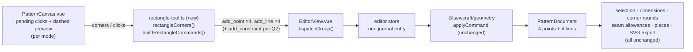

# Rectangle sketching (rectangle tool)

Status: **draft** — Q1 (what "3 point" means), Q2 (whether the tool adds
constraints) and Q3 (one ribbon control or three) are unanswered; implementation
must not start before they are resolved.
Refs #60
Related: 002 (geometry core primitives), 005 (canvas editor interactions),
2026-10-21-circle-sketching (#52), 2026-10-21-arc-sketching (#53),
2026-10-19-constraint-tools-ribbon, 2026-10-20-multi-entity-selection (#50)

## 📝 TLDR

Today a rectangle can only be drawn edge by edge with the Line tool, so a plain
block costs eight clicks, skews the moment anything is dragged, and produces four
unrelated lines. Proposed future behaviour: a **Rectangle** tool family whose
three modes mirror the issue — diagonal corners, centre plus corner, and three
points for a rectangle at an angle. Every mode emits the same thing the issue
asks for: **four shared points and four lines**, created as one command batch and
undone in one step. No new entity kind, command, schema version or HTTP route is
proposed, so rectangles remain ordinary geometry that selection, dimensions,
corner rounds, seam allowances, pieces and SVG export already understand.

## 📝 Problem Statement

- **Who needs it:** the maker blocking out a pattern piece — a sleeve, pocket,
  waistband strip, cuff or yoke — where the first move is always "a rectangle of
  this size here, at this angle". Also the agent authoring commands, which
  currently has to spell out eight or twelve separate commands to express one
  rectangle.
- **What happens today:** `Entity` is `point | line | curve | circle | arc`
  (`packages/geometry/src/types.ts:69`) and `Command` has `add_point`,
  `add_line`, `add_circle`, `add_arc` but no rectangle
  (`packages/geometry/src/commands.ts:221`). The closest workflow is the Line
  tool: four lines, eight clicks, each corner snapped by hand
  (`frontend/src/lib/drafting.ts:28`). Nothing records that the result was meant
  to be a rectangle, so a drag on any corner turns it into a quadrilateral, and
  a width/height dimension cannot keep it rectangular unless the user first adds
  four constraints one at a time.
- **Evidence it matters:** issue #60 asks for exactly this tool and fixes the
  representation — "Rectangle is 4 points + lines connecting them". The three
  requested modes match the mode set of mainstream sketch tools: Onshape's
  Corner / Center point / **Aligned** rectangle (its aligned mode is three
  clicks: first corner, end of the first side, then the perpendicular width),
  AutoCAD's `RECTANG` (two corners plus options) and Seamly2D/Valentina, which
  take two corners plus an optional rotation angle. None of them requires a
  distinct rectangle entity — the modes differ only in how the four corner
  coordinates are derived.
- **Constraints:** commands are the only mutation path (`AGENTS.md`, rule 1);
  units are millimetres; points are the only solver variables
  (`types.ts:8-11`); the ribbon is data-driven and every tool needs an icon in a
  total `Record` (`frontend/src/lib/editor-ribbon.ts:40`,
  `frontend/src/lib/ribbon-icons.ts:12`); coverage must stay at 100 % for
  `frontend/src` and `packages/geometry/src`.
- **Why it is ambiguous:** the issue's "3 point - user clicks three points to
  which rectangle is matched" can mean a rotated rectangle (CAD convention) or
  merely "three corners of an axis-aligned one". It also does not say whether the
  tool should add the constraints that make a rectangle stay a rectangle, nor
  where the three modes live in the ribbon. Those are Q1–Q3.

## 📝 Proposed Solution

### Options considered

| #   | Option                                                                                                                                                                      | Trade-offs                                                                                                                                                                                                                                                                                                                                                                                       | Verdict                                                                                                                       |
| --- | --------------------------------------------------------------------------------------------------------------------------------------------------------------------------- | ------------------------------------------------------------------------------------------------------------------------------------------------------------------------------------------------------------------------------------------------------------------------------------------------------------------------------------------------------------------------------------------------ | ----------------------------------------------------------------------------------------------------------------------------- |
| A   | **Composition (recommended):** the gesture computes four corner coordinates and emits `add_point` ×4 + `add_line` ×4 (+ constraints per Q2) as one batch                                                                                    | Reuses every existing consumer untouched: selection, dimensions, corner rounds, seam allowances, pieces (`basicPieceForLoops`, `packages/geometry/src/piece.ts:452`), SVG export, undo. Matches the issue's own model. Cost: a rectangle is not a named object afterwards, so width/height are edited through dimensions rather than a rectangle dialog, and rectangularity depends on Q2 | **Recommended**                                                                                                                |
| B   | **A `rectangle` entity** referencing two or three corner points, deriving the other corners as non-solver values                                                              | Gives a real object with derived width, height and rotation, one selectable thing to delete, and a natural home for mode-aware properties. Cost: derived corners are a new concept in a model whose only solver variables are points; every exhaustive `entity.kind` switch gains a case; edges would need synthetic line entities or a new edge concept for seams, corner rounds and pieces — a much larger blast radius than the issue asks for | Rejected for v1; revisit only if parametric rectangle editing is wanted                                                        |
| C   | **Composition plus a rectangle feature record** (like `cornerRounds` / `pieces`) that tags the four lines, the mode and the defining points                                     | Keeps plain geometry for every consumer and still allows re-editing or "select the whole rectangle" later; additive document collection, no schema bump needed in principle. Cost: new document state, migration and undo rules, and a mode-aware properties surface — real work with no user-visible payoff until re-edit exists                                            | Rejected for v1; a natural follow-up to A                                                                                      |
| D   | **Three separate rectangle entities by mode** (diagonal, centre, aligned)                                                                                                     | No mode ambiguity at read time. Cost: three kinds for one shape, three sets of switches, and documents that cannot be compared or merged; strictly worse than B                                                                                                                  | Rejected                                                                                                                      |
| E   | **Build nothing**; keep drawing rectangles with the Line tool                                                                                                                 | No new surface, and the issue stays open. Drawing one block stays eight clicks, corners stay hand-snapped, and no rectangle is protected from skew                                                                                                                              | Rejected — this is the workaround the issue is asking to replace                                                              |

### What "3 point" means (Q1)

| #   | Reading                                                                                                                                          | Consequence                                                                                                                                                                                                                              |
| --- | ------------------------------------------------------------------------------------------------------------------------------------------------ | ----------------------------------------------------------------------------------------------------------------------------------------------------------------------------------------------------------------------------------------- |
| I1  | **Rotated rectangle (recommended):** click 1 is a corner, click 2 ends the first side (fixes rotation and length), click 3 sets the perpendicular width on either side                       | Matches Onshape's aligned rectangle and gives pattern drafters rectangles along a grainline or a folded edge. Rectangularity then needs a solver guarantee (Q2), because horizontal/vertical constraints cannot express a rotated side  |
| I2  | **Three corners of an axis-aligned rectangle:** click three corners, the fourth is derived                                                                                | Simpler and needs no new constraint strategy, but it is just the diagonal mode with one extra click, and it cannot express the angled panel that motivates a third mode at all                                                            |
| I3  | **Centre plus two corners:** click the centre, then two corners                                                                                                             | A second centre flavour; adds no capability the centre mode lacks                                                                                                                         |

### Behaviour (under the recommended answers)

1. **Three tools, three gestures.** `add_rectangle` (diagonal), `add_center_rectangle`
   and `add_3point_rectangle` join the Sketching ribbon group after Circle. Each
   stays active after a commit and is cancelled by Escape, a tool change or a
   document load, exactly like Line, Circle and Arc.
2. **Snapping and point reuse.** Every click is resolved with
   `resolveDraftingEndpoint` (`frontend/src/lib/drafting.ts:28`), so an existing
   point under the pointer is reused by id and a bare-canvas click becomes a
   provisional corner.
3. **Diagonal mode.** First click = one corner, second = the opposite corner. The
   four corners are `(x1, y1)`, `(x2, y1)`, `(x2, y2)`, `(x1, y2)`.
4. **Centre mode.** First click = centre, second = a corner. The rectangle spans
   `|2·(corner − centre)|` around the centre.
5. **Three-point mode.** First click = a corner, second = the end of the first
   side, third = a point whose perpendicular projection onto that side gives the
   depth and whose side of the line gives the direction (Q1 = I1).
6. **Commit.** The gesture emits `add_point` for each corner it must create, then
   four `add_line` commands in traversal order (A→B, B→C, C→D, D→A), then the
   constraints Q2 decides on. `EditorView` applies the batch through
   `dispatchGroup`, so one undo removes every entity the gesture created — a
   reused point is never deleted by that undo.
7. **Guards.** A rectangle narrower than `MIN_RECTANGLE_SIZE` (0.001 mm) in either
   direction is refused: no command, preview stays. A click resolving to a corner
   already used by the same gesture is refused the same way.
8. **After commit.** The four lines are ordinary cut geometry; each is selectable
   on its own, marquee selects all four, and the existing multi-entity delete
   applies. Construction status, seam allowances, corner rounds and pieces are
   added afterwards with the existing tools.

## 📝 Architecture



Takeaway: the change is a new pure gesture helper plus canvas wiring; the
geometry package, the command contract and every downstream consumer stay as they
are, because a rectangle is four lines.

### New files

- `frontend/src/lib/rectangle-tool.ts` — pure, framework-free:
  ```ts
  export type RectangleMode = 'diagonal' | 'center' | 'three_point';

  /** Millimetres below which a side is treated as degenerate. */
  export const MIN_RECTANGLE_SIZE = 0.001;

  /**
   * The four corners in traversal order (A, B, C, D), or `null` when the clicks
   * cannot form a rectangle: a repeated corner, a side shorter than
   * MIN_RECTANGLE_SIZE, or a third point on the first side's line.
   */
  export function rectangleCorners(
    document: PatternDocument,
    mode: RectangleMode,
    clicks: DraftingEndpoint[],
  ): Vec2[] | null;

  /** add_point for each new corner, then the four lines, then Q2's constraints. */
  export function buildRectangleCommands(
    document: PatternDocument,
    mode: RectangleMode,
    clicks: DraftingEndpoint[],
    nextId: (prefix: string) => EntityId,
  ): Command[];
  ```
  The canvas calls `rectangleCorners` for the preview and
  `buildRectangleCommands` for the commit, so what is drawn and what is written
  come from the same function — the rule the Arc tool already follows
  (`frontend/src/lib/arc-tool.ts:50`).
- `frontend/src/lib/rectangle-tool.test.ts` — the pure cases: every mode, point
  reuse on each corner, rotation on both sides in three-point mode, every
  degenerate guard, and command order.

### Edited modules

- `frontend/src/lib/editor-tools.ts` — three `EditorTool` members and labels.
- `frontend/src/lib/editor-ribbon.ts` — Sketching group entries and the
  `TOOL_ICONS` record (total over `EditorTool`, so omitting a glyph is a type
  error).
- `frontend/src/lib/ribbon-icons.ts` — glyphs `rectangle`,
  `rectangle-center`, `rectangle-aligned` in the same 12 × 12 box as the rest.
- `frontend/src/components/PatternCanvas.vue` — per-mode pending state, dashed
  preview, `Esc`/tool-change/document-load cancellation, test ids.
- `frontend/src/views/EditorView.vue` — three handlers, each one
  `dispatchGroup` call next to `onAddLine`/`onAddArc`
  (`frontend/src/views/EditorView.vue:619-631`).
- Tests beside each of the above.

### Not edited (and why)

- `packages/geometry/src/**` — no entity, command, solver or export change.
- `config/geometry.php`, `docs/domain/command-spec.md` and
  `docs/domain/command-spec.json` — no new command, so `spec_version` stays
  `0.10.0` and `sewcraft.pattern/0.2` is untouched.
- `docs/architecture/data-model.md` — the document gains no new shape; a
  rectangle serialises as four points and four lines.
- `EntityPropertiesPanel.vue` — four lines show the existing line properties.

## 📝 Data Model

No change. A rectangle is four `point` entities and four `line` entities that
share their endpoints:

```
A ── line AB ── B ── line BC ── C ── line CD ── D ── line DA ── A
```

- No new entity kind, no rectangle record, no migration, no sensitive data.
- Documents round-trip through an older build unchanged, because the payload is
  plain points and lines.
- Consequence to accept: the document cannot tell a rectangle from four lines
  drawn by hand. Renaming, re-sizing by width/height and mode-aware properties
  would need Option C.

## 📝 API Contracts

No new command, route or parameter. The gesture composes existing commands; the
envelope stays `{ id, type, params, issuedAt? }`.

- `add_point` — one per created corner, in click order.
- `add_line` — four, traversal order; both endpoints must be drafting points and
  distinct (`applyAddLine`, `packages/geometry/src/commands.ts:553`), and a command
  id that already exists is a no-op.
- `add_constraint` (only if Q2 enables it) — `horizontal` / `vertical` take the
  two corner ids of an edge; `angle` takes three corner ids and
  `value: Math.PI / 2` (`packages/geometry/src/types.ts:125-131`).
- Ids are generated per batch with `nextCommandId` and must be unique within it.
- Because no command is added, `GET /api/commands` is unchanged; agents that want
  a rectangle already have everything they need.

## 📝 UI/UX

- **Ribbon.** Three icon buttons in the Sketching group, after Circle: Rectangle,
  Centre rectangle, 3-point rectangle. The group grows from seven to ten items and
  the ribbon wraps (`frontend/src/components/EditorRibbon.vue:92`); Q3 covers the
  alternative of one button plus a mode picker.
- **Cursor.** Crosshair, as for the other drafting tools.
- **Preview.** A dashed rectangle in the muted foreground with
  `pointer-events-none`, recomputed from the same corner function that commits:
  two corners for the diagonal mode, a centred box for the centre mode, and a
  rotated box for the three-point mode. Provisional corner dots mark points that
  will be created; reused points keep their normal highlight.
- **No dimension text in the preview.** Width and height readouts would be new
  canvas behaviour; the existing dimension tool already measures the result.
- **Commit feedback.** The rectangle appears in one step, the pending clicks
  clear, the tool stays active.
- **Selected state.** Each edge uses the existing line selection styling; there is
  no rectangle-level highlight, which is consistent with a rectangle being four
  lines.
- **Accessibility.** Pointer-driven like the other tools; each ribbon control
  keeps its `aria-label` and `aria-pressed`; Escape cancels; the preview is
  `aria-hidden`.
- **Test ids.** `rectangle-preview`, `center-rectangle-preview`,
  `three-point-rectangle-preview`, and `rectangle-pending-corner-{index}` for the
  provisional corners.
- **Mockup.** `.ai/specs/assets/rectangle-tool/mockup-01-gestures.html` (with a
  PNG render beside it) draws the three click sequences and names I2 as the
  rejected reading of the third mode. No current-app screenshot is committed
  because the change adds three ribbon buttons and canvas gestures, which a static
  screenshot does not show.

## 📝 Edge Cases & Failure Scenarios

| Scenario                                               | Expected behaviour                                                                                                         |
| ------------------------------------------------------ | -------------------------------------------------------------------------------------------------------------------------- |
| Diagonal clicks share an x or y coordinate             | Refused: `MIN_RECTANGLE_SIZE` guard, no zero-width/zero-height rectangle, preview stays                                      |
| Second click lands on the first corner                 | Refused; no duplicate point, no command                                                                                    |
| A corner snaps to an existing point                   | That point is reused; only the missing corners are created; undo removes the created ones only                              |
| The same existing point would fill two corners         | Refused by the repeated-corner guard                                                                                       |
| Three-point: third click lies on the first side's line  | Refused (zero depth); preview stays                                                                                        |
| Three-point: third click on the other side             | Rectangle is built on that side; the preview follows the pointer's side                                                     |
| Three-point: second click lands on the first            | Refused; no direction, preview stays                                                                                       |
| Escape / tool change / document load mid-gesture        | Pending clicks and preview clear; nothing is written                                                                        |
| Undo after commit                                       | One undo removes the four lines, any constraints Q2 added, and the points the gesture created; reused points survive          |
| Redo                                                    | The batch replays in order; every id still resolves                                                                         |
| A corner point is deleted later                         | Existing behaviour: the two edges referencing it are skipped by render/export; the other two remain                          |
| A rectangle edge is used by a piece or has a seam       | Unchanged per-edge behaviour; deleting the edge is still the piece's guard to raise                                          |
| Corner round on a rectangle corner                      | Works through the existing shared-corner path; verification step covers a rotated corner                                    |
| Seam allowance on a rotated rectangle                   | Existing per-edge offset and `side` semantics apply; verification step covers the four edges                                |
| Create piece from the four edges                        | `basicPieceForLoops` already finds the closed chain; no rectangle-specific code                                              |
| Q2 constraints conflict with existing constraints on a reused corner | `add_constraint` does not reject conflicts today, so the batch's solve can fail; `executeCommand` then throws and the group writes nothing, leaving the existing error bar to explain why no rectangle appeared (see Risks) |
| An older build opens a document with a rectangle        | Loads unchanged; it is four points and four lines                                                                           |

## 📝 Risks & Impact Review

- **Rectangularity is not free (product risk, Q2).** Four lines with no constraints
  deform when dragged, and width/height dimensions cannot hold them rectangular.
  Auto-adding two `horizontal` + two `vertical` constraints (or three 90° `angle`
  constraints for the rotated mode) fixes that, at the price of four constraint
  icons per rectangle and possible conflicts with constraints already on a reused
  corner. The spec cannot pick this without the maintainer, hence Q2.
- **Over-constrained reuse (medium, only if Q2 enables constraints).**
  `add_constraint` accepts redundant or conflicting constraints without
  validation (`packages/geometry/src/commands.ts:825-908`), and a non-converged
  solve makes `executeCommand` throw, with `dispatchGroup` writing nothing
  (`commands.ts:433-435`, `frontend/src/stores/editor.ts:48-70`). A rectangle
  drawn onto a corner that already carries incompatible constraints would
  therefore not appear at all, and the user would see the solver message instead.
  The behaviour is safe but surprising; skipping auto-constraints when any corner
  is a reused point (Q2 = A) avoids it. A test covers the conflicted case.
- **Ribbon crowding (low).** Sketching grows to ten controls; the ribbon wraps, so
  nothing is hidden, but scanning cost rises. Q3 covers consolidating the three
  modes behind one control; the follow-up, if wanted, is its own change.
- **Rotated geometry through existing consumers (low–medium).** Seam allowances,
  corner rounds and pieces are direction-aware but have only been exercised on
  axis-aligned drafting. The verification phase rounds and offsets a rotated
  rectangle and records the result; any gap found is a separate bug, not part of
  this design.
- **Preview/commit divergence (low).** Both call the same corner function, so a
  gesture that previews cannot fail to commit for geometric reasons.
- **Compatibility (none).** No schema, command, route, solver or stored-shape
  change; nothing to migrate and nothing to roll back. Removing the tool later
  leaves documents valid.
- **Coverage (low).** New logic is pure and branchy but small; every guard in the
  table above is a test, which keeps the 100 % gate reachable without ignore
  comments.

## ❓ Open Questions

Asked on issue #60. The PR is a draft until these are answered.

| #   | Question                                                                                                                                                                                                                         | Why it matters                                                                                                                                                                                                                                                                  | Recommended answer                                                                                                                             |
| --- | -------------------------------------------------------------------------------------------------------------------------------------------------------------------------------------------------------------------------------- | --------------------------------------------------------------------------------------------------------------------------------------------------------------------------------------------------------------------------------------------------------------------------------- | ---------------------------------------------------------------------------------------------------------------------------------------------- |
| Q1  | **What should the third mode be?** I1 a rotated rectangle (corner, end of first side, perpendicular width), I2 three corners of an axis-aligned rectangle, or drop the third mode?                                                  | I1 is what Onshape calls the aligned rectangle and the only reading that adds a capability; I2 is the diagonal mode with an extra click; dropping the mode contradicts the issue. The choice fixes the click count, the preview maths and whether a rotated rectangle is supported at all | **I1.** It is the CAD convention and the only mode that earns its place next to the other two                                              |
| Q2  | **Should the tool add constraints?** A: yes — two `horizontal` + two `vertical` for the axis-aligned modes, three 90° `angle` constraints for the rotated mode (a closed quadrilateral's fourth angle follows), skipped when any corner is a reused point. B: always auto-constrain, even onto reused points. C: never auto-constrain; the user adds them with the constraint ribbon | Without constraints a "rectangle" skews and cannot be driven by width/height dimensions, which is most of the point of a rectangle in a parametric editor. With them, four extra constraint icons and possible conflicts on reused corners appear; `add_constraint` does not detect conflict today | **A.** Keeps rectangle behaviour predictable for fresh drafting, and does not silently over-constrain geometry the user already constrained                        |
| Q3  | **Where do the modes live?** A: three ribbon buttons. B: one Rectangle button plus a segmented mode control in a contextual bar (the corner-round prompt bar is the precedent). C: one button, mode cycling with a shortcut | Three buttons are the smallest surface and need no new UI machinery, but Sketching reaches ten items. One button plus a picker keeps the ribbon compact and makes the current mode explicit, at the cost of a new component and one more click before drawing | **A for v1.** Ship the capability first; consolidating the three controls behind a picker is a visible UI change that deserves its own review |

## ✅ Resolved assumptions (autonomous defaults)

Only reversible implementation calls are defaulted here; Q1–Q3 are product
decisions and stay open above.

| #   | Assumption                                                                                                      | Why                                                                                                           | Status     |
| --- | --------------------------------------------------------------------------------------------------------------- | ------------------------------------------------------------------------------------------------------------- | ---------- |
| R1  | A rectangle is four shared points + four lines, not a new entity                                                | The issue states this model; it keeps every downstream consumer and the command contract untouched            | Reversible |
| R2  | No new command, schema or `spec_version` change                                                                  | The gesture composes `add_point`, `add_line` and (per Q2) `add_constraint`, all of which exist                | Reversible |
| R3  | One gesture = one journal entry through `dispatchGroup`                                                          | Matches Line, Arc and Circle; gives one-step undo and all-or-nothing failure                                   | Reversible |
| R4  | Corners are shared point entities, not eight coincident line endpoints                                          | Half the points, and coincident constraints are unnecessary                                                   | Reversible |
| R5  | Snapping and point reuse use `resolveDraftingEndpoint`                                                          | Same behaviour as every other drafting tool                                                                   | Reversible |
| R6  | Rectangles are cut geometry at creation; construction is a later toggle                                          | Matches Line and Circle, which have no construction switch in their gesture                                   | Reversible |
| R7  | Degenerate side guard at 0.001 mm, and a repeated-corner guard                                                   | Same tolerance family as `ENDPOINT_TOLERANCE` and `MIN_RADIUS`; prevents zero-area documents                  | Reversible |
| R8  | The tool stays active after commit; Escape, a tool change or a document load cancels                             | Existing drafting-tool behaviour                                                                              | Reversible |
| R9  | No mode is remembered between gestures                                                                           | Keeps each ribbon control meaning exactly one gesture                                                          | Reversible |
| R10 | No rectangle-level selection, highlight or properties in v1                                                     | Four lines behave like lines; a rectangle grouping is Option C                                                 | Reversible |
| R11 | No rectangle dimension readout in the preview                                                                   | New canvas behaviour with no request behind it; the dimension tool measures the result                         | Reversible |
| R12 | Only the gesture mockup is committed, no current-app screenshots                                                 | The change is three ribbon buttons plus canvas gestures, which a static screenshot does not show               | Reversible |

## 📋 Phasing

- **Phase 1 — Gesture math.** `rectangle-tool.ts` with the corner function, the
  command builder and the mode-independent guards, fully unit-tested.
- **Phase 2 — Tool surface.** Three `EditorTool` members, ribbon entries and glyphs,
  with the ribbon and icon tests updated.
- **Phase 3 — Canvas.** Pending state, previews, commits and cancellation for all
  three modes, wired through `EditorView`.
- **Phase 4 — Constraints (conditional on Q2).** The chosen constraint policy,
  its tests, and the reused-corner rule.
- **Phase 5 — Verification.** Manual pass in the running app, plus rounded corner,
  seam allowance and piece checks on a rotated rectangle.

Each phase leaves the app working: Phase 1 adds unused pure functions, Phase 2
adds selectable tools that do nothing yet, Phase 3 completes the feature, and
Phase 4 only strengthens the behaviour.

## 📋 Implementation Plan

### Phase 1 — Gesture math

1. Add `RectangleMode`, `MIN_RECTANGLE_SIZE` and `rectangleCorners` with a test per
   mode, per corner-reuse combination, and per guard (shared x/y, repeated corner,
   zero depth, third point on the first side's line).
2. Add `buildRectangleCommands` with tests for command order (`add_point`, then
   `add_line` A→B→C→D→A), id uniqueness, and that reused points produce no
   `add_point`. Phase 4 appends the constraint commands.

### Phase 2 — Tool surface

1. Add the three `EditorTool` members and labels.
2. Add the three ribbon items and the three glyphs, and update the ribbon, icon and
   tool tests that assert the Sketching group contents.

### Phase 3 — Canvas

1. Add per-mode pending state and preview geometry to `PatternCanvas.vue`, driven
   by `rectangleCorners`, with test ids for each preview.
2. Wire clicks, Escape, tool change and document load to the pending state; test
   cancellation leaves the document untouched.
3. Add the three `EditorView` handlers that call
   `dispatchGroup(buildRectangleCommands(...))`; assert one journal entry, one-step
   undo and that a failing command rolls the whole group back.

### Phase 4 — Constraints (conditional on Q2)

1. If Q2 = A: add the H/V or 90° angle commands to the builder, plus the rule that
   skips them when a corner is reused; test both branches and the chosen rule for
   Q2 = B or C.
2. Test that a rectangle whose corner already carries an incompatible constraint
   surfaces the solve error and does not present as a movable shape.

### Phase 5 — Verification

1. Run `npm run format`, `npm run typecheck`, `npm run lint`, `npm run format:check`,
   `npm run test:coverage` (100 % for `packages/geometry/src` and `frontend/src`),
   `npm run build`; the geometry package is untouched, so no backend change is
   expected, but the run includes the backend coverage command from `AGENTS.md`.
2. In the running app: draw one rectangle in each mode, from empty canvas and from
   existing points; drag a corner (with and without Q2 constraints); add width and
   height dimensions; round a corner and add a seam allowance on a rotated
   rectangle; create a piece from the four edges; verify one-step undo, Escape
   cancellation, and SVG export.
