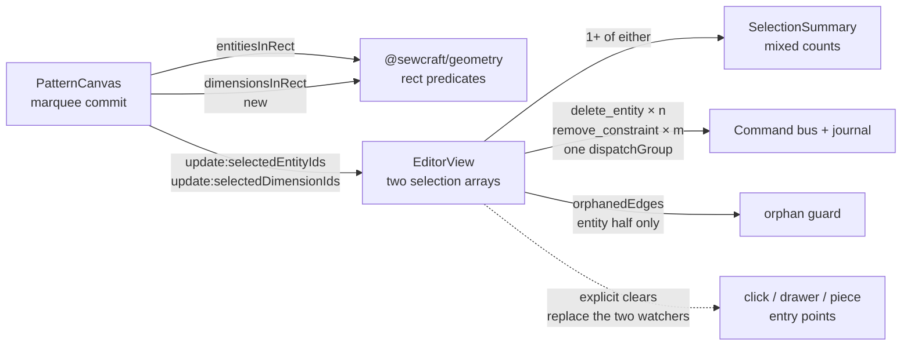

# Marquee selection includes dimensions

Status: draft — design proposal for review; Q1 is the blocking selection-model call
Refs: [#84 — drag selection should also select dimensions](https://github.com/slawekniewiadomski/sew-craft/issues/84)
Builds on: `.ai/specs/2026-10-20-multi-entity-selection.md`,
`.ai/specs/2026-10-24-selectable-dimensions.md`,
`.ai/specs/2026-10-19-movable-linear-dimensions.md`,
`.ai/specs/2026-10-23-cut-dimension-tool.md` and
`.ai/specs/2026-10-22-pieces-and-allowance.md`
Supersedes: `2026-10-20-multi-entity-selection.md` R2 and
`2026-10-24-selectable-dimensions.md` R4, both of which keep dimensions out of the
marquee
Command spec: unchanged
Pattern schema: unchanged (no document field is added)
Package version: `@sewcraft/geometry` `0.12.0` → `0.13.0` (one additive export)

## 📝 TLDR

A maker who drags a selection rectangle over a sketch today catches points, lines,
curves, arcs and circles but never the dimensions drawn among them, even though
those dimensions are visible and individually selectable. Proposed future
behaviour: the same Select-tool marquee also selects the dimensions whose
dimension line it covers, so one drag plus Delete removes a mixed set of geometry
and dimensions in one undo step. The marquee is the only gesture allowed to
produce a mixed selection; clicks stay mutually exclusive. This is frontend view
state plus one rectangle predicate in `@sewcraft/geometry` — no command, schema,
API or export change.

## ❓ Open Questions

| #   | Question                                                                                                                                                                                                                                                                                                             | Why it blocks                                                                                                                                                                                                                                                                                                                              | Recommended answer                                                                                                                                                                                                                                                                                     |
| --- | -------------------------------------------------------------------------------------------------------------------------------------------------------------------------------------------------------------------------------------------------------------------------------------------------------------------- | ------------------------------------------------------------------------------------------------------------------------------------------------------------------------------------------------------------------------------------------------------------------------------------------------------------------------------------------ | ------------------------------------------------------------------------------------------------------------------------------------------------------------------------------------------------------------------------------------------------------------------------------------------------------ |
| Q1  | Does the marquee mixing entities and dimensions **supersede the mutual-exclusion rule** agreed for #82, or should the marquee keep that rule by selecting dimensions **only when the rectangle hits no entities**, or should the two selections first be **consolidated into one typed selection**? | The spec for #82 (`2026-10-24-selectable-dimensions`, its Q1) deliberately made entity and dimension selection separate and mutually exclusive, and its R4 deferred the marquee. Allowing a mixed marquee narrows that reviewed decision, decides whether the two watchers stay, and decides whether Delete must compose `delete_entity` and `remove_constraint`. Reversing it later rewrites the same selection state and tests. | **Yes — mixed, marquee-only (Option B).** The issue itself asks a drag to select dimensions, and dimensions sit next to the geometry they measure, so a dimension-only fallback would miss the common drag. B needs no selection-model rewrite: the two arrays and both prop/emit contracts stay, the mutual-exclusion watchers move into the click/drawer paths, and Delete gains one mixed branch. Option C stays the documented consolidation path. |

The design below is written under Option B. The PR is a draft until a human
answers Q1; a reviewer applies `spec-ready` only after that.

## 📝 Problem Statement

- **Who needs it:** a maker tidying a sketch that carries several dimensions —
  driving/set, driven, referenced and cut dimensions. Dimensions accumulate near
  the geometry they measure, and removing the ones that no longer help is routine.
- **What happens today:** the Select tool's marquee collects only entities.
  `finishMarquee()` calls `entitiesInRect()` and then clears the dimension
  selection (`frontend/src/components/PatternCanvas.vue:2641-2664`). Dimensions
  are constraints, not entities, so they are invisible to that predicate. A
  rectangle drawn around a line and its dimension selects the line only; the
  dimension has to be picked individually, on the canvas or from the Dimensions
  drawer — where Ctrl/Cmd multi-select and a grouped Delete already work
  (`frontend/src/views/EditorView.vue:712-722`, `:1888-1895`).
- **Evidence it matters:** issue #84 asks for exactly this gesture, and the
  previous spec explicitly deferred it (its R4: "the marquee stays entity-only in
  v1"). Bulk dimension deletion is not missing — the gesture is. A maker who has
  just swept a region expects the rectangle to catch everything visible inside
  it; today it silently drops the dimensions.
- **Constraints:** selection is ephemeral view state and never enters
  `PatternDocument`, the journal, the API or command payloads. Removal keeps
  using `remove_constraint` and `delete_entity`; the entity orphan guard
  (`orphanedEdges`) must keep protecting point deletes. Rectangle math belongs in
  `@sewcraft/geometry` (`AGENTS.md`, architecture rule 2), not in the component.

## 📝 Proposed Solution

### Options considered

| #   | Option                                                                                                                                                                                                                         | Trade-offs                                                                                                                                                                                                                                                                                                                                                 | Verdict                                                                                 |
| --- | ------------------------------------------------------------------------------------------------------------------------------------------------------------------------------------------------------------------------------ | ---------------------------------------------------------------------------------------------------------------------------------------------------------------------------------------------------------------------------------------------------------------------------------------------------------------------------------------------------------- | --------------------------------------------------------------------------------------- |
| A   | **Dimension fallback** — the marquee selects dimensions only when it hits no entities; mutual exclusion and Delete stay untouched                                                                                                | Smallest possible change (one conditional in `finishMarquee`). But dimensions sit next to the geometry they measure, so the realistic drag — over a line and its dimension — would still select the line only, leaving #84 effectively unfixed.                                                                                                            | Rejected — does not deliver the requested behaviour in the common case                 |
| B   | **Mixed, marquee-only** — `finishMarquee` emits entity hits and dimension hits; the two mutual-exclusion watchers are replaced by explicit clears in the click and drawer paths; Delete gains one mixed branch                 | Delivers the intent with no component-contract change: both `update:*` emits and both props already exist, so the canvas keeps its API. Cost: a third selection state (both arrays non-empty) that every consumer must handle, and mutual exclusion becomes a per-entry-point rule instead of one watcher.                                                   | **Recommended**                                                                         |
| C   | **One typed selection** — `{ kind: 'entity' \| 'dimension'; id }[]` as the single source of truth; both `v-model` bindings are replaced by one typed prop and one atomic event, and consumers derive counts from it            | Cleanest invariant: mixed is the normal state, no "both non-empty" special cases, and one atomic write replaces two sequential emits. Cost: rewrites the canvas prop/emit contract and touches roughly twenty consumer sites in `EditorView.vue`, its tests and `PatternCanvas.test.ts` — a selection-model refactor bundled with a small behaviour fix.       | Viable next step; deferred — see Q1                                                     |
| D   | **Dimension priority** — if any dimension is hit, select only dimensions; otherwise select entities                                                                                                                             | Keeps mutual exclusion and needs no Delete change. Silently discards entity hits inside the rectangle, so the result contradicts what the user sees; surprising on a busy sketch.                                                                                                                                                                            | Rejected — unpredictable                                                               |
| E   | **Do nothing** — keep the drawer as the bulk dimension path                                                                                                                                                                    | No risk, no work. Leaves #84 open and the two selection vocabularies inconsistent for the canvas gesture; the drawer already provides the capability, so this costs only ergonomics.                                                                                                                                                                          | Rejected — contained cost, specific request                                             |

Option B wins because the requested capability is a *gesture* change, not a state
model change: the two selections already exist and are already pruned, summarised
and deleted correctly for their own kind. What is missing is a rectangle predicate
for dimensions and one rule for the mixed case. Option C is the right destination
once mixed selection is wanted beyond the marquee (select-all, a mixed inspector,
keyboard paths); Q1 records that so it is a decision, not an omission.

### Behaviour

#### Marquee hit test for dimensions

- Dimensions are `distance` and `derived_distance` constraints. Each resolved
  layout (`dimensionGeometry()` / `derivedDimensionGeometry()`) provides the
  dimension line, extension lines, chevrons and the label position.
- A dimension's **marquee hit geometry is its dimension line** — the main segment
  from `layout.dimensionStart` to `layout.dimensionEnd`. Extension lines,
  chevrons and the value label are **not** marquee targets.
  - Extension lines reach the measured geometry, so counting them would let a
    rectangle grab a dimension whose line sits far outside it.
  - Chevrons are 3 mm decorations at the line ends; they never decide a window.
  - The label is a fixed-pixel, rotated, screen-space box centred on
    `layout.label.position` (`packages/geometry/src/dimension.ts:698-705`,
    rendered at `PatternCanvas.vue:3599-3610`). Making it part of a world-space
    predicate would make the result depend on zoom; a second screen-space
    predicate is a separate capability. The label stays a **click** target, as it
    is today.
- **Crossing** (left-to-right): the dimension line overlaps the rectangle.
- **Window** (right-to-left): both dimension-line endpoints are inside the
  rectangle.
- Unresolvable layouts (a broken dimension, a dangling anchor, a degenerate span)
  are skipped exactly as the renderer skips them, so the marquee never selects
  something that is not drawn.
- The drawn 1 px stroke is the target; the invisible 24 px drag strip is a click
  affordance and does not widen the marquee.

#### Gestures

| Gesture (Select tool)                     | Result                                                                                                       |
| ----------------------------------------- | ------------------------------------------------------------------------------------------------------------ |
| Bare-canvas drag, no modifier             | Replace both selections with the rectangle's entity hits and dimension hits (either may be empty).            |
| Bare-canvas drag, Ctrl/Cmd                | Add the rectangle's entity and dimension hits to their selections.                                            |
| Bare-canvas drag, Ctrl/Cmd+Alt or +Shift  | Remove the rectangle's entity and dimension hits from their selections.                                       |
| Bare-canvas drag below the 4 px threshold | Treated as a click: both selections clear.                                                                    |
| Cancelled marquee (Escape/blur/cancel)    | Both selections survive unchanged.                                                                            |
| Additive/subtractive marquee with no hits | Both selections survive unchanged.                                                                            |
| Click an entity (any modifier)            | Entity selection changes; the dimension selection clears.                                                     |
| Click a dimension (any modifier)          | Dimension selection changes; the entity selection clears.                                                     |
| Select a piece                            | Clears both selections, as today.                                                                             |
| Any non-Select tool, read-only document   | Unchanged: no marquee, no selection.                                                                          |

The marquee is therefore the only path that may leave both selections non-empty.
Every other entry point keeps the previous spec's mutual exclusion. Clicks stay
exclusive because the canvas emits an **empty list for the other kind** on every
entity and dimension click (today it does so only for a plain entity click,
`PatternCanvas.vue:2196-2199`), and the drawer handlers clear the other array
themselves. No watcher clears the opposite selection, so the two emits a marquee
commit produces cannot race; the only retained watcher clears `selectedPieceId`.

#### Delete with a mixed selection

- Delete/Backspace, the ribbon Delete action and the summary Delete remove the
  whole mixed selection as **one** `dispatchGroup`: every selected dimension via
  `remove_constraint`, every selected entity via `delete_entity`.
- The entity orphan guard runs first and over the entity half only. A non-empty
  orphan list refuses the **whole** delete with the existing message and removes
  nothing — no half-applied action, matching the group's atomicity. The selection
  stays intact so the user can include the missing edges.
- The summary Delete stays **disabled** with the existing orphan hint whenever
  `orphanCandidates` is non-empty — including a mixed selection, because it now
  carries that delete too. The ribbon action and Backspace stay enabled and report
  the existing error on click. This preserves today's affordance instead of
  letting the same condition enable one path and disable the other.
- A rejected command leaves the document and both selections untouched and uses
  the existing error banner; a successful group clears both selections.
- `delete_entity` already cascades: it removes every distance constraint anchored
  to a deleted entity, including dimensions the marquee did **not** select. That
  is existing behaviour and stays; it is called out in the edge cases so the
  mixed case is not mistaken for a bug.
- Read-only documents keep the existing early return; the drawer still selects but
  Delete stays a no-op.

#### Selection surfaces

- `selectionStatus` (live region) names both counts when mixed: “2 entities and 3
  dimensions selected”; single-kind wording is unchanged.
- `SelectionSummary` already accepts `entities` and `dimensions`; the change is
  its mixed rendering. Today `dimensionMode` hides the entity count and breakdown
  (`frontend/src/components/SelectionSummary.vue:22-38`). When both counts are
  non-zero it shows “N entities and M dimensions selected”, keeps the entity
  breakdown, and keeps the dimension pointer note; the single-kind wordings stay.
- The single-entity property inspector already appears only when exactly one
  entity and no dimension is selected (`EditorView.vue:1668-1682`); no change,
  but the mixed case gains a test.
- `canCreatePiece` additionally requires `selectedDimensionIds.length === 0`:
  dimensions are not loop members, and silently ignoring them would make the
  action's scope ambiguous.
- The Properties drawer badge already sums both counts
  (`EditorView.vue:257`) and needs no change.
- While the marquee is latched, dimension hits preview with the same primary halo
  as a committed selection but at reduced opacity, mirroring the entity preview
  (`marqueeCandidates` → `opacity-60`). The preview uses the same predicate as the
  commit, so it can never promise a different set.

### Prior art

- **Fusion 360 / Onshape:** window and crossing selection pick sketch geometry and
  dimensions together, and one Delete removes the mixed set; the dimension line
  and its text are the target.
- **FreeCAD:** box selection includes dimensional constraints alongside geometry;
  Delete acts on the whole selection.
- **SolidCraft (this project's inspiration):** marquee selection covers points,
  edges and constraints in one rectangle, which is the interaction this app is
  modelled on.
- **CAD convention:** left-to-right is a window (fully enclosed), right-to-left is
  a crossing (touched) — already implemented for entities and kept for dimensions.

Takeaway: mixed rectangle selection is the domain norm, and hit-testing the
dimension line matches how the established tools behave while keeping the
predicate world-space.

## 📝 Architecture



Takeaway: the canvas gains one rectangle predicate and emits the dimension hits it
already has an emit for; `EditorView` owns the mixed-state rules and composes the
existing commands into one journal entry. The document, command payloads and
geometry model are untouched.

### Modules

| Module | Change |
| --- | --- |
| `packages/geometry/src/selection.ts` | Add `dimensionsInRect(document, rect, mode)` returning dimension ids in constraint order, using `dimensionGeometry()` / `derivedDimensionGeometry()` on the dimension line only and the existing `pointInRect` / `convexOverlap` helpers. Export through the package index (already re-exports `selection.ts`) and bump `packages/geometry/package.json` to `0.13.0`. |
| `packages/geometry/src/selection.test.ts` | Cover crossing, window, extension-line-only miss, label-only miss, broken/dangling layouts and derived cut dimensions. |
| `frontend/src/components/PatternCanvas.vue` | Compute `marqueeDimensionCandidates` while latched and dimension hits in `finishMarquee()`; emit them instead of `[]`; add the reduced-opacity halo preview; emit an empty list for the other kind on every entity and dimension click, so a click can never leave both non-empty. No new prop or emit. |
| `frontend/src/views/EditorView.vue` | Remove the two mutual-exclusion watchers, keep one watcher that clears `selectedPieceId` when either selection becomes non-empty; clear the other selection in `onOutlineSelect` and `onDimensionSelect`; extend `deleteSelected` to one mixed group with the orphan guard; mixed `selectionStatus`; disable the summary Delete on orphans for mixed selections; add the `canCreatePiece` gate; pass both counts to `SelectionSummary`. |
| `frontend/src/components/SelectionSummary.vue` | Render the mixed line when both counts are non-zero and keep the entity breakdown in that case; single-kind rendering unchanged. |
| `.ai/specs/005-canvas-editor-interactions.md` | Replace the entity-only marquee contract line: the marquee selects dimensions as well as entities, and a mixed selection deletes as one undo entry. |

No file in `app/`, `routes/`, `database/`, `docs/domain/`, `config/` or the
export layer changes. `PatternDocument`, the journal shape and the command spec
are untouched.

### State shape

Unchanged — the two arrays stay, and the marquee may fill both:

```ts
/** Ordered, ephemeral entity selection; never written to the document. */
const selectedEntityIds = ref<EntityId[]>([]);
/** Ordered, ephemeral dimension selection, kept apart from entities. */
const selectedDimensionIds = ref<EntityId[]>([]);
```

The new invariant replaces the old watcher pair:

> A click, drawer row or piece selection leaves at most one of the two arrays
> non-empty. Only a committed marquee may fill both.

It is enforced at the canvas click emits and the drawer handlers, and pinned by
tests so a future entry point cannot silently break it.

## 📝 Data Model

None. Selection is not stored in `PatternDocument`, the project API, the journal
or the export. No entity, field, migration or index is added.

## 📝 API Contracts

None on the HTTP or command surface. `remove_constraint` and `delete_entity` keep
their single-target semantics and inverses; the UI composes them in one existing
`dispatchGroup`, so undo restores the whole mixed set. No new command, field,
endpoint or removed export is added, and the command-spec version does not move.

`@sewcraft/geometry` gains **one additive public export**, `dimensionsInRect`, so
its version moves `0.12.0 → 0.13.0` — the precedent set when `entitiesInRect`
shipped (`2026-10-20-multi-entity-selection.md:230-231`). No existing export
changes shape or behaviour.

The component contract does not change either: `PatternCanvas` already declares
`selectedEntityIds`, `selectedDimensionIds`, their two `update:*` emits and
`marquee-change`; this spec changes what `finishMarquee()` puts in the dimension
payload, not the payload type. `SelectionSummary` already accepts both counts; only
its rendering changes.

## 📝 UI/UX

- **Selection feedback:** dimensions already render a 4 px primary underlay and a
  label outline when selected (`dimension-selection-halo`). A mixed marquee
  selection uses that same treatment, so there is no new visual language.
- **Marquee preview:** while latched, a would-be dimension hit shows the same halo
  at reduced opacity, exactly as entities show `text-primary opacity-60`; on
  release the halo becomes full strength. No animation, no new colour token.
- **Summary:** “2 entities and 3 dimensions selected” with one Delete action and
  the entity breakdown; single-kind wording stays “N entities selected” / “N
  dimensions selected”.
- **Inspector:** unchanged — a mixed selection shows the summary, never the
  single-entity inspector.
- **Create piece:** the ribbon action is disabled with the existing disabled
  styling while a dimension is selected; its tooltip gains the reason.
- **Accessibility:** the marquee stays pointer-only, like entity selection; the
  live region announces the mixed count, and the Dimensions drawer remains the
  keyboard path for selecting dimensions. Selection is distinguished by outline
  and underlay, not hue alone. No focusable canvas elements are introduced.
- **No new chrome:** no select-all, no context menu, no batch property editor, no
  mixed inspector, no touch-specific additive mode.

## 📝 Edge Cases & Failure Scenarios

| Scenario | Behaviour |
| --- | --- |
| Rectangle covers a dimension line and the line it measures | Both are selected; one Delete removes both in one undo entry. |
| Rectangle covers only an extension line, a chevron or the value label | The dimension is not selected: none is a marquee target. It stays clickable. |
| Rectangle starts on a dimension's 24 px drag strip | The dimension is selected and dragged, as today; no marquee starts. |
| Right-to-left rectangle with one dimension-line endpoint outside | The dimension is not selected (window requires both endpoints). |
| Rectangle covers a broken dimension | Skipped — it has no resolved layout and is not drawn. |
| Rectangle covers a derived cut dimension | Selected and deletable on the same terms as a driving dimension. |
| Dimensions hidden with the View toggle | Not selected; the marquee never selects what is not rendered. |
| Mixed selection includes a point whose edges are not selected | Delete refuses the whole group with the existing orphan message; nothing is removed; the summary Delete is disabled with the hint. |
| Mixed selection deletes an entity anchoring an unselected dimension | The existing `delete_entity` cascade removes that dimension too; undo restores it with the journal snapshot. |
| Undo after a mixed delete | One journal entry restores every entity and dimension with its id; both selections are cleared. |
| Redo / load / external delete removes a selected item | The existing prune watcher drops the missing ids from both arrays. |
| Additive marquee over an already mixed selection | New hits append to each kind; no duplicates. |
| Subtractive marquee over a mixed selection | Hits are removed from each kind; non-hits stay. |
| Marquee cancelled mid-drag | Both selections survive. |
| Read-only document | No marquee; drawer selection still works, Delete is a no-op. |
| Touch pointer | Unchanged: touch taps select one item and drags pan; no additive marquee. |
| Constraint/corner-round/dimension tools | No marquee and no selection change, as today. |

## 📝 Risks & Impact Review

- **Reversal of a reviewed decision (Q1).** `2026-10-24-selectable-dimensions`
  chose mutual exclusion for clicks and deferred the marquee (R4). This spec
  narrows that decision to "clicks are exclusive, the marquee may mix", and both
  earlier contract lines are marked superseded so the repository does not hold
  contradictory rules. A reviewer who prefers the old invariant can answer Q1
  with Option A or C.
- **A third selection state.** Every consumer that reads one array now has to
  decide what a mixed state means. The spec names each consumer and its rule
  (summary, status, Create piece, Delete enablement, inspector) and adds tests for
  the mixed case, so the new state cannot be reached without a defined outcome.
- **Delete safety.** The orphan guard is the one place where a wrong composition
  could destroy a point and strand edges. The guard runs over the entity half
  before any command is built, the whole group is refused on a hit, and the
  summary Delete keeps its disabled state. The dimension branch never consults the
  guard, exactly as today.
- **Cascade surprise.** `delete_entity` already removes the constraints anchored to
  the deleted entity (`packages/geometry/src/commands.ts:775-790`), so a mixed
  delete can remove a dimension the marquee did not cover. This is existing
  behaviour, documented rather than changed; undo restores via the journal
  snapshot.
- **Over-selection.** Restricting the hit to the dimension line keeps the
  rectangle honest: it selects dimensions whose line is genuinely inside or
  touched, not dimensions merely attached to geometry inside the rectangle.
- **Label regression risk.** A rectangle over only the value label will not select
  the dimension, while a click on it will. The edge-case table and R1 state this;
  extending the marquee to the screen-space label box is a separate capability.
- **Preview/commit divergence.** The preview and the commit call the same
  predicate with the same rectangle and mode, so the promise and the result cannot
  differ; a test pins it.
- **Performance.** `dimensionsInRect` walks `document.constraints` and resolves a
  layout per dimension, only while the marquee is latched (matching the entity
  preview's latch condition) and once on release. Documents carry tens of
  dimensions, not thousands; no caching is introduced.
- **Scope.** Selecting pieces, seams, feature points or corner rounds with the
  marquee is explicitly out of scope; those keep their own interactions.
- **Reversibility.** Frontend view state and one pure predicate plus an additive
  package export; reverting means restoring the two watchers, the `[]` emit and
  the version. No data migration, no API version, no stored state.

## ✅ Resolved assumptions (autonomous defaults)

| #   | Assumption | Why | Status |
| --- | ---------- | --- | ------ |
| R1 | The marquee hit target is the dimension line only: crossing = line overlap, window = both line endpoints inside. Extension lines, chevrons and the label are not marquee targets; the label stays a click target. | The label is a fixed-pixel, rotated, screen-space box, so folding it into a world-space predicate would make selection depend on zoom; a second screen-space predicate is a separate capability. The line is the dimension's defining geometry. | Reversible |
| R2 | Derived cut dimensions are included; dimensions hidden by the View toggle are excluded. | Both follow what is rendered and selectable today; hidden means not drawn, and selecting it would be invisible. | Reversible |
| R3 | Mixed Delete is all-or-nothing; the orphan guard applies to the entity half only. The summary Delete stays disabled on orphans for any selection containing entities, while the ribbon/Backspace paths report the error. | Matches the atomicity the journal already gives a group, keeps today's disabled+hint affordance, and avoids a half-applied action. | Reversible |
| R4 | Replace/add/subtract semantics apply to both kinds; a cancelled or empty-additive/subtractive marquee leaves both selections untouched; a replace marquee with no hits clears both. The old "clear dimensions on a committed marquee" rule is removed. | Reuses the existing marquee contract verbatim for the new kind; the dimension set needs the same modifier semantics as entities. | Reversible |
| R5 | The latched marquee previews dimension hits with the same halo at reduced opacity. | The entity marquee already previews; a silent dimension hit would make the gesture feel inconsistent. Same predicate as the commit. | Reversible |
| R6 | The mixed summary names both counts and keeps the entity breakdown; the single-entity inspector is already gated and stays as is; Create piece is disabled while any dimension is selected. | Prevents a piece action from silently applying to only half of a mixed selection, and keeps the count legible without a mixed inspector. | Reversible |
| R7 | The live region names both counts when mixed; single-kind wording is unchanged. | The count is the only non-visual feedback for a pointer-only gesture. | Reversible |
| R8 | Read-only, non-Select tools, touch behaviour, drawer selection and dimension click/drag/edit are unchanged. | The issue asks only for the marquee; widening it would bundle unrelated interaction work. | Reversible |
| R9 | No new command, schema, API, document field or changed export; the existing `dispatchGroup` composes the two existing commands, and the package gains one additive export with a minor version bump. | Keeps the change inside the frontend and the pure rectangle predicate, per the architecture rules. | Reversible |
| R10 | No mockup is committed; this spec is text-only. | The decision is about selection semantics, not a visual design; a static image of a rectangle would not make the trade-offs clearer. | Reversible |

## 📋 Phasing

- **Phase 1 — Dimension line predicate.** The pure `dimensionsInRect` hit test,
  its tests and the package version bump. No user-visible change; Phase 2 consumes
  it.
- **Phase 2 — Marquee selection and mixed state.** Selection ownership in the
  canvas/drawer, the mixed Delete and its consumers, then the marquee emit and the
  latched preview. This phase ships the capability as one reviewable change.
- **Phase 3 — Hardening and verification.** Hidden/derived/broken dimensions,
  read-only, touch, pruning, the `005` contract line and the full gate.

Phase 1 leaves the app untouched; Phase 2 ships the feature and Phase 3 hardens
it. No intermediate shipped state can produce a mixed selection that Delete
cannot handle.

## 📋 Implementation Plan

### Phase 1 — Dimension line predicate

1. Add `dimensionsInRect(document, rect, mode)` to
   `packages/geometry/src/selection.ts` with the R1 hit geometry, skipping
   unresolved layouts; add unit tests for crossing, window, extension-line-only
   miss, label-only miss, broken layouts and derived cut dimensions.
2. Bump `packages/geometry/package.json` to `0.13.0` and confirm the export
   reaches `src/index.ts` unchanged.

### Phase 2 — Marquee selection and mixed state

3. In `PatternCanvas.vue`, emit an empty list for the other kind on every entity
   and dimension click, so clicks can never leave both non-empty; extend the
   existing click tests to cover both kinds and both directions.
4. In `EditorView.vue`, remove the two mutual-exclusion watchers and keep one
   watcher that clears `selectedPieceId` when either selection becomes non-empty;
   clear the other selection in `onOutlineSelect` and `onDimensionSelect`. Tests:
   canvas click → no mixed state; drawer click → no mixed state; piece clears from
   either.
5. Extend `deleteSelected` to one mixed branch: orphan guard over the entity half,
   then a single `dispatchGroup` of `remove_constraint` (dimensions) followed by
   `delete_entity` (entities); clear both selections only on success. Update the
   summary Delete's disabled/hint props to key off `orphanCandidates` alone. Tests
   for mixed success, orphan refusal, rejection, cascade and read-only.
6. Add the mixed `selectionStatus` and `SelectionSummary` wording, keep the entity
   breakdown, and add the `canCreatePiece` gate; test each mixed rendering. Keep
   the already-gated inspector and add a mixed-case test.
7. In `PatternCanvas.vue`, compute `marqueeDimensionCandidates` from
   `dimensionsInRect` while the marquee is latched (only when `showDimensions`),
   and emit the dimension hits in `finishMarquee` for replace/add/subtract instead
   of `[]`; keep cancelled and empty-additive gestures leaving both selections
   untouched. Add the reduced-opacity halo preview and pin preview/commit
   equality.

### Phase 3 — Hardening and verification

8. Cover hidden dimensions, derived and broken cut dimensions, dense overlapping
   dimensions, a marquee that starts on a dimension strip, undo/redo/load pruning
   of a mixed selection and read-only mode.
9. Replace the marquee contract line in
   `.ai/specs/005-canvas-editor-interactions.md` with the entity+dimension rule
   and one mixed-delete undo entry.
10. Run the full validation gate and confirm 100 % statements, branches, functions
    and lines across `packages/geometry/src`, `frontend/src` and backend `app/`.

## ✅ Acceptance criteria

- [ ] A left-to-right marquee over a dimension line and the geometry it measures
      selects both the entities and the dimension.
- [ ] A right-to-left marquee selects a dimension only when both of its
      dimension-line endpoints are fully inside.
- [ ] A rectangle that covers only an extension line, a chevron or the value label
      does not select the dimension; a click on the label still selects it.
- [ ] Replace/add/subtract modifiers apply to both kinds; a cancelled marquee and
      an additive/subtractive marquee with no hits leave both selections intact;
      a replace marquee with no hits clears both.
- [ ] A click on an entity clears the dimension selection and a click on a
      dimension clears the entity selection, whatever the modifier.
- [ ] Delete removes a mixed selection as one undo entry; a non-empty orphan list
      refuses the whole delete and removes nothing, and the summary Delete is
      disabled with the hint.
- [ ] An entity delete still cascades its anchored dimensions, and undo restores
      them from the journal snapshot.
- [ ] Hidden dimensions are not selected; derived cut dimensions are; broken
      dimensions are skipped.
- [ ] The latched marquee previews dimension hits with the same set it commits.
- [ ] The live region and summary name both counts; Create piece is disabled while
      a dimension is selected.
- [ ] Undo, redo, load and external deletion prune both selections.
- [ ] `@sewcraft/geometry` moves to `0.13.0` for the one additive export; no
      command, schema, API, export or document change ships; the full validation
      gate passes with 100 % statements, branches, functions and lines.

## Out of scope

- Consolidating the two selections into one typed selection (Option C); it is the
  documented next step once mixed selection is wanted beyond the marquee.
- Marquee selection of pieces, seams, feature points or corner rounds.
- Making the screen-space value label a marquee target.
- Select-all, keyboard marquee, auto-scroll, touch additive modes or a mixed
  property inspector.
- Changing dimension click, drag, double-click editing or drawer selection.
- Live dimension previews beyond the selection halo, or new colour tokens.
- Mockups or prototype assets.

## Checks

```bash
npm run format
npm run typecheck
npm run lint
npm run format:check
npm run test:coverage
npm run build
docker compose run --rm --no-deps -e DB_CONNECTION=sqlite -e DB_DATABASE=:memory: \
  app sh -c "composer install --no-interaction && php artisan test --coverage --min=100"
```
