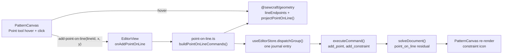

# Point on line — create a constrained point in one gesture

Status: implemented — Q1 answered with the recommended option A (the Point tool
infers the relation); the spec and the implementation ship on PR #87
Refs #85
Related: `.ai/specs/2026-10-19-constraint-tools-ribbon.md` (the existing
Point-on-line constraint tool), `.ai/specs/2026-10-20-line-tool-point-creation.md`
(its UI/UX bullet and assumptions row R6 defer this gesture),
`.ai/specs/005-canvas-editor-interactions.md`

## 📝 TLDR

The Point tool creates a free point at the snapped grid or nearest-point
position and ignores what is under the pointer. Clicking a line therefore leaves
a point sitting near the line but attached to nothing. A maker who wants the
point to belong to the edge must create it first and then arm the existing
Point-on-line constraint tool. Proposed future behaviour: one click on a
straight line creates the point at the projected position and applies
`point_on_line` as one undoable gesture. The issue is a single sentence, so
where that gesture lives is undecided (Q1); the design below describes the
recommended Point-tool inference and the alternatives that Q1 must choose
between.

## 📝 Open Questions

- **Q1 — Where should a constrained point on a line be created?** The issue names
  the capability, not the gesture. Answer before implementation:
  - **A (recommended)** — the Point tool infers it: a click that hits a straight
    line projects onto that line and adds `point_on_line`; a click on bare canvas
    still creates a free point. No new control.
  - **B** — a dedicated mode: a separate **Point on line** tool, or a split
    **Point** control with *Free point* / *Point on line* modes. Keeps the Point
    tool free-only and makes the relation explicit.
  - **C** — the existing **Point-on-line constraint tool** creates the point when
    its first pick is a line, instead of waiting for an existing point.
  - **D** — snap-only: place the point on the line but leave it unconstrained.
  - **E** — do nothing: keep the current two-step path.

  **Answered:** A — the Point tool infers the relation. `spec-ready` on PR #87
  confirmed the recommended answer, and the implementation below follows it.

  The rest of this spec assumes **A**; choosing B changes the UI/UX and
  implementation sections, and choosing C changes the constraint-tool contract.

## 📝 Problem Statement

- **Who needs it:** the maker drafting a pattern who needs a point that belongs to
  an edge — a notch, a seam reference, or a point from which to draw new
  geometry — and expects to place it directly on that edge.
- **What happens today:** the Point tool ignores the entity hit. In
  `frontend/src/components/PatternCanvas.vue`, `onPointerDown`'s `add_point` case
  calls `emitAddPoint(screen)` without looking at `hit` (`:2207-2209`), and
  `emitAddPoint` applies `snappedPoint()` (`:2450-2453`) — nearest existing point
  within 6 mm, otherwise the 10 mm grid (`frontend/src/lib/snap.ts`). A click on a
  line is treated exactly like a click on empty canvas. The relation exists but
  is a separate action: arm **Point on line** in the Constraints group, then pick
  the point and the line (`frontend/src/lib/constraint-tools.ts:55`, `:136`,
  `:239`).
- **Evidence it matters:** issue #85 asks for exactly this capability. The Line
  tool spec anticipated the gap: its UI/UX section says a click on a line creates
  a free point, and "adding a `point_on_line` constraint stays a separate action.
  Copy or a follow-up issue can address that if users expect it"; its assumptions
  row R6 repeats that constraining to the clicked edge is separate work
  (`.ai/specs/2026-10-20-line-tool-point-creation.md:162-167`, `:231`). #85 is
  that follow-up.
- **Constraints:** commands remain the only mutation path, so the gesture must
  compose the existing `add_point` and `add_constraint` commands rather than
  mutate the document; `@sewcraft/geometry` stays framework-agnostic; no new
  command, schema, HTTP API or solver work is needed; every new branch needs a
  test to hold the 100 % coverage gate.
- **Why it is ambiguous:** the issue does not say whether the user wants the
  Point tool to infer the relation, a distinct tool, or merely snapping; the
  existing constraint tool means part of the capability already exists. That is
  Q1, not something this spec should silently decide.

## 📝 Proposed Solution

### Options considered

| #   | Option                                                                                                                                                                         | Trade-offs                                                                                                                                                                                                                                                                                                                                                                                                                            | Verdict                                                                                                                          |
| --- | ------------------------------------------------------------------------------------------------------------------------------------------------------------------------------ | ------------------------------------------------------------------------------------------------------------------------------------------------------------------------------------------------------------------------------------------------------------------------------------------------------------------------------------------------------------------------------------------------------------------------------------- | -------------------------------------------------------------------------------------------------------------------------------- |
| A   | **Point-tool inference (recommended):** a click on a straight line projects onto it and adds `point_on_line`; bare canvas stays a free point                                       | Matches the CAD convention of inferring relations while drawing, adds no ribbon control, and keeps one creation path. Cost: the Point tool no longer always means "free point" — a visible semantic reversal of R6 in the line-tool spec. The 12 px line hit band also becomes an "on line" zone, so a free point a few millimetres from an edge needs more zoom; there is no modifier override in v1. It needs a pre-click signal (line highlight, projection ghost, status hint) so the constraint is not a surprise. | **Recommended**, conditional on the signalled inference and Q1 confirming the reversal. |
| B   | **Dedicated mode:** a separate **Point on line** tool, or a split **Point** control with *Free point* / *Point on line* modes                                     | Explicit: the user opts into the relation and the Point tool stays free-only. A split control matches the grouped sketch tools and avoids a second "Point on line" label in the ribbon. Cost: one more mode to discover and one more click for every constrained point; a standalone tool duplicates the Constraints group's "Point on line" name, which is confusing.                                                          | **Strong runner-up**: least surprising, but a larger UI change and a naming collision.                                            |
| C   | **Extend the Point-on-line constraint tool:** a line-first pick creates the point at the projected position and applies the constraint                          | No new control and the relation stays inside the tool that names it. Cost: changes a reviewed workflow; a line-first pick currently waits for an existing point and is a tested capability (`constraint-tools.test.ts:147-179`). It also makes the same button sometimes create geometry and sometimes constrain existing geometry.                                                                                       | **Rejected for v1** — it removes a working pick path to gain a creation shortcut.                                                 |
| D   | **Snap-only:** project the point onto the line but do not add a constraint                                                                                                     | Cheapest implementation and no semantic reversal. Cost: moving either line endpoint leaves the point behind; it looks attached but is not, which is the failure the issue is about.                                                                                                                                                                                                                                                  | **Rejected** — it does not deliver "point on line" as a relation.                                                                 |
| E   | **Do nothing:** keep the current two-step path (Point, then the Point-on-line constraint tool)                                                                                 | No work, nothing regresses, and the relation is already reachable. Cost: every point on an edge takes two tools and a pick order; the obvious gesture keeps producing an unconstrained point.                                                                                                                                                                                                                                      | **Rejected** — this is the state the issue asks to change.                                                                       |

### Behaviour (under the recommended answer A)

1. **Hover.** With the Point tool active, no existing point within the 6 mm
   `POINT_SNAP_TOLERANCE`, and a resolvable straight line under the pointer, the
   line is highlighted in the accent colour and thickened, a projection ghost
   marks the position the point will take, and the canvas status hint says
   **"Click to create a point constrained to this line."** The signal appears
   before the click, never after. It clears on pointer leave, tool change,
   Escape, or a document change that removes the line.
2. **Click precedence.** Keep today's point snap first: if a point is within
   `POINT_SNAP_TOLERANCE` (6 mm), behave exactly as today. Otherwise, if the
   click hits a resolvable straight line, resolve the raw world pointer (not the
   grid-snapped position) and project it onto the line's infinite supporting
   line. Otherwise fall through to the grid snap. This keeps a click near an
   existing point from creating a near-duplicate on a line that passes beside it.
3. **Click on a straight line.** Build a single batch: `add_point` at the
   projected coordinates, then
   `add_constraint { type: 'point_on_line', entities: [newPoint, line.start, line.end] }`.
   Apply it with `dispatchGroup`, so the gesture is one journal entry and one
   undo.
4. **Click anywhere else.** Unchanged: bare canvas creates a free point at the
   existing `snapPoint` position; a point hit keeps today's behaviour; curve, arc
   and circle hits keep creating a free point. A degenerate line (coincident
   endpoints) has no projection, so it shows no hover signal and falls through to
   today's free-point behaviour.
5. **After the click.** The point and its constraint appear together, the
   constraint icon renders through the existing overlay (`constraint-view.ts`),
   and the Point tool stays armed for the next point. The new point is not
   selected, matching today's `add_point`. The marker is placed at the centroid of
   the constraint's referenced points, so it is not necessarily next to the new
   point; the constraints drawer is the durable record.
6. **Dragging the point later.** `move_point` is solved with the document's
   constraints, so the point slides along the supporting line rather than leaving
   it. Dragging a line endpoint carries the point with the line.
7. **Undo / redo.** One undo removes the point and the constraint; redo restores
   both. This relies on the existing grouped-dispatch journal entry, not on a new
   command.
8. **Read-only.** No hover ghost, hint or command; the same guard as every other
   creation tool.

### Where the logic lives

- **Geometry package** `packages/geometry/src/dimension.ts`: the existing private
  `footOnLine()` projection is exported as `projectPointOnLine(point, segment)`.
  It is already the one implementation used by dimension placement, is pure, and
  is re-exported through `packages/geometry/src/index.ts`. This follows the
  repository rule to keep geometry math in the package instead of duplicating it
  in the frontend, and it adds a direct unit test for the degenerate case.
- **Pure frontend helper** `frontend/src/lib/point-on-line.ts`:
  - `buildPointOnLineCommands(document, lineId, pointer, nextId): Command[] | null`
    — resolves the line with `lineEndpoints()`, projects with the exported
    `projectPointOnLine()`, and returns `[add_point, add_constraint]` in that
    order with fresh ids. Returns `null` when the id is not a resolvable
    non-degenerate line.
- **`frontend/src/components/PatternCanvas.vue`**: gains a hovered-line ref and
  projection ghost for the Point tool, a `point-on-line-hint` status element, and
  one emit `add-point-on-line(lineId, x, y)` carrying the raw world pointer. The
  existing `add-point` emit and every other tool stay untouched.
- **`frontend/src/views/EditorView.vue`**: one handler composes
  `buildPointOnLineCommands` and calls the existing `dispatchGroup`; no new store
  state and no second mutation route.

## 📝 Architecture



Takeaway: the component resolves intent, a pure frontend helper composes two
existing commands, and the store applies and solves them atomically. The geometry
package gains one additive projection export; the command, schema and HTTP
contracts are unchanged.

## 📝 Data Model

None. `add_point` creates the same `PointEntity` as before and `add_constraint`
creates the existing `point_on_line` constraint. No new entity, field,
document-version or migration.

## 📝 API Contracts

None for commands and HTTP. No command type, param, API endpoint, database
column or command-spec entry changes. The frontend composes `add_point` +
`add_constraint`: `params: { type: 'point_on_line', entities: [point, a, b] }`
is already the documented shape (`docs/domain/command-spec.md`). The geometry
package gains one additive named export, `projectPointOnLine`, re-exported from
`index.ts`; it changes no existing signature and no stored document. The
component's `add-point-on-line` emit is an internal frontend contract, tested
with `PatternCanvas` and wired to its single parent.

## 📝 UI/UX

- **Tool state:** the Point tool's cursor and active state do not change. No new
  ribbon control under option A.
- **Line hover:** the line thickens through the existing `lineWidth()` path and
  takes the accent colour through `entityClass`, the same combined treatment
  dimension picks use, and an accent projection dot is drawn at the projected
  position, `pointer-events-none` and `aria-hidden`.
- **Status hint:** a `role="status"` element, styled like the Arc and Dimension
  hints, reads **"Click to create a point constrained to this line."** while a
  line is hovered. With no line hovered, the Point tool shows no hint, so the
  canvas does not gain permanent chrome.
- **Click feedback:** the point and constraint appear together; the constraint
  marker sits at the centroid of the three referenced points, so it may not be
  adjacent to the new point. The constraints drawer is the durable confirmation.
- **Accessibility:** the hint is announced politely; the ghost and line highlight
  are decorative because the command result carries the meaning. Like the rest
  of the creation tools, the gesture is pointer-driven; this spec adds no keyboard
  creation path.
- **Test ids:** `point-on-line-hint`, `point-on-line-ghost`.
- **No mockup:** the change is pointer feedback on an existing canvas, not a new
  screen or layout. A static image would not prove the projection, the hover
  signal or the one-undo behaviour; the states above are the reviewable
  description.

## 📝 Edge Cases & Failure Scenarios

| Scenario                                                     | Expected behaviour                                                                                                                                       |
| ------------------------------------------------------------ | -------------------------------------------------------------------------------------------------------------------------------------------------------- |
| Click on a straight line                                     | Project the raw pointer, then `add_point` + `point_on_line` as one entry; the point lies exactly on the supporting line                                  |
| Click on a line very close to one of its endpoints           | The point lands at the projection, possibly at or just beyond the endpoint because the transparent hit band is screen-space; the constraint stays valid   |
| Click on an existing point                                   | Unchanged — today's Point tool creates a free point at the snapped position; this spec does not add de-duplication                                        |
| Click within 6 mm of an existing point that sits by a line   | Point snapping wins over line inference, so behaviour is exactly today's (a free point at the snapped position); no near-duplicate is projected onto the line |
| Click on a degenerate line (coincident endpoints)            | `projectPointOnLine` cannot resolve a direction, so there is no hover signal and the click falls through to today's free-point behaviour                    |
| Click on bare canvas                                         | Unchanged — free point at the nearest point or grid intersection                                                                                          |
| Click on a curve, arc or circle                              | Unchanged — free point; the model has no point-on-curve relation yet                                                                                      |
| Click on a construction line                                 | Same as a normal line; the new point is a normal, non-construction point, matching the Point tool's current output                                        |
| The line id no longer resolves when the helper runs          | `buildPointOnLineCommands` returns `null` and nothing is dispatched. The canvas only emits after a successful projection, so this is a totality guard on a public pure helper, unit-tested rather than an ignored branch |
| `add_constraint` or the solver fails                         | `dispatchGroup` assigns nothing, so neither command lands; the existing error banner shows the reason                                                     |
| Undo after the gesture                                       | One press removes the point and the constraint together                                                                                                   |
| Redo                                                         | Both commands replay in order with stable ids                                                                                                             |
| Delete the line later                                        | The constraint references the line's two endpoint points, not the line id, so it remains while those points exist; the point stays on their supporting line |
| Delete one of the line's endpoint points                     | The existing `delete_entity` cascade removes the `point_on_line` constraint with the endpoint                                                              |
| Two overlapping or collinear lines under the pointer         | The topmost rendered hit wins, as everywhere else on the canvas; the hover highlight shows which line will be used                                        |
| Pointer leaves the canvas or the tool changes                | Hover highlight, ghost and hint clear; no pending state survives                                                                                          |
| Escape while hovering                                        | Clears the hover signal; Escape has no other Point-tool gesture to cancel                                                                                 |
| Undo, redo or a document load while hovering                 | The hovered line is recomputed against the new document; a removed line clears the signal                                                                  |
| Touch or pen tap on a line                                   | The same projection applies on the tap that emits the event; no hover-only state is required                                                              |
| Read-only document                                           | No hover signal and no mutation                                                                                                                           |
| Autosave                                                     | Unchanged; the grouped dispatch marks the document dirty once and the existing save loop persists it                                                       |

## 📝 Risks & Impact Review

- **Hidden constraint / reversed tool meaning (medium).** The Point tool would no
  longer always create a free point, contradicting the line-tool spec's R6. The
  mitigation is the accent line highlight, projection ghost, status hint and Q1's
  explicit confirmation; without those the constraint would be a surprise that
  users discover only when the point refuses to leave the line. This is a
  product-direction call, not a code defect.
- **No free point near a line (medium, deliberate under A).** The 12 px screen
  hit band becomes an "on line" zone, so a free point a few millimetres from an
  edge is harder to place at low zoom. Point snapping still wins within 6 mm of an
  existing point. No modifier override is added in v1; a future Alt-to-place-free
  option can address it without changing the command model.
- **Point-vs-line hit precedence (low).** A click near an existing point that sits
  beside a line could otherwise create a near-duplicate projected onto the line.
  The 6 mm point snap runs before line inference, preserving today's behaviour;
  the edge-case table pins it.
- **Inconsistent with drafting endpoints (low, deliberate).** Line, arc, circle
  and rectangle endpoints still create free points when clicked on another line.
  This slice is Point-tool-only because endpoints are part of a different gesture
  and changing them would widen the blast radius; a follow-up can unify the rule
  once Q1 settles the inference question.
- **Infinite-line semantics (low).** `point_on_line` constrains to the supporting
  line, not the segment, so a point can survive beyond a shortened line. That is
  existing constraint behaviour and is documented above; no model change is
  proposed.
- **Overlapping or degenerate lines (low).** The DOM hit is topmost-first, so the
  highlighted line and the constrained line can differ when lines coincide; the
  hover highlight shows the chosen one. A zero-length line has no projection, so
  it shows no signal and keeps today's free-point click.
- **Coverage (medium).** The exported projection, command-building and hover
  branches need unit and component tests to hold the 100 %
  statements/branches/functions/lines gate. The `null` return is covered by
  missing- and degenerate-line tests, not an ignore comment.
- **Delivery and QA (medium).** Per `AGENTS.md`, the feature ships on one combined
  PR with the spec as its first commit; this draft is the review gate on that
  branch. The spec-only stage carries `skip-qa`; once implementation lands on the
  same branch, the PR is user-facing and should carry `needs-qa`.
- **Rollback (low).** Revert the frontend wiring, helper and the additive geometry
  export; no schema, stored document, command or HTTP API change is involved.
  Documents that already contain `point_on_line` constraints are unaffected.

## 🧭 Resolved assumptions (autonomous defaults)

These are non-blocking defaults applied so the design is coherent; Q1 remains
open and gates implementation.

| #   | Assumption                                                                                                                   | Why                                                                                                                                  | Reversible? |
| --- | ---------------------------------------------------------------------------------------------------------------------------- | ------------------------------------------------------------------------------------------------------------------------------------ | ----------- |
| R1  | The gesture is one journal entry via `dispatchGroup`                                                                         | Matches the Line, Arc, Circle and Rectangle gestures; one undo for one user action                                                    | Yes         |
| R2  | Point snap (6 mm) wins first; then a resolvable line hit projects the raw pointer; otherwise grid snap                      | Preserves today's behaviour near existing points, avoids near-duplicates on adjacent lines, and projects the clicked place rather than a snapped one | Yes         |
| R3  | Reuse `point_on_line` and its infinite-line residual; do not add a segment-clamped constraint                                | No new command, schema or solver work; the existing relation is what the Constraints group already offers                             | Yes         |
| R4  | Scope to the Point tool only; drafting endpoints keep their current free-point behaviour                                     | Smallest blast radius; endpoints belong to a different gesture and can be a follow-up                                                 | Yes         |
| R5  | Point, curve, arc and circle clicks keep today's behaviour                                                                   | No point-on-curve relation exists; changing those paths would be a separate feature                                                   | Yes         |
| R6  | Show a line highlight, a projection ghost and a status hint before the click                                                 | Makes the inferred constraint discoverable and addresses the hidden-constraint risk                                                   | Yes         |
| R7  | A line that cannot resolve shows no inference signal; the click keeps today's free-point behaviour; the helper returns `null` | Never promises a constraint the geometry cannot deliver, and keeps the pure helper total for its unit-tested contract                    | Yes         |
| R8  | Do not change deletion cascade; deleting the line leaves the constraint while its endpoint points exist                      | Existing `point_on_line` semantics; changing them would affect every constraint created through the Constraints group                | Yes         |
| R9  | No new command, HTTP API, schema, solver change or schema-version bump; the only package-surface change is the additive `projectPointOnLine` export | Both needed commands already exist, the document shape is unchanged, and the projection is promoted from an existing private helper        | Yes         |
| R10 | The new point is non-construction even when the line is construction                                                         | Matches the Point tool's current output; the line's guide status does not make the point a guide                                       | Yes         |
| R11 | This draft spec-only stage is `skip-qa`; implementation continues on the same combined PR branch and then needs QA                 | The spec changes no runtime behaviour, while the implemented interaction is user-facing; `AGENTS.md` keeps spec and implementation on one PR | Yes         |
| R12 | No modifier override (for example Alt) to force a free point near a line in v1                                                | Keeps the first slice small and the interaction single-purpose; the consequence is documented and can be added later                    | Yes         |

## 📋 Phasing

- **Phase 1 — projection and command composition.** Export the existing
  projection from the geometry package and add the pure two-command builder, both
  fully unit-tested. No UI change.
- **Phase 2 — gesture and affordance.** Canvas hover signal, emit, editor wiring,
  grouped dispatch and component tests. This completes the feature.

## 📋 Implementation Plan

1. **Export the projection from `packages/geometry/src/dimension.ts`.** Rename the
   private `footOnLine()` to `projectPointOnLine(point, segment)` and export it;
   update its two internal callers. Add unit tests for a point off the line, a
   point already on it, and a degenerate segment returning `null`.
2. **Add `frontend/src/lib/point-on-line.ts`.** Implement
   `buildPointOnLineCommands()` with `lineEndpoints()` and the exported
   `projectPointOnLine()`. Unit-test the command order, ids, params, the
   already-on-line case and the `null` case for a missing or degenerate line.
3. **Wire `frontend/src/components/PatternCanvas.vue`.** Track the hovered line
   while the Point tool is active, apply the accent highlight, render the
   projection ghost and `point-on-line-hint`, emit `add-point-on-line` only when
   point snapping did not win and a line resolves, and keep `add-point` for every
   other hit. Test hover, hint, emit payload, point-snap precedence, the
   degenerate-line fallback and pointer leave/tool change.
4. **Wire `frontend/src/views/EditorView.vue`.** Compose
   `buildPointOnLineCommands` and dispatch with `dispatchGroup`; test the handler,
   the one-entry journal and the `null` guard.
5. **Run the repository gate** and update this spec's status. Implementation
   continues on this same branch after Q1 is answered and a human applies
   `spec-ready`, keeping the combined PR required by `AGENTS.md`; at that point the
   PR carries `needs-qa`.

## ✅ Acceptance criteria

- [x] With the Point tool active, hovering a resolvable straight line (and no
      point within the 6 mm snap tolerance) highlights the line in the accent
      colour, shows the projected ghost and displays
      `Click to create a point constrained to this line.`
- [x] Clicking that line creates a point at the projection and a
      `point_on_line` constraint referencing that point and the line's two
      endpoints, as one journal entry.
- [x] One undo removes both additions; redo restores both.
- [x] Clicking bare canvas, an existing point, a curve, an arc, a circle or a
      degenerate line keeps today's free-point behaviour.
- [x] A point within the 6 mm snap tolerance wins over line inference, so no
      near-duplicate is projected onto a nearby line.
- [x] Pointer leave, tool change, Escape and a document change clear the hover
      highlight, ghost and hint.
- [x] Read-only mode shows no signal and dispatches nothing.
- [x] The geometry projection, the pure builder and every new canvas branch keep
      statements, branches, functions and lines at 100 % coverage.
- [x] `npm run format`, `typecheck`, `lint`, `format:check`, `test:coverage` and
      `build` pass.

## Out of scope

- Building the dedicated **Point on line** tool/mode or changing the existing
  Point-on-line constraint tool (Q1 alternatives B and C).
- Point inference for line, arc, circle or rectangle endpoints, and any
  point-on-curve, point-on-arc or point-on-circle relation.
- Changing `point_on_line` to clamp to a segment, changing the deletion cascade,
  or adding a modifier override to force a free point near a line.
- A hit-target redesign for the Point tool, keyboard-first point placement, or
  new colour tokens/icons.
- Mockups or screenshots: the change is pointer feedback on an existing canvas,
  not a new screen.

## Checks

```bash
npm run format
npm run typecheck
npm run lint
npm run format:check
npm run test:coverage
npm run build
docker compose run --rm --no-deps -e DB_CONNECTION=sqlite -e DB_DATABASE=:memory: \
  app sh -c "composer install --no-interaction && php artisan test --coverage --min=100"
```
