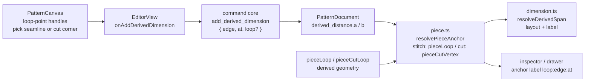

# Seamline points as dimension anchors

Status: implemented — Q1 (the stitch loop) and Q2 (optional `loop` on `CutAnchor`)
resolved under the recommended answers
Refs: [#78 — Seamline points](https://github.com/slawekniewiadomski/sew-craft/issues/78)
Builds on: `.ai/specs/2026-10-23-cut-dimension-tool.md`,
`.ai/specs/2026-10-22-pieces-and-allowance.md`,
`.ai/specs/2026-10-23-default-piece-seam-allowance.md`, and the two unmerged
anchor proposals `2026-10-23-dimension-point-and-line-anchors.md` (draft PR #76)
and `2026-10-23-cut-dimension-point-and-edge-anchors.md` (draft PR #77)
Command spec: `0.11.0` today; Q2 decides whether this widens
`add_derived_dimension` (following PR #77's next minor) or adds nothing
Pattern schema: `sewcraft.pattern/0.2`; the schema question stays with PR #77

## 📝 TLDR

Issue #78 asks that seamlines **also have points**, that those points are **not
editable in the classic way**, and that they become **anchor points for
dimensions**. Today a dimension can only attach to a drafting point (the
Dimension tool) or to a cut-loop vertex addressed by `{ edge, at }` (the Cut
dimension tool, `CutAnchor` in `packages/geometry/src/types.ts:176`). The derived
corners a piece and its allowances generate — the sew-line corners and the
allowance boundary's join points — have no anchor identity at all, so the maker
must draw helper geometry that does not follow the allowance or a corner round.

Proposed future behaviour: a **derived, read-only loop point** that a dimension
can address by `{ piece, edge, at }`, resolved from the piece's loop on every
read and never stored as an entity or a solver variable. Which loop those points
belong to — the stitch loop (the seamline proper) or the allowance boundary —
is **Q1** and blocking; the spec presents the options and the design that follows
from each, and the recommended reading (the stitch loop) is the one implemented
here.

## 📝 Problem Statement

- **Who needs it:** the maker annotating a piece from its sew line rather than
  from the drafting skeleton — the width of a piece between two seamline
  corners, a seamline corner to a construction line, a notch to a sew-line
  corner. Later, sizing and grading will reference the same corners, so the
  anchor identity is worth settling before that work starts.
- **What happens today:**
  - A piece's geometry is derived, not stored. `pieceLoop()` (`piece.ts:400`)
    walks the loop edges into the **stitch loop** and returns `points`,
    `naturalStart` and `spans`; `pieceCutLoop()` (`piece.ts:444`) offsets it per
    edge into the **cut loop** and returns a per-vertex join list. Neither
    exposes anchors.
  - `CutAnchor` only reaches the cut loop, and only through
    `pieceCutVertex()` (`piece.ts:487`, called by `resolveCutSpan()` in
    `dimension.ts:480`). It resolves a *stitch-loop* vertex index and reads the
    matching cut vertex, so it cannot address the stitch loop itself and cannot
    address a join's second point at a bevel.
  - The Dimension tool still requires drafting point ids (`requireDraftingPoint`
    in `commands.ts:486`); PR #76 widens that to points **and straight lines**,
    still not to loop geometry.
  - The canvas highlights pick targets while the Cut dimension tool is active,
    but `cutVertexHandles` (`PatternCanvas.vue:412`) filters the **point
    entities** behind the loop edges — not the derived cut joins, and not the
    bridge ends a corner round contributes.
- **The workaround is lossy:** a construction point placed on a corner is an
  editable entity that drifts when the allowance width changes, does not follow
  a corner round, and survives deleting the dimension. Measuring what the
  pattern actually sews or cuts therefore means re-placing the helper after
  every design change.
- **Evidence it matters:** #78 says the points are wanted *because* dimensions
  need them, and the existing cut dimensions already prove the shape of the
  answer: a derived anchor that is resolved on read, owns no solver variable,
  and stays read-only (`DerivedDistanceConstraint` in `types.ts`).
- **Constraints:** commands remain the only mutation path, `@sewcraft/geometry`
  stays pure, stored documents keep loading, the 100 % coverage gate applies to
  every new branch, and v1 adds no new tool (R4).

## 📝 Proposed Solution

### What "seamline point" may mean — the ambiguity behind Q1

Sewing uses "seamline" for the line the seam is sewn along, which the glossary
calls the **stitch line** and the code calls the **stitch loop**. The issue's
phrasing — "seamlines **created by seams**" — can also be read as the boundary a
seam **allowance** adds, which the code calls the **cut loop**. The two readings
produce different anchors, and #77 already covers part of the second. Q1 asks
which one #78 means; the table is the evidence for the question, not a decision.

| # | Reading | Where it lives in code | What is missing | Already covered by |
| - | ------- | ---------------------- | --------------- | ------------------ |
| 1 | **Stitch-loop corners** — the sew-line corner of every loop edge, including the ends of a corner-round bridge | `pieceLoop().points` / `naturalStart` / `spans` (`piece.ts:400-440`) | No anchor addresses the stitch loop; a dimension must use the editable point entity behind the corner | Nothing |
| 2 | **Allowance boundary corners** — the cut line's join points, both points of a bevel join and the miter point | `pieceCutLoop().vertices` (`piece.ts:444-455`) | `pieceCutVertex` returns one representative per loop vertex; a bevel's second point is unreachable, and only cut dimensions can anchor there | Partly, by `CutAnchor` and PR #77's edge anchors |
| 3 | **Seam junctions between two pieces** — the seam that joins piece A's edge to piece B's | Does not exist: an edge belongs to exactly one piece (`pieceForEdge`, `piece.ts`) | There is no seam entity, no join, no seamline generated across pieces | Nothing, and it is out of scope until seams between pieces exist |

Reading 1 is the recommended interpretation: it matches the glossary's "what you
sew on", it is the only reading that needs nothing before it, and "not editable
in the classic way" describes it exactly — the corner is a position derived from
two edges, not an independent point the maker should drag. A spec for reading 3
would have to wait for a seams-between-pieces feature; Q1 should say so
explicitly if that is the intent.

### Options considered

| # | Option | Trade-offs | Verdict |
| - | ------ | ---------- | ------- |
| A | **Derived loop anchor on `derived_distance`** — `{ piece, edge, at, loop? }`, resolved on read from `pieceLoop()` or `pieceCutLoop()`; `loop` omitted means the cut loop, so today's documents and #77's anchors keep their meaning | Reuses the anchor shape, `pieceCutVertex`-style resolution, the derived dimension's read-only rendering, dragging, dedupe, inspector row and broken state. No new stored entity, no solver variable, no new tool. Cost: anchors exist only inside one piece, and a derived anchor can never **drive** geometry (R10) | **Recommended** |
| B | **Materialised read-only points** — mint a `point` entity at every loop join, marked construction + fixed + derived, so both the Dimension and the Cut dimension tools pick them as ordinary points | The repository already does exactly this for corner rounds: six derived `fixed`/`construction` entities minted and regenerated per round (`commands.ts`, `corner-round.ts`), kept honest by a persisted `cornerRounds` record and an `isCornerRoundDerived` predicate. That precedent makes B viable, not exotic. Cost: the loop changes with every allowance edit, loop edit, round and load, so the mint/regenerate path runs far more often than a round's command-time regeneration; a second source of truth for a position the loop already derives; solver exposure; document growth; a migration that mints points for existing pieces | Rejected for v1 — the precedent proves it can be done, but the update frequency is where rounds and loop points differ |
| C | **Snapshot anchors** — store the picked millimetre coordinate on the dimension | Trivial to implement and immune to loop churn. Cost: the dimension stops following the piece; an allowance change, a corner round or a loop edit leaves it measuring empty space, which defeats the reason #78 asks for the points | Rejected — a stale number is worse than no anchor |
| D | **Build nothing** — keep using construction points, or wait for seams between pieces | No code and no contract risk. Cost: the helper-point workaround stays, and the anchor model stays split between drafting points and cut vertices | Rejected — the appointment of a derived anchor is small and #78 asks for it |

Option A wins because the derived dimension already *is* "a read-only number
computed from piece geometry"; widening which loop it can address adds one
resolver branch and one stored enum value. Option B is a real house pattern —
corner rounds prove it — but their derived points only change when a round
command runs, while a loop join changes with every allowance edit, loop edit and
load: B moves the maintenance cost from one resolver call per read into a
regeneration path that many commands must not forget. Option C is rejected on
the ground the existing cut dimension already rejects stored readings.

### Behaviour under the recommended option

1. **Anchor shape.** A derived anchor names a piece edge and one end of it, plus
   the loop to resolve against:
   `{ edge, at: 'start' | 'end', loop?: 'stitch' | 'cut' }`. An omitted `loop`
   means `cut`, so every stored anchor keeps today's meaning and PR #77's
   `at: 'edge'` value stays untouched (Q2 decides whether `at: 'edge'` also
   accepts `loop`; the recommendation is no — an edge anchor is already a
   straight cut segment).
2. **Resolution.** `start`/`end` on the stitch loop resolve through
   `pieceLoop()`'s `naturalStart`/`spans` exactly as `pieceCutVertex()` does
   today, including a reversed loop edge and the ends a corner-round bridge
   contributes. On the cut loop they keep calling `pieceCutVertex()`. Both are
   pure reads; nothing is written.
3. **Not editable.** A seamline point is never a selection target, never a drag
   handle, never a solver variable, never exported as a cut edge, and never
   saved. It exists only while the canvas draws its handle or a dimension
   references it.
4. **Read-only measuring.** v1 extends **derived** dimensions only (the Cut
   dimension family, R10). A seamline point cannot carry a `distance`
   constraint, because there is nothing for the solver to move: the position
   follows two edges, not a free variable.
5. **Visible pick targets.** While a derived-dimension tool is armed, seamline
   points are highlighted the way cut vertices are today — a ring at each
   eligible corner, from `pieceLoop()` rather than from the point entities. The
   ring is not focusable and carries no entity id, so it cannot be mistaken for
   a drafting point (R11: tool-only, no always-on layer).
6. **Coincident corners.** Where an edge carries no allowance, its stitch and
   cut corners are the same position, so the tool offers **one** anchor there
   and stores `loop: 'stitch'`; a separate cut anchor on that corner would
   measure the identical span. An edge whose allowance is non-zero keeps both
   positions and both anchors.
7. **Dedupe.** Two anchors that address the same `{ piece, edge, at, loop }` pair
   in either order update the existing dimension's orientation/offset
   (`sameAnchor` in `frontend/src/lib/pieces.ts` gains the `loop` compare). A
   stitch anchor and a cut anchor on the same loop vertex are different
   measurements and are not deduped into each other.
8. **Broken state.** Deleting an anchored edge deletes its piece, which deletes
   the dimension. Deleting a loop **point** leaves the piece standing; the
   dimension resolves again from whatever the loop now is, and reports **broken**
   only when the loop itself stops resolving — the same contract the cut
   dimension already has.
9. **Undo.** Placement's inverse is `remove_constraint`; the anchor is storage,
   not a side effect, so undo and redo need no extra journal entries.

## 📝 Architecture



Takeaway: the document stores an anchor, not a coordinate; one resolver chooses
the stitch or cut loop, and rendering, measurement, commands and the inspector
all read its result.

### Geometry package

- `types.ts` — `CutAnchor` gains an optional `loop?: 'stitch' | 'cut'` (name and
  placement depend on Q2; the alternative is a separate anchor type). Export a
  `LoopAnchor` alias if the implementation wants one name for both.
- `piece.ts` —
  - `pieceLoopVertex(document, piece, { edge, at })` → the stitch-loop position
    at that edge's natural start or end, or `null` when the loop does not
    resolve. Mirrors `pieceCutVertex`'s index arithmetic
    (`naturalStart[edgeIndex]`, `(start + spans[edgeIndex]) % points.length`)
    so both loops agree vertex for vertex, including a reversed edge.
  - `resolvePieceAnchor(document, piece, anchor)` → `{ point }`, dispatching
    `anchor.loop ?? 'cut'` to `pieceLoopVertex` or `pieceCutVertex`. One
    predicate, so the command, the canvas and the inspector cannot drift.
- `commands.ts` — `applyAddDerivedDimension` resolves its anchors with
  `pieceCutVertex` directly, so it must switch to `resolvePieceAnchor` too; the
  validation in `requireCutAnchor` gains the `loop` rules. Leaving it behind
  would accept an anchor the dimension then draws differently.
- `dimension.ts` — `resolveCutSpan` becomes `resolvePieceAnchor`-based; rename
  only if Q2 keeps one anchor type, otherwise add `resolveStitchSpan`. A span
  `≤ 1e-9` mm reports broken, as today.
- `migration.ts` — unchanged when `loop` is optional with a `cut` default; no
  schema bump for this feature alone. If #77 takes a schema bump, this spec
  follows it and adds no second branch.

### Frontend

- `PatternCanvas.vue` — the handle computed for the armed derived tool gains the
  stitch-loop corners (from `pieceLoop()`, not from point entities); picking and
  hit-testing are specified below; the preview, hint and dedupe reuse the
  existing cut-dimension path. No new tool id (R4).
- **Hit-testing without an entity id.** Every current pick resolves to an entity
  `Hit` (`hit.kind === 'point'` → `piecesAtPoint`), so an entity-less loop point
  needs its own path: while the derived tool is armed, project each eligible
  loop point to screen space, take those within the existing point-pick radius
  of the pointer, and pick the **nearest**; a distance tie breaks by piece order
  and then by edge order in `piece.edges`, so the same pointer position always
  yields the same anchor. The hit test runs against the loop points only — never
  against arbitrary geometry — and is exercised by unit tests on the pure helper,
  not only through the component.
- `frontend/src/lib/pieces.ts` — `sameAnchor` gains the `loop` compare, or two
  dimensions on one loop vertex collapse into one; add `loopAnchorForPoint` if
  the existing `anchorForPoint` cannot express the loop.
- `frontend/src/lib/dimensions.ts` — `CutDimensionPlacement`'s anchors carry the
  optional loop, so the existing placement/dedupe helpers keep one shape.
- `frontend/src/lib/entity-properties.ts` — the anchor label prints
  `loop:edge:at` (`stitch:e1:start`); a cut anchor keeps today's `e1:start`.
- `frontend/src/components/EntityPropertiesPanel.vue` — unchanged read-only row.
- No new component, tool, icon, route or store.

### Documentation

- `docs/domain/glossary.md` — **Seamline point** (a derived, non-editable corner
  of a piece loop used as a dimension anchor) and, if Q1 chooses both loops, the
  stitch-loop anchor distinction.
- `docs/architecture/geometry-core.md` — the two loop resolvers and the
  read-on-demand guarantee.
- `docs/architecture/data-model.md` — the anchor shape and its `cut` default.
- `docs/domain/command-spec.md` / `.json` / `config/geometry.php` —
  `add_derived_dimension`'s anchor description, only when Q2 lands a stored
  field (three-way sync, `spec_version` follows PR #77).
- `BACKWARD_COMPATIBILITY.md` — an optional field with a safe default needs no
  entry; a new anchor *value* does, and would follow #77's precedent.

## 📝 Data Model

```ts
interface CutAnchor {
  edge: EntityId;
  /** `start`/`end` address a loop vertex; #77 adds `edge` for a whole cut edge. */
  at: 'start' | 'end' | 'edge';
  /**
   * Which loop the anchor resolves against. Omitted means `cut`, the meaning an
   * anchor has today. `stitch` addresses the seamline itself.
   */
  loop?: 'stitch' | 'cut';
}
```

- No new entity, table or column; one optional field (Q2 may instead introduce a
  separate anchor type — the trade-off is one stored shape versus two).
- A stored `loop` field is additive: an older build ignores it and reads the
  anchor as a cut vertex, so it measures the stitch corner's cut position — a
  wrong number of the same class PR #77's schema question already owns, and
  never a crash. Whether that is acceptable, or the feature waits for #77's
  schema decision, is part of Q2.

## 📝 API Contracts

### `add_derived_dimension`

- params: `piece`, `a`, `b`, `orientation?`, `offset?`; each anchor gains
  optional `loop`.
- `edge` must be in `piece.edges`; `at` must be `start` or `end`, plus `edge`
  only once the implementation PR for #77 (not its spec PR) has landed that
  value and its validation; `loop` must be `stitch` or `cut` when present.
- `loop: 'stitch'` with `at: 'edge'` is rejected: a stitch "edge" anchor would
  duplicate #77's straight cut edge and has no defined stitch equivalent in v1.
- The anchor must resolve to a point on the chosen loop, and the two anchors must
  not be identical (`{edge, at, loop}`) nor resolve to the same position within
  `1e-9` mm.
- `orientation` stays `aligned`, `horizontal` or `vertical`; `offset` must be
  finite.
- inverse: `remove_constraint`, unchanged.

### `update_constraint`

- `orientation`/`offset` only; `value` and `reference` stay rejected for
  `derived_distance`. Anchors are immutable — replacing one is remove + add.

### `remove_constraint` / `delete_entity` / `delete_piece`

- `delete_piece` removes its derived dimensions, as today.
- An anchored edge deletion removes the piece and the dimension.
- A loop point deletion leaves the piece and the dimension; the dimension
  re-resolves from the new loop.

### Command spec sync

Only the `add_derived_dimension` anchor description widens, and only if Q2 makes
`loop` a stored field. No new command, no envelope change. The `at: 'edge'`
wording in `docs/domain/command-spec.*` comes from #77's implementation and is
not added here ahead of it.

## 📝 UI/UX

### Picking

```
[Cut dimension] armed
  a ring on every piece loop corner — cut vertices (today) plus, under Q1,
  the stitch-loop corners of the same pieces
  pick 1: a corner → pending anchor (loop: cut | stitch)
  pick 2: a corner of the same piece → placement starts
  click: place → add_derived_dimension
```

- A seamline ring is visually distinct from a drafting point handle: no fill, a
  thinner stroke, and no pointer affordance for dragging. It never becomes a
  selection.
- When both loops share a corner (an edge with no allowance), the tool offers one
  anchor there and stores the **stitch** loop, because the corner the maker sees
  is the sew line and a cut anchor at the same position would measure the
  identical span. A cut anchor remains available on every edge that carries an
  allowance, where the two positions differ.
- `Escape`, a tool change or a click on empty canvas clears the pending anchor,
  as today.

### Hints

| Situation | Text |
| --------- | ---- |
| Tool armed, no pick | `Pick a corner of one piece.` |
| First anchor pending | `Pick the second corner on the same piece.` |
| First pick is not a loop corner | `Pick a seamline or cut corner of a piece.` |
| Second pick is on another piece | `Both corners must belong to the same piece.` |
| Same anchor, or the same position | `The corners must be different.` |
| Stitch ring picked on an edge with no allowance | Allowed; the stitch corner stands on the drawn edge |

### Rendering and editing

- The resolved span drives the existing layout; no new label style or colour.
  The inspector row names the loop, so a stitch dimension is not mistaken for a
  cut dimension: `stitch:e1:start → stitch:e2:end`.
- The dimension stays read-only: drag to reposition, delete, no value field.
- Accessibility: the handles are decorative (`aria-hidden`), the live region
  announces each rejected pick, and the inspector row's loop prefix is text, not
  an icon.

No mockup image is committed. The decision Q1 asks for is which **geometry** the
points address, not how they look; a mockup would silently pick one option and
make the review look settled. A wireframe of the two rings belongs to the
implementation PR once Q1 is answered.

## 📝 Edge Cases & Failure Scenarios

| Scenario | Expected behaviour |
| -------- | ------------------ |
| Edge has no allowance | Its stitch and cut corners coincide; the tool offers one anchor there and stores the stitch loop |
| Rounded corner bridge | The stitch loop includes the bridge ends; a `start`/`end` anchor resolves to the trimmed tangent side, not the sharp corner |
| Reversed loop edge | `naturalStart`/`spans` arithmetic keeps the anchor at the edge's own start, matching `pieceCutVertex` |
| Bevel or miter-limit join | A stitch anchor is unaffected; a cut anchor keeps today's representative point. The bevel's second cut point stays unreachable (part of #77's or a follow-up's scope) |
| Allowance width changes after placement | The stitch anchor does not move; the cut anchor's value recomputes on read |
| Corner round added after placement | The stitch loop gains the bridge; the anchor follows the trimmed corner and the dimension re-measures |
| Loop point deleted | The piece stands if it can still resolve; the dimension re-resolves or reports broken |
| Anchored edge deleted | The piece and its dimension are removed by `delete_piece`'s cascade |
| Both anchors resolve to one position | Rejected at placement; a dynamic zero span later reports broken, never `0` |
| A stitch and a cut anchor on one vertex | Two distinct measurements; not deduped |
| Previous-version build opens a document with `loop: 'stitch'` | It ignores `loop` and measures the cut position — a wrong number, no crash; Q2 decides whether that is acceptable or the feature waits |
| Undo a placement | Removes the dimension; undo of a deletion restores it with its anchor |

## 📝 Risks & Impact Review

- **Two anchor proposals, one of them not code yet (high, sequencing).** Draft
  PRs #76 and #77 were **spec-only** at review time; both implementations have
  since landed (#76 and #77 merged), so `at: 'edge'` and this spec's `loop` add to
  one type in coordinated steps rather than colliding.
- **The wrong loop (high, product).** If Q1's answer is the allowance boundary
  rather than the stitch loop, the resolver, the handles and the anchor label
  change; the stored shape survives, which is why the spec does not pick the
  loop silently. Reading 3 (seams between pieces) would make this spec
  premature and should stop at Q1.
- **A read-only anchor is not a driving anchor (medium, product).** The issue
  says "anchor points for dimensions" without saying which kind. A derived point
  cannot drive the solver, because no variable is free to move. R10 settles this
  for v1; if the maker does need driving dimensions to seamline points, the
  design becomes a projection constraint (a real new concept) and needs its own
  spec.
- **Contract surface (low, if Q2 keeps `loop` optional).** One optional field
  with a `cut` default; every existing payload, document and reader keeps its
  meaning. The package version still moves with #77's minor.
- **Pick ambiguity (low).** Two rings on one corner when an edge has no
  allowance could make the tool feel unpredictable. The collapse rule (one
  anchor, stitch loop) and the inspector's loop prefix keep the result legible.
- **Entity-less hit-testing (low).** A seamline handle has no entity id, so the
  pick is a screen-space nearest-point search rather than the existing entity
  hit path; an unconsidered radius or tie-break would make picks feel random.
  The helper is unit-tested with a radius boundary and an exact tie.
- **Coverage (low).** The resolvers are small and branchy — a loop dispatch, the
  two `at` values, the reversed-edge case, an unresolvable loop — and each
  branch is a test, so the 100 % gate needs no ignore comment.

## ❓ Open Questions (resolved)

`spec-ready` was applied on this PR with no different answer posted on #78, so the
implementation follows the recommended answers below — the same rule the previous
spec in this chain (#77) shipped under. Q1 resolved to **A** and Q2 to **A after
#77's implementation**, which has landed.

| # | Question | Why it matters | Resolved answer |
| - | -------- | -------------- | -------------- |
| Q1 | **Which geometry are "seamline points"?** A: the stitch loop (the seamline proper, what the pattern sews along). B: the allowance's cut loop joins. C: both. D: seam junctions between two pieces (needs a seams-between-pieces feature first). | It decides the resolver, the handles, the anchor label and whether this lands before or after a seams feature. #77 already covers part of B; C doubles the pick surface; D is a different product. | **A**, with B's remaining gap (the bevel's second point) left to a follow-up. Reading A is the glossary's seamline and needs nothing before it |
| Q2 | **One anchor shape or two, and which schema route?** A: an optional `loop` on `CutAnchor` (one shape; older builds read the cut position). B: a separate stitch anchor type (explicit; two stored shapes and two resolver families). C: wait for #77's schema decision and land with it. | This is the stored contract. It also decides whether older builds silently measure the cut corner, and whether the command spec changes at all. | **A after #77's implementation lands**, taking #77's schema decision with it. Landing first would make the anchor shape collide with #77's `at: 'edge'` work |

## ✅ Resolved assumptions (non-blocking)

Only reversible design calls are settled here; Q1–Q2 above stay open. Both
rows below that settle a product-ish question cite the repo evidence that
answers it, and are listed so a reviewer can override them in the spec review
rather than discover them in the diff.

| # | Assumption | Why | Status |
| - | ---------- | --- | ------ |
| R1 | No new entity kind and no stored point geometry for loop corners; anchors resolve on read | The piece loop itself is derived and never stored (`docs/architecture/data-model.md`). Corner rounds show the materialised alternative is possible, but their derived points only regenerate at command time; loop joins change on every allowance and loop edit, so the mint path would run far more often (Option B) | Reversible |
| R2 | Anchors stay inside one piece | Matches the cut dimension's contract and avoids cross-piece cascade rules | Reversible |
| R3 | A seamline point is never selectable, draggable or solvable | "Not editable in classic way" in #78; a derived position has no free variable | Reversible |
| R4 | No new tool id in v1; the existing derived-dimension tool gains the stitch loop | Smallest surface; a second tool can be split out later if the pick rules get crowded | Reversible |
| R5 | `loop` is optional and defaults to `cut` | Keeps every stored anchor and #77's payloads meaning what they mean | Reversible |
| R6 | v1 does not address the bevel's second cut point | It is a different gap, already adjacent to #77's edge anchors | Reversible |
| R7 | Zero span (`≤ 1e-9` mm) reports broken, never `0` | Reuses the existing derived-dimension rule | Reversible |
| R8 | No mockups committed; wireframes go in the implementation PR | The open decision is geometric, not visual | Reversible |
| R9 | `docs/domain/glossary.md` gains the term "seamline point" | The glossary is the vocabulary source the other specs cite | Reversible |
| R10 | v1 is **read-only derived dimensions only**; driving dimensions to seamline points are out of scope | `DerivedDistanceConstraint` adds no solver equation by construction (`types.ts:182-197`), and there is no free variable at a derived corner. Driving would need a projection constraint — its own spec | Reversible; override if the maker needs a driven measurement |
| R11 | Seamline points are visible **only while a derived-dimension tool is armed** | The canvas already renders cut-vertex rings only while the tool is armed (`cutVertexHandles`, `PatternCanvas.vue:412-418`); an always-on layer would change the canvas's look and hit surface for no measured need | Reversible; override if the points should always be visible |

## ✅ Acceptance criteria

Testable statements the implementation must satisfy, in addition to the edge-case
table:

1. A piece with a 10 mm allowance on an edge yields two distinct anchors on that
   edge (`loop: 'stitch'` and `loop: 'cut'`), and each dimension measures its own
   loop; changing the allowance width moves only the cut dimension's value.
2. An edge without an allowance yields one anchor on its corner and the stored
   anchor is `loop: 'stitch'`.
3. A stitch anchor never appears in the selection set, the drag handles, the
   exported SVG's cut edges, or the solver's variable list — asserted directly,
   not inferred from the absence of a UI affordance.
4. A `sewcraft.pattern/0.2` document with anchors that omit `loop` loads and
   measures exactly as it does today, byte-for-byte on the rendered value.
5. A stitch dimension and a cut dimension over the same piece corner stay two
   separate constraints (no dedupe collapse).
6. The full gate passes: `npm test`, `npm run test:coverage` at 100 % across
   `packages/geometry/src`, `frontend/src` and backend `app/`, `npm run lint`,
   `npm run format:check`, `npm run typecheck`, `npm run build`, and the Pest
   command from `AGENTS.md`.

## 📋 Phasing

- **Phase 0 — Dependency.** The implementation PR for #77 lands (or its anchor
  shape and schema decision are settled), and Q1–Q2 are answered on #78. No code
  before this.
- **Phase 1 — Geometry.** `pieceLoopVertex`, `resolvePieceAnchor` and the
  `loop` field, with tests for both loops, a reversed edge, a round bridge, a
  missing piece and an unresolvable loop.
- **Phase 2 — Command and contract.** `add_derived_dimension` validation,
  `sameAnchor` dedupe, command-spec sync and the docs, once Q2 fixes the shape.
- **Phase 3 — Canvas and inspector.** Seamline handles, pick acceptance, the
  loop-labelled inspector row and the hints.
- **Phase 4 — Verification.** Browser pass over stitch and cut picks, a rounded
  corner, a reversed edge and an allowance change; screenshots if a provider is
  available at implementation time.

Each phase leaves the app working: Phase 1 adds pure resolvers nothing consumes,
Phase 2 makes the anchors storable and validated, Phase 3 makes them pickable,
Phase 4 verifies.

## 📋 Implementation Plan

1. **Step 1 — Stitch-loop resolver.** Add `pieceLoopVertex(document, piece,
   { edge, at })` in `piece.ts`, reusing `pieceLoop`'s `naturalStart`/`spans`
   arithmetic. Tests: forward and reversed edge, a corner-round bridge end, a
   missing edge, a piece whose loop does not resolve. `npm run test:coverage`
   stays at 100 % for the new branches.
2. **Step 2 — Anchor dispatch.** Add `loop?: 'stitch' | 'cut'` to the anchor
   type and `resolvePieceAnchor()`, returning the stitch or cut position.
   Tests: omitted `loop` equals today's cut result; `loop: 'cut'` is explicit;
   `loop: 'stitch'` differs only where the allowance offsets it.
3. **Step 3 — Dimension resolution.** Point `resolveCutSpan` (or its renamed
   successor) at `resolvePieceAnchor`; keep the broken/zero-span rules intact.
   Tests: a stitch span, a cut span, a mixed pair, a dynamic zero span.
4. **Step 4 — Command validation.** `add_derived_dimension` accepts `loop`,
   rejects `loop: 'stitch'` with `at: 'edge'`, rejects identical anchors and
   sub-`1e-9` mm spans, and keeps every existing rejection. Step 4 also switches
   `applyAddDerivedDimension`'s own `pieceCutVertex` calls to
   `resolvePieceAnchor` and adds the `loop` compare to `sameAnchor`. Tests pin
   each branch, the dedupe and the inverse.
5. **Step 5 — Command spec and docs.** The three command-spec files move
   together to #77's version with the widened anchor description, plus the
   glossary, geometry-core and data-model entries. `CommandSpecTest` asserts the
   version.
6. **Step 6 — Canvas handles and picks.** Seamline rings render only while the
   tool is armed (R11); the pure nearest-point helper is unit-tested (radius
   boundary, exact tie); picking creates the right anchor, the coincident-corner
   collapse applies and the hints match the table. Component tests cover the ring
   set, the collapse and each hint.
7. **Step 7 — Inspector row.** The anchor label gains the loop prefix and the
   read-only behaviour is unchanged. Tests cover a stitch row, a cut row and a
   broken row.
8. **Step 8 — Verification.** Run the full gate (`npm test`, `npm run
   test:coverage`, lint, format, typecheck, build, the backend Pest command) and
   a browser pass over a piece with a rounded corner, a reversed edge and one
   allowance change.
