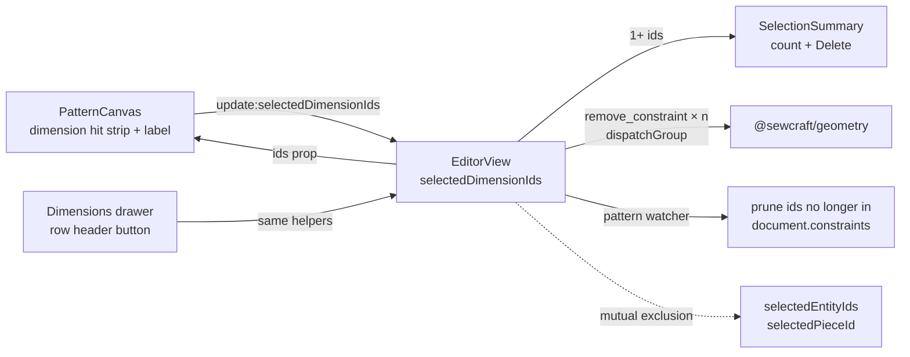

# Selectable dimensions

Status: implemented — Q1 confirmed in favour of the recommended separate selection by `spec-ready`; implementation lands on this PR
Refs: [#82 — Selectable dimensions](https://github.com/slawekniewiadomski/sew-craft/issues/82)
Builds on: `.ai/specs/2026-10-20-multi-entity-selection.md`,
`.ai/specs/2026-10-19-movable-linear-dimensions.md`,
`.ai/specs/2026-10-24-dimension-pick-feedback.md`,
`.ai/specs/2026-10-22-pieces-and-allowance.md`
Command spec: unchanged
Pattern schema: unchanged

## 📝 TLDR

A maker can drag and edit a dimension but cannot select one, so deleting several
dimensions means one trip to the Dimensions drawer per row. Proposed future
behaviour: with the Select tool, a click on a dimension line or value selects it,
Ctrl/Cmd-click adds or removes further dimensions, and Delete removes the whole
dimension selection in one undo entry. The dimensions drawer mirrors the same
selection. This is frontend view state: removal keeps using the existing
`remove_constraint` command, and no schema, API, command, or geometry-package
contract changes.

## ❓ Open Questions

| #   | Question                                                                                                                                                                                                                    | Why it blocks                                                                                                                                                                                                                                     | Recommended answer                                                                                                                                                                                      |
| --- | --------------------------------------------------------------------------------------------------------------------------------------------------------------------------------------------------------------------------- | ------------------------------------------------------------------------------------------------------------------------------------------------------------------------------------------------------------------------------------------------- | ------------------------------------------------------------------------------------------------------------------------------------------------------------------------------------------------------- |
| Q1  | Should dimension selection be a **separate, mutually exclusive** selection (like the Pieces drawer selection), or should dimensions join the existing entity selection as **one mixed selection** where a single Delete removes both kinds? | It decides the shape of the selection state, the `PatternCanvas` prop/emit contract, what a future marquee selects, and whether a mixed Delete must compose `remove_constraint` with `delete_entity`. Reversing it later rewrites the same files and tests. | **Separate and mutually exclusive.** It ships the requested capability with no refactor of the entity selection, entity Delete or orphan guard, reuses the precedent set by `selectedPieceId`, and leaves one typed mixed selection available as a later upgrade. |

The spec is written under the recommended answer. `spec-ready` on the PR is the
human confirmation of Q1, so implementation proceeds under that model.

## 📝 Problem Statement

- **Who needs it:** a maker reading or tidying a pattern that already carries
  several dimensions — driving/set dimensions, driven dimensions, referenced
  dimensions and cut dimensions. Dimensions accumulate around dense geometry, and
  removing the ones that no longer help is a routine cleanup.
- **What happens today:** dimensions are constraints, not entities. The canvas
  renders them from `document.constraints` and lets the Select tool drag a
  committed dimension (`frontend/src/components/PatternCanvas.vue:1273-1276`,
  `:1854-1870`) or double-click its value to edit it (`:1904-1906`). The only way
  to remove one is the per-row delete in the Dimensions drawer
  (`frontend/src/views/EditorView.vue:1810-1828`, `:987-990`), one row at a time.
  Clicking a dimension on the canvas does not mark it, and Delete only considers
  `selectedEntityIds` (`EditorView.vue:680-698`).
- **Evidence it matters:** issue #82 asks for selecting one or many dimensions
  specifically so they can be deleted together. The app already has a
  multi-selection vocabulary for entities (click, Ctrl/Cmd toggle, Alt/Shift
  subtract, one grouped undo), so dimensions are the visible gap in it.
- **Constraints:** selection is ephemeral view state and must not enter
  `PatternDocument`, the journal, the HTTP API or the command payloads. Removal
  must go through `remove_constraint`
  (`docs/domain/command-spec.md:178-188`), the command that already backs the
  drawer delete and restores the dimension with its id on undo. No geometry math
  is needed: dimension hit targets are already drawn from resolved layout, so
  `@sewcraft/geometry` does not change.

## 📝 Proposed Solution

### Options considered

| #   | Option                                                                                                                                                                                                                       | Trade-offs                                                                                                                                                                                                                                                       | Verdict                                                                              |
| --- | ---------------------------------------------------------------------------------------------------------------------------------------------------------------------------------------------------------------------------- | ---------------------------------------------------------------------------------------------------------------------------------------------------------------------------------------------------------------------------------------------------------------- | ------------------------------------------------------------------------------------ |
| A   | **Separate `selectedDimensionIds`, mutually exclusive with entity and piece selection; canvas click + drawer row select; one grouped `remove_constraint` delete**                                                              | Smallest blast radius: the entity selection contract, entity Delete and the orphan guard stay untouched; mirrors the existing `selectedPieceId` pattern. Cost: no mixed entity+dimension Delete, and a second selection array that must be kept exclusive.        | **Recommended**                                                                      |
| B   | **Join the existing selection as a typed mixed selection** (`{ kind: 'entity' \| 'dimension'; id }[]`), one Delete for both kinds                                                                                              | One selection concept; mixed selections and a future marquee that includes dimensions come for free. Cost: rewrites the `selectedEntityIds` prop/emit contract and its canvas tests, and needs a mixed command plan plus an orphan-guard rule for the entity half. | Viable later; rejected for this slice — it bundles a selection refactor with the requested capability. |
| C   | **Drawer-only multi-select** — selection checkboxes/rows only in the Dimensions drawer, no canvas change                                                                                                                       | Tiny and safe. Misses the obvious canvas gesture: dimensions are already clickable/draggable there, and the user expects to select what they see. It also adds a third selection surface after the canvas and Outline.                                          | Rejected — does not meet the issue where the user is looking                              |
| D   | **Label-only selection** — only the value label selects, the line keeps drag-only                                                                                         | Narrows the hit target to the one element whose double-click already edits a value, so a click would compete with editing. The invisible 24 px drag strip is the established hit target for the whole dimension.                                                | Rejected — smaller target, more gesture conflict                                          |
| E   | **Do nothing** — keep one-at-a-time drawer deletes                                                                                                            | No risk. Leaves #82 open and the multi-selection vocabulary inconsistent between entities and dimensions.                                                                                                                                                        | Rejected — the request is specific and the cost is contained                              |

Option A wins because it treats “what is selected” as a frontend concern with two
object types that the UI already keeps apart: entity selection, piece selection,
and now dimension selection. Option B remains the natural consolidation once
mixed selection is actually wanted; Q1 records that choice rather than hiding it.

### Behaviour

#### Canvas selection

Selection clicks happen only with the **Select** tool. The Dimension and Cut
dimension tools keep their current drag behaviour and never change the selection,
so placing a new dimension cannot silently select an old one.

| Gesture (Select tool)               | Target                         | Result                                                                                   |
| ----------------------------------- | ------------------------------ | ---------------------------------------------------------------------------------------- |
| Plain click                         | Dimension line or value label  | The dimension becomes the whole selection; the existing drag begins. A click without movement leaves it selected. |
| Ctrl/Cmd-click                      | Dimension line or value label  | Toggle membership in the ordered dimension selection; no drag starts.                    |
| Ctrl/Cmd+Alt or Ctrl/Cmd+Shift-click | Dimension line or value label  | Remove the dimension from the selection; no drag starts.                                  |
| Plain click                         | Entity, empty canvas, marquee  | Entity selection is committed; the dimension selection clears (mutual exclusion).        |
| Cancelled marquee                   | —                              | Both selections stay as they were.                                                       |
| Dimension or Cut dimension tool     | Dimension                      | Drag as today; selection unchanged.                                                     |
| Constraint or corner-round tool     | —                              | Dimension hit strips and labels are not interactive, as today.                           |

The dimension line and its label are both targets, because the line already has a
24 px invisible drag strip (`PatternCanvas.vue:3430-3441`) and the label is
already pointer-active while draggable (`:3488-3506`). The existing drag becomes
“select on press, move while pressed”. A plain click is therefore a selection
without movement, and the current double-click value editor still opens because a
click without movement emits no update (`.ai/specs/2026-10-19-movable-linear-dimensions.md`).

Mutual exclusion is explicit, not incidental:

- Selecting a dimension clears `selectedEntityIds` and `selectedPieceId`.
- Committing an entity selection clears `selectedDimensionIds`. The canvas emits
  an empty dimension selection on the gestures that replace or change the entity
  set: a plain entity click, a plain empty-canvas click, a latched marquee, and a
  modified marquee that produced hits. A cancelled marquee, or an additive/
  subtractive marquee with no hits, leaves dimensions untouched.
- Selecting a piece clears dimensions, exactly as it already clears entities
  (`EditorView.vue:271-276`).

Derived cut dimensions are selectable and deletable on the same terms. Their value
stays read-only; selection is not an editing surface.

#### Drawer selection

The Dimensions drawer becomes a second entry point so dimensions can be selected
without hunting for them on the canvas:

- The row header (dimension id plus anchor ids) becomes a button with the same
  modifier rules as an Outline row and the canvas.
- The selected row is highlighted and exposes `aria-current="true"`.
- The existing per-row Remove action stays independent: it removes that one
  dimension and does not select the row.
- Canvas and drawer share one `selectedDimensionIds`, so the highlight moves in
  both directions.

#### Delete

- Delete/Backspace, the ribbon Delete action and the summary Delete remove every
  selected dimension with one `remove_constraint` per id inside a single
  `dispatchGroup`. That is one journal entry and one undo step: the group keeps
  the exact pre-delete snapshot, and each normal dimension's inverse also
  recreates it with its original id
  (`docs/domain/command-spec.md:178-188`; the journal already snapshots grouped
  commands, `frontend/src/stores/editor.ts:21-28`, `:81-108`).
- The dimension branch is separate from the entity branch, so the entity orphan
  guard is neither consulted nor weakened.
- After a successful delete the dimension selection clears; a rejected command
  leaves the document and the selection intact and uses the existing error
  banner.
- Deleting a dimension that another dimension references keeps today’s
  `remove_constraint` behaviour: the dependent stays, records its last value and
  renders as broken. No confirmation is added in v1. Deleting both the source and
  the dependent in one selection is safe because all constraints are removed in
  the same group.
- The per-row Remove is unchanged; if it removes a selected dimension, the
  document watcher prunes the id.

#### Properties drawer and status

- One or more selected dimensions show the compact `SelectionSummary` with the
  count and a Delete action. There is no dimension property inspector in v1: the
  Dimensions drawer already owns value, reference, orientation and offset
  editing.
- The summary note reads “Ctrl/Cmd-click adds or removes a dimension” while
  dimensions are selected; the entity wording is unchanged.
- The Properties drawer badge and the workspace live region count dimensions
  (`drawerCounts.properties` and `selectionStatus` in `EditorView.vue:247-301`).
- The empty-state hint becomes “Select a point, line, curve, arc, circle or
  dimension on the canvas or in a drawer.”
- Dimension labels and drag strips explain the gesture in their existing
  `title`: “Click to select, drag to reposition, double-click to edit” for a
  driving dimension, and “Click to select, drag to reposition” for a read-only
  cut dimension.

## 📝 Architecture



Takeaway: the canvas and the drawer both feed one ephemeral array in
`EditorView`; the geometry package only executes the existing remove command,
and the entity and piece selections remain untouched apart from being cleared
when a dimension becomes selected.

### Modules

| Module | Change |
| --- | --- |
| `frontend/src/views/EditorView.vue` | Add `selectedDimensionIds`; dimension click/drawer handlers using `selectionModeFrom`, `toggleSelection`, `applySelection`; mutual-exclusion watches; dimension branch in `deleteSelected`; summary branch; badge and live-region counts; pruning in the `pattern` watcher; updated empty hint; pass the prop to the canvas. |
| `frontend/src/components/PatternCanvas.vue` | Add `selectedDimensionIds` prop and `update:selectedDimensionIds` emit; wrap the existing drag handler with a selection-first gesture; add the selected halo/outline; clear dimensions on selection-changing entity gestures; update the label/drag-strip titles. No new geometry math. |
| `frontend/src/components/SelectionSummary.vue` | Accept a dimension count (entities optional); render “N dimensions selected” and the dimension note; keep the entity modes unchanged. |
| `frontend/src/lib/selection.ts` | No new algorithm: reuse `SelectionMode`, `selectionModeFrom`, `applySelection` and `toggleSelection` unchanged. `orphanedEdges` stays entity-only and is not called for a dimension selection. |
| Tests | `PatternCanvas.test.ts`, `EditorView.test.ts`, `SelectionSummary.test.ts` for the behaviours below. |

No file in `app/`, `routes/`, `database/`, `docs/domain/`, `packages/geometry/`
or `config/` changes. `PatternDocument` is untouched. `005-canvas-editor-interactions.md`
gets one contract line in the implementation phase so its interaction summary
mentions dimension selection alongside entity selection.

### State shape

```ts
/** Ordered, ephemeral dimension selection; never written to the document. */
const selectedDimensionIds = ref<EntityId[]>([]);
```

The canvas receives it as a separate prop, leaving the existing
`selectedEntityIds` prop/emit contract and its tests intact:

```ts
selectedDimensionIds?: EntityId[];
'update:selectedDimensionIds': [ids: EntityId[]];
```

The selected set is a small `Set` computed from the prop, so the template does
not scan the document per segment.

## 📝 Data Model

None. The selection is not stored in `PatternDocument`, the project API, the
journal or the export. `JournalEntry` already supports grouped commands, so a
multi-dimension delete needs no schema work.

## 📝 API Contracts

None on the HTTP or command surface. `remove_constraint` keeps its current
single-constraint semantics and its inverse; the UI composes it in a group. No
new command, field, endpoint or package export is added, and the command-spec
version does not move.

The internal component contract changes only additively: `PatternCanvas` gains
one optional prop and one emit. `PatternCanvas` is used only by `EditorView` and
its tests, which are updated in the same step.

## 📝 UI/UX

- **Selected dimension (driving, driven, referenced):** the main dimension
  segment gains a 4 px primary underlay at reduced opacity behind the existing
  1 px state-coloured stroke; the value label keeps its text colour and gains a
  2 px primary outline. A broken dimension keeps its destructive text and gains
  the same outline, so the state is not hidden by selection.
- **Selected cut dimension:** the same treatment on its
  `stroke-dimension-derived` line and label; the read-only value remains
  read-only.
- **Multiple dimensions:** every selected dimension gets the same treatment; no
  “primary” member. The summary and live region carry the count.
- **Drawer:** the selected row uses the same `bg-primary/10` row treatment as the
  Outline selection and `aria-current="true"`; the row header is the button, the
  inputs and Remove stay independent.
- **Discoverability:** the existing invisible 24 px strip already makes the line
  easy to grab; the updated `title` now says that a click selects and a drag
  moves. Hover styling is not added — selection is the feedback.
- **Accessibility:** canvas dimension selection is pointer-only, like entity
  selection; the drawer row button is the keyboard path, and Delete works from
  the drawer. The live region announces the dimension count unchanged in
  structure. Selection is distinguished by a 2 px outline and a heavier underlay,
  not by hue alone. No focusable canvas elements are introduced.
- **No new chrome:** no dimension context menu, no batch property editor, no
  select-all action, no marquee change and no touch-specific additive mode.

## ✅ Acceptance criteria

- [ ] With the Select tool, a plain click on a dimension line or value label
      selects it; clicking without moving leaves it selected, and dragging still
      repositions the dimension.
- [ ] Ctrl/Cmd-click adds or removes a dimension; Ctrl/Cmd+Alt or Ctrl/Cmd+Shift
      subtracts; a plain click replaces the dimension selection.
- [ ] Clicking an entity, empty canvas, or committing a marquee clears the
      dimension selection; a cancelled marquee and an additive/subtractive
      marquee with no hits leave it unchanged.
- [ ] The Dimension and Cut dimension tools never change the selection, and
      constraint/corner-round modes expose no selectable dimension.
- [ ] Selected dimensions show the primary halo/outline while their driving,
      driven, referenced or broken state stays legible; unselected dimensions do
      not change.
- [ ] Dimensions drawer rows select with the same modifiers, show
      `aria-current`, and their Remove action still deletes one dimension without
      selecting it.
- [ ] Delete/Backspace, ribbon Delete and summary Delete remove all selected
      dimensions in one grouped batch and one undo entry; undo restores their
      ids and the selection is cleared only on success.
- [ ] Removing a referenced source leaves dependents broken with their last
      value; a rejected command leaves the document and selection intact.
- [ ] The Properties drawer shows the dimension count with Delete and no
      inspector; the badge, hint and live region count dimensions.
- [ ] Undo, redo, load and external deletion prune stale dimension ids.
- [ ] No command, schema, API, export or geometry-package change ships; the full
      validation gate passes with 100 % statements, branches, functions and
      lines.

## 📝 Edge Cases & Failure Scenarios

| Scenario | Behaviour |
| --- | --- |
| Click a dimension without moving | It is selected; no drag update is emitted, so double-click editing still works. |
| Drag a dimension | It is selected and repositions exactly as today; one `update_constraint` on release. |
| Ctrl/Cmd-click a selected dimension | It is removed from the selection; no drag starts. |
| Ctrl/Cmd+Alt/Shift-click an unselected dimension | Selection is unchanged; no drag starts. |
| Dimension selection active, then an entity is clicked | Dimensions clear and the entity becomes the selection. |
| Dimension selection active, then bare canvas is clicked | Both selections clear on release. |
| Marquee is cancelled with Escape/blur/pointercancel | The previous entity and dimension selections both survive. |
| Additive marquee produces no hits | The existing selection (dimension or entity) is unchanged. |
| Marquee over entities while dimensions are selected | The committed marquee clears dimensions; the result is entity-only. |
| Dimension or Cut dimension tool active | Pointer-down on an existing dimension drags it; selection does not change. |
| Constraint or corner-round tool active | Dimension hit strips/labels are not rendered as interactive; no selection. |
| Read-only document | Canvas selects nothing (existing early return); drawer rows may still be selected, and Delete stays a no-op. |
| Dimensions hidden with the View toggle | Selected ids persist; the canvas halo disappears but the drawer row stays selected and Delete still works. |
| Undo/redo/load removes a selected dimension | The watcher prunes the missing id; an empty selection falls back to the hint. |
| Per-row Remove targets a selected dimension | The command succeeds; the watcher prunes the id. |
| Selected set includes a source and its dependent | Both `remove_constraint` commands run in one group; undo restores both. |
| Removing a source only | The dependent stays, records its last value and renders broken, as today. |
| Group command rejected | Atomic dispatch leaves the document untouched; the selection stays and the error banner reports it. |
| Dense overlapping dimensions | The topmost hit strip wins the click, matching today’s drag target; the drawer is the fallback for a precise pick. |
| Touch/pen | A tap selects one dimension; drag moves it; additive touch selection is not added in v1 (use the drawer). |
| Escape | Cancels the tool or marquee only; it does not clear a selection, matching entity selection. |

## 📝 Risks & Impact Review

- **Selection-model split (Q1).** Two arrays mean two invariants to keep
  exclusive. The mitigation is a single pair of watches in `EditorView` and one
  canvas gesture wrapper; Option B (typed mixed selection) is the documented
  consolidation path if the two ever need to mix. The blast radius is frontend
  view state only.
- **Click/drag/double-click conflict.** Selection is added to a pointer-down
  path that already starts a drag and a double-click editor. The rule is
  “selection on press, drag only for a plain press, no update without movement”;
  the existing drag and editor tests are extended rather than rewritten.
- **Discovery.** A selected dimension must be obvious; the halo/outline plus the
  summary and drawer highlight are deliberately redundant. No hover-only cue is
  added, because hover is not available on touch.
- **Hidden dimensions.** The View toggle hides rendering but not the document;
  a selected hidden dimension remains deletable from the drawer. This mirrors how
  hidden construction entities keep their selection; tests pin it.
- **Dependent dimensions.** Deleting a referenced source breaks dependents, as
  the existing drawer delete already does. The spec keeps that behavior and
  removes both when both are selected, rather than inventing a cascade or a
  confirmation flow in this slice.
- **Read-only and command safety.** The dimension branch checks `editor.readOnly`
  and goes through `dispatchGroup`; no direct document mutation is introduced.
- **Performance.** Selection and highlighting are O(selected dimensions) per
  render; hit testing already exists. No document-wide scan beyond the existing
  prune watcher.
- **No compatibility exposure.** No stored data, API, command or schema changes,
  so there is no migration, downgrade or export impact.
- **Mockup limit.** No mockup is committed: the change is a token-level selected
  treatment on existing dimension geometry, and the open decision is about
  selection scope, which a static image would not settle. If the visual treatment
  needs review, a screenshot of the implementation is the right evidence.

## 📋 Phasing

- **Phase 1 — Single-dimension selection.** `selectedDimensionIds`, canvas
  click-to-select on the existing hit targets, the selected halo/outline, the
  empty-canvas/entity clear paths, pruning and the live status. One dimension at
  a time already ships value.
- **Phase 2 — Multiple dimensions and delete.** Modifier toggling/subtracting,
  drawer row selection, the summary branch, grouped `remove_constraint` Delete
  through the keyboard/ribbon/summary, and the badge.
- **Phase 3 — Hardening and docs.** Derived cut dimensions, hidden dimensions,
  read-only, cancelled gestures, stale ids, the 005 interaction line, and the
  full validation gate.

Each phase leaves the app working: Phase 1 makes a dimension selectable, Phase 2
makes multi-delete useful, Phase 3 closes the edge cases.

## 📋 Implementation Plan

### Phase 1 — Single-dimension selection

1. Add `selectedDimensionIds` to `EditorView.vue`; add the dimension branch to
   `selectionStatus`, the Properties badge and the `pattern` watcher that prunes
   ids missing from `document.constraints`; clear dimensions in `selectPiece()`.
   Tests: pruning after undo/load, status copy, piece selection clearing.
2. Add the `selectedDimensionIds` prop and emit to `PatternCanvas.vue`; add
   `onDimensionPointerDown` around the existing `beginDimensionDrag` /
   `beginDerivedDimensionDrag` so a plain Select-tool press emits the selection
   and then starts the drag. Tests: select, select-without-move, drag still
   emits the dimension update, Dimension/Cut tools do not select, read-only
   selects nothing.
3. Render the selected treatment (primary underlay behind the main segment and a
   2 px label outline) for committed distance and derived drawings; add test
   hooks/classes. Tests: selected vs unselected, driving/driven/referenced/broken
   and cut dimensions, no preview treatment.
4. Clear dimensions on selection-changing entity gestures: plain entity click,
   bare-canvas click, latched marquee, modified marquee with hits. Tests:
   entity click, empty click, marquee replace, add/subtract with zero hits,
   cancelled marquee.

### Phase 2 — Multiple dimensions, drawer and delete

5. Apply `selectionModeFrom` / `toggleSelection` / `applySelection` in the canvas
   wrapper and the drawer row handler. Tests: add, toggle off, subtract, replace,
   ordering, no duplicate ids.
6. Add the dimension branch to `deleteSelected()`: one `remove_constraint` per
   selected id, one `dispatchGroup`, clear only on success. Wire the ribbon
   `can-delete`, the live region and the summary. Tests: one journal entry, undo
   restores all ids, read-only no-op, a rejected group leaves selection intact.
7. Extend `SelectionSummary.vue` with an optional dimension count and the
   dimension note; branch the Properties drawer for 1+ dimensions; update the
   empty hint and badge. Tests: singular/plural count, breakdown, Delete event,
   entity modes unchanged.
8. Make the Dimensions drawer row header a selection button using the same
   helpers, add `aria-current` and the selected row class, keep the Remove action
   independent. Tests: click/modifier semantics, Remove does not select, canvas
   and drawer stay in sync.
9. Update the dimension label/drag-strip `title` copy for select + drag (+ edit
   for driving dimensions). Tests: title text for driving and cut dimensions.

### Phase 3 — Hardening and verification

10. Cover hidden dimensions, stale ids, derived dimensions, read-only, touch and
    the cancelled/no-hit gesture table; add the dimension-selection line to
    `.ai/specs/005-canvas-editor-interactions.md`.
11. Run the full gate and close any coverage branch the new gestures open.

## Checks

```bash
npm run format
npm run typecheck
npm run lint
npm run format:check
npm run test:coverage
npm run build
docker compose run --rm --no-deps -e DB_CONNECTION=sqlite -e DB_DATABASE=:memory: \
  app sh -c "composer install --no-interaction && php artisan test --coverage --min=100"
```

## ✅ Resolved assumptions (autonomous defaults)

| #   | Assumption | Why | Reversible? |
| --- | --- | --- | --- |
| R1 | Selection is ephemeral frontend state; removal goes only through `remove_constraint`; no document, command, API or schema field is added. | Selection is a view concern, and the existing command already has a lossless inverse. | Yes |
| R2 | Selection clicks happen only with the Select tool; the Dimension and Cut dimension tools keep drag-only behavior. | Selecting an old dimension while placing a new one would be surprising, and the issue is about editing existing dimensions. | Yes |
| R3 | A plain press selects and may start the existing drag; Ctrl/Cmd toggles without dragging; Ctrl/Cmd+Alt/Shift subtracts without dragging. | Matches the entity and Outline selection vocabulary; keeps the zero-movement rule that protects double-click editing. | Yes |
| R4 | The marquee stays entity-only in v1; a committed marquee clears a dimension selection under mutual exclusion. | The existing marquee spec deliberately excludes dimensions, and extending rectangle math to dimension layout is a separate capability. | Yes |
| R5 | The Dimensions drawer row header is a selection entry point and mirrors the canvas; the per-row Remove stays independent. | Gives a keyboard path and a way to select hidden/overlapping dimensions without inventing a new list. | Yes |
| R6 | 1+ selected dimensions show the compact summary with Delete and no dimension inspector. | The Dimensions drawer already owns value/reference/orientation/offset editing; the summary answers the issue’s delete use case without a second editor. | Yes |
| R7 | Delete groups one `remove_constraint` per selected dimension in one `dispatchGroup`; no confirmation for dependent broken dimensions. | Reuses the existing command and grouped-undo journal entry; the drawer already breaks dependents without a prompt. | Yes |
| R8 | Hidden dimensions keep their selection; the drawer shows it and ids are pruned only when the constraint disappears. | Matches how hidden construction entities keep a selection, and keeps the drawer as the authoritative visible list. | Yes |
| R9 | Read-only documents allow drawer selection but no canvas selection; Delete stays a no-op. | The canvas already refuses every pointer gesture in read-only mode, while selection itself is harmless. | Yes |
| R10 | No mockup is committed. | The change is a selected-state treatment on existing geometry, and the blocking question is selection scope, not a visual that a static image can answer. | Yes |
