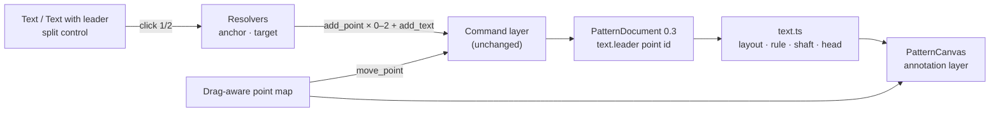

# Annotation text with a leader — underline, arrow and independent movement

Status: **implemented** — the 10 mm default, the Text / Text with leader split
control, the derived rule and arrow, and independent label/target movement
shipped on PR #92 (2026-10-25). Builds on
`2026-10-25-piece-containers-and-annotations` (annotation text, the `leader`
field and `textLayout`/`textLeader`) and the rectangle split control in
`2026-10-23-grouped-sketch-tools`.
Prototype: `.ai/specs/assets/annotation-text-leader/mockup-01-annotation-leader.html`
Static preview: `.ai/specs/assets/annotation-text-leader/mockup-01-annotation-leader.png`

## 📝 TLDR

Annotation text becomes a two-variant tool: **Text** and **Text with leader**.
New labels default to a 10 mm cap height. A label with a leader draws a thin rule
under its text and a solid leader from the rule's nearer end to a filled arrow at
the target. Dragging the label moves only its anchor, so the arrow stays on its
point; dragging the arrow target moves only that point, so the label stays put.
This is future behaviour; the current code has a 6 mm default, a manual "Use
selected point" leader picker and no arrow, rule, or label drag.

## 📝 Problem Statement

- **Who needs it:** the maker annotating a panel with "velcro", "rivet 2×" or a
  grain note, who needs the label to point at a specific spot without the line
  cutting through the letters, and who wants to reposition the label and the
  arrow independently.
- **What happens today:**
  - Text defaults to a 6 mm cap height (`DEFAULT_TEXT_SIZE`, `text.ts:8`).
  - A leader is a text property with a manual picker: the properties panel shows
    a point id plus **Use selected point** and **Clear** buttons
    (`EntityPropertiesPanel.vue:536-560`). The handler does not use the selection
    at all; it picks the first other point of the piece
    (`EditorView.vue:802-817`), so the result is unpredictable.
  - The leader is a dashed polyline from the nearest edge of the label box to the
    point (`text.ts:80-118`, rendered at `PatternCanvas.vue:3246-3255`). It has no
    arrow, no rule under the text and no gap from the text.
  - A label cannot be dragged: in the Select tool a non-point hit selects and
    starts a canvas pan (`PatternCanvas.vue:2304-2320`). Only the leader point can
    be dragged, and because `textViews` reads the document instead of the
    drag-aware point map (`PatternCanvas.vue:1687-1714`), the leader does not
    follow the point until the pointer is released.
- **Evidence it matters:** the annotation-text follow-up asks for a 10 mm
  default, a dedicated leader variant placed by two clicks, and independent text
  and arrow movement. The current picker makes "leader to a rivet" a lottery,
  and the missing arrow leaves the read direction ambiguous.
- **Constraints:** commands remain the only mutation path; `@sewcraft/geometry`
  stays pure and framework-agnostic; units are millimetres; no schema change is
  needed; every new branch needs a test to hold the 100 % coverage gate.
- **Why it is not obvious:** a label is one entity but has two points, and the
  natural gesture for "move the label" can either move both or only the anchor.
  The design below makes the split explicit and reuses the existing point drag.

## 📝 Proposed Solution

### Options considered

| #   | Option                                                                                                                       | Trade-offs                                                                                                                                                                                                                                                             | Verdict                        |
| --- | ---------------------------------------------------------------------------------------------------------------------------- | ---------------------------------------------------------------------------------------------------------------------------------------------------------------------------------------------------------------------------------------------------------------------- | ------------------------------ |
| A   | **Keep the leader as a point reference on the text; add a variant tool and derive the rule and arrow**                       | No schema or command change; the leader already cascades on delete and moves with the piece; movement is the existing point drag. Cost: the label and its target stay two points, so the UI must make their independence obvious.                                      | **Recommended**                |
| B   | **Model the leader as a separate annotation line entity plus an arrow decoration**                                            | The line is ordinary geometry, so it is selectable and extensible. Cost: a new entity or decoration contract, duplicate lifecycle and cascade logic, and the line would need to know which label owns it for underline attachment.                                     | Rejected — more surface for no gain |
| C   | **Make the leader a plain text property edited by the picker, add an arrow only**                                            | Smallest diff. Cost: keeps the unpredictable first-point picker and cannot express a two-click target; the user still cannot say "point at this".                                                                                                                     | Rejected — does not meet the brief |
| D   | **Move the label and the target together as one text object**                                                               | Makes label movement trivial. Cost: contradicts the brief; the arrow would no longer stay on the selected point, and fixing an arrow after a text move would be impossible without a separate target drag.                                                            | Rejected                       |

### Behaviour

1. **Default size.** A newly created label has a 10 mm cap height
   (`DEFAULT_TEXT_SIZE = 10`). Existing labels keep their stored `fontSize`; the
   default only applies at creation and to hand-authored documents that omit the
   field.
2. **Two variants.** The Annotation ribbon group becomes a split control with
   **Text** as the primary half and a caret menu offering **Text** and **Text with
   leader**, the same pattern as Rectangle. The primary stays Text; the caret does
   not remember the last variant.
3. **Text.** One click places a label at the snapped position with content
   `Text`, alignment `left`, rotation `0` and size 10 mm. No leader is set and no
   rule is drawn.
4. **Text with leader.** Two clicks:
   - Click 1 stores the label anchor and shows a ghost label at the position.
   - Between clicks the ghost label, its rule, and a dashed rule-to-pointer
     leader with an outline arrow follow the pointer. The pointer snaps to the
     same candidates the second click will accept.
   - Click 2 commits the batch: an `add_point` for the anchor when it is new, an
     `add_point` for the target when it is new, and one `add_text` carrying the
     `leader` id. One `dispatchGroup`, so one undo.
   - Escape, a tool change, or losing the anchor point cancels the pending
     gesture without creating anything.
5. **Target picking.** The second click reuses an existing point of the active
   piece within the 6 mm point-snap tolerance — annotation marks included — and
   otherwise creates a point at the grid-snapped position. Corner-round-derived
   points are not candidates. A target equal to the anchor, or inside the label
   box, is refused with a hint; the gesture stays armed on the first click.
6. **Arrow rule.** A label with a leader draws a solid rule under the text,
   spanning the label width, `0.12 × fontSize` below the baseline. The leader
   starts at whichever rule end is nearer the target; a tie picks the end on the
   target's side of the label centre, then the right end. The shaft runs from that
   end to the base of a filled triangle whose tip is exactly the target. The head
   is `0.30 × fontSize` long and `0.15 × fontSize` wide, shrinking proportionally
   when the leader is shorter; the shaft stops at the head base and never pokes
   through the tip. Rule, shaft and head are annotation-coloured and canvas-only.
7. **Independent movement.**
   - Dragging the label with the Select tool selects it and moves only its anchor
     point through the existing `move_point` path. The target stays where it is;
     the rule and arrow re-derive from the new anchor on every frame.
   - Dragging the arrow target moves only that point, through the same
     `move_point` path. The label stays; the arrow follows the point live and
     commits once on release.
   - Both points remain ordinary points: selecting either shows point properties,
     constraints and dimensions can reference them, and normal solver rules
     apply. Deleting the target clears `leader` (existing cascade); deleting the
     anchor deletes the label.
   - The canvas reads both points through the drag-aware point map, so the label,
     rule and arrow preview live rather than jumping on release.
8. **Anchor ownership.** New labels always create a dedicated anchor point, even
   when the click lands on an existing point; a label drag therefore never moves
   pattern geometry. Existing labels keep their anchor ids and behave like any
   other point drag — if that anchor is shared with geometry, the shared point
   moves too. The tool does not reuse points for anchors, but it does reuse them
   for the arrow target.
9. **Properties panel.** The Leader row, its point id, **Use selected point** and
   **Clear** are removed; content, alignment, rotation and size stay. A leader is
   created by the variant tool, and removed by deleting the target point. The
   `update_text` command keeps its `leader` parameter for agents and the future
   inspector, but no editor UI emits it in this change.
10. **Existing labels.** Any label that already has `leader` adopts the rule and
    arrow automatically; no migration or stored change. Its layout recalculates
    on content, size, alignment, rotation, anchor or target changes.

## 📝 Architecture

Takeaway: the feature is a frontend creation gesture plus pure derived geometry;
the document, solver and command contracts stay as they are.

### New and edited modules

**Geometry package**

- `packages/geometry/src/text.ts` — `DEFAULT_TEXT_SIZE` 10; replace `textLeader`
  with `textLeaderGeometry(entity, anchor, leader)` returning
  `{ underline: Segment, shaft: Segment | null, head: Vec2[] } | null`, and keep
  the intersection-free, DOM-free style. The helper owns end selection, the
  **0.12 / 0.30 / 0.15** ratios and the short-leader shrink.
- `packages/geometry/src/types.ts` — the `fontSize` comment changes from 6 to 10;
  no field changes.
- `packages/geometry/src/index.ts` — export the new type/helper.
- Tests: `packages/geometry/tests/text.test.ts`.

**Frontend**

- `lib/editor-tools.ts` — `add_text_leader` tool and label.
- `lib/editor-ribbon.ts` — the Annotation group renders
  `toolGroup('text', 'Text', [Text, Text with leader])`.
- `lib/ribbon-icons.ts` — a `text-leader` glyph (a T with an arrow).
- `lib/drafting.ts` — `resolveTextAnchorEndpoint` (snap, never reuse) and
  `resolveLeaderEndpoint` (snap to any non-derived point of the piece, including
  annotation points; else new coordinates).
- `lib/text-tool.ts` — `buildTextCommands` gains an optional leader endpoint and
  creates new points with `role: 'annotation'`; the same default content/size.
- `components/PatternCanvas.vue` — tool state, preview, commit, cancel, drag-aware
  `textViews`, rule/shaft/head rendering, label drag in the Select tool.
- `views/EditorView.vue` — `onAddText` accepts the leader pair, dispatches the
  batch, removes `onCreateLeader`.
- `components/EntityPropertiesPanel.vue` — removes the Leader field and the
  `create-leader` emit.
- Tests beside every file above.

**Docs and contracts**

- `docs/domain/command-spec.md` — `add_text` default 6 → 10; a note that the
  leader is a point reference and the editor now creates it with the variant tool.
- `config/geometry.php` — `spec_version` `0.14.0` (documented default change).
- `docs/architecture/geometry-core.md` — the derived rule and arrow.
- `docs/domain/glossary.md` — annotation text entry mentions the leader rule and
  arrow.
- Tests: `tests/Feature/CommandSpecTest.php` if it asserts the version.

## 📝 Data Model

No stored change; `sewcraft.pattern/0.3` stays the schema.

| Surface                   | Change                                                                                       |
| ------------------------- | -------------------------------------------------------------------------------------------- |
| `TextEntity`              | none — `leader?: EntityId` keeps its meaning                                                  |
| New point `role`          | new text anchors and new arrow targets are created with `role: 'annotation'`                 |
| `DEFAULT_TEXT_SIZE`       | 6 → 10 mm                                                                                    |
| Derived `TextLayout`      | box, corners and rotation unchanged; the rule is computed beside it                         |
| Derived `textLeaderGeometry` | `{ underline, shaft, head }` or `null` when there is no leader or a point is missing       |
| `PatternDocument.schema`  | unchanged                                                                                    |

A new label anchor is private to its label. A reused target keeps its existing
role, so pointing at a loop vertex does not turn that vertex into annotation
geometry.

## 📝 API Contracts

No command is added, removed or reshaped. `add_text` and `update_text` keep their
params, including `leader`.

- `add_text` now documents `fontSize` default **10** instead of 6. The command
  envelope and the `GET /api/commands` shape are unchanged; `spec_version` moves
  from `0.13.0` to `0.14.0` so agents can detect the new default.
- A target may be any ordinary point of the same piece, including one with
  `role: 'annotation'`; the existing same-piece and not-corner-round-derived
  validation still applies.
- The editor composes the gesture from existing commands:
  `add_point { role: 'annotation' }` (anchor, when new) →
  `add_point { role: 'annotation' }` (target, when new) →
  `add_text { leader }`. Plain text is the same batch without the target.
- `update_text.leader: null` remains the programmatic way to remove a leader.

## 📝 UI/UX

- **Ribbon.** Annotation group: split control, primary **Text**, caret menu with
  **Text** and **Text with leader**. The caret has an accessible name and each
  menu row is a real button; the group uses the same markup and keyboard
  behaviour as Rectangle.
- **Placement.** The Text tool keeps its one-click flow. Text with leader shows a
  ghost label after click 1, a dashed leader with an outline arrow to the snapped
  pointer, and the hint **"Click the arrow target."** After a refused target the
  hint names the fix: **"Choose a point outside the label."** or **"The arrow
  needs a different point."**
- **Rendering.** Rule and leader are 0.5 strokes with `non-scaling-stroke`; the
  head is filled geometry in millimetres so it scales with zoom. The label keeps
  its italic annotation font and hit box; the rule, shaft and head are
  `pointer-events="none"`.
- **Movement.** With the Select tool, the label hit box shows a move cursor and a
  plain press selects and drags the anchor; modified clicks select without
  dragging, matching points. The target point shows the ordinary point hover and
  drag. A short drag below the pointer threshold does not emit `move_point`.
- **Selection.** Selecting the label shows its properties (no Leader row).
  Selecting the target shows point properties. The annotation layer stays
  `aria-hidden` like the dimension labels.
- **Test ids.** `tool-text` (split group), `tool-add_text`,
  `tool-add_text_leader`, `text-<id>`, `text-hit-<id>`, `text-underline-<id>`,
  `text-leader-<id>`, `text-arrow-<id>`, `text-leader-preview`,
  `text-leader-hint`.
- **Mockup.**
  `.ai/specs/assets/annotation-text-leader/mockup-01-annotation-leader.html`
  shows both variants, the rule and arrow, the split control and a draggable
  label/target pair.

## 📝 Edge Cases & Failure Scenarios

| Scenario                                           | Expected behaviour                                                                                                        |
| -------------------------------------------------- | ------------------------------------------------------------------------------------------------------------------------- |
| Second click lands on the label box or rule        | Refused with "Choose a point outside the label."; stay on click 1                                                          |
| Second click is the anchor point                   | Refused with "The arrow needs a different point."; stay on click 1                                                         |
| Second click on another piece's point              | Existing cross-piece guard names the piece; stay on click 1                                                                |
| Escape during placement                            | Pending gesture cleared; no point or text created                                                                          |
| Tool change during placement                       | Pending gesture cleared                                                                                                    |
| Anchor point disappears (undo while pending)       | Pending gesture cleared through `endpointMissing`                                                                          |
| Target is a corner-round-derived point             | Not a candidate; the click falls through to a new point at the snapped position                                            |
| Leader shorter than the arrow head                 | Head shrinks proportionally; no inverted or overlapping head                                                               |
| Leader target later falls inside the label         | Possible only through the command API; geometry still renders, the editor never creates it                                 |
| Moving the label                                  | Only the anchor moves; target and arrow direction stay                                                                     |
| Moving the target                                 | Only the target moves; label stays                                                                                         |
| Label anchor shared with geometry (old labels)     | The shared point moves with the label, like any point drag; new labels have a dedicated anchor                              |
| Target deleted                                     | Label stays, `leader` clears, rule and arrow disappear                                                                     |
| Label deleted                                      | Anchor and target points stay; existing text-delete behaviour is unchanged                                                |
| Content, size or rotation changes                  | Rule and arrow re-derive; a target that becomes too close shrinks the head                                                 |
| Rotated label                                      | Rule rotates with the box; the leader still leaves from the nearer end in world space                                      |
| Existing label with `leader`                       | Adopts the rule and arrow with no migration                                                                                |
| 10 mm default                                      | Only new labels; every stored label keeps its `fontSize`                                                                   |
| Agent supplies a target id only                    | Same render path; no UI-only validation (inside-box check) applies                                                         |

## 📝 Risks & Impact Review

- **Visual change to existing labels (low, accepted).** Any label that already
  has a leader gains a rule and an arrow. This is the intended fix, but it
  changes saved projects' canvas rendering without touching their data.
- **Default change (low).** Creation defaults to 10 mm; stored labels keep their
  size. A hand-authored document that omits `fontSize` will now render at 10
  instead of 6. The app always stores it, so this is limited to external
  documents.
- **Picker removal (low, reversible).** There is no editor control to set or
  clear a leader except the new tool and deleting the target. Agents keep the
  command path. Reverting the UI change restores the picker without data work.
- **Shared anchors on old labels (low).** Dragging such a label moves the shared
  point (and any geometry using it). New labels are private; the risk is limited
  to labels created before this change.
- **No schema or command break.** Rollback is a code revert; documents need no
  migration. `spec_version` `0.14.0` records the default change.
- **Coverage.** The new geometry branches (end selection, short leader, missing
  points, rotation, alignment) and the two-click state machine need tests; the
  gate stays 100 % for statements, branches, functions and lines.

## 📝 Resolved assumptions (autonomous defaults)

| #   | Question                                                                 | Chosen answer                                                                                                  | Rationale / reversibility                                                                                     |
| --- | ------------------------------------------------------------------------ | -------------------------------------------------------------------------------------------------------------- | ------------------------------------------------------------------------------------------------------------- |
| Q1  | Does the rule appear on every annotation label, or only on labels with a leader? | Only on labels with a leader.                                                                                  | The rule's purpose is to anchor the arrow; plain text stays quiet. Reversible by a render-only change.        |
| Q2  | Should a new label reuse a snapped existing point as its anchor?          | No — the tool creates a dedicated anchor point.                                                                | Keeps label movement from moving pattern geometry. Reused targets still cover the "point at a rivet" case.    |
| Q3  | Should the arrow target reuse an existing point or always create a new one? | Reuse a snapped point of the piece, annotation marks included; otherwise create an annotation point.           | The brief says the arrow stays on the selected point; reusing the point is the only way to honour that.       |
| Q4  | How is a leader removed once the picker is gone?                          | Delete the target point; the existing cascade clears `leader`. No new "remove" control.                        | No new UI surface and the cascade already works. Agents keep `update_text.leader: null`.                      |
| Q5  | Do existing labels change size to 10 mm?                                  | No — only new labels; stored `fontSize` wins.                                                                  | Avoids silently resizing saved annotations; the default is a creation concern.                                 |
| Q6  | Is the leader attached to the rule end or to an arbitrary point along it? | The nearer end.                                                                                                | A sliding attachment can cut through the letters when the target is above the label; an end attachment cannot. |

## 📋 Phasing

- **Phase 1 — Geometry and rendering.** 10 mm default, rule and arrow geometry,
  annotation-layer rendering, docs. Existing leader labels immediately look
  right; the picker still works.
- **Phase 2 — Creation and cleanup.** Split tool, two-click gesture, dedicated
  anchor/target resolvers, panel cleanup. New leaders are created by the tool.
- **Phase 3 — Independent movement.** Drag-aware text views, label drag, live
  target drag, tests and the final gate.

Each phase leaves the app working and is independently reviewable; Phase 1 ships
value even if the later phases slip.

## 📋 Implementation Plan

### Phase 1 — Geometry and rendering

1. **Default and helper.** In `packages/geometry/src/text.ts`, set
   `DEFAULT_TEXT_SIZE = 10`, replace `textLeader` with
   `textLeaderGeometry`, and add the `Segment`/`LeaderGeometry` exports. Cover
   left/centre/right, rotation, both end choices, the tie-break, a short leader,
   a missing point and no leader.
2. **Canvas rendering.** Switch `textViews` to the new helper and render the
   rule, shaft and filled head with the new test ids; delete the dashed polyline
   and its old tests. Add render tests for a rotated label and a short leader.
3. **Docs and contract.** Update the `types.ts` comment,
   `docs/domain/command-spec.md` (default 10), `config/geometry.php`
   (`spec_version` `0.14.0`) and `docs/architecture/geometry-core.md`; update the
   feature test for the version.

### Phase 2 — Creation and cleanup

4. **Tool and icon.** Add `add_text_leader` to `editor-tools.ts`, the split group
   to `editor-ribbon.ts` and a `text-leader` glyph. Test the group, primary and
   menu items.
5. **Resolvers.** Add `resolveTextAnchorEndpoint` and `resolveLeaderEndpoint` in
   `drafting.ts`; reject derived points, include annotation points for the
   target, and never reuse a point for the anchor. Unit-test each branch.
6. **Command builder.** Extend `buildTextCommands` with an optional leader
   endpoint and `role: 'annotation'` on new points. Test plain and leader
   batches, including a reused target.
7. **Two-click state.** Implement the pending anchor, preview, refusal hints,
   cancel paths and commit in `PatternCanvas.vue`/`EditorView.vue`. Test both
   clicks, Escape, tool change, same-point, inside-box and cross-piece.
8. **Panel cleanup.** Remove the Leader row and `create-leader` from
   `EntityPropertiesPanel.vue`/`EditorView.vue`; update their tests.

### Phase 3 — Independent movement

9. **Drag-aware views.** Make `textViews` read the drag-aware point map for the
   anchor and target. Test that a live point drag moves the label or arrow before
   release.
10. **Label drag.** In the Select tool, a plain press on a text hit selects it and
    begins a drag of its anchor; modified clicks only select. Reuse `beginDrag`
    and the existing `move_point` emit. Test that a label drag emits `move-point`
    for the anchor only and that the target id is absent from the payload.
11. **Target drag.** Confirm the arrow follows a target drag live and the label
    stays; add the missing test. Then run the full validation gate and update the
    glossary/geometry-core if any wording changed.
