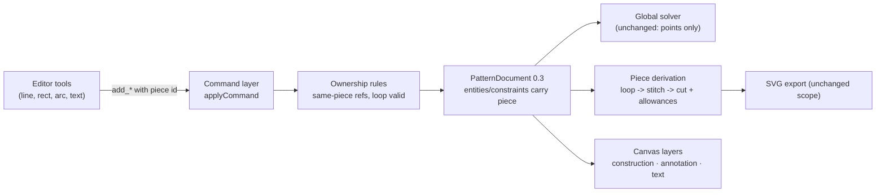

# Piece containers, annotation geometry and annotation text

Status: **ready for implementation** — Q1–Q4 were settled with the maintainer and
are recorded as D12–D15 below.
Builds on: 2026-10-22-pieces-and-allowance, 2026-10-23-pieces-sidebar-and-selection,
2026-10-23-cut-dimension-tool, 2026-10-23-project-save-and-upgrades,
2026-10-23-default-piece-seam-allowance, 006-construction-geometry
Supersedes: the document-level entity model — geometry and constraints now belong
to a piece. Retires the legacy `seams` collection the 0.2 schema reserved for 0.3.

## 📝 TLDR

A **piece becomes the container** for everything drawn on it: points, lines,
curves, arcs, circles, corner rounds, constraints and dimensions. Ownership is a
flat `piece` id on every entity and constraint; there is no document-level
geometry layer. The user creates an **empty piece first**, then sketches inside
it, and the piece's **cut loop is captured automatically** the first time its cut
edges close (with an explicit Set/Clear loop control as the escape hatch).

Geometry gains a **role**: cut (the default), **construction**, or **annotation**.
Annotation geometry is ordinary sketch geometry used as a sewing mark — a rivet
point, a velcro rectangle, a strap outline. It is never a cut edge, never part of
the loop and never exported. A new **text** entity puts a label on the pattern
("velcro", "rivet 2×") with alignment, rotation, an optional leader point and a
fixed italic monospace design token.

The scope stops at the editor: **export is deliberately untouched** in this
change, so annotations and text are canvas-only until the export follow-up.

## 📝 Problem Statement

- **Who needs it:** the maker drafting a pouch front panel who must write down
  where the strap, velcro and rivets go, and who wants the whole panel to move as
  one object instead of dragging points one at a time.
- **What happens today:**
  - Geometry is document-global. `PatternDocument` holds flat `entities` and
    `constraints` (`packages/geometry/src/types.ts:275-291`); a `Piece` is only an
    ordered loop of edge ids plus allowances (`types.ts:163-173`). Nothing records
    which construction line, dimension or annotation belongs to which panel.
  - A piece is created *after* the loop exists, from a selection of edges
    (`frontend/src/lib/pieces.ts:151`, `packages/geometry/src/commands.ts:1878`),
    so the "piece first" workflow cannot be expressed.
  - There is only one non-cut state: `construction: boolean`
    (`types.ts:11-67`). A guide line and a "sew velcro here" mark are the same
    thing, so the canvas cannot style them differently and a future export cannot
    include one and exclude the other.
  - There is no text entity at all: `Entity` is `point | line | curve | circle |
    arc` (`types.ts:69`).
  - A dimension may reference any two points in the document, so a panel's
    dimensions can silently straddle two panels.
  - There is no multi-point translate: the only move command is `move_point`
    (`commands.ts:240`).
- **Constraints:** commands remain the only mutation path (`AGENTS.md` rule 1);
  the geometry package stays pure and framework-agnostic; units are millimetres
  and points stay the only solver variables; coverage stays at 100 % for
  `packages/geometry/src`, `frontend/src` and backend `app/`.
- **Why it is ambiguous:** whether ownership lives on the entity or in nested
  piece arrays; whether the loop is stored or derived; what "move as one" means
  for a piece whose geometry is bound to document-level geometry; and whether
  text is cut-capable. Those were settled in the design discussion — see
  _Resolved decisions_ below.

## 📝 Proposed Solution

### Options considered

| #   | Option                                                                                                                                 | Trade-offs                                                                                                                                                                                                                                                                                 | Verdict                                                                             |
| --- | -------------------------------------------------------------------------------------------------------------------------------------- | ------------------------------------------------------------------------------------------------------------------------------------------------------------------------------------------------------------------------------------------------------------------------------------------ | ----------------------------------------------------------------------------------- |
| A   | **Flat ownership (recommended):** `piece: EntityId` on every entity and constraint, absent meaning nothing (no document layer)         | Keeps ids global, so `getEntity`, the solver, rendering and selection keep working unchanged; ownership becomes a filter used by lifecycle, move and export. Cost: every create command carries the piece id, and every consumer that means "all geometry" must ask per piece                   | **Recommended**                                                                     |
| B   | **Nested ownership:** `Piece.entities` / `Piece.constraints` arrays                                                                     | Expresses the container literally and makes piece files trivial to split later. Cost: every lookup becomes a piece walk, the solver must iterate pieces, and a cross-piece reference has no address — a much larger rewrite for the same behaviour                                         | Rejected for v1                                                                     |
| C   | **Document layer plus derived membership:** keep the flat document, compute a piece's extent from its loop and constraints transitively   | No schema change. Cost: a shared point belongs to two panels, a free annotation belongs to none, and a dimension spanning panels is ambiguous — it fails exactly where the user needs the container                                                                                        | Rejected                                                                            |
| D   | **`kind: 'annotation'` entity family** with a nested shape union                                                                        | Type-safe: an annotation can never be mistaken for a cut edge. Cost: duplicates point resolution, rendering, hit-testing and properties for every shape, and "any sketch can be an annotation" turns into a shape union that grows forever                                                    | Rejected — the role is the concept, not the geometry                                |
| E   | **Store the loop vs derive it from owned edges**                                                                                        | Deriving removes stale state, but a corner round trims both lines and replaces the shared corner with two tangent points plus a derived arc, so endpoint-identity loop discovery (`basicPieceForLoops`, `piece.ts:671`) stops closing. Storing keeps every existing loop consumer working unchanged | **Store, with automatic capture** — see _Cut loop lifecycle_                         |

### Ownership and roles (decision A)

Every entity and constraint names exactly one piece:

```ts
type EntityRole = 'construction' | 'annotation';

interface PointEntity {
  id: EntityId;
  kind: 'point';
  x: number;
  y: number;
  piece: EntityId;
  role?: EntityRole;
  fixed: boolean;
}
interface LineEntity {
  id: EntityId;
  kind: 'line';
  start: EntityId;
  end: EntityId;
  piece: EntityId;
  role?: EntityRole;
}
interface CurveEntity {
  id: EntityId;
  kind: 'curve';
  p0: EntityId;
  p1: EntityId;
  p2: EntityId;
  p3: EntityId;
  piece: EntityId;
  role?: EntityRole;
}
interface ArcEntity {
  id: EntityId;
  kind: 'arc';
  start: EntityId;
  through: EntityId;
  end: EntityId;
  piece: EntityId;
  role?: EntityRole;
}
interface CircleEntity {
  id: EntityId;
  kind: 'circle';
  center: EntityId;
  rim: EntityId;
  piece: EntityId;
  role?: EntityRole;
}
```

- `role` absent means **cut**: the entity is piece-boundary eligible.
- `role: 'construction'` is the old `construction: true`: a guide, never a cut
  edge, dashed and muted on canvas.
- `role: 'annotation'` is a sewing mark: visible like construction geometry but
  styled distinctly (accent colour, dashed) and never a cut edge, never exported.
- Four helpers replace every `entity.construction` read:
  `roleOf(entity)`, `isConstruction(entity)`, `isAnnotation(entity)`,
  `isCut(entity)` (in a new `packages/geometry/src/roles.ts`).
- Constraints carry `piece` too. A constraint may only reference entities of its
  own piece; `add_constraint` and `update_constraint` reject anything else. Cut
  dimensions already carry `piece` (`types.ts:198-209`).

### Cut loop lifecycle

A piece is created **empty** — `create_piece` drops both `edges` and the
allowance preset it used to spread over them. A piece with no loop is a valid,
saveable state: it just cannot take allowances, cut dimensions or export.

- **Automatic capture (frontend).** After a committed batch, if the active piece
  has no loop, the editor computes the piece's owned cut edges and asks
  `basicPieceForLoops(document, ids)` (`piece.ts:671`). When exactly one closed
  chain comes back, the editor dispatches `set_piece_loop` with that ordered
  chain, which also applies the document's default allowance to its edges. The
  geometry stays explicit and undoable; the user never has to press a button in
  the normal flow. Because `basicPieceForLoops` rejects any component with a
  vertex of degree other than two, a chain that is crossed by another line or
  still has a dangling end cannot trigger a capture.
- **Manual capture.** Select any closed chain of cut edges and choose *Set cut
  loop*; the ordered chain comes from the existing `pieceCreationFromSelection`
  walk (`frontend/src/lib/pieces.ts:151`), renamed and scoped to one piece.
- **Clear.** The piece card offers *Clear cut loop*, which emits
  `set_piece_loop` with `edges: []`. The piece survives, its geometry stays owned.
- **Repair.** Editing a loop edge later is allowed: the loop keeps its stored
  order, and the existing loop walk (`walkLoop`, `piece.ts:249`) fills a rounded
  corner. Replacing the loop is the only operation that re-validates the chain.

### Annotation geometry

Annotation is a role, so every existing sketch tool and shape works:

| Use case                       | Geometry                                              | Role          |
| ------------------------------ | ----------------------------------------------------- | ------------- |
| Rivet / snap position          | one `point`                                           | `annotation`  |
| Velcro patch placement         | rectangle: 4 points + 4 lines                         | `annotation`  |
| Strap outline / fold guidance  | line, curve, arc, circle, or a closed chain            | `annotation`  |
| Grainline, centre line         | line                                                  | `construction`|

Annotation points are ordinary solver points and can be dimensioned from the
panel's own geometry (`distance` constraints inside the same piece), which is how
"rivet 20 mm from the seam" is expressed. Annotation geometry is excluded from:

- loop capture and `set_piece_loop` validation,
- allowances and cut dimensions,
- corner rounds (`add_corner_round` rejects an annotation line),
- snapping while drafting (see UI/UX), and
- any future cut export.

### Annotation text

A new `text` entity, always an annotation, anchored to one of the piece's points:

```ts
interface TextEntity {
  id: EntityId;
  kind: 'text';
  piece: EntityId;
  /** The point the label is placed at; must belong to the same piece. */
  anchor: EntityId;
  /** One line, trimmed, 1–120 characters. */
  content: string;
  /** Horizontal anchoring at the anchor point; default `left`. */
  alignment: 'left' | 'center' | 'right';
  /** Radians, counter-clockwise; default 0. */
  rotation: number;
  /** Cap height in millimetres; default 6, range 1–100. */
  fontSize: number;
  /** Optional point the leader line runs to; same piece, not the anchor. */
  leader?: EntityId;
}
```

Text has no `role`: it is annotation by kind. It is not a solver variable; its
anchor and leader points are.

## 📝 Resolved decisions

| #   | Decision                                                                                                                                       |
| --- | ---------------------------------------------------------------------------------------------------------------------------------------------- |
| D1  | Pieces are containers only. No project/document layer and no cross-piece references in this change; shared axes come later.                     |
| D2  | The user creates an empty piece, then sketches. Every entity is created inside the active piece; no orphans exist.                              |
| D3  | Annotation is a role on ordinary geometry, not a new geometry family, so any sketch can be an annotation.                                       |
| D4  | The role can be changed after creation (`set_role`: cut ↔ construction ↔ annotation), so a mistyped line is recoverable.                         |
| D5  | Text is annotation-only for now; "text as a cut/laser shape" is a later, separate tool.                                                         |
| D6  | Text carries alignment, rotation, font size and an optional leader line to a point owned by the same piece.                                     |
| D7  | The font is a design token — IBM Plex Mono Italic with a monospace fallback stack — not a per-text choice.                                      |
| D8  | Deleting a piece cascades to its geometry and constraints, after a confirmation in the UI.                                                      |
| D9  | Holes and multiple loops are out of scope; a piece has at most one loop and a second closed chain is simply owned, not looped.                  |
| D10 | Legacy document compatibility is dropped. Schema 0.3 is the only schema this build reads; the 0.1→0.2 migration and the legacy `seams` field go. |
| D11 | Export is out of scope: the SVG download keeps its current layers and does not yet include annotations or text.                                 |
| D12 | A piece moves by arming the **Move** toggle in its card and dragging; arrow keys nudge 1 mm (Shift 10 mm), with consecutive nudges coalesced into one command. No mode-free interior drag, because it would take the canvas' marquee selection away. |
| D13 | The cut loop is captured **automatically** when exactly one simple closed chain of the piece's cut edges exists; Set/Clear stay available as the escape hatch. `basicPieceForLoops` only accepts components whose every vertex has degree two, so messy geometry cannot trigger a capture. |
| D14 | Annotations are **always visible** on canvas in v1. A visibility toggle ships with the export pass, where "include annotations in the print" needs the same switch. |
| D15 | Deleting a loop edge keeps the piece and leaves its loop broken. Refusing the delete would block ordinary cleanup, and deleting the whole piece would now discard annotations, text and dimensions along with the edge. |

## 📝 Architecture



Takeaway: the solver still solves the whole document; ownership is a grouping
axis used by commands, lifecycle, rendering and movement. Nothing new couples the
pieces at solve time, because no constraint may cross a piece boundary.

### New files

- `packages/geometry/src/roles.ts` — `EntityRole` helpers and the one predicate
  every consumer uses:
  ```ts
  export function isConstruction(entity: { role?: EntityRole }): boolean;
  export function isAnnotation(entity: { kind: Entity['kind']; role?: EntityRole }): boolean; // text is always annotation
  export function isCut(entity: { kind: Entity['kind']; role?: EntityRole }): boolean;
  export function pieceEntities(document: PatternDocument, piece: EntityId): Entity[];
  export function pieceConstraints(document: PatternDocument, piece: EntityId): Constraint[];
  ```
- `packages/geometry/src/text.ts` — pure text layout with no DOM:
  ```ts
  /** Monospace advance as a fraction of font size. */
  export const MONO_ADVANCE_RATIO = 0.6;
  export interface TextLayout {
    /** Rotated box corners, in drawing order, for hit-testing and selection. */
    corners: Vec2[];
    width: number;
    height: number;
    rotation: number;
  }
  /** The label's box at its anchor, or `null` when the anchor is missing. */
  export function textLayout(entity: TextEntity, anchor: Vec2 | null): TextLayout | null;
  /** The leader polyline from the label edge to the leader point, or `null`. */
  export function textLeader(entity: TextEntity, anchor: Vec2 | null, leader: Vec2 | null): Vec2[] | null;
  ```
- `frontend/src/lib/text-tool.ts` — click → `add_text` command with defaults; the
  same file owns the default content/size so canvas and panel agree.
- Tests beside each file.

### Edited modules

**Geometry package**

- `types.ts` — `EntityRole`, `role` replaces `construction`, `piece` on every
  entity and constraint, `TextEntity` joins `Entity`, `Piece.edges` stays but is
  allowed empty, legacy `Seam`/`seamSide`/`PatternDocument.seams` removed,
  `PATTERN_SCHEMA = 'sewcraft.pattern/0.3'`.
- `document.ts` — `cutEdges` and `entityPoints` learn roles and text;
  `documentSeams`/`getSeam`/`seamForEdge` deleted.
- `piece.ts` — `pieceEdges` filters by `isCut`; `validatePiece` gains the
  ownership and role rules; `basicPieceForLoops` filters `isCut`; the legacy
  `pieceForEdge` keeps working through `piece.edges`.
- `commands.ts` — the command surface below, same-piece validation, cascade
  rules, `move_piece`, `set_role`, `set_piece_loop`, `add_text`, `update_text`;
  legacy seam and `add_construction_line`/`set_construction` commands removed.
- `offset.ts` — legacy `seamAllowancePaths`/`documentSeams` path removed; piece
  allowances are the only allowance path.
- `export.ts` — only adapts to roles; the legacy no-piece `renderEntities` path
  and `seamAllowance` option are deleted because a document with entities and no
  pieces is no longer representable. Layer output for pieces is unchanged.
- `migration.ts` — `KNOWN_PATTERN_SCHEMAS = ['sewcraft.pattern/0.3']`;
  `normalizeDocument` returns a 0.3 document untouched and throws a typed
  `UnsupportedPatternSchemaError` otherwise; the 0.1→0.2 conversion is deleted.
- `selection.ts` — text entities hit-test through `textLayout`.
- `index.ts` — export the new types and helpers.

**Frontend**

- `stores/editor.ts` — `activePieceId`, `setActivePiece`, cleared when the piece
  is deleted or a document loads; `dispatchGroup` unchanged.
- `views/EditorView.vue` — active-piece wiring, tool commands pass the piece,
  New piece action, Set/Clear loop actions, move mode, text tool, cross-piece
  guard, unsupported-schema copy.
- `lib/pieces.ts` — `pieceSummaries` reports an incomplete piece (`loop: null`)
  and per-piece entity counts; `pieceCreationFromSelection` becomes
  `loopFromSelection(document, piece, ids)`.
- `lib/editor-tools.ts`, `lib/editor-ribbon.ts`, `lib/ribbon-icons.ts` — a Text
  tool and an Annotation group; New piece replaces Create piece.
- `lib/editor-ribbon.ts:122` — the existing Create piece action becomes **New
  piece** and no longer requires a selection.
- `components/PatternCanvas.vue` — role-driven classes, annotation layer, text
  layer, leader egress, move-mode preview, cross-piece guard feedback, test ids.
- `components/EntityPropertiesPanel.vue` — role select (Cut / Construction /
  Annotation) and, for text, content, alignment, rotation, size, leader picker.
- `components/PiecePanel.vue`, `components/sidebar/*` — incomplete state, Set /
  Clear loop, active-piece highlight, Move toggle.
- `components/UpgradeDocumentDialog.vue` — the "older format" branch is removed;
  the copy covers "this build reads 0.3 only".
- `assets/main.css` — `--annotation` colour and `--font-annotation` tokens.
- Tests beside every file above.

**Docs and contracts**

- `config/geometry.php` — `spec_version` `0.13.0` and the new command list.
- `docs/domain/command-spec.md`, `docs/domain/command-spec.json` — full command
  surface and a "Migration from spec 0.12.0" section describing the break.
- `docs/domain/glossary.md` — Piece (container), Annotation geometry, Annotation
  text, Cut loop unchanged, Construction geometry reworded as a role.
- `docs/architecture/geometry-core.md` — entities, roles, ownership, text.
- `docs/architecture/data-model.md` — schema 0.3, ownership, no legacy seams.
- `docs/architecture/export.md` — annotations/text are not exported yet.
- `BACKWARD_COMPATIBILITY.md` — a dated development-stage exemption: 0.2
  documents are not read, stored projects need recreating, and the protected
  surface returns once the format is standardised.
- `AGENTS.md` — Piece means container; a piece owns its geometry, dimensions and
  annotations.

### Not edited (and why)

- `solver.ts` — the solve stays global and point-based; ownership adds no equation.
- `dimension.ts` rendering/maths — same-piece validation happens in the command
  layer, so the measurement code stays.
- `routes/api.php`, controllers, requests — the API stores the document opaquely;
  only the schema string and command spec change.
- `docs/architecture/api.md` — no route or envelope change.

## 📝 Data Model

`PatternDocument` at `sewcraft.pattern/0.3`:

```ts
interface PatternDocument {
  schema: 'sewcraft.pattern/0.3';
  units: 'mm';
  entities: Entity[];           // each carries piece, point/line/curve/arc/circle/text
  constraints: Constraint[];    // each carries piece
  pieces: Piece[];              // container; edges may be empty
  cornerRounds?: CornerRound[]; // unchanged
  defaults?: PatternDefaults;   // unchanged
}
```

| Field                   | Change                                                                           |
| ----------------------- | -------------------------------------------------------------------------------- |
| `entities[].construction`| **removed**, replaced by `role?: 'construction' \| 'annotation'`                  |
| `entities[].piece`      | **new, required**                                                                 |
| `constraints[].piece`   | **new, required** (already present on `derived_distance`)                         |
| `text` entity           | **new kind**                                                                      |
| `pieces[].edges`        | kept, but may be `[]`; it is the captured loop, not a creation argument           |
| `pieces[].allowances`    | kept                                                                             |
| `seams`                 | **removed** (legacy, reserved for this bump)                                     |
| `schema`                | `sewcraft.pattern/0.2` → `sewcraft.pattern/0.3`                                   |

**No load-time migration.** A stored 0.2 document is not converted: it is
rejected by `normalizeDocument` with `UnsupportedPatternSchemaError`, and the
editor opens it read-only with an "unsupported format" dialog. That is a
deliberate development-stage decision (D10), recorded in
`BACKWARD_COMPATIBILITY.md`; it keeps this change from writing a migration for a
model that is about to be standardised. Existing projects must be recreated.

## 📝 API Contracts

`spec_version` moves to **0.13.0** (breaking). Envelope unchanged:
`{ id, type, params, issuedAt? }`.

### Changed commands

| Command              | Change                                                                                                                | Inverse                                   |
| -------------------- | --------------------------------------------------------------------------------------------------------------------- | ----------------------------------------- |
| `add_point`          | new required `piece`; `construction?: bool` → `role?: 'construction' \| 'annotation'`                                  | `delete_entity`                           |
| `add_line`           | new required `piece`; `construction` → `role`                                                                          | `delete_entity`                           |
| `add_curve`          | new required `piece`; `construction` → `role`                                                                          | `delete_entity`                           |
| `add_arc`            | new required `piece`; `construction` → `role`                                                                          | `delete_entity`                           |
| `add_circle`         | new required `piece`; `construction` → `role`                                                                          | `delete_entity`                           |
| `add_constraint`     | new required `piece`; every referenced entity must belong to it; a `reference` source dimension must too                 | `remove_constraint`                       |
| `create_piece`       | **breaking**: drops `edges` and `allowance`; creates an empty piece named by params                                              | `delete_piece`                            |
| `delete_entity`      | removes the id from any piece loop, deletes text anchored to or leading from it, keeps the piece                        | `null` (journal snapshot)                 |
| `delete_piece`       | **cascade** deletes all owned entities, constraints, texts, rounds and cut dimensions                                  | `null` (journal snapshot)                 |
| `update_constraint`  | anchors must stay inside the constraint's piece                                                                        | previous values                           |
| `set_piece_allowance`| unchanged, but requires the edge to be in the captured loop                                                           | previous value                            |

### New commands

| Command           | Params                                                                                              | Notes                                                                                     | Inverse                         |
| ----------------- | --------------------------------------------------------------------------------------------------- | ----------------------------------------------------------------------------------------- | ------------------------------- |
| `set_piece_loop`  | `piece: entity_id`, `edges: entity_id[]` (empty clears), `allowance?: 'default' \| 'none' \| AllowancePreset` | Validates an ordered closed chain of ≥3 cut line/curve/arc edges owned by the piece; the allowance preset fills edges that have no allowance yet (default `'default'`) | previous `edges`, same id       |
| `set_role`        | `id: entity_id`, `role: 'cut' \| 'construction' \| 'annotation'`                                    | Rejects text, and rejects demoting a cut line that carries a corner round                  | previous role                   |
| `move_piece`      | `id: entity_id`, `dx: number`, `dy: number`                                                         | Translates every point owned by the piece, fixed points included; one undoable step        | same command with `-dx`, `-dy`  |
| `add_text`        | `piece: entity_id`, `anchor: entity_id`, `content: string`, `alignment?`, `rotation?`, `fontSize?`, `leader?: entity_id` | Anchor and leader must be points of the same piece; content trimmed, 1–120 chars           | `delete_entity`                 |
| `update_text`     | `id: entity_id`, `content?`, `anchor?`, `alignment?`, `rotation?`, `fontSize?`, `leader?: entity_id \| null`              | Same-piece validation; `leader: null` removes the leader                                  | `update_text` with old values   |

### Removed commands

`add_construction_line` (use `add_line` with `role: 'construction'`),
`set_construction` (use `set_role`), and the legacy `add_seam_allowance` /
`set_seam_allowance` / `remove_seam_allowance` (piece allowances are the only
allowance path). `docs/domain/command-spec.md` gets one migration section naming
all of them.

### Validation rules

1. Every create names an existing piece; every referenced entity belongs to it.
2. `set_piece_loop` accepts only ≥3 distinct cut line/curve/arc edges, all owned
   by the piece, forming one closed chain (existing `validatePiece` rules minus
   the removed "already in another piece" check, which ownership makes impossible).
3. `set_role` on a line/arc that participates in a corner round is refused
   ("Remove the corner round first"); on a loop edge it is allowed and leaves the
   piece incomplete rather than deleting the loop.
4. `add_corner_round` requires both lines to share a role and rejects annotations.
5. `add_text`/`update_text` require `1 ≤ content.length ≤ 120` after trimming,
   no newlines, `1 ≤ fontSize ≤ 100`, finite `rotation`, and a leader distinct
   from the anchor.
6. `move_piece` refuses non-finite deltas and is a no-op at `(0, 0)`.

## 📝 UI/UX

- **New piece.** The ribbon action creates an empty piece, names it
  `Piece <n>`, marks it active and focuses the canvas with a hint: "Draw a closed
  chain to give this piece its cut loop." No selection is required.
- **Active piece.** Shown as a highlighted row in the Pieces drawer and as a
  compact badge in the canvas corner ("Piece 1 · no cut loop"). Clicking a
  different piece's geometry with no tool armed activates that piece. With a
  drafting tool armed, clicking another piece's geometry is refused with a hint
  ("Switch to Piece 2 to edit it"), so a line can never span containers.
- **Loop capture.** After the closing segment commits, the piece card flips from
  "No cut loop" to its finished/cut sizes. *Set cut loop* (from a selection) and
  *Clear cut loop* live in the piece card; both emit `set_piece_loop`.
- **Move.** With a piece active, the piece card's **Move** toggle arms a move
  gesture: drag anywhere on the canvas to translate the whole piece, with a live
  preview; the command is dispatched once on release, so one undo restores it.
  Escape, a tool change or selecting another piece exits the mode. With a piece
  active and no tool armed, arrow keys nudge it by 1 mm (Shift: 10 mm);
  consecutive nudges within 300 ms coalesce into one `move_piece`, so undo still
  steps back the whole adjustment.
- **Roles.** The properties panel offers Cut / Construction / Annotation for any
  non-text entity; canvas styling follows: cut = foreground solid, construction =
  muted dashed, annotation = `--annotation` dashed with a hollow handle.
- **Annotation text tool.** In the ribbon's Annotation group. Click places a
  label at the clicked point with content `Text`, alignment `left`, size 6 mm and
  the anchor point created/reused; the properties panel opens with the content
  field focused. The label renders italic monospace in the annotation colour; the
  leader is a thin dashed line from the anchor to the leader point.
- **Snapping.** Drafting snaps ignore annotation geometry and annotation points,
  so a piece loop can never be built onto a sewing mark; annotation points remain
  selectable and dimensionable.
- **Empty and incomplete states.** A piece with no loop shows "No cut loop"
  instead of sizes, and its allowance rows are disabled with the existing
  explanatory tone. A loop with a deleted edge shows "Cut loop broken · repair or
  clear".
- **Accessibility.** The role select and text fields are labelled; canvas text is
  SVG `<text>` with `aria-hidden` (the same convention as dimension labels), and
  the piece badge is a live region announcement on activation.
- **Test ids.** `active-piece-badge`, `piece-loop-state`, `piece-move-toggle`,
  `annotation-layer`, `text-layer`, `text-<id>`, `text-leader-<id>`,
  `new-piece-action`, `set-cut-loop`, `clear-cut-loop`.
- **Mockup.** `.ai/specs/assets/piece-containers/mockup-01-annotations.html`
  shows a panel with the three roles, a velcro rectangle, a rivet point, a label
  with a leader, the active-piece badge and the Move control.

## 📝 Edge Cases & Failure Scenarios

| Scenario                                                        | Expected behaviour                                                                                                                   |
| --------------------------------------------------------------- | ------------------------------------------------------------------------------------------------------------------------------------ |
| New piece created, nothing drawn                                | Valid; saves; shows "No cut loop"; allowance rows disabled                                                                           |
| First closed chain closes                                       | Loop captured automatically as one `set_piece_loop`; undo removes the loop, not the edges                                            |
| A second closed chain is drawn in the same piece                | Left as owned geometry; the loop is unchanged; no error (holes are out of scope)                                                     |
| Two closed chains exist when the piece is still loop-less       | No auto-capture (ambiguous); the card offers Set cut loop from a selection                                                           |
| Loop edge deleted                                               | Edge and its dependants go; the id leaves `pieces[].edges`; the piece reports a broken loop, it is not deleted                        |
| Loop point deleted                                              | Edges referencing it stay dangling and are skipped by rendering; the piece reports a broken loop                                     |
| `set_role` on a loop edge                                       | Allowed; the loop is kept as stored, so the piece reports a broken loop until repaired or cleared                                     |
| `set_role` on a rounded line                                    | Refused: "Remove the corner round first"                                                                                              |
| `add_corner_round` on annotation lines                          | Refused: "Annotation geometry cannot be rounded"                                                                                     |
| Constraint picking across pieces                                | Anchor rejected with "That point belongs to Piece 2"                                                                                 |
| `move_piece` on a piece with a broken loop                      | Allowed; points translate, the loop stays broken                                                                                      |
| `move_piece` with constraints                                  | Safe: lengths, angles, horizontal/vertical are translation-invariant; no anchor references world coordinates                           |
| Arrow-key nudge while a text field is focused                  | Ignored: the canvas shortcut only fires when focus is not in an input or select                                                       |
| Text anchor deleted                                             | Text is deleted with the point (dangling label never renders)                                                                         |
| Text leader deleted                                             | Text stays; the leader is removed (`leader` cleared via the same cascade)                                                             |
| Deleting a piece with the active-piece badge showing            | Cascade runs after the confirmation; active piece clears; selection clears                                                            |
| Piece with `quantity > 1` and annotations                       | Unchanged: quantity is cut count only; annotations are per piece, not per cut copy                                                     |
| A 0.2 document is opened                                        | Refused with the unsupported-format dialog naming the stored schema; never migrated or overwritten                                    |
| Agent emits a create without `piece`                            | Rejected by command validation with a message naming the missing param                                                                |
| Annotation point used in a dimension                            | Allowed if the dimension is in the same piece; drives the solver exactly like any other point                                          |
| Annotation geometry in export                                   | Not exported; the current cut/stitch/fold layers are unchanged                                                                        |

## 📝 Risks & Impact Review

- **Schema and command break (high, accepted).** Every stored pattern and every
  command payload changes shape. With no users beyond the maintainer this is the
  cheap moment to do it, but it is irreversible for existing projects: they must
  be recreated. Recorded as a dated exemption in `BACKWARD_COMPATIBILITY.md`;
  `spec_version` 0.13.0 and the migration section make the break explicit.
- **Sweeping test churn (medium).** Every geometry test constructs entities
  without `piece`; all fixtures need a piece and a role audit. This is mechanical
  but touches ~20 files. A shared `pieceDocument()` test helper keeps it small.
- **Automatic loop capture can surprise (medium).** A user chaining unrelated cut
  edges inside a loop-less piece may get a loop they did not intend. Mitigations:
  capture only when exactly one closed chain exists, keep the loop as an explicit
  `set_piece_loop` in the journal, and offer Clear. A second capture never
  replaces an existing loop.
- **Corner rounds vs derived discovery (already mitigated).** Storing the loop is
  what keeps rounds working; the cost is that an explicitly edited loop can go
  stale, which the broken-loop state surfaces instead of failing silently.
- **Text metrics are approximate (low).** Width comes from
  `MONO_ADVANCE_RATIO` rather than DOM measurement, so the selection box can be a
  few percent off from the rendered glyphs. Rendering and hit-testing use the
  same estimate so the hit area always matches what is drawn.
- **Bundled font is not added (low).** IBM Plex Mono is not shipped in v1; the
  token falls back to the platform monospace. Print fidelity is revisited with
  the export follow-up.
- **Move semantics are safe but only because constraints stay local (low).**
  Translation-invariance holds for the current constraint set. A future
  world-anchored constraint (fixed to origin, or a project axis) would need
  `move_piece` to refuse or re-solve; the command should document that.
- **Annotation snapping rule could annoy (low).** Excluding annotations from
  snapping prevents marking a rivet exactly on a seam intersection while
  drafting. Annotation points stay dimensionable, and a "snap to annotations"
  toggle is a cheap follow-up.
- **Export gap (product risk, medium).** The stated goal — print with annotations,
  laser without — is not delivered here; v1 shows the marks on canvas only. This
  is deliberate scope control, but the feature is not useful for printing until
  the export pass lands.
- **Coverage (low).** New logic is pure (roles, text layout, loop capture) and
  the guards above are each a test; the 100 % gate stays reachable without
  ignore comments.

## ✅ Resolved assumptions (autonomous defaults)

| #   | Assumption                                                                                                       | Why                                                                                                       | Status     |
| --- | ---------------------------------------------------------------------------------------------------------------- | --------------------------------------------------------------------------------------------------------- | ---------- |
| R1  | `role` replaces `construction` instead of living beside it                                                       | Two flags would allow contradictory states; a single enum is the same read cost at every call site        | Reversible |
| R2  | Ownership is a required `piece` field, not an optional one                                                       | "No document layer" is only true if it is impossible to create an orphan                                  | Reversible |
| R3  | The loop stays stored (`pieces[].edges`) and may be empty                                                        | Corner rounds break endpoint-based discovery; every existing loop consumer keeps working                   | Reversible |
| R4  | Auto-capture runs in the frontend as an explicit `set_piece_loop` command                                        | Keeps the geometry package free of implicit document mutations and makes the step undoable and auditable   | Reversible |
| R5  | Constraints may only reference their own piece; no `piece` in `CutAnchor` is needed because it is piece-scoped     | Ownership already scopes it; adding another field would duplicate the source of truth                      | Reversible |
| R6  | Annotation points are solver variables, dimensionable like any other point                                       | Locating a rivet requires driving its position from the panel's geometry                                   | Reversible |
| R7  | Text is single-line, capped at 120 characters                                                                    | Multi-line text needs wrapping, baseline layout and a bigger editor; one line covers labels                | Reversible |
| R8  | Text uses `MONO_ADVANCE_RATIO = 0.6` for width                                                                   | Deterministic and testable without DOM measurement; matches the monospace token closely enough for a box    | Reversible |
| R9  | Default text size is 6 mm, alignment `left`, rotation 0, no leader                                                | Fits a typical 1–2 cm label inside a panel and keeps first placement predictable                          | Reversible |
| R10 | The Move gesture dispatches one `move_piece` on release                                                           | One command per gesture keeps the journal readable and undo one step                                       | Reversible |
| R11 | Annotation and text are excluded from the SVG export in this change                                              | Export was explicitly out of scope; half-adding a layer without a print preset risks a misleading download | Reversible |
| R12 | Legacy seam commands and the `seams` field are removed with the same bump                                        | 0.3 was already reserved for exactly this; keeping dead code would force a second, larger break later        | Reversible |
| R13 | 0.2 documents are rejected rather than migrated                                                                  | The maintainer is the only user; a migration would encode a model that is still moving                     | Reversible |

## 📋 Phasing

- **Phase 1 — Document model.** Schema 0.3: ownership, roles, text entity, legacy
  seam removal, migration deletion, command surface and validation, plus the
  geometry test fixture sweep and command-core docs. Nothing in the UI yet.
- **Phase 2 — Piece lifecycle commands.** `set_piece_loop`, loop capture/repair
  rules, cascade delete, `move_piece`, `set_role`, text CRUD — all unit-tested in
  the geometry package.
- **Phase 3 — Data layer.** Store `activePieceId`, tools pass the piece, text
  tool and layout helper, loop auto-capture after a batch, cross-piece guard.
- **Phase 4 — Canvas.** Role styling, annotation geometry and text layers, leader,
  move-mode preview and arrow-key nudging.
- **Phase 5 — Panels.** Piece card incomplete/broken states, Set/Clear loop,
  Move toggle, active highlight; properties panel role select and text editor;
  ribbon Text tool and New piece action.
- **Phase 6 — Consolidation.** Command spec trio, docs, `BACKWARD_COMPATIBILITY`
  exemption, mockup, full gate and a manual pass.

Each phase leaves the app working: Phase 1 is a coherent new document shape with
existing tools updated in the same phase, Phase 2 adds commands no UI calls yet,
Phase 3–5 switch the editor one surface at a time, and Phase 6 closes the
contracts.

## 📋 Implementation Plan

### Phase 1 — Document model

1. `types.ts`: add `EntityRole`, replace `construction` with `role` on point,
   line, curve, arc and circle; add `piece` to every entity and constraint; add
   `TextEntity` to `Entity`; remove `Seam`/`SeamSide`/`seamSide` and
   `PatternDocument.seams`; set `PATTERN_SCHEMA = 'sewcraft.pattern/0.3'`.
2. Add `roles.ts` with `roleOf`, `isConstruction`, `isAnnotation`, `isCut`,
   `pieceEntities`, `pieceConstraints`, and one test per role combination
   including text.
3. Add `text.ts` with `MONO_ADVANCE_RATIO`, `textLayout`, `textLeader`; tests for
   each alignment, rotation, leader and the 1–100 mm size range.
4. Update `document.ts` (`entityPoints`, `cutEdges`), `piece.ts`
   (`pieceEdges`, `validatePiece`, `basicPieceForLoops`), `selection.ts` (text),
   `offset.ts` and `export.ts` for roles and text; delete `documentSeams`,
   `getSeam`, `seamForEdge` and the legacy export paths with their tests.
5. `migration.ts`: return 0.3 untouched, throw `UnsupportedPatternSchemaError`
   otherwise; delete the 0.1 conversion and its fixtures/tests.
6. Rewrite the command surface in `commands.ts`: `piece` + `role` params, text
   commands, same-piece validation, removed legacy commands; update
   `index.ts` exports.
7. Update every geometry test fixture with a `piece` and role; keep selected
   tests for each new rejection message.

### Phase 2 — Piece lifecycle commands

1. `create_piece` creates an empty piece; `set_piece_loop` validates and stores a
   loop (or clears it) and applies its allowance preset to edges without one; tests
   for empty, valid, reversed, broken, annotation, construction, circle, foreign
   and duplicate-edge inputs.
2. `delete_entity` clears the id from loops and deletes anchored text; test that
   the piece survives and reports a broken loop.
3. `delete_piece` cascades entities, constraints, texts, rounds and cut
   dimensions; test that another piece is untouched.
4. `move_piece` translates owned points including fixed ones, returns the exact
   inverse, refuses non-finite deltas and no-ops on zero; test with a constraint
   set to prove translation invariance.
5. `set_role` toggles cut/construction/annotation, refuses text and rounded
   lines, and updates the inverse correctly.

### Phase 3 — Data layer

1. Add `activePieceId`/`setActivePiece` to the editor store with tests for
   activation, deletion and document load.
2. Update the line, rectangle, arc, circle and constraint builders to pass the
   active piece; test that a batch fails when the active piece is missing.
3. Add `text-tool.ts` (click → `add_text` with defaults) and wire
   `update_text` editing through the properties panel.
4. Add loop auto-capture after a committed batch: compute owned cut edges, call
   `basicPieceForLoops`, dispatch one `set_piece_loop` when exactly one chain
   exists; tests for closed, open, ambiguous and already-looped pieces.
5. Add the cross-piece guard to picking and snapping; tests for refused picks
   and allowed same-piece picks.

### Phase 4 — Canvas

1. Render roles with the `--annotation` styling and add annotation/text test ids;
   test construction, annotation and cut classification.
2. Render text with rotation, alignment, leader and the font token; test the
   transform and leader geometry against `textLayout`/`textLeader`.
3. Add move mode: preview translation on drag, one `move_piece` on release,
   Escape/tool-change cancellation; test the single journal entry and undo.
4. Add arrow-key nudging (1 mm, Shift 10 mm) with the 300 ms coalescing window,
   plus its guard for focused inputs; test one journal entry per burst.

### Phase 5 — Panels

1. Piece card: incomplete and broken loop states, Set loop (from selection),
   Clear loop, Move toggle, active highlight; tests for each state and action.
2. Ribbon: New piece (no selection requirement) and the Text tool with its icon;
   update ribbon/icon tests.
3. Properties panel: role select and the text fields (content, alignment,
   rotation, size, leader pick); tests for each edit dispatch and validation.
4. Unsupported-schema dialog copy and test; remove the older-format upgrade path.

### Phase 6 — Consolidation

1. Sync `config/geometry.php`, `docs/domain/command-spec.md` and
   `docs/domain/command-spec.json` at `spec_version` 0.13.0, including the
   migration section and the removed commands.
2. Update the glossary, geometry-core, data-model, export and AGENTS docs; add
   the `BACKWARD_COMPATIBILITY.md` development-stage exemption.
3. Commit the mockup under `.ai/specs/assets/piece-containers/`.
4. Run `npm run format`, `npm run typecheck`, `npm run lint`,
   `npm run format:check`, `npm run test:coverage` (100 % for
   `packages/geometry/src` and `frontend/src`), `npm run build`, and the backend
   `artisan test --coverage --min=100` command from `AGENTS.md`.
5. Manual pass in the running app: create two pieces, sketch and close a loop on
   each, add construction and annotation geometry, place a rivet point and a
   velcro rectangle, add a labelled text with a leader, dimension a rivet from
   the seam, add allowances, move a piece, delete a loop edge and repair it, then
   verify undo/redo and that export still produces the current layers.
