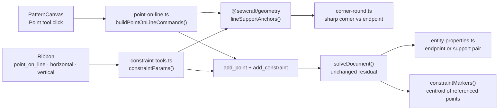

# Direction constraints on rounded-corner lines

Status: draft — design review (autonomous defaults; no ⚠ items). This PR ships
the design only; the implementation plan below is for its follow-on PR.
Pattern schema: unchanged
Command spec: unchanged
Geometry package: 0.14.0 (additive `lineEndpointAnchor` and `lineSupportAnchors`)
Amends: `.ai/specs/2026-10-24-point-on-line.md` (its click-on-a-line rule) for rounded lines
Related: `.ai/specs/2026-10-20-corner-rounding-tool.md` (the sharp corner stays
the authored handle), `.ai/specs/2026-10-19-constraint-tools-ribbon.md` (the
constraint pick workflow)

## 📝 TLDR

A maker who rounds a corner and then places a point on one of the trimmed lines
gets `This point is derived by a corner round; edit the radius.` instead of a
constrained point. The Point tool builds `point_on_line` from the line's current
endpoints, and a round has replaced one of them with a derived tangent. The same
wall stops the Point-on-line, Horizontal and Vertical constraint tools when the
picked line is rounded. Proposed future behaviour: direction constraints
reference the authored points that define the line's supporting line — the sharp
corner in place of a tangent, otherwise the endpoint — so a rounded line behaves
like any other line, constraints created before a round keep working, and
removing the round leaves them alone.

## 📝 Problem Statement

- **Who needs it:** the maker who rounds a corner for a seam and then continues
  drafting on one of the two trimmed lines — adding a notch, a seam reference, or
  a point to measure from — and expects the new point to belong to that line.
- **What happens today:** `add_corner_round` re-points both selected lines from
  the sharp corner to their derived tangent points
  (`packages/geometry/src/commands.ts:1748-1757`). The Point tool then builds
  `point_on_line` from `line.start` and `line.end`
  (`frontend/src/lib/point-on-line.ts:45`), and the constraint ribbon does the
  same for a line pick (`frontend/src/lib/constraint-tools.ts:187`). Every
  referenced point must pass `requireDraftingPoint`
  (`packages/geometry/src/commands.ts:574-587`), which rejects corner-round
  derived ids (`:1092-1093`). The two-command batch rolls back, so no point is
  created and the canvas shows the corner-round message.
- **The inspector has the mirror problem.** A constraint that already existed
  before the round still references the sharp corner and the far anchor, but the
  line now stores two different endpoint ids. `constraintActsOnEntity` compares
  the constraint's point pair with the line's current endpoints, so the
  constraint disappears from that line's properties after the round
  (`frontend/src/lib/entity-properties.ts:266`).
- **Evidence it matters:** the failure is silent in geometry terms — the click is
  correct, the projection is correct, and the constraint the user asked for is
  exactly the one the model supports. It is blocked only by which authored point
  instance the two references name. The corner-round spec already expects
  constraints on the sharp corner to keep working
  (`.ai/specs/2026-10-20-corner-rounding-tool.md`, Q2 and its risks section), and
  the point-on-line spec assumed `[point, line.start, line.end]` before rounded
  lines were considered (`.ai/specs/2026-10-24-point-on-line.md`, UI/UX §3).
- **Constraints:** commands remain the only mutation path; `@sewcraft/geometry`
  stays pure; no command, schema, HTTP or solver change is needed; every new
  branch needs a test to hold the 100 % coverage gate.

## 📝 Proposed Solution

### The rule

For a line whose end has been trimmed by a corner round, its **support anchor**
is the authored point that end still lies on:

- a current endpoint that is a round tangent maps to that round's sharp corner;
- any other endpoint is its own anchor.

The sharp corner, the tangent and the line's other anchor are collinear by
construction — the tangent is placed along the corner-to-anchor ray — so naming
the corner instead of the tangent describes the same supporting line. This is
also exactly what a constraint created **before** a round already references,
which is why it survives the round unchanged.

### Where it applies

A new pure geometry helper supplies the rule to every consumer:

```ts
lineEndpointAnchor(document, lineId, endpoint: EntityId): EntityId
lineSupportAnchors(document, lineId): { start: EntityId; end: EntityId } | null
```

`lineEndpointAnchor` is a pure id mapping: it returns the matching round's sharp
corner or the endpoint unchanged, and does not re-validate the document.
`lineSupportAnchors` is the validating pair helper: it returns `null` when the id
is not a line or either current endpoint is no longer a point. The two callers
that already hold a line endpoint (the round preview and `add_corner_round`) use
the singular form; the constraint builders and the inspector use the pair form.

- **Point tool** — `buildPointOnLineCommands` keeps projecting onto the trimmed
  segment from `lineEndpoints`, but writes
  `[newPoint, anchors.start, anchors.end]` into `add_constraint`. Clicking a
  rounded line now creates the point and constraint as one journal entry.
- **Constraint ribbon** — `constraintParams` maps a line pick to the support
  anchors for `point_on_line`, `horizontal` and `vertical`. Those three are
  direction relations: the angle between the two named points is the angle of
  the visible line. `distance` and `equal` keep the raw endpoints because they
  measure length, and mapping them to the sharp corners would compare the
  **untrimmed** line; they stay rejected on rounded lines.
- **Inspector** — `constraintActsOnEntity` accepts either the line's current
  endpoint pair or its support-anchor pair for those three direction types. This
  restores constraints created before a round as well as showing the new ones.
- **One rule, not three copies** — `originalAnchor` in
  `packages/geometry/src/commands.ts:1612-1617` and `anchorOf` in
  `frontend/src/lib/corner-round.ts:58-64` already implement the singular
  mapping. Both delegate to the exported helper instead of keeping a private
  copy. This is an enabling refactor inside the same capability, not a separate
  behavior change.

### Alternatives considered

| #   | Option                                                                                                                                                                                  | Trade-offs                                                                                                                                                                                                                                                                                                                         | Verdict                                                                                                          |
| --- | --------------------------------------------------------------------------------------------------------------------------------------------------------------------------------------- | ------------------------------------------------------------------------------------------------------------------------------------------------------------------------------------------------------------------------------------------------------------------------------------------------------------------------------------ | ---------------------------------------------------------------------------------------------------------------- |
| A   | **Support anchors (recommended):** build direction constraints from the authored points behind the trimmed endpoints                                                                     | No command validation change; the constraint references ids that survive `remove_corner_round`, so removal and undo leave it untouched; matches constraints that predate the round. Cost: a rounded line's `point_on_line` names the sharp corner rather than the line's visible endpoint pair, so the inspector needs the extra pair match. | **Recommended**                                                                                                  |
| B   | **Relax `add_constraint`:** allow derived fixed points as the `a`/`b` reference of `point_on_line`, `horizontal` and `vertical`                                                         | Smallest immediate change: the existing builders already pass `line.start`/`line.end`. Cost: the constraint then names ids that `remove_corner_round` deletes, so removal would have to rewrite or drop it; a rewrite to the corner still leaves undo restoring a different point instance than the original, and the "derived points are not drafting handles" rule is weakened. | Rejected — buys one line of validation relief with a cascade and undo asymmetry.                                |
| C   | **Anchor the constraint to the line entity:** a `point_on_line` that names `lineId` instead of two points, like a line-anchored dimension                                          | The cleanest long-term model, since the relation is with the edge. Cost: command payload, schema, solver residual, migration, command-spec sync and every consumer of the current three-id tuple — a contract change far larger than the defect.                                                                                       | Rejected for this slice; a candidate for a future constraint-model spec.                                        |
| D   | **Do nothing:** require the user to delete the round, constrain the point, and re-round the corner                                                                                      | No work. Cost: the obvious drafting order (round the seam, then place the notch) is the one that fails; the workaround also destroys and rebuilds the radius and any other geometry on that corner.                                                                                                                                   | Rejected — this is the state the report describes.                                                               |

## 📝 Architecture



Takeaway: both creation paths resolve the same authored anchors through one
geometry helper, while the solver, commands and stored document shape are
unchanged. The inspector reads the same helper to relate a stored constraint to
its rounded line.

The helper lives in `packages/geometry/src/corner-round.ts` because it is pure
corner-round knowledge; it is re-exported through `index.ts`. `lineEndpoints`
stays the source of geometric truth for projection, hit testing and dimensions —
support anchors are about **naming authored geometry**, not about moving it.

## 📝 Data Model

None. `point_on_line`, `horizontal` and `vertical` keep their existing fields and
arity. The only change is which authored point ids a constraint built from a
rounded line stores. Existing documents keep loading unchanged; their
constraints already point at the sharp corner when they predate a round.

## 📝 API Contracts

No command, HTTP or stored-schema change. The geometry package gains two additive
named exports, `lineEndpointAnchor` and `lineSupportAnchors`, and moves to
**0.14.0** per the package's additive-export convention. No existing signature or
behavior changes; the two private copies being replaced have identical behavior.

## 📝 UI/UX

No new screen, control, hint or cursor. The Point tool's existing line hover,
projection ghost and status hint already appear over a rounded line, and now the
click succeeds where it previously raised an error banner. The constraint ribbon
keeps its existing pick rules, including the `distinct` rejection when the picked
point is already one of the line's anchors; that rejection is a no-op guard, not
the rounded-line defect. The constraint marker keeps the existing rule — the
centroid of its referenced points — so on a heavily trimmed line the icon may sit
on the trimmed-away part of the supporting line; it is a status glyph, not a
handle, and the constraints drawer remains the durable record.

No mockup: the change makes an existing pointer gesture succeed, with no new
visual state to design.

## 📝 Edge Cases & Failure Scenarios

| Scenario                                                                  | Expected behaviour                                                                                                                                                           |
| ------------------------------------------------------------------------- | ---------------------------------------------------------------------------------------------------------------------------------------------------------------------------- |
| Click a rounded line with the Point tool at the clicked end               | The point lands at the projection and `point_on_line` names the sharp corner and the far anchor; one journal entry, one undo                                                |
| Click a line rounded at both ends                                          | Both anchors are the two sharp corners; the point lands on the visible trimmed segment and the constraint is equivalent                                                      |
| Click a line rounded at the opposite end only                             | The clicked end maps to itself and the rounded end maps to its corner; no visible change from today                                                                          |
| Click a plain line                                                        | Behaviour unchanged — the anchors are the endpoints, so the stored constraint is byte-identical to today's                                                                   |
| Pick a rounded line for `horizontal` or `vertical`                        | Ready and applied against the support anchors; the visible line stays horizontal or vertical as the round regenerates                                                       |
| Pick a rounded line for `point_on_line`                                   | Ready and applied; same semantics as the Point-tool click                                                                                                                    |
| Pick the sharp corner itself as the constrained point, then its line      | `hasDistinctPoints` rejects the tuple as `distinct` — the corner is already on the line, so this is a no-op, not an error to fix                                             |
| Pick a rounded line for `equal` or a two-point `distance`                 | Unchanged — those relations measure length, so the trimmed endpoints remain the correct reference and the command's drafting rule still rejects them; documented out of scope |
| Constraint created before the round, then the corner is rounded           | The inspector now keeps listing it on the line through the support-anchor pair, and the constraint stays satisfied because the corner did not move                           |
| Radius changed on the round                                               | Regeneration moves the tangent along the same support line; the constraint stays satisfied                                                                                   |
| Round removed                                                             | The line returns to the sharp corner; the constraint still references the corner and the far anchor, so it stays valid and undo does not rewrite it                          |
| Unresolvable line or missing endpoint when the helper runs                | `lineSupportAnchors` returns `null`; the builder dispatches nothing and the ribbon reports its existing rejection, rather than sending dangling ids                           |
| Two point picks instead of a line pick                                    | Unchanged; a derived tangent used as a point reference is still rejected as a drafting handle                                                                                |
| Marker position on a heavily trimmed line                                 | Accepted as today's centroid rule; the constraint still resolves, and a marker-placement refinement is a separate cosmetic follow-up                                        |

## 📝 Risks & Impact Review

- **Stored reference semantics (medium, reversible).** Constraints built from a
  rounded line now name the sharp corner instead of the tangent. That is the
  same shape documents already carry after a round, but any future code that
  assumes `point_on_line.a`/`b` equal the line's current endpoints must use the
  support helper. The blast radius is limited to the three direction types, and
  the geometry helper is the single rule. Rollback is deleting the helper use and
  restoring the raw endpoint ids; no stored document is migrated.
- **Inspector matching (low).** Matching both pairs could make one constraint
  appear on a line it merely shares a point with in an exotic topology. The
  support pair is line-specific by construction, and the exact current-endpoint
  match still wins; the existing "only its own segment" rule is preserved for
  every other constraint type.
- **Marker placement (low, cosmetic).** With a large radius the sharp corner can
  be far from the visible trimmed line, so the centroid marker can drift onto the
  trimmed-away support line. The constraint is correct; the drawer is the durable
  record. A follow-up can anchor the marker to the trimmed segment if the drift
  proves confusing.
- **Length relations remain unsupported (low, deliberate).** `equal` and
  two-point `distance` on a rounded line still reject. Mapping them to the
  corners would silently compare untrimmed lengths, which is worse than a clear
  rejection; making them measure the trimmed geometry needs a different
  constraint shape and is out of scope.
- **Public API addition (low).** Two additive geometry exports move the package
  to 0.14.0. No existing export changes, so frontend and tests keep compiling;
  coverage must include every new branch (`null` line, missing endpoint, one-end
  and two-end mappings).
- **Coverage (medium).** The helper, both creation paths and the inspector
  branch each add a branch. Tests must exercise the plain, one-end rounded and
  both-ends rounded cases, plus the `null` guards, to hold the 100 % gate.
- **Delivery (low).** This PR is design-only and `skip-qa`; the implementation
  follows on its own PR via `om-auto-implement-spec`, where the interaction is
  user-facing and needs QA.

## 🧭 Resolved assumptions (autonomous defaults)

| #   | Assumption                                                                                                                                                                | Why                                                                                                                                                | Reversible? |
| --- | ------------------------------------------------------------------------------------------------------------------------------------------------------------------------- | -------------------------------------------------------------------------------------------------------------------------------------------------- | ----------- |
| R1  | Direction constraints reference the authored support anchors, not the derived tangents (option A)                                                                         | Authored ids survive round removal and undo; it is the same shape a pre-round constraint already has; no command validation is weakened.            | Yes         |
| R2  | `point_on_line`, `horizontal` and `vertical` are in scope; `distance` and `equal` keep raw endpoints and stay rejected on rounded lines                                    | The three are direction relations, so the support line is exactly the same relation; the two length relations would change meaning. Confirmed by the requester to include `horizontal`/`vertical`. | Yes         |
| R3  | `lineEndpointAnchor` and `lineSupportAnchors` live in `corner-round.ts` and replace the private copies in `commands.ts` and `frontend/src/lib/corner-round.ts`              | One rule for the same trim mapping; the geometry package already owns corner-round knowledge and both existing copies are identical.                | Yes         |
| R4  | `lineSupportAnchors` returns `null` for an unresolvable line or a non-point endpoint; callers treat that as "nothing to build"                                             | Keeps the helper total and its contract unit-testable without defensive code at every call site.                                                    | Yes         |
| R5  | The constraint marker keeps the existing centroid rule; no canvas or inspector styling changes                                                                             | Keeps the slice focused on the broken relation; the icon remains a status glyph and the drawer is the durable record.                               | Yes         |
| R6  | No schema, command, solver, HTTP API or database change; the geometry package moves to 0.14.0 for the additive exports                                                     | Everything needed already exists; the defect is which authored ids are named, not a missing capability.                                             | Yes         |
| R7  | This PR ships the design only; the implementation plan is the brief for the follow-on implementation PR, which carries QA                                                                                     | Per the requester's "create spec PR". The design-only PR changes no runtime behavior, so it carries `skip-qa`; the implementation touches user-facing interaction and needs QA.                                        | Yes         |

## 📋 Phasing

- **Phase 1 — the rule and its callers.** Add the geometry helper, unit-test the
  mapping, and delegate the two private copies to it. No behavior change yet.
- **Phase 2 — create the constraints.** Use the helper in the Point-tool builder
  and the constraint ribbon; update their unit and editor tests.
- **Phase 3 — keep the inspector honest.** Match direction constraints against
  the support pair, update the geometry docs, run the full gate and mark the spec
  implemented.

## 📋 Implementation Plan

1. **Add `lineEndpointAnchor` and `lineSupportAnchors` to
   `packages/geometry/src/corner-round.ts`.** The singular helper finds the round
   whose `end.line` is the line and whose `end.tangent` is the endpoint and
   returns `end.corner`, otherwise the endpoint. The pair helper resolves the
   line, returns `null` when it is missing or either endpoint is not a point, and
   otherwise maps both ends. Add unit tests for a plain line, a round at one end,
   rounds at both ends and both `null` guards; also assert that the mapped pair,
   the trimmed endpoint pair and the sharp corners stay collinear, so the design's
   core claim is tested rather than assumed. Confirm the additive exports pass
   the package's 100 % coverage.
2. **Delegate the private copies.** Replace `originalAnchor` in
   `packages/geometry/src/commands.ts` and `anchorOf` in
   `frontend/src/lib/corner-round.ts` with the exported helper. Behavior must be
   identical; the existing corner-round preview and command tests are the
   regression check. Bump `packages/geometry/package.json` to 0.14.0.
3. **Fix the Point tool.** In `frontend/src/lib/point-on-line.ts`, keep
   `lineEndpoints` for the projection but use `lineSupportAnchors` for the
   constraint's `a`/`b`, returning `null` when the anchors do not resolve.
   Unit-test the plain line (unchanged ids), a rounded line and the `null` case;
   add an EditorView test that clicks a rounded line and asserts the point,
   constraint references and one-entry journal with no error banner. Add a
   command-level regression test that applies the batch to a rounded document,
   then removes the round, undoes the removal and changes the radius, asserting
   the constraint stays present and satisfied each time.
4. **Fix the constraint ribbon.** In `frontend/src/lib/constraint-tools.ts`, map
   a line pick to the support anchors for `point_on_line`, `horizontal` and
   `vertical`; leave `distance` and `equal` on `line.start`/`line.end`. Unit-test
   a rounded line for one of each direction type and confirm `equal` keeps the
   raw endpoints; add one editor test for a rounded line if the existing ribbon
   coverage does not reach it.
5. **Fix the inspector.** Pass the document into `constraintActsOnEntity` (or
   resolve the support pair in `entityProperties`) and match `point_on_line`,
   `horizontal` and `vertical` against either the endpoint pair or the support
   pair. Unit-test a constraint created before a round and one created after it,
   and confirm an unrelated line still does not list it.
6. **Document and verify (in the follow-on implementation PR).** Add the two
   helpers and the rounded-line reference rule to
   `docs/architecture/geometry-core.md`, run the repository gate
   (`npm run format`, `typecheck`, `lint`, `format:check`, `test:coverage`,
   `build`), update this spec's status to implemented and tick the acceptance
   criteria. No Docker checks are needed: the slice touches frontend and geometry
   only.

## ✅ Acceptance criteria

- [ ] With the Point tool, clicking a line rounded at the clicked end, at the
      opposite end or at both ends creates a point at the projection and a
      `point_on_line` constraint referencing the authored support anchors, as one
      journal entry with no error banner.
- [ ] Clicking a plain line produces the same constraint ids as before this
      change.
- [ ] The constraint ribbon accepts a rounded line for `point_on_line`,
      `horizontal` and `vertical`; `equal` and two-point `distance` keep their
      current rejection on rounded lines.
- [ ] A direction constraint created before a round remains listed on its line in
      the inspector after the round, and a new one is listed too.
- [ ] `lineSupportAnchors` returns `null` for a missing line or a non-point
      endpoint; the builders dispatch nothing and the inspector resolves no line
      pair, rather than sending dangling ids.
- [ ] Removing the round leaves the constraint untouched and still satisfied;
      undo restores the round without rewriting the constraint.
- [ ] `docs/architecture/geometry-core.md` documents the two helpers and the
      rounded-line reference rule.
- [ ] `npm run format`, `typecheck`, `lint`, `format:check`, `test:coverage` and
      `build` pass with statements, branches, functions and lines at 100 %.

## Out of scope

- `equal` and two-point `distance` on rounded lines, and any change to how those
  relations measure trimmed geometry.
- A line-entity-anchored `point_on_line` payload (option C) and its schema,
  solver and command-spec work.
- Point-on-curve, point-on-arc and point-on-circle relations.
- Deleting or rewriting constraints on round removal; support anchors make that
  unnecessary for the three direction types.
- A marker-placement or inspector-layout redesign for rounded lines.
- Mockups or screenshots: the change fixes an existing gesture, not a new screen
  or visual state.
