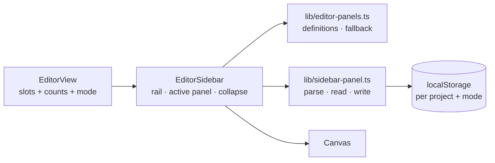

# Sidebar panel tabs

Status: implemented
Pattern schema: unchanged
Command spec: unchanged
Geometry package: unchanged
Amends: `.ai/specs/2026-10-23-editor-sidebar-readability.md` (the drawer stack
this replaces)
Amended by: `.ai/specs/2026-10-26-top-bars-reduction.md` (the collapse/expand
control moved from the rail's foot to the right end of the editor ribbon)

## 📝 TLDR

Replace the sidebar's collapsible drawer stack with one **vertical icon rail** on
the panel's canvas-facing edge, Onshape-style. The rail is also the resize bar:
its tabs switch a single panel that shows one section at a time, and the editor
ribbon's toggle collapses the panel while the rail stays on the canvas edge. The
last used tab is remembered per project and mode; a fresh piece opens Properties,
a fresh assembly opens Assembly.

## 📝 Problem Statement

The sidebar currently stacks every section as an independently collapsible
drawer. With seven sections in a piece tab, the panel is either long enough to
scroll past several open headers or full of collapsed headers, while the
resize bar next to it is a few pixels of dead chrome. Only one section is read at
a time in practice, so the open/closed state per section adds state and height
without adding information. The sidebar rail is the natural home for section
switching: it is always beside the content, it can carry the sections' counts, and
it makes the panel width the only thing a collapse has to hide.

## 📝 Decisions

- **One active section.** The rail shows exactly one tab's content at a time.
- **Clicking the active tab does not collapse.** Collapsing is the ribbon
  toggle's job, so a stray second click never hides the panel the user is
  reading.
- **The rail stays visible when the panel is collapsed.** It sits on the canvas
  edge; clicking any tab reopens the panel on that section, and the ribbon
  toggle reopens the last one.
- **Last used per project and mode.** Stored per piece/assembly mode, falling
  back to Properties for a piece and Assembly for an assembly.
- **The rail doubles as the resize handle.** A 4 px separator on its
  canvas-facing edge keeps today's drag-to-resize gesture.
- **No tab exists for nothing.** With no piece or assembly yet, the rail keeps
  the piece section list with Properties active, so Pattern defaults stay
  reachable and the sidebar does not disappear when the first tab is created.

## 📝 UI/UX

### The rail

A 40 px column attached to the panel's left edge, inside the same aside, with the
4 px resize separator on its canvas side. From top to bottom:

1. One icon button per section, 28 × 28 px, vertically spaced, with a 16 px glyph
   from the existing `RibbonIcon` registry.
2. The active icon gets a primary tint background and a 2 px primary bar on the
   panel side, so the active section reads at a glance.
3. Non-zero counts appear as a small `text-2xs` badge at the icon's lower-right;
   zero counts are omitted. The accessible label includes the count
   (`Outline, 12 items`) and the tooltip mirrors it.
4. A flexible spacer. The collapse/expand control is not on the rail: it is the
   single toggle at the right end of the editor ribbon.

Icons map to today's drawers: Properties (`select`), Piece (`piece`), Pattern
(`eye`), Assembly (`piece`), Outline (`line`), Dimensions (`dimension`),
Constraints (`constraints`). Assembly mode defines only the Assembly section.

### The panel

When expanded, a 320 px default panel (resizable 240–560 px, already persisted by
`useSidebarLayout`) sits to the right of the rail. It has:

- a compact header: section title in the existing small-caps style plus the count;
- the section body, unchanged in content and still supplied by the same
  `#properties`, `#pieces`, `#pattern`, `#assembly`, `#outline`, `#dimensions` and
  `#constraints` slots;
- the existing workspace stats slot under the body.

The header is a label, not a control: there is no per-section open/closed state
and no chevron in the header. Content the body already renders (selection
summaries, allowance rows, etc.) is untouched.

### Interactions

| Action | Result |
| --- | --- |
| Click an inactive tab | That section becomes active; the panel expands if collapsed. |
| Click the active tab | No change; the panel stays open. |
| Click the ribbon's sidebar toggle | Panel collapses; the rail widens the canvas by the panel width and remains visible. |
| Click it while collapsed | Panel reopens on the active section. |
| Drag the separator | Resizes the panel; the rail moves with it. Disabled while collapsed. |
| Switch piece ↔ assembly tab | The active section follows the new mode's stored tab. |
| Open another project | The active section follows that project's stored tab for the mode. |
| Change a count | The badge and the accessible label update in place. |

Keyboard: every rail button is a normal focusable button, so Tab reaches the
entries and Enter/Space activates them. The sidebar toggle is a sibling of the
ribbon toolbar and follows its tools in focus order. Tooltips appear on hover
and focus.

### Read-only

The rail, the ribbon toggle and resize stay usable: they are view chrome, not
document mutations. The section body remains wrapped in the read-only
`fieldset` as today.

## 📝 Architecture

Files:

- `frontend/src/lib/editor-drawers.ts` → `frontend/src/lib/editor-panels.ts`:
  `PanelId`, `PanelDefinition { id, label, icon }`, `EDITOR_PANELS`,
  `panelsFor(mode)`, `defaultPanelFor(mode)`, and the pure persistence helpers
  `persistedPanelKey(projectId, mode)`, `readPersistedPanel(storage, projectId,
  mode)` and `writePersistedPanel(storage, projectId, mode, panel)`. An unknown or
  malformed stored panel falls back to the mode's default. The key is
  `sewcraft:sidebar:panel:<mode>:<projectId>`; storage failures are ignored, like
  `lib/sidebar-layout.ts`.
- `frontend/src/components/EditorSidebar.vue`: rewritten as rail + one panel.
  Props keep `width`, `collapsed`, `counts`, `readOnly`, `mode`; a new
  `patternId` scopes the active-panel preference. Emits keep
  `update:width`/`update:collapsed`. It reads the active panel on mount and when
  `patternId`/`mode` change, writes on every switch, keeps the existing
  resize-handle logic, and renders no collapse control of its own: the rail's
  `update:collapsed` emit only reopens the panel on a section click.
- `frontend/src/views/EditorView.vue`: passes `patternId`, renames
  `drawerCounts` to `panelCounts`, and keeps the slots as-is. The document, command
  bus and canvas wiring are untouched.
- `frontend/src/components/SidebarDrawer.vue` and its test are deleted; the
  drawer header, per-section open state and `initialDrawerState` disappear.
- Old specs: amend `2026-10-23-editor-sidebar-readability.md` to note the rail
  replaces its drawer stack.

## 📝 Alternatives considered

| # | Option | Trade-off | Verdict |
| --- | --- | --- | --- |
| A | Keep the drawers, persist their open state | Least code, but the stack still grows with every section and the rail stays dead chrome | Rejected |
| B | Horizontal tabs above the panel | Familiar, but steals vertical space and reads like the bottom document tabs | Rejected |
| C | Vertical text labels on the rail | Self-describing without tooltips, but takes 90+ px from the canvas | Rejected |
| D | Expandable rail on hover | Keeps icons discoverable, adds a hover surface that steals canvas gestures | Rejected |
| E | Icons on the existing 4 px resize bar | Smallest footprint, but the hit targets fall below a usable size and the rail cannot show counts | Rejected |

## 📝 Implementation plan

1. **Panel model.** Add `lib/editor-panels.ts` and `lib/sidebar-panel.ts` with
   definitions, mode lists, default fallback and persistence; test valid, unknown,
   malformed and storage-failure cases.
2. **Rail + panel.** Rewrite `EditorSidebar.vue`: rail buttons with active state,
   counts and tooltips; one panel header and body slot; keep the resize separator
   and collapsed rail. The collapse control moved to the editor ribbon (see
   `2026-10-26-top-bars-reduction.md`). Test activation, active-click no-op,
   resize, counts, mode and project fallback, read-only.
3. **EditorView wiring.** Pass the project id and counts, keep the section slots,
   and migrate the affected tests from `drawer-toggle-*` / drawer contents to
   `sidebar-tab-*` and the visible panel.
4. **Cleanup and evidence.** Delete `SidebarDrawer.vue` and its test, remove the
   drawer state helpers, amend the superseded spec, run the full frontend gate
   (100 % coverage) and check both modes in the running app.

## 📝 Acceptance criteria

- [x] The piece tab shows the rail with Properties, Piece, Pattern, Outline,
      Dimensions and Constraints; assembly shows Assembly only.
- [x] Exactly one section body is visible; switching tabs replaces it.
- [x] Clicking the active tab keeps the panel open.
- [x] The editor ribbon's sidebar toggle collapses the panel, leaves the rail
      visible and reopens the last section; a tab click while collapsed opens that
      section. (Originally the rail's own chevron; moved by
      `2026-10-26-top-bars-reduction.md`.)
- [x] The panel keeps its width on resize and clamps to 240–560 px.
- [x] Non-zero counts show on the rail and in the panel header; zero counts do not.
- [x] The last used section persists per project and mode; a fresh piece opens
      Properties and a fresh assembly opens Assembly.
- [x] A malformed stored panel or unavailable storage falls back safely.
- [x] Read-only keeps the rail, resize and collapse working while the body stays
      disabled.
- [x] `SidebarDrawer.vue`, drawer open state and drawer tests are gone; the
      frontend checks pass at 100 % coverage.

## 📝 Risks

| Risk | Likelihood | Mitigation |
| --- | --- | --- |
| The rail's icon-only labels are hard to discover | Medium | Tooltips on hover and focus, plus count badges; a labelled rail was rejected for width. |
| Migrating many sidebar tests hides a real regression | Medium | Switch tests through one `openPanel` helper and keep each test's original assertion. |
| Resize drag conflicts with rail clicks | Low | The separator is a separate 4 px element; rail buttons are inside their own column. |
| A remembered section for another project leaks across projects | Low | The key includes project id and mode; unknown values fall back. |
