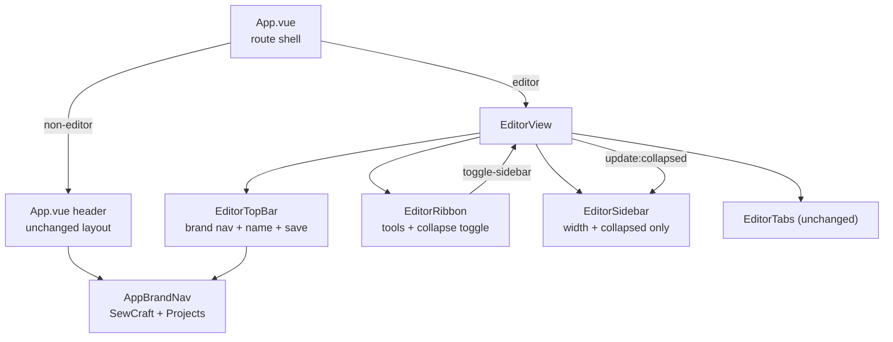

# Top bars reduction

Status: **proposed** — draft design-only PR, implementation not started. Two
product decisions remain open (Q1–Q2); the PR stays draft until they are
confirmed. Pattern schema, command spec and geometry package are unchanged.

Builds on: `013-editor-workspace-shell.md` (the current header + ribbon shell).
Amends: `013-editor-workspace-shell.md` (the editor's header row) and, once it
merges first, `2026-10-25-sidebar-panel-tabs.md` (the rail that carries the
collapse control today).

## 📝 TLDR

The editor stacks two full-width bars above the tool ribbon: the app header
(SewCraft + Projects) and a separate project/save bar. This spec merges them into
one 40 px row on the editor route — brand, Projects, project name, save status,
Save — and moves the sidebar collapse control from the sidebar's own chrome to
the right end of the ribbon. The result is about 57 px more canvas height, one
border instead of two, and the collapse control beside the tools. This is future
behaviour; today the two bars and the sidebar-owned collapse button are unchanged.

## 📝 Problem Statement

**Who needs it:** makers drafting on a laptop, where vertical canvas space is the
scarce resource and the top chrome is paid on every edit.

**What happens today** (measured from the components at `origin/develop`, b55aea8):

| Row | Source | Height |
| --- | --- | --- |
| App header: SewCraft + Projects | `App.vue`, `px-4 py-3` + `text-lg` | ~52 px + 1 px border |
| Project/save bar: name, status, Save | `EditorSaveBar.vue`, `px-3 py-1.5` + `h-8` button | ~44 px + 1 px border |
| Tool ribbon: groups + labels | `EditorRibbon.vue`, `py-1` + 36 px buttons | ~54 px + 1 px border |
| **Total above the canvas** | | **~153 px** |

- The app header is identical on every route, but only the editor needs project
  identity and saving. On the editor route it consumes a whole row for two links,
  and the project identity sits in a second row below it.
- Two bars mean two paddings and two horizontal rules before the tools.
- The sidebar collapse control lives inside the sidebar: on `develop` in the
  sidebar's header row (`EditorSidebar.vue`, `sidebar-collapse`), and in the
  pending rail redesign (PR #96) at the foot of the 40 px rail. Either way it is
  separated from the tools it balances against, and when collapsed the expand
  control occupies the rail's only remaining full-width row.
- FR #95 asks for one top bar and for the collapse control to sit at the right of
  the tools bar. It is a focused layout request: no new capability, no data
  change.

## 📝 Options considered

The issue is brief, so the design space was explored before writing the detail.
Four realistic options, plus the baseline:

| # | Option | Saving | Trade-off | Verdict |
| --- | --- | --- | --- | --- |
| A | Build nothing; only trim padding on the two bars | ~12 px | Keeps the duplicated row, two borders and two ownership points; does not meet "same top bar" | Rejected |
| B | **Editor-owned unified bar.** Hide the app header on the editor route; the editor renders one bar with brand + Projects + project identity + save controls. Non-editor routes keep the existing app header. Shared brand markup extracted into one component. | ~57 px | The brand markup appears on two route-specific bars (solved by one shared `AppBrandNav.vue`); `App.vue` gains one route condition | **Recommended** |
| C | App-level route-aware bar with a teleport/slot. `App.vue` keeps one header mounted for every route and the editor teleports its controls into it. | ~57 px | One header instance, but teleport target lifecycle, focus order and "App knows editor state" couple the shell to the editor; harder to test and to reason about during loading | Viable later; rejected for v1 |
| D | Single chrome row including the bottom tabs | ~92 px | Maximum space, but tabs would compete with tool groups in the same row and the bottom tab bar is a deliberate workspace pattern; large, unrelated change | Rejected — out of scope |
| E | Drop the brand from the editor entirely and put only project + save in the bar | ~57 px | Simplest row, but loses the only route back to Projects on the editor screen | Rejected — navigation regression |

Option B wins because it delivers the requested space with the smallest
structural change: no teleport, no new state, and the non-editor shell is left
alone.

## 📝 Resolved assumptions (autonomous defaults)

These are the non-blocking choices applied so the spec reads as one coherent
design. They can be overridden in review.

| # | Assumption | Rationale |
| --- | --- | --- |
| R1 | The merged bar is 40 px high (`h-10`) with one bottom border, and sits above the ribbon. | Fits the `h-8` Save button with 4 px breathing room and removes one rule. |
| R2 | Brand/Projects markup is extracted once and reused by both route bars. | Prevents the two headers drifting in type scale or target size. |
| R3 | The project name stays a read-only label with the same `pattern-name` test id. | The issue asks for placement, not rename; inline rename is a separate capability with its own save path. |
| R4 | Save status remains a `role="status"` live region with the existing wording; `aria-live` stays assertive for failed/error/paused. | Preserves the current screen-reader contract exactly. |
| R5 | The tabs stay at the bottom; their `+` menu and reorder behaviour are untouched. | Out of the issue's scope; moving them would compete with the ribbon (option D). |
| R6 | The bar renders in `loading` and `error` states too, with brand + Projects and a placeholder name, and no Save/status. | Hiding the app header on the editor route must never strand the user on a failed load. |
| R7 | Exactly one dedicated collapse/expand toggle exists, at the right of the ribbon. The sidebar renders no toggle and drops its local toggle handlers, but keeps `update:collapsed` so choosing a section while collapsed can still reopen the panel. | Two toggles for one state is a bug factory and a duplicate focus stop; the rail's "open this section" intent is navigation, not a second toggle. |
| R8 | Both piece and assembly modes show the same bar and the same collapse control. | The toolbar changes with the mode; the chrome should not. |
| R9 | `Ctrl/Cmd+S`, autosave, conflict dialogs and the unsaved-changes route guard are unchanged. | The top bar relocates existing controls; it does not re-implement saving. |
| R10 | No mockup or screenshot is committed. | This is a design-only spec and a layout change that the wireframe plus measurements can carry; visuals belong with the implementation evidence. |

## 📝 Open Questions

These block the design and are asked on FR #95. The PR stays draft until they
are answered.

**Q1 — Does the 40 px bar apply only to the editor, or to every route?**
Recommended: editor-only for v1. `/projects` keeps its current ~52 px header, so
navigating between the two routes changes the bar height by ~12 px. The
alternative is to unify the app header at 40 px everywhere for a constant shell,
which expands the change to the Projects page. *This decides `App.vue`'s header
markup and whether `AppBrandNav` needs a compact size variant.*

**Q2 — How should save status behave below 640 px?**
Recommended: keep one row and replace the status text with a 6 px dot plus
tooltip, while the existing SR-only live region keeps the full wording.
Alternatives: keep the text and truncate the project name harder (status copy is
long and would crowd the Save button), or hide the status entirely (loses the
saving/failure signal). *This decides the responsive markup and the narrow-width
acceptance criteria.*

## 📝 Proposed Solution

Option B, pending Q1:

- `App.vue` stops rendering its header on the editor route (`v-if="!isEditor"`,
  matching the footer). The header stays exactly as today on `/projects`.
- A new `AppBrandNav.vue` holds the SewCraft wordmark link and the Projects link;
  both route bars use it.
- `EditorSaveBar.vue` becomes `EditorTopBar.vue`: it absorbs the brand nav, keeps
  the existing save-state logic and Save button, and renders one row.
- The sidebar collapses from a button at the right end of the ribbon.
- The sidebar keeps its width/collapsed state and no longer renders a dedicated
  toggle; its section controls keep the "choose a section and reopen" intent
  through `update:collapsed`.

```text
┌──────────────────────────────────────────────────────────────────────────────┐
│ SewCraft  Projects │ Summer dress · Pattern      Unsaved changes     [Save]   │  40 px
├──────────────────────────────────────────────────────────────────────────────┤
│ TOOLS  FEATURES  ANNOTATION  SKETCHING  CONSTRAINTS  EXPORT            [ » ]  │  ribbon
│ [select] [cut loop] [undo] [redo] [delete] [fit] …                            │
├──────────────────────────────────────────────────────────────────────────────┤
│                                                                              │
│ canvas                                                            sidebar →  │
│                                                                              │
├──────────────────────────────────────────────────────────────────────────────┤
│ [+] [Piece 1] [Assembly 1]                                                   │  tabs
└──────────────────────────────────────────────────────────────────────────────┘
```

The `»` button is the single dedicated collapse/expand control: it points right
while the sidebar is open and left while it is collapsed (the `chevron-down`
glyph rotated `-90deg` / `90deg`, reusing the existing registry icon). In
read-only mode the same row swaps the status for the `Read-only` pill and hides
Save; the wireframe shows the dirty state.

### Top bar composition

| Region | Content | Behaviour |
| --- | --- | --- |
| Left | `SewCraft` wordmark, `Projects` link | Same targets and labels as the app header; `SewCraft` goes to `/projects`. |
| Divider | 1 px vertical rule | Separates navigation from project context. |
| Middle | Project name, ` · Pattern`, read-only pill | `min-w-0 flex-1 truncate`; full name in `title`; pill only in read-only mode. |
| Right | Save status, Save button | Status keeps its live-region wording; Save keeps `Ctrl+S` and the disabled rules. |

### Ribbon composition

The ribbon root becomes a plain flex row with two children:

1. the existing group container, `flex-1 flex-wrap` (groups still wrap on
   narrow widths, unchanged internally). `role="toolbar"` and
   `aria-label="Editor tools"` move here, so the sidebar toggle is not announced
   as an editor tool;
2. a `shrink-0` divider + 36 × 36 px toggle button, vertically centred, outside
   the toolbar.

When the groups wrap to two rows, the toggle stays at the right of the whole
ribbon block, not pinned to the first row.

## 📝 Architecture



Files:

- `frontend/src/components/AppBrandNav.vue` (new): the two links, extracted from
  `App.vue`; no props beyond an optional `class`.
- `frontend/src/components/EditorTopBar.vue` (renamed from `EditorSaveBar.vue`):
  keeps the save-state computeds (`statusText`, `canSave`, `liveMode`,
  `attention`, `savedTime`) and the Save button; adds `AppBrandNav`, the divider
  and the project identity. Its root is a `<header data-testid="editor-top-bar">`.
  Props stay `name`, `state`, `savedAt`, `origin`, `readOnly`, plus a new
  `loadState: 'loading' | 'ready' | 'error'` (default `ready`) that suppresses
  status and Save until the document is ready; emits stay `save`.
- `frontend/src/App.vue`: renders its `<header>` only when
  `route.name !== 'editor'`; its internals move to `AppBrandNav`.
- `frontend/src/components/EditorRibbon.vue`: new prop `sidebarCollapsed`; new
  emit `toggle-sidebar`; root restructured into toolbar + right-hand button,
  with `role="toolbar"` moved to the inner group container; button exposes
  `aria-expanded`, `aria-controls="sidebar"`, `data-testid="sidebar-toggle"`,
  the Collapse/Expand label and a tooltip.
- `frontend/src/components/EditorSidebar.vue`: add `id="sidebar"` to the `<aside>`;
  remove the collapsed-header collapse button and the collapsed-rail expand
  button (or the rail-foot chevron when PR #96 is the base); drop the local
  toggle handlers but keep the `update:collapsed` emit for a section click while
  collapsed. `collapsed` and `width` props stay.
- `frontend/src/views/EditorView.vue`: owns `collapsed` (already returned by
  `useSidebarLayout`); renders `EditorTopBar` above all three editor states;
  passes `:sidebar-collapsed="collapsed"` and handles `@toggle-sidebar`.
- No backend, API, schema, command or geometry changes.

## 📝 UI/UX

### States

| State | Top bar |
| --- | --- |
| Loading | Brand + Projects; name `Loading…`; no status, no Save. |
| Load error | Brand + Projects; name `Project unavailable`; no Save. |
| New | Name, `New pattern — not saved yet`, Save enabled. |
| Dirty | Name, `Unsaved changes`, Save enabled with the dirty dot. |
| Saving | Name, `Saving…`, Save disabled. |
| Saved | Name, `Saved 12:04` or `Autosaved 12:04`, Save disabled. |
| Failed / error / paused | Name, existing message in `text-destructive`, Save enabled where it is today. |
| Read-only | Name, `Read-only (older format)` pill, no Save. |

The bar's two placeholders are the only new copy. The existing body blocks stay
unchanged: `editor-loading` keeps `Loading project…`, and the error block keeps
its message and explicit Back to Projects link. The bar exists so hiding the app
header never removes the way back to Projects, not to replace that detail.

### Interactions

| Action | Result |
| --- | --- |
| Click SewCraft or Projects | Same navigation as today; the unsaved-changes route guard still prompts. |
| Click Save / press Ctrl+Cmd+S | Unchanged. |
| Click the ribbon's collapse button | Sidebar collapses; the same button stays in place and now expands. |
| Click it while collapsed | Sidebar returns to its remembered width and active section/drawer. |
| Switch piece ↔ assembly | Bar and button unchanged; only the ribbon groups swap. |
| Resize the sidebar | Unchanged (the separator stays in the sidebar). |

### Accessibility

- Exactly one `<header>` landmark per route: the editor's `EditorTopBar` root,
  or the app header on `/projects`. The hidden one is removed with `v-if`, not
  visually hidden.
- Navigation links keep their text; focus order is SewCraft → Projects → Save →
  ribbon tools → sidebar toggle (DOM order follows the visual order).
- `role="toolbar"` stays on the ribbon's group container, so the sidebar toggle
  is a sibling of the toolbar, not an editor tool.
- The toggle is a 36 × 36 px target with `aria-expanded`,
  `aria-controls="sidebar"` (the `<aside id="sidebar">`) and a label that
  reflects the next action; the icon is `aria-hidden`.
- The save status remains the single live region. The loading/error placeholder
  is not a live region.

### Responsive (pending Q2)

Recommended single-row behaviour:

- ≥ 1024 px: every region visible.
- 640–1023 px: project name truncates; status and Save keep their space.
- < 640 px: project name truncates, the status text is replaced by a 6 px dot
  with a `title` + tooltip, and the SR-only live region keeps the full wording.
  Dot tones: muted for new/saved, primary for dirty/saving, destructive for
  failed/error/paused. The Save button's dirty dot is suppressed below this
  breakpoint so there is only one indicator. SewCraft and Projects remain.

The bar must never produce horizontal page scroll; truncation absorbs the
pressure.

## 📝 Edge Cases & Failure Scenarios

- **Very long project names.** Truncate in the middle region and put the full
  name in `title`; the Save region never shrinks.
- **Long status copy** (`Save paused — changed elsewhere`). `whitespace-nowrap`
  and `shrink-0`; replaced by the dot only below the Q2 breakpoint.
- **Narrow widths.** The ribbon groups wrap as today; the collapse button stays
  on the right of the block. The top bar does not wrap at ≥ 640 px.
- **Loading failure.** The bar still renders with brand + Projects so the user can
  leave; the error panel keeps the explicit Back to Projects link.
- **Read-only document.** The pill stays; Save disappears exactly as today;
  collapsing remains allowed (view chrome, not a mutation).
- **Sidebar collapsed on load.** The button starts in the Expand state and its
  label/tooltip match; the saved width returns on expand.
- **Section click while collapsed.** Choosing a section from the collapsed rail
  still reopens the panel on that section through `update:collapsed`; it is
  navigation, not a second toggle.
- **PR #96 ordering.** `develop` has both a collapsed-header collapse button and
  a collapsed-rail expand button; the rail redesign has one foot chevron. Remove
  every dedicated toggle wherever it sits on the base branch; the resulting
  editor is identical. Implementation rebases on whichever shell is on
  `develop`.
- **Route leave with unsaved changes.** The existing `onBeforeRouteLeave` confirm
  is attached to `EditorView`; moving the Projects link into that view does not
  bypass it.
- **Browser zoom / 200 %.** Truncation and wrapping keep the chrome inside the
  viewport; no horizontal scrollbar is introduced.

## 📝 Risks & Impact Review

| Risk | Likelihood | Impact | Mitigation |
| --- | --- | --- | --- |
| Editor layout tests assert the old two-bar structure and the sidebar-owned toggle | High | Frontend suite churn | Keep `pattern-name`, `save-status`, `save-project` and `read-only-pill`; replace `editor-save-bar` with `editor-top-bar` and `sidebar-collapse`/`sidebar-expand` with `sidebar-toggle` in one step per phase. |
| Losing the app header on the editor route strands a user on load failure | Medium | Navigation dead end | R6: the bar renders in every editor state; test loading and error explicitly. |
| The two brand navs drift visually | Low | Inconsistent shell | R2: one `AppBrandNav.vue`; no duplicated markup. |
| The moved toggle becomes undiscoverable when the sidebar is collapsed | Medium | User cannot reopen the panel | The button is always visible in the ribbon, labelled Expand sidebar, with tooltip and `aria-expanded`. |
| A second collapse control is left behind in the sidebar | Medium | Two focus stops, contradictory state | R7: delete both sidebar toggle buttons in the same step while keeping the section-expand emit; test that exactly one toggle exists. |
| 40 px bar cramps the Save target at 200 % zoom | Low | Missed clicks | `h-8` button inside `h-10` row; the bar never goes below the button height. |
| Ribbon wrapping misplaces the button | Low | Visual imbalance | The button is outside the wrapping group container, centred on the block. |

Reversibility: frontend-only, no schema, no data migration, no public contract.
Each phase lands as its own revertable set of commits. The main irreversible cost
is test churn, not user data.

## 📋 Phasing

- **Phase 1 — Unified top bar.** `AppBrandNav`, `EditorTopBar`, `App.vue` route
  condition, `EditorView` always-rendered bar. Ships on its own; the sidebar
  toggle stays where it is.
- **Phase 2 — Ribbon-owned collapse control.** `EditorRibbon` button,
  `EditorSidebar` cleanup, `EditorView` wiring. Depends on Phase 1's wiring and
  ships after it; Phase 1 is still independently shippable, Phase 2 is not.

## 📋 Implementation Plan

1. **Extract the brand nav.** Add `AppBrandNav.vue` with the two links and move
   `App.vue`'s header internals onto it. Test that both routes still reach
   `/projects`.
2. **Build `EditorTopBar`.** Rename `EditorSaveBar.vue` and its test, add the
   brand nav + divider + project region, and keep every save state. Test all
   states, long names, read-only and the single live region.
3. **Hide the app header on the editor route.** Add the route condition, render
   the bar in loading/error/ready, and update `App`/`EditorView` tests. Verify the
   page saves no vertical rule duplication.
4. **Move the toggle into the ribbon.** Add the prop/emit and the right-hand
   button; remove the sidebar's two toggle buttons while keeping its
   section-expand emit; move `role="toolbar"` to the group container; wire
   `EditorView`. Test toggle, collapsed-on-load, section-click expansion,
   one-toggle-only and both modes.
5. **Amend the superseded specs.** Update `013-editor-workspace-shell.md` (editor
   header row) and `2026-10-25-sidebar-panel-tabs.md` (collapse location) once
   this spec is accepted.
6. **Verify and record.** Run the full frontend gate at 100 % coverage
   (`npm run format`, `typecheck`, `lint`, `format:check`, `test:coverage`,
   `build`) and check the editor at 1280 px, 768 px and 375 px in a browser.

## 📋 Acceptance criteria

- [ ] The editor route renders exactly one header row above the ribbon: brand,
      Projects, project name, save status, Save.
- [ ] The `/projects` route keeps its existing header and footer.
- [ ] The editor saves about 57 px of vertical chrome compared with the current
      two-bar layout at 1280 px.
- [ ] Loading and error states still expose SewCraft and Projects.
- [ ] The sidebar collapse and expand actions both live on one toggle at the right
      end of the ribbon, with correct labels, `aria-expanded`, `aria-controls` and
      a working `id="sidebar"` target.
- [ ] No dedicated collapse/expand toggle remains inside the sidebar; choosing a
      section while collapsed still reopens the panel on that section.
- [ ] Exactly one `<header>` landmark and one `role="toolbar"` exist on the
      editor route.
- [ ] The save live region is announced once, with unchanged wording for every
      state.
- [ ] Read-only, both ribbon modes, long names and narrow widths behave as
      specified (narrow-width treatment pending Q2).
- [ ] Frontend checks pass at 100 % coverage; `013` and the sidebar-tabs spec are
      amended.
