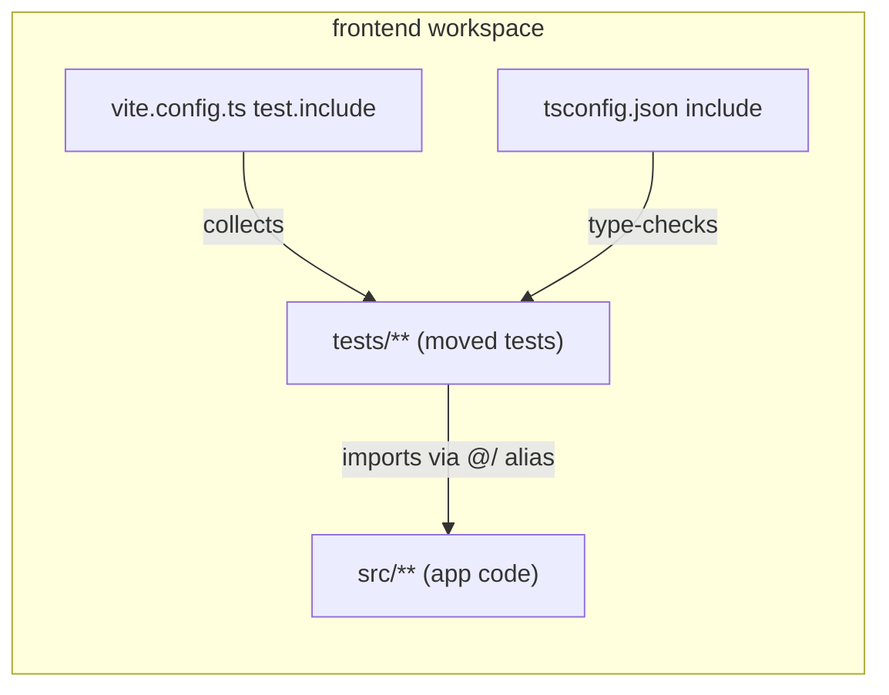

# Frontend tests under a mirrored `tests/` directory

Status: **implemented** — landed on the same PR that carried the spec (PR #100),
after the operator approved it with `spec-ready`. Q1 took its recommended option
(`frontend/tests/`, mirroring `frontend/src/`), so the move shipped as one
mechanical change: 75 test files, no runtime, API or schema surface touched.
Refs #98

## 📝 TLDR

The frontend keeps its 73 Vitest files beside the code they test
(`frontend/src/**/*.test.ts`), which buries source files in editors and file
trees. This spec proposes moving every frontend test to
`frontend/tests/<same path as src>/`, keeping the file names, the runners and
the 100 % coverage gate unchanged, and switching the moved tests to the `@/`
alias for imports. `packages/geometry` and `integration/` keep their current
layouts.

## 📝 Problem Statement

- **Who needs it:** the maintainer working in `frontend/src`, where 73 of 167
  files are `*.test.ts`; `src/lib` alone holds 31 tests among 62 files. Finding
  `dimensions.ts` next to `dimensions.test.ts` is fine, but scrolling
  `src/components` (31 test files among 82) is not.
- **What happens today:** tests are colocated by convention —
  `docs/architecture/standards.md:170-171` states "Vitest test files are
  colocated with the code as `*.test.ts`". Vitest collects them with
  `test.include: ['src/**/*.test.ts']` (`frontend/vite.config.ts:37`), and
  `frontend/tsconfig.json` includes `"src"` so `vue-tsc` type-checks them.
- **Evidence it matters:** the issue asks for a `tests` folder "with structure
  mimicking app, i don't want them alongside core files, they make files hard
  to find". This is a developer-experience cost, not a product defect: no user
  behaviour or runtime code is involved.
- **Constraints:** the move must not change any test's behaviour, must keep the
  100 % statements/branches/functions/lines gate, must keep
  `npm run typecheck`, `npm run lint` and `npm run format:check` green, and must
  not touch the command layer or `@sewcraft/geometry` (AGENTS.md).
- **Why it is not obvious:** the test directory could be workspace-local or
  repo-wide, imports can stay relative or switch to the alias, and the
  documented colocation rule has to change with the code. Those choices are
  recorded below rather than left implicit.

## 📝 Proposed Solution

### Options considered

| #   | Option | Trade-offs | Verdict |
| --- | ------ | ---------- | ------- |
| A   | **`frontend/tests/` mirroring `frontend/src/`** — `src/lib/utils.test.ts` → `tests/lib/utils.test.ts` | One obvious boundary inside the workspace that already owns Vitest, tsconfig and the coverage gate; a two-line config change (`test.include`, tsconfig `include`); tests stay under the frontend package, so aliases, `process.cwd()` and per-workspace scripts keep working. Cost: 73 renames and 75 import rewrites; `@/` becomes the normal way to import source from a test. | **Recommended** |
| B   | `frontend/src/**/__tests__/` folders | Cheaper: relative imports stay short and the diff is mostly renames. But tests remain inside `src`, one level deeper — it does not fix "not alongside core files", and `src/lib/__tests__` still sits in the file tree the issue complains about. | Rejected — does not solve the stated problem |
| C   | Repo-root `tests/frontend/` (one test tree for every JS workspace) | Single searchable location, and a future home for geometry tests. But it crosses the npm workspace boundary: `frontend`'s Vitest root, tsconfig `include`, `@/` alias and coverage `include` would all have to reach outside the package; geometry and integration already have their own runners. Larger blast radius for no extra benefit. | Rejected — wider change than the issue asks for |
| D   | Build nothing; rely on editor search and file nesting | Zero cost, but the issue is precisely that search and the tree are hard to scan; it also leaves the convention undocumented. | Rejected |

### Chosen layout

`frontend/src/<path>/<name>.test.ts` → `frontend/tests/<path>/<name>.test.ts`,
file names unchanged:

| Today | After |
| ----- | ----- |
| `src/App.test.ts` | `tests/App.test.ts` |
| `src/lib/utils.test.ts` | `tests/lib/utils.test.ts` |
| `src/components/ui/button/button.test.ts` | `tests/components/ui/button/button.test.ts` |
| `src/views/EditorView.error.test.ts` | `tests/views/EditorView.error.test.ts` |

Counts by directory (73 files total): `lib` 31, `components` 19,
`components/ui` 6, `components/sidebar` 6, `views` 3, `composables` 2,
`stores` 2, `api` 1, `router` 1, `assets` 1, `App.test.ts` 1.

## 📝 Architecture

Vitest is configured in `frontend/vite.config.ts`; the only discovery change is
the `test.include` glob. Coverage stays scoped to `src/**/*.{ts,vue}` — tests
leave `src`, so the existing `main.ts` / `*.d.ts` excludes remain sufficient and
no threshold moves. `vue-tsc` needs `tests` added to `frontend/tsconfig.json`'s
`include`, otherwise type errors in moved tests are invisible to
`npm run typecheck`. ESLint (`files: ['**/*.ts']` in
`frontend/eslint.config.js`) and Prettier already cover any directory under
`frontend/`, and `npm run lint` runs `eslint .` from the package root, so
neither changes.

Takeaway: the tests move out of `src`, but Vitest, `vue-tsc` and the `@/` alias
inside the same workspace keep discovery and type resolution unchanged.

### Import strategy

Every relative import inside the moved tests points into `src` — 75 static
`from './…'` imports plus the dynamic `import('./projects')` calls — and becomes
an alias import, e.g. `import PiecePanel from './PiecePanel.vue'` →
`import PiecePanel from '@/components/PiecePanel.vue'`, and
`from './index'` in `src/router/index.test.ts` → `from '@/router/index'`.
Dynamic imports follow the same rule: `src/api/projects.test.ts` calls
`await import('./projects')` after `vi.resetModules()`; it becomes
`await import('@/api/projects')` so module isolation still loads the module
under test, not a test-directory neighbour.

Path-dependent reads keep working unchanged: `src/assets/main.test.ts` reads
`resolve(process.cwd(), 'src/assets/main.css')`, and Vitest's working directory
is still `frontend/`. No snapshot or fixture files exist, so there is nothing
to relocate alongside the tests.

## 📝 Edge Cases & Failure Scenarios

- **A missed file silently stops running.** Once `include` points at `tests/`,
  any test left in `src/` is not collected and the suite still passes. Guard:
  the migration step asserts `find frontend/src -name '*.test.ts'` is empty and
  Vitest reports **73 test files**, compared with the baseline recorded before
  the move.
- **Coverage stays 100 % while tests vanish.** With v8 and `include: src/**`,
  unexecuted modules can drop out of the report, so green coverage is not proof
  the tests ran. The test-file count and the pre-move test count are the
  acceptance signal, not coverage alone.
- **`vue-tsc` misses the new directory.** Forgetting the tsconfig `include`
  makes `npm run typecheck` pass on a half-moved tree; the first migration step
  changes config and moves the first slice together.
- **A slice move hides the rest of the suite.** Flipping `test.include` to
  `tests/**` while 42 tests still sit in `src/` would silently stop running
  them and could tank coverage. The migration therefore lists **both** globs
  until the last slice has moved, and the final step narrows it to `tests/**`
  only. The union is temporary and must not survive the PR.
- **Duplicate basenames.** The mirror keeps names unique per path
  (`router/index.test.ts` stays the only `index.test.ts`); no renaming is
  needed. `EditorView.error.test.ts` keeps its descriptive infix.
- **Future `shadcn-vue` components.** `npx shadcn-vue add <component>` writes to
  `src/components/ui/`; its test belongs at
  `tests/components/ui/<component>/<component>.test.ts`. The updated standards
  doc says so.
- **Cross-workspace confusion.** Geometry tests stay colocated
  (`packages/geometry/src/**/*.test.ts`) because that package is pure,
  dependency-light and has its own runner; integration tests stay in
  `integration/`. The spec does not unify them.

## 📝 Risks & Impact Review

- **Documented convention changes.** `docs/architecture/standards.md:170-171`
  currently mandates colocation; it must be rewritten in the same PR, and
  `AGENTS.md`'s repository-layout section gains a one-line note that frontend
  tests live under `frontend/tests/`. Old specs that mention colocation are
  historical and stay untouched.
- **Large but mechanical diff.** 73 renames plus 75 import edits. Review with
  rename detection, then confirm no `src` file content changed, the test count
  matches the baseline, and the coverage gate is still 100 %.
- **No runtime, API, schema or dependency change.** Nothing in `app/`,
  `packages/geometry/` or `frontend/src` behaviour changes; rollback is a
  `git revert` of the single migration PR.
- **No enforcement added now.** A lint rule or CI check that forbids
  `src/**/*.test.ts` would be new surface for a documentation-only concern; the
  resolved assumptions record this and leave it for a follow-up if tests creep
  back.

## 📝 Open Questions

- **Q1 — Where does `tests/` live? — resolved: `frontend/tests/`.** The operator
  approved option A with `spec-ready`, so the mirror stays inside the frontend
  workspace, where the Vitest root, tsconfig and `@/` alias already are; geometry
  and integration keep their own runners. The 73 files the design counted became
  75 during implementation, because `develop` gained two `src/lib` midpoint tests
  that moved with the rest.

## 📝 Resolved assumptions (autonomous defaults)

| # | Question | Applied default | Why | Confirm? |
| - | -------- | --------------- | --- | -------- |
| Q2 | Keep `*.test.ts` names or rename to `*.spec.ts`? | Keep `*.test.ts`; names otherwise unchanged | Zero renaming noise; the `include` glob and every doc reference stay recognisable | reversible |
| Q3 | Relative imports or `@/` alias in moved tests? | `@/` alias for every import into `src` | Relative chains like `../../src/lib/x` break when a test moves; the alias already exists in `vite.config.ts` and `tsconfig.json` | reversible |
| Q4 | Move geometry and integration tests too? | No — frontend only; they have separate runners and configs | The issue names frontend tests; touching three workspaces turns a mechanical move into a repo-wide refactor | reversible |
| Q5 | Add a test-layout lint/CI guard? | No new guard; document the rule in `docs/architecture/standards.md` and `AGENTS.md` | Keeps the change scoped to files moving; the 73-file count check catches omissions during migration | reversible |
| Q6 | Mockups or screenshots? | None — this is a repository-layout change with no user-facing surface | Nothing visual changes for a user | reversible |

Q1 is the only gate, and `spec-ready` closed it: the PR implemented the layout
and left draft state behind in the same run.

## 📋 Phasing

- **Phase 1 — foundation and first slice.** Config plus the `lib` tests, proving
  discovery, typecheck and coverage work from `tests/`.
- **Phase 2 — remaining slices.** Components (including `sidebar` and `ui`),
  views, stores, composables, api, router, assets and `App.test.ts`.
- **Phase 3 — finalise.** Narrow `test.include` to `tests/**`, confirm the
  baseline count, update the standards and `AGENTS.md`, run every validation
  command.

Each phase leaves the app working and the suite green. `test.include` lists both
locations until Phase 3, so no test silently stops running mid-migration.

## 📋 Implementation Plan

1. **Record the baseline.** Run `npm test --workspace @sewcraft/frontend` and
   capture the reported test-file and test counts (expected: 73 files) before
   changing anything.
2. **Phase 1: move `src/lib`.** `git mv` the 31 `src/lib/*.test.ts` files to
   `tests/lib/`, rewrite their source imports to `@/lib/...`, set
   `test.include` to `['src/**/*.test.ts', 'tests/**/*.test.ts']` (temporary
   union) in `frontend/vite.config.ts`, and add `"tests"` to the `include`
   array in `frontend/tsconfig.json`. Verify: the suite still collects 73 files
   with all 31 lib files in `tests/lib/`, `npm run typecheck`, and
   `npm run test:coverage` is 100 %.
3. **Phase 2a: move the light slices.** `git mv` `api`, `router`, `stores`,
   `composables`, `assets` and `App.test.ts`; rewrite imports (including the
   `await import('@/api/projects')` calls) and keep `process.cwd()` reads as
   they are. Verify 73 files still run, plus typecheck and coverage.
4. **Phase 2b: move views and components.** `git mv` `views` (3), `components`
   (19), `components/sidebar` (6) and `components/ui` (6); rewrite imports with
   the alias. Verify 73 files still run, plus typecheck and coverage.
5. **Phase 3: narrow discovery and document.** Set `test.include` to
   `['tests/**/*.test.ts']`, assert `find frontend/src -name '*.test.ts'`
   prints nothing and the suite reports the step-1 baseline (73 files, same
   test count); rewrite the testing-conventions bullet in
   `docs/architecture/standards.md` and add the layout note to `AGENTS.md`.
6. **Full gate.** From the repo root run `npm run format`, `npm run lint`,
   `npm run format:check`, `npm run test:coverage`, `npm run build`; all must
   pass with coverage at 100 %. No backend change, so the Pest gate is expected
   to stay green untouched.

### Acceptance criteria

- No `*.test.ts` remains under `frontend/src/`; `frontend/tests/` mirrors it
  path for path, with the same file names.
- Vitest collects the same 73 files and the same tests as before the move.
- `npm run typecheck`, `npm run lint`, `npm run format:check`,
  `npm run test:coverage` (100 %) and `npm run build` pass.
- `docs/architecture/standards.md` and `AGENTS.md` describe the new layout; no
  `frontend/src` file changes behaviour.
