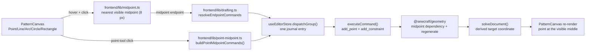

# Midpoint constraint — create and pin a point at an edge's middle

Status: proposed — spec-only; implementation follows on a separate PR that
references this document. The design decisions below were confirmed during the
design conversation; there are no open questions.
Related: `.ai/specs/2026-10-24-point-on-line.md` (the Point-tool inference this
mirrors), `.ai/specs/2026-10-19-constraint-tools-ribbon.md` (the Constraints
group it extends), `.ai/specs/2026-10-25-rounded-corner-line-constraints.md`
(the trimmed-line anchor rules), `docs/architecture/constraint-solver.md`.

## 📝 TLDR

A maker marking a notch, a balance point or a seam reference on an edge cannot
currently place a point at the exact middle of that edge. The Point tool creates
a free point or a point that slides along the line, and the Constraints group has
no midpoint relation. Proposed future behaviour: a **midpoint** constraint pins a
point to the middle of a visible straight segment, and the Point, Line, Arc,
Circle and Rectangle tools create it when a click lands within 8 px of that
middle. The point is derived, so it follows the line and cannot be dragged away.

## ✅ Resolved design decisions

| #   | Decision                                                                                                                                                                    | Confirmed answer |
| --- | --------------------------------------------------------------------------------------------------------------------------------------------------------------------------- | ---------------- |
| D1  | Is the relation persistent or a coordinate snap?                                                                                                                            | Persistent `midpoint` constraint; not snap-only. |
| D2  | Which gestures create it?                                                                                                                                                   | Both: Point-tool inference and a **Midpoint** button in the Constraints group. |
| D3  | How close to the middle counts, and what wins?                                                                                                                              | An 8 px screen-space magnet. Existing-point snap (6 mm) wins, then midpoint, then point-on-line inference, then the grid. |
| D4  | What is the midpoint of a line whose end a corner round has trimmed?                                                                                                        | The middle of the **visible** trimmed segment. |
| D5  | Can it constrain a point between two arbitrary points, not only a line?                                                                                                     | Yes: point + line, or point + two points. |
| D6  | Which point-creating tools infer it?                                                                                                                                        | All of them: Point, Line, Arc, Circle and Rectangle. Text anchors and the Curve tool (which only reuses existing points) stay out. |
| D7  | What feedback appears before the click?                                                                                                                                     | A midpoint tick on the line and a status hint. |
| D8  | What happens when the maker drags the midpoint point?                                                                                                                       | It is derived and read-only; the point stays at the middle and the drag is rejected. The source line moves it. Removing the constraint leaves an ordinary free point at its last position. |
| D9  | Does the document schema move?                                                                                                                                              | No. Additive constraint type only; `spec_version` moves to `0.16.0` because `add_constraint` accepts a new type. |

## 📝 Problem Statement

- **Who needs it:** the maker placing a notch, a balance point, a seam-match mark
  or a construction point at the middle of a drawn edge. Midpoints are ordinary
  drafting landmarks, and the app already supports the neighbouring relations:
  `point_on_line` pins a point to a line's supporting line, and the dimension
  tool measures from the midpoint of a line anchor.
- **What happens today:** the Point tool uses `snappedPoint()` — nearest existing
  point within `POINT_SNAP_TOLERANCE` (6 mm), otherwise the 10 mm grid — and
  ignores the middle of the line under the pointer
  (`frontend/src/components/PatternCanvas.vue`, `emitAddPoint`). A click on a
  line is inferred as `point_on_line`, which deliberately slides anywhere along
  the supporting line (`.ai/specs/2026-10-24-point-on-line.md`). The Constraints
  group exposes `point_on_line`, `horizontal`, `vertical`, `distance`, `angle`
  and `equal`; there is no midpoint relation, and `equal`/`distance` combinations
  do not express "this point is exactly halfway between these two points"
  without extra geometry.
- **Evidence it matters:** midpoint constraints are a standard sketch relation in
  CAD — Onshape ships a **Midpoint** constraint that constrains a point to the
  midpoint of a line or arc, and FreeCAD users routinely emulate it with
  symmetry — and pattern-drafting tools expose midpoint construction points. In
  SewCraft, every drafting tool already snaps to existing points and the grid; a
  midpoint target is the missing third snap candidate, and the hover/ghost
  pattern established by the point-on-line spec makes the inference cheap to
  discover.
- **Constraints:** commands remain the only mutation path, so every gesture must
  compose `add_point`, `add_constraint` and the drafting command in one batch;
  `@sewcraft/geometry` stays pure and framework-agnostic; the new constraint must
  not become a solver variable that deforms the source line; every branch needs a
  test to hold the 100 % coverage gate; the command spec must stay in three-way
  sync (`config/geometry.php`, `docs/domain/command-spec.md`,
  `docs/domain/command-spec.json`).
- **Why the current model cannot express it:** `point_on_line` has one residual —
  the signed distance to the supporting line. A midpoint needs two equations (the
  point is halfway along each axis) and the point must be **dependent** rather
  than free, otherwise the least-squares solver splits the movement between the
  point and the line's other endpoint when either is dragged. That is D8: the
  point is derived geometry, not a free solver variable.

## 📝 Proposed Solution

### Constraint shape

Add one `midpoint` constraint type with two mutually exclusive forms:

```ts
| { id; type: 'midpoint'; point: EntityId; line: EntityId; piece?: EntityId }
| { id; type: 'midpoint'; point: EntityId; a: EntityId; b: EntityId; piece?: EntityId }
```

- `point` is the derived point. It must be an ordinary point, never a
  corner-round-derived point and never the target of another midpoint.
- The **line form** names a straight line. At solve time the source is the line's
  current `start` and `end` points, so the relation follows the visible segment
  when a corner round trims that line and survives when the round is removed. The
  line's own id is what the constraint stores, so deleting the line cascades.
- The **two-point form** names any two distinct point ids, including fixed
  corner-round points. It is what the Constraints group creates when the user
  picks two points instead of a line.
- `piece` is the owning piece, matching the existing `add_constraint` ownership
  rule. All referenced entities must be in that piece when it is present.

### Solver behaviour

- `solve()` collects the midpoint dependencies once per call. The target points
  are excluded from `variableIds`; the constraint contributes **no residual**.
- `readState()` overwrites each target's coordinate with the average of its two
  sources on every residual evaluation. That makes the target a deterministic
  function of the variables, so constraints that reference a midpoint point see
  its correct coordinate and the numerical Jacobian captures the dependency.
- `solveDocument()` writes the solved coordinates and then runs
  `regenerateMidpoints()` after `regenerateCornerRounds()`, so a line-form midpoint
  follows a newly trimmed or restored visible segment.
- A document made only of midpoint constraints is converged by definition, like a
  document made only of driven dimensions.
- Chained midpoints are rejected at creation because a midpoint source may not be
  a midpoint target. A hand-edited document that contains a chain raises a clear
  solver validation error instead of silently computing a stale coordinate.

### Interaction

1. **Hover.** With the Point, Line, Arc, Circle or Rectangle tool active, if no
   existing point is within `POINT_SNAP_TOLERANCE` (6 mm) and a visible straight
   line's midpoint is within 8 screen pixels of the pointer, draw a small accent
   midpoint tick on that line and show the status hint
   **"Click to create a point at this line's midpoint."** Clear the signal on
   pointer leave, tool change, Escape, or a document change that removes the
   line. The marker is `pointer-events-none` and `aria-hidden`; the hint is a
   polite `role="status"` element.
2. **Point tool click precedence.** Keep the existing point snap first. Otherwise
   the midpoint zone wins over point-on-line inference: a click inside the zone
   creates the point at the exact midpoint and applies `midpoint`; a click
   elsewhere on a line keeps today's `point_on_line` inference; bare canvas keeps
   the grid snap. Point snap still wins over both, preserving today's
   near-point behaviour.
3. **Drafting tools.** The Line, Arc, Circle and Rectangle tools reuse the Point
   tool's point/midpoint/grid candidates but do not infer `point_on_line`: an
   existing point hit is reused by id; otherwise the midpoint zone returns a
   midpoint endpoint; otherwise the grid/point snap applies. On commit, the shared endpoint-command
   builder emits `add_point` at the midpoint and `add_constraint` with
   `[point, line]` immediately after it, before the geometry command. All of it
   is one `dispatchGroup` journal entry and one undo. The Rectangle tool maps its
   clicked endpoints back to the rectangle's corner indices so a midpoint corner
   is attached to the right corner; if any corner is reused or derived, it skips
   its own axis/angle constraints exactly as it does for reused corners today.
4. **Constraints group.** Add a **Midpoint** button. It is a two-slot constraint:
   pick the point to pin, then pick a line or two points. A line pick stores
   `[point, line]`; a two-point pick stores `[point, a, b]`. The point moves to
   the midpoint on the next solve, becomes derived and read-only, and the relation
   is shown in the constraints drawer. Removing the constraint frees the point at
   its last position.
5. **After creation.** The point appears at the exact middle, the relation is
   recorded in the constraints drawer, and the active tool stays armed for the
   next gesture where the tool normally stays armed. The gesture is one undo/redo
   entry.
6. **Dragging.** A midpoint point is read-only: `move_point` rejects it with
   “This point is fixed at the midpoint; move its source line or points instead.”
   Dragging a source
   line or changing its endpoints moves the point; dragging one endpoint of an
   unconstrained line moves only that endpoint because the midpoint is not a free
   variable. If a line uses a midpoint point as an endpoint, that end is anchored
   and cannot be dragged independently.
7. **Read-only.** No hover signal, no hint and no dispatch in read-only mode, the
   same guard as every creation and constraint tool.
8. **Undo / redo.** The gesture uses the existing grouped-dispatch journal, so one
   undo removes the new point and its constraint (and the drafted geometry for a
   drafting tool), and redo restores them with stable ids.

### Why a derived point instead of a normal constraint

| Option | Trade-off | Verdict |
| --- | --- | --- |
| **Derived point with a `midpoint` record (recommended)** | The target is excluded from solver variables and recomputed from its sources, so the relation is exact and the source line keeps its shape. Removing the record turns the point into an ordinary free point without a second mutation. | **Chosen.** |
| Normal solver constraint with two residuals | Simpler solver change, but the point is a free variable: dragging it pulls the line, and dragging one line endpoint lets least-squares move the other endpoint. It cannot satisfy D8 ("fixed in place"). | Rejected. |
| Mark the point `fixed` and add a solver residual | A fixed point cannot be recomputed when its line moves, and the residual would instead drive the line's endpoints. Undo would also need to restore the `fixed` flag. | Rejected. |
| Snap-only, no relation | Cheapest, but the point drifts as soon as the line moves and looks attached while it is not. | Rejected. |
| `point_on_line` plus `equal`/`distance` constraints | Expresses a related idea with more equations and hidden intermediate points; the point still slides and the relation is hard to read in the drawer. | Rejected. |
| Mirror Onshape and cover arcs/circles too | Onshape's Midpoint constraint accepts an arc; that needs a different source (three arc points or arc parameter) and is a separate feature. | Deferred; lines and arbitrary point pairs only in v1. |

### Visible segment and rounded lines

The line form stores the line id, not its endpoint ids. `lineEndpoints()` still
reads the visible segment for the gesture preview; the constraint resolves the
line's current `start`/`end` at solve time. Adding a corner round to that line
therefore moves the midpoint to the middle of the trimmed edge, and removing the
round restores it. The two-point form deliberately stores its two point ids and
does not follow later trims; that is the expected difference between picking a
line and picking two points.

### Alternatives for where the gesture lives

| Option | Trade-off | Verdict |
| --- | --- | --- |
| **Point-tool inference plus Constraints-group tool (chosen)** | Matches the existing point-on-line inference and the Constraints group's model; one relation, two entry points. | Chosen. |
| Point-tool inference only | No way to constrain an existing point; the drawer never gains a midpoint entry from an existing sketch. | Rejected by D2. |
| Dedicated midpoint tool only | More discoverable but duplicates the Constraints group and leaves the Point tool unaware of the middle. | Rejected by D2. |
| Snap-only | See above. | Rejected. |

## 📝 Architecture



Takeaway: the canvas only resolves a target; pure frontend helpers compose the
existing `add_point` and `add_constraint` commands; the geometry package owns the
dependent-point substitution. No HTTP API, database column or command envelope
changes; the only command-surface change is the new `add_constraint` type.

**Geometry package (new and changed):**

- `packages/geometry/src/types.ts` — add `midpoint` to `CONSTRAINT_TYPES` and the
  `Constraint` union.
- `packages/geometry/src/midpoint.ts` (new) — `lineMidpoint()`,
  `midpointTargetFor()`, `midpointDependencies()`, `regenerateMidpoints()`, plus
  the validation helpers shared by the command and the solver.
- `packages/geometry/src/solver.ts` — exclude midpoint targets from variables,
  substitute their coordinates in `readState`, skip their residual, and validate
  chains/unknown sources.
- `packages/geometry/src/commands.ts` — `CONSTRAINT_ARITY`/validation branch for
  the two entity shapes; `move_point` rejects a midpoint target; cascade already
  removes the relation through `constraintEntityIds`.
- `packages/geometry/src/document.ts` — `constraintEntityIds()` and
  `constraintPointIds()` cases.
- `packages/geometry/src/index.ts` — export the new helpers.

**Frontend:**

- `frontend/src/lib/snap.ts` — `MIDPOINT_SNAP_PIXELS = 8` alongside the existing
  point-snap constants.
- `frontend/src/lib/midpoint.ts` (new) — pure `nearestLineMidpoint()` over the
  active piece's visible, non-annotation straight lines, with the 8 px tolerance
  converted from the viewport scale by the caller.
- `frontend/src/lib/drafting.ts` — extend `DraftingEndpoint` with
  `{ kind: 'midpoint'; lineId; x; y }`, and update `endpointPosition`,
  `sameDraftingEndpoint`, `endpointMissing` and `resolveEndpointCommands`.
- `frontend/src/lib/point-midpoint.ts` (new) — `buildPointMidpointCommands()`
  for the Point tool.
- `frontend/src/lib/line-tool.ts`, `arc-tool.ts`, `circle-tool.ts`,
  `rectangle-tool.ts` — pass the midpoint tolerance through endpoint resolution;
  the rectangle maps clicked endpoints to corner indices.
- `frontend/src/lib/constraint-tools.ts` — `midpoint` slots, prompts, rejection
  reasons and param resolution.
- `frontend/src/lib/constraint-view.ts` — label, roles, icon and marker handling.
- `frontend/src/components/PatternCanvas.vue` — midpoint hover state, marker,
  hint, emits and click precedence for all five tools.
- `frontend/src/views/EditorView.vue` — grouped dispatch for the Point-tool
  gesture and the drafting handlers' endpoint flow.

## 📝 Data Model

The document gains only a new constraint type; `PointEntity` is unchanged and no
`fixed` flag is written. That is deliberate: the derived status is a function of
the midpoint record, so creating/removing the constraint is the whole state
change and undo/redo needs no extra command. The stored shape is:

```jsonc
// line form, what the gestures create
{ "id": "constraint-1", "type": "midpoint", "point": "point-1", "line": "line-1" }

// two-point form, from the Constraints group
{ "id": "constraint-2", "type": "midpoint", "point": "point-2", "a": "point-3", "b": "point-4" }
```

- `CONSTRAINT_TYPES` gains `midpoint`; `constraintEntityIds()` returns
  `[point, line]` or `[point, a, b]`.
- `constraintPointIds()` returns `[point]` for the line form and
  `[point, a, b]` for the two-point form; the solver validates the line's
  endpoints separately.
- Deleting a referenced line or point removes the constraint through the existing
  `delete_entity` cascade. The target point is not deleted; it becomes free.
- No database migration and no schema-string bump. A document that contains a
  `midpoint` constraint is still `sewcraft.pattern/0.4`; an older build that does
  not know the type fails when the constraint is read, rather than silently
  rendering wrong geometry (the same downgrade trade-off recorded for
  line-anchored dimensions). The `BACKWARD_COMPATIBILITY.md` note is updated
  during implementation.
- Command spec version moves from `0.15.0` to `0.16.0` because `add_constraint`
  accepts a new type; the document schema string stays.

## 📝 API Contracts

No HTTP route, request shape or envelope changes. The command catalog at
`GET /api/commands` gains the new constraint type and its `spec_version`; the
command surface changes additively:

### `add_constraint` — midpoint

- params: `type: 'midpoint'`, `entities: [point, line]` **or**
  `entities: [point, a, b]`, optional `piece`.
- The two forms are distinguished by `entities.length`: two entities means the
  second is a straight line; three means all are points. `value`, `reference`,
  `orientation` and `offset` are rejected for midpoint.
- Validation:
  - `point` is an existing point, is not corner-round-derived, is not already a
    midpoint target, and is not a source of another midpoint.
  - line form: the line exists, has two resolvable point endpoints, and those
    endpoints are distinct (length > `1e-6` mm). The target is neither endpoint,
    and neither endpoint is already a midpoint target (no chain).
  - two-point form: `a` and `b` are existing points, distinct, not the target,
    and not midpoint targets themselves (no chain).
  - all references belong to `piece` when `piece` is present.
- inverse: `remove_constraint`, which returns the point to ordinary free-point
  behaviour at its last coordinate.
- `update_constraint` rejects midpoint: it has no numeric value or presentation.
- `remove_constraint` works unchanged and cascades as today.
- The command-spec JSON, `docs/domain/command-spec.md` and `config/geometry.php`
  all gain the type; `spec_version` becomes `0.16.0`.

### Geometry package exports

The new helpers are additive named exports; no existing signature changes. The
package version is bumped in the implementation PR per the protected-surface rule
for new public exports.

## 📝 UI/UX

- **Tool state:** the five point-creating tools keep their cursors and existing
  previews. There is no new mode.
- **Midpoint marker:** a small accent tick/diamond centred on the line midpoint,
  drawn in the same layer as the point-on-line ghost and with the line
  highlighted through the existing accent treatment. It is decorative and
  `aria-hidden`.
- **Status hint:** a `role="status"` element styled like the Arc and point-on-line
  hints, reading **"Click to create a point at this line's midpoint."** It is
  present only while the midpoint candidate is active; when a point snap wins,
  the midpoint hint and marker disappear.
- **Constraints group:** one **Midpoint** button. The group follows the existing
  point → segment order: prompt 1 is **"Pick the point to pin at the
  midpoint."** and prompt 2 is **"Pick a line, or two points."** A point that is
  already derived (corner round or midpoint) is rejected with **"Pick a point
  that is not already derived."** A line whose endpoint is a midpoint target is
  rejected as a chain with **"Pick a line whose endpoints are not already
  fixed."**
- **After creation:** the affected point is visibly at the middle. The
  constraints drawer lists the relation; the generic canvas marker may overlap
  the target point, so the drawer remains the durable record. Derived status is
  not the solver's `fixed` flag and is not shown as such in the properties panel;
  the drag rejection message explains why the point does not move.
- **Accessibility:** the hint is announced politely; the marker is decorative;
  the command result carries the meaning. This is pointer-driven like the rest of
  the creation tools; no keyboard creation path is added.
- **Test ids:** `midpoint-hint`, `midpoint-marker`.
- **No mockup:** this is pointer feedback on the existing canvas, not a new screen
  or layout. The states above are the reviewable description; a static mockup
  would not prove projection, precedence or one-undo behaviour. Visual evidence
  for this spec PR is skipped because the shared test-env descriptor and
  `agent-browser` provider are not installed in this checkout; that is a
  verification gap, not a design claim.

## 📝 Edge Cases & Failure Scenarios

| Scenario | Expected behaviour |
| --- | --- |
| Click within 8 px of a visible line's midpoint, no point snap | Create the point at the exact midpoint and `midpoint` with `[point, line]` as one journal entry. |
| Click within 6 mm of an existing point | Point snap wins: the Point tool keeps today's free-point behaviour; drafting tools reuse the point by id. |
| Click on a line outside the midpoint zone | Point tool keeps today's `point_on_line` inference; drafting tools keep the grid/point snap. |
| Click on bare canvas | Unchanged grid/point snap. |
| Click on a degenerate line (coincident endpoints) | No midpoint candidate and no relation; the click falls through to the existing behaviour. |
| Line midpoint already has a point | Point snap wins within 6 mm; drafting tools reuse it. The Point tool still creates a new point at the snapped coordinate, matching today's Point-tool behaviour. |
| Rounded line's visible segment | The line form resolves current `start`/`end`; the midpoint is the visible middle. |
| Corner round added after the midpoint | Line form follows the trimmed segment. |
| Corner round removed | Line form survives (it stores the line id) and follows the restored segment. |
| Two-point form after a later trim | It keeps measuring the two named points; that is the explicit difference from a line pick. |
| Delete the source line | The line-form constraint cascades; the target becomes a free point at its last position. |
| Delete a source point in the two-point form | The constraint cascades; the target becomes free. |
| Delete the target point | The constraint is removed with the point; no orphan. |
| Remove the midpoint constraint | The point stays where it is and becomes movable; undo restores the relation and derived behaviour. |
| Undo / redo a gesture | One entry removes/restores the point, the constraint and any drafted geometry together. |
| Drag the midpoint point | `move_point` rejects it with a clear message; move the source line or points instead. |
| Drag a source line's endpoint | The midpoint follows; an unconstrained line's other endpoint stays put because the target is not a free variable. |
| Drag a line whose end is a midpoint point | That endpoint is anchored; the command is rejected. There is no whole-line drag in the canvas, so this only arises when an endpoint is dragged directly. |
| A grouped command fails after `add_point`/`add_constraint` | `dispatchGroup` assigns nothing; neither the point nor the relation lands, matching every other grouped gesture. |
| Chain a midpoint (a line endpoint is already a midpoint target) | Rejected at creation; a hand-edited chain raises a solver validation error. |
| Apply midpoint to a corner-round-derived point | Rejected; only ordinary points can become midpoint targets. |
| Apply a second midpoint to the same target | Rejected with the same derived-point message. |
| Midpoint target already referenced by another relation | Allowed; the derived coordinate is substituted into that relation's residuals. |
| Overlapping or collinear lines near the midpoint | Nearest midpoint in screen space wins; ties fall back to document order. The hover marker shows the chosen line. |
| Very short line | The midpoint may be within the 6 mm point snap; point snap wins. |
| Zoom changes | The magnet remains 8 screen pixels inclusive (`<= 8 / scale` in world units). |
| Loaded document with stale midpoint coordinates | Stored coordinates are trusted on load like corner-round-derived points; the next solve regenerates them. A hand-edited stale document renders at the stored position until then. |
| Pointer leaves, tool changes, Escape, undo/redo, document load | Hover marker and hint clear; a pending midpoint endpoint is dropped when its line disappears. |
| Read-only document | No hover signal and no mutation. |
| Autosave | Unchanged; the grouped dispatch dirties the document once and the existing save loop persists it. |

## 📝 Risks & Impact Review

- **Solver dependency semantics (medium).** Making the target a substituted
  dependent rather than a residual is the key design commitment. It keeps the
  source line rigid and lets other constraints reference the midpoint, but it
  requires `readState` to recompute targets on every evaluation and rejects
  chains. The implementation must test a line-form midpoint with a constraint
  anchored to it, a corner-round trim, and a hand-edited chain.
- **Read-only drag (medium, deliberate).** A midpoint point cannot be dragged, and
  a line that uses one as an endpoint cannot have that end dragged independently.
  This is what “fixed in place on the line” means; the error message and the
  constraints drawer carry the explanation. Removing the constraint restores
  normal dragging.
- **Drafting-tool surface (medium).** Five tools share the endpoint resolver, and
  the rectangle is the exception because it derives four corners from two or three
  clicks. The rectangle mapping needs explicit tests for each mode or a corner can
  attach to the wrong derived point.
- **Corner-round ordering (low).** `solveDocument` regenerates corner rounds after
  solving; the midpoint pass runs after that. A constraint anchored to a midpoint
  on a line whose sharp corner moved in the same command can lag by one solve;
  this matches the existing tangent-anchor behaviour and is documented rather than
  hidden.
- **Downgrade (low).** No schema bump means an older build sees an editable
  `sewcraft.pattern/0.4` document containing an unknown constraint type and fails
  loudly. The alternative — a schema bump — would force every document into the
  upgrade dialog for an additive type. The project already accepts the same
  trade-off for line-anchored dimensions; record it in
  `BACKWARD_COMPATIBILITY.md`.
- **Hidden constraint (low).** The click infers a relation. The hover tick, line
  highlight and hint appear before the click; point snap wins near existing
  points. This mirrors the reviewed point-on-line signal and avoids a silent
  relation.
- **Coverage (medium).** The new solver branches, command validation, endpoint
  variants, hover precedence and rectangle mapping all need unit/component tests
  to hold statements, branches, functions and lines at 100 %.
- **Delivery (low).** This PR is design-only and carries `skip-qa`; the
  implementation PR is user-facing and needs QA evidence. The implementation must
  keep the command spec three-way sync and the geometry package version bump.
- **Rollback (medium).** Reverting the geometry type without a document migration
  leaves stored midpoint constraints unreadable by the reverted build. Roll back
  by keeping the type and disabling the UI, or by rewriting/removing stored
  midpoint records in a deliberate cleanup; do not silently drop the type.

## 📋 Phasing

- **Phase 1 — geometry and command contract.** Add the type, derived-point
  substitution, validation, cascade and move rejection; sync the command spec and
  docs. The app keeps working; the constraint is not yet reachable from the UI.
- **Phase 2 — Constraints-group entry point.** Add the Midpoint tool, label,
  icon, prompts and derived-point rejection; the relation is usable on existing
  geometry.
- **Phase 3 — inference and affordance.** Add the 8 px candidate, endpoint
  variant, all five tool paths, rectangle mapping, hover marker/hint and grouped
  dispatch. This completes the feature.

## 📋 Implementation Plan

1. **Spec and command contract.** Land this document; in the implementation PR,
   add `midpoint` to `CONSTRAINT_TYPES` and the `Constraint` union, update
   `constraintEntityIds`/`constraintPointIds`, and write the command-spec entry
   and `spec_version` bump in all three places.
2. **Midpoint helpers.** Add `packages/geometry/src/midpoint.ts` with
   `lineMidpoint`, `midpointTargetFor`, `midpointDependencies` and
   `regenerateMidpoints`; unit-test line, two-point, missing-reference,
   degenerate-line and chain cases.
3. **Solver substitution.** Exclude targets from `variableIds`, compute them in
   `readState`, skip their residual, validate sources, and call
   `regenerateMidpoints` after corner rounds. Test a line midpoint, a midpoint
   referenced by another constraint, a line endpoint drag and a corner-round
   trim.
4. **Command validation and cascade.** Implement both `add_constraint` entity
   shapes, reject invalid targets/sources/params, reject `move_point` on a target,
   and verify `remove_constraint`, delete cascade and undo/redo leave the point
   free at its last position.
5. **Constraint tool.** Add slots, prompts, rejection reasons, label, roles and
   icon; resolve a line pick to the line id and a two-point pick to ids; component
   tests for the pick order and derived rejections.
6. **Point-tool inference.** Add `buildPointMidpointCommands`, the midpoint
   hover/marker/hint and the click precedence; test the 8 px boundary, point-snap
   precedence, point-on-line fallback, one-entry journal and `null` guard.
7. **Drafting inference.** Extend `DraftingEndpoint` and the shared endpoint
   commands; wire Line, Arc, Circle and Rectangle; map rectangle clicks to corner
   indices; test all five tools, including a rounded source line and a pending
   gesture whose line disappears.
8. **Documentation and QA.** Update `docs/architecture/constraint-solver.md`,
   `docs/architecture/data-model.md`, `docs/domain/command-spec.md`,
   `docs/domain/command-spec.json`, `config/geometry.php`, the geometry package
   version and `BACKWARD_COMPATIBILITY.md`; run the gate; capture browser QA for
   the implemented interaction.

## ✅ Acceptance criteria

- [ ] `add_constraint` accepts `midpoint` with `[point, line]` and
      `[point, a, b]`, validates both forms, and rejects invalid targets, chains,
      degenerate lines and unrelated params.
- [ ] The target is a derived coordinate: excluded from solver variables,
      recomputed from its sources, and visible to other constraints without a
      one-step lag in ordinary solves (the documented corner-round ordering case
      is the only exception).
- [ ] Removing the constraint leaves the point free at its last coordinate; undo
      and redo restore the relation; delete cascades remove the relation but not
      the target.
- [ ] `move_point` rejects a midpoint target with a clear message; dragging a
      source line moves the midpoint.
- [ ] The line form follows the visible segment through corner-round creation and
      removal; the two-point form keeps its named points.
- [ ] Hovering within 8 px of a visible line's middle in the Point, Line, Arc,
      Circle or Rectangle tool shows the midpoint marker and hint.
- [ ] A click in that zone creates the derived point and the relation as one
      journal entry; point snap wins within 6 mm; point-on-line/grid behaviour is
      unchanged outside the zone.
- [ ] The Constraints group exposes a working **Midpoint** tool; converting an
      existing point makes it read-only, and removing the constraint frees it.
- [ ] Read-only mode shows no signal and dispatches nothing.
- [ ] Every new branch keeps statements, branches, functions and lines at 100 %
      coverage; `npm run format`, `typecheck`, `lint`, `format:check`,
      `test:coverage`, `build` and the backend Pest/coverage command pass.

## Out of scope

- Midpoint of an arc, circle or curve; Onshape supports arcs, but that needs a
  different source and is a separate feature.
- Midpoint snapping while dragging existing points or placing dimension anchors;
  line anchors already measure from their midpoint.
- Changing `point_on_line` to clamp to a segment, or replacing it with midpoint.
- A schema-string bump or a document migration for the additive constraint type.
- A new keyboard creation path, modifier override, or ribbon layout change.
- Mockups/screenshots for this spec PR: the shared test environment and
  `agent-browser` provider are not installed in this checkout; the implementation
  PR owns the browser QA evidence.

## Checks

```bash
npm run format
npm run typecheck
npm run lint
npm run format:check
npm run test:coverage
npm run build
docker compose run --rm --no-deps -e DB_CONNECTION=sqlite -e DB_DATABASE=:memory: \
  app sh -c "composer install --no-interaction && php artisan test --coverage --min=100"
docker compose run --rm --no-deps app sh -c "composer install --no-interaction && vendor/bin/pint"
```
