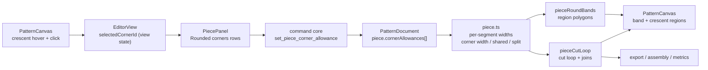

# Per-corner seam allowance

Status: proposed — the direction questions were settled in conversation (D1–D5);
no open questions block this spec
Builds on: `.ai/specs/2026-10-22-pieces-and-allowance.md`,
`.ai/specs/2026-10-20-corner-rounding-tool.md`,
`.ai/specs/2026-10-23-feature-group-and-piece-corner-rounds.md`
Supersedes: the equal-allowance rule and the rejection of the split-midpoint
option in `.ai/specs/2026-10-23-feature-group-and-piece-corner-rounds.md`
(behaviour 6, option C at `:65`) — answered under *Reversal* below
Command spec: `0.16.0` → `0.17.0` (one additive command)
Geometry package: `0.15.0` → `0.16.0` (one additive offset option, one behaviour
change in piece cut loops — see behaviour 3)
Pattern schema: `sewcraft.pattern/0.4` unchanged (one optional field)

## 📝 TLDR

A rounded corner should carry its **own** allowance width, so the green crescent
across the round can be 20 mm while its two edges stay at 10 mm, and that
crescent should be **selectable and editable by itself** on the canvas. Today an
allowance belongs to a loop edge only, a round is a derived bridge that inherits
whatever its two edges agree on, and the whole band is one non-interactive path.
Proposed future behaviour: a piece stores an optional width per corner round, the
band is split into one region per round, and a click on a crescent edits that
corner. The width is absolute millimetres; with none set the crescent inherits its
edges, or splits in half when they disagree.

## 📝 Problem Statement

- **Who needs it:** a maker drafting a corner that needs more seam bulk than the
  rest of the piece — a collar point, a bag gusset, a waistband end. Adding to one
  corner is ordinary pattern work: it is where you either turn the seam or need
  the fabric to spread.
- **What happens today — the feature is blocked from both directions:**
  - An allowance is per loop edge: `Allowance { edge, width, kind? }`
    (`packages/geometry/src/types.ts:230-237`), stored on the piece
    (`Piece.allowances`, same file `:260-261`). There is no place to say "this
    corner is wider".
  - A rounded corner is not an edge. It is a **derived bridge** that `walkLoop`
    inserts between two consecutive loop edges (`packages/geometry/src/piece.ts:287`,
    `:308-311`), so the bridge's offset is resolved from its neighbours by
    `sharedAllowance` (`piece.ts:344-359`), which returns `null` — rendering the
    whole piece unresolvable — when the two edges differ.
  - The equal-allowance rule is deliberate, not an oversight:
    `.ai/specs/2026-10-23-feature-group-and-piece-corner-rounds.md` behaviour 6
    requires it, and its option C (*offset the arc per side, split at the
    midpoint*) was rejected as "no single tangent offset exists, the midpoint is
    arbitrary, and the cut line no longer corresponds to a real construction
    rule". This spec reopens that decision; *Reversal* below answers all three
    objections.
  - The command layer refuses the edit outright: `requireRoundedAllowancesMatch`
    (`commands.ts:3214-3228`) throws *"Remove the corner round before changing one
    side of a rounded corner."* from `set_piece_allowance`
    (`commands.ts:3256`, `:3288`).
  - Rounding such a corner in the first place is refused too:
    `add_corner_round` rejects unequal allowances with *"Both edges need the same
    allowance to round this corner."* (`commands.ts:1848-1859`), and the frontend
    hides those corners (`hasAllowanceMismatch`, `frontend/src/lib/corner-round.ts:183-197`,
    used at `:212`, `:246`, `:346` with the rejection reason `allowance`).
  - Nothing in the band is selectable: the band is one even-odd path built from
    the cut and stitch loops (`PatternCanvas.vue:1107-1133`, rendered at
    `:3309-3320`) inside a `pointer-events-none` layer.
- **The workaround is lossy:** remove the round, set both edges to the wider
  value, re-round, then remove the extra width from the two edges. Every step
  moves the cut loop, and the corner cannot simply be "doubled".
- **Evidence it matters:** the ask is the maker's own workflow, and the two
  guards above exist precisely because the model cannot express the state the
  maker wants. Drafting tools in the field let an allowance be set per edge
  *segment* and per corner join; the gap here is the corner, not the edge.
- **Constraints:** commands stay the only mutation path, `@sewcraft/geometry`
  stays pure, stored `0.4` documents keep loading, the 100 % coverage gate
  applies to every new branch, and v1 adds no new tool.

## 📝 Proposed Solution

### Options considered

| # | Option | Trade-offs | Verdict |
| - | ------ | ---------- | ------- |
| A | **Absolute cut width per round, stored on the piece** (`cornerAllowances: { round, cutWidth }[]`), resolved as a per-segment distance, exposed as one band region per round | Absolute means "20 mm at this corner" survives later edge edits, which is what the maker types. Reuses the loop's existing per-segment distance array (`PieceLoop.distances`, `piece.ts:44-55`) and the offsetter's join machinery, with one new option to make the step square (behaviour 3). Cost: a second allowance list beside `allowances` | **Recommended** |
| B | **Store the width on the `CornerRound` record** | The round *is* the corner, so the data reads naturally. Cost: a round is piece-independent geometry (`types.ts:380-404`) that exists before a piece owns its lines and survives the piece being re-cut; the piece owns the loop the width affects, and allowances already live there. Deleting a piece would orphan the value | Rejected — allowance is piece-scoped |
| C | **Multiplier of the neighbours** (`× 2` stored) | Follows later edge edits. Cost: breaks down exactly when the two edges disagree, which is the state this feature exists to create; a corner would change width when an unrelated edge is edited | Rejected — settled against (D2) |
| D | **Taper the extra width into the neighbours** | A smoother cut line. Cost: needs a width ramp *inside* a segment, which the document cannot store and the offsetter only approximates; the maker still cuts a step in practice | Rejected — settled against (D1) |
| E | **Split every region, including edge strips, and make all of them selectable** | The whole band becomes a selection surface. Cost: an edge is already selectable by clicking its line, and a sharp corner's wedge would need an arbitrary owner or a bisector rule; no measured need | Deferred — edges keep today's behaviour (R4) |

Option A wins because the loop is already a **per-segment** distance field: a
bridge is a run of boundary segments and nothing in the offsetter requires its
segments to share a distance. Option B puts the value on the wrong lifetime;
C and D were ruled out in conversation; E adds selection semantics the ask does
not need.

### Behaviour under the recommended option

1. **Width source.** A round's crescent resolves in this order: the piece's own
   `cornerAllowances` entry for that round → the cut distance both adjacent edges
   agree on (today's rule, including "both none" = no band) → a **split at the
   round's midpoint**, the first half following the incoming edge and the second
   the outgoing one.
2. **Absolute, and always a seam.** The stored value is the cut distance
   (`cutWidth`). A corner carries no `kind`: `double` means *double fold* in this
   codebase (`allowanceDistance`, `piece.ts:75-78`), which is not what "double the
   allowance" means here, and a fold line across a corner arc is not something
   v1 needs (R2).
3. **The step has to be forced, and forcing it is the one real offset change.**
   The offsetter resolves a distance per segment (`offset.ts:220-298`), but
   `joinVariablePoints` only takes its "step" branch when two source directions
   are **exactly** parallel (`Math.abs(turn) <= 1e-9`, `offset.ts:44`, `:130-135`).
   A round's bridge is the arc's cubic Bézier flattened into 16 chords
   (`FLATTEN_SEGMENTS`, `flatten.ts:6`; `cornerRound` → `edgePolyline`), so the
   vertex where an edge meets the bridge turns by ≈2.8° and the arc's midpoint by
   ≈5.6°. A distance change there goes into the miter branch, and the default
   miter limit is 4 × the larger distance (`offset.ts:45`, `:143-144`): 12 mm
   beside 10 mm is accepted as a **~42 mm spike**, while the 20 mm-vs-10 mm example
   only survives because its difference is large enough to be beveled. The step
   is therefore explicit, not incidental:
   `OffsetOptions.tangentStep?: number` (radians, default `0` = today's
   behaviour) makes a vertex with `|turn| ≤ tangentStep` and differing adjacent
   distances return the two offset points — a straight step across. `pieceCutLoop`
   passes `π/18` (10°), which covers both chord turns and stays far below any
   drafted corner; other callers keep the default. The step is perpendicular to
   the bisector rather than to the true tangent, so it is ~2.8° off square
   (~5 % of its length) — invisible at pattern scale, and recorded as an
   approximation.
4. **The split.** The midpoint split assigns the two halves' distances; the same
   `tangentStep` rule turns the join at the arc's midpoint into the split line.
   Split at the bridge vertex nearest **half its arc length**, and where an odd
   segment count leaves a middle segment, give it to the **wider** half so
   reversing the stored loop direction cannot flip the halves. A zero-length
   bridge does not split and takes the incoming edge's cut distance.
5. **Regions.** `pieceRoundBands()` returns one entry per round with a band: the
   crescent as one closed polygon, or two when split. A polygon follows the
   stitch arc forward and the cut loop back, including the join points the step
   adds at each end, so its outline is exactly the line the maker would draw to
   separate one region from the next.
6. **Selection.** With the Select tool, a press that lands on a crescent (and not
   on an entity or dimension) selects that corner; the piece card opens its
   corner row. Moving the pointer over the piece draws every round's separation
   line; moving over a crescent highlights that one. Nothing new is stored on the
   document — the selection is view state.
7. **Editing.** The corner row in the piece card takes a width in millimetres,
   **Inherit** (remove the entry) and **Double** (write `2 × the current base`).
   A doubled corner is therefore the literal number 20, not a stored multiplier.
8. **Exports and measurements follow automatically.** SVG, assembly shapes, cut
   area and allowance area all read the cut loop (`pieceCutLoop`,
   `export.ts`), so a corner width changes them with no export branch.
9. **The two old guards retire.** `set_piece_allowance` no longer refuses one side
   of a rounded corner, and `add_corner_round` no longer refuses unequal
   allowances — the split crescent is the answer in both cases. The frontend's
   `allowance` rejection reason and `hasAllowanceMismatch` go with them.

### Reversal of the 2026-10-23 equal-allowance decision

The earlier spec introduced the equal-allowance rule and rejected the midpoint
split with three objections. They are answered here rather than ignored:

| Objection (`2026-10-23-feature-group-and-piece-corner-rounds.md:65`) | Answer |
| ------------------------------------------------------------------- | ------ |
| "No single tangent offset exists" | True, and this spec does not pretend otherwise. The crescent is not one offset: two halves keep their own offsets and meet at a step |
| "The midpoint is arbitrary" | It is deterministic and now visible: nearest half the arc length, odd segment to the wider half, and it disappears the moment the corner has a width. Its only job is to keep a piece resolvable when the maker has set no corner width |
| "The cut line no longer corresponds to a real construction rule" | The rule is explicit: each side offsets by its own allowance and the change is cut square at the split (behaviour 3). The step *is* the construction |

What stays rejected from that spec's option list is the **interpolation** variant
(this spec's option D): a width that ramps inside a segment has no stored form
and is not what gets cut.

## 📝 Architecture



Takeaway: the document stores one width per corner; a single per-segment resolver
feeds the cut loop, the region polygons, exports and measurements, so a corner
cannot render one width and export another.

### Geometry package

- `types.ts` — `CornerAllowance { round: EntityId; cutWidth: number }`, and
  `Piece.cornerAllowances?: CornerAllowance[]` (absent = none, like `quantity`).
- `offset.ts` — `OffsetOptions.tangentStep?: number` (radians, default `0`), read
  only by `joinVariablePoints`'s turn test; `seamAllowancePath` and every other
  caller keep today's geometry. Package `version` moves to `0.16.0` with the
  behaviour change recorded in `geometry-core.md`.
- `piece.ts` —
  - `LoopSegment` (`piece.ts:31-39`) gains `round: EntityId | null`, set where
    `walkLoop` inserts a bridge (`piece.ts:287`, `:308-311`) from
    `roundBetween()` — already exported (`corner-round.ts:134`), so
    `roundBridge`'s signature does not move.
  - `cornerAllowanceForRound(piece, round)` — mirrors `allowanceForEdge`
    (`piece.ts:80-83`).
  - One private resolver replaces the bridge branch of `loopDistances`
    (`piece.ts:361-404`) and returns `{ distance, fold }` **per segment**, with
    the three cases of behaviour 1. `loopDistances` keeps its signature as the
    distance projection; `pieceFoldLines` (`piece.ts:483-503`) projects `fold`,
    so a `double` edge still ends its fold line at the tangent.
  - `pieceCutLoop` (`piece.ts:466-476`) passes
    `{ closed: true, tangentStep: TANGENT_STEP }` so a distance change at a
    bridge end or the split midpoint cuts square.
  - `pieceRoundBands(document, piece): RoundBand[]`, `RoundBand =
    { round, state: 'own' | 'inherited' | 'split', parts: Vec2[][] }`. Skips
    rounds whose band is empty, and returns `[]` when the cut loop is compacted
    (`cut.vertices.length !== loop.points.length`, the case `pieceCutEdge` already
    guards at `piece.ts:567-569`) or self-intersecting, where the band is drawn as
    an error and no region is offered.
- `commands.ts` — the new command (below); `requireRoundedAllowancesMatch`,
  `roundedNeighbours`, and the `allowancesAgree` call in `add_corner_round`
  retire. `allowancesAgree` itself goes if nothing else reads it.
- `migration.ts` — no change: an optional field with "absent = none" needs no
  normalisation. `document.ts` — no change (`createPiece` still starts with
  edges only).
- `export.ts` / `assembly.ts` — no change; both already consume the cut loop.

### Frontend

- `frontend/src/lib/allowance-regions.ts` (new, pure) — `pointInPolygon`,
  `roundRegionAt(document, piece, world)` returning the round whose crescent
  contains the point (walk order, first match, stable), and
  `pieceContainsPoint(document, piece, world)` for the hover that reveals the
  separators. Both are unit-tested; neither touches Vue.
- `frontend/src/lib/pieces.ts` — `PieceCornerRow`
  (`round`, `radius`, `cutWidth: number | null`, `inherited: number | null`,
  `halves: number[]`, `state: 'own' | 'inherited' | 'split' | 'none' | 'broken'`)
  and `PieceSummary.corners`, built from `cornerRounds()` + `pieceRoundBands()`.
- `PatternCanvas.vue` —
  - a `piece-corner-layer` between the band (`:3309`) and the cut loop (`:3554`)
    drawing each band part as a path: fill inherits the band tint, stroke only
    while the piece is hovered (thin) or the region is hovered/selected (thick);
  - pointer state `hoveredRoundId` set in `onCanvasPointerMove`
    (`:2571-2600`) and cleared in `onCanvasPointerLeave` (`:2639-2645`), active
    only for the Select tool with allowances visible and not `readOnly`;
  - a press inside a crescent that resolves to no entity/dimension
    (`hitEntity`, `:1814-1821`) starts the marquee as it does today; the crescent
    is selected on **release**, and only when the gesture did not become a
    marquee or a pan, so a drag from inside the band still marquees;
  - new props/emits `selectedCornerId` / `update:selectedCornerId`.
- `EditorView.vue` — `selectedCornerId` ref beside `selectedEntityIds`
  (`:192`), cleared by Escape, a tool change, a piece tab change, a click that
  selects something else, and a document change that drops the round; the
  `set-piece-corner-allowance` handler mirrors `onSetPieceAllowance`
  (`:1453-1468`).
- `PiecePanel.vue` — a **Rounded corners** block after *Per-edge allowances*
  (`:271-320`), rows keyed by round, plus the **Double** and **Inherit** actions.
  The card is rendered twice (drawer and inspector), so both gain it for free.
- `frontend/src/lib/corner-round.ts` — `hasAllowanceMismatch` and its three call
  sites retire, together with the `allowance` rejection reason.
- `frontend/src/lib/command-ids.ts` — one new id prefix for the command.

### Documentation

- `docs/domain/command-spec.md`, `docs/domain/command-spec.json`,
  `config/geometry.php` — the new command (three-way sync, `spec_version`
  `0.17.0` on the same PR) and the relaxed wording of `set_piece_allowance` and
  `add_corner_round`.
- `docs/architecture/geometry-core.md` — per-segment allowance resolution, the
  tangent step, the midpoint split.
- `docs/architecture/data-model.md` — `Piece.cornerAllowances`.
- `docs/domain/glossary.md` — **Corner allowance** and **Split crescent**.
- `BACKWARD_COMPATIBILITY.md` — a note under the stored-schema surface: the field
  is additive inside `0.4`; an older build keeps the document and the field but
  draws the inherited width, so the wrong cut line, area and export appear with no
  error. That is the downgrade trade-off to record, alongside the geometry change
  from the new offset option.

## 📝 Data Model

```ts
export interface CornerAllowance {
  /** The corner round this cut distance belongs to. */
  round: EntityId;
  /** Cut distance in millimetres; must be > 0. */
  cutWidth: number;
}

export interface Piece {
  // …
  /** Cut distances for corner rounds; a round with no entry inherits its edges. */
  cornerAllowances?: CornerAllowance[];
}
```

| Situation | Crescent distance |
| --------- | ----------------- |
| Own cut width set | That distance on every bridge segment; a step at both tangent points |
| No entry, the two edges agree (including both none) | Today's shared value, i.e. `allowanceDistance()` of the shared allowance (`piece.ts:75-78`); no step |
| No entry, the edges differ | Each edge's own `allowanceDistance()`, split at half the bridge's arc length, odd segment to the wider half |
| Entry with a non-finite or ≤ 0 value | Ignored, treated as absent (the command never writes one) |
| Two entries for one round | First match wins; the next command that rewrites the piece drops the duplicate |

- **`cutWidth`, not `width`.** `Allowance.width` is the *finished* width and its
  `kind` decides the cut distance (`double` cuts at `2 × width`,
  `docs/domain/command-spec.md:470-482`). A corner has no kind — it is always
  seam-like, so its cut distance is the number the maker types. Naming the field
  `width` would put a cut value where every other `width` is finished, so the
  field, the command param and the card row all say **cut**.
- Absent array or absent entry means "inherit". No kind, no fold line, no default
  preset: a corner width never arrives from `defaults.allowance` or from **Apply**
  on the edges.
- Entries naming an unknown round, or a round whose two lines are not both in
  this piece, are **ignored when resolving** rather than dropped on load; they
  are cleaned by the next command that rewrites the piece.

## 📝 API Contracts

### `set_piece_corner_allowance`

Set, change or remove one rounded corner's own cut width.

- params: `piece: entity_id`, `round: entity_id`, `cutWidth?: number` (mm, the
  distance the cut line moves), `remove?: bool`
- `piece` must exist; `round` must be a corner round of that document whose two
  lines are both in that piece's loop.
- `remove: true` drops the entry and takes no `cutWidth`; removing an entry that
  is not there is a no-op with `inverse: null`.
- Otherwise `cutWidth` is required, finite and greater than `0`. The entry is
  keyed by round, so a second call replaces rather than appends. Re-applying the
  stored value is a no-op with `inverse: null`.
- inverse: `set_piece_corner_allowance` with the previous `cutWidth`, or with
  `remove: true` when the corner had none.

### `set_piece_allowance`

- Unchanged shape. `requireRoundedAllowancesMatch` is removed, so setting one side
  of a rounded corner is now accepted; the crescent splits (behaviour 1).
- The retired message *"Remove the corner round before changing one side of a
  rounded corner."* leaves the code and the docs.

### `add_corner_round`

- Accepts lines whose allowances differ. The "both edges need the same allowance"
  rejection and the frontend's `allowance` rejection reason retire.
- Every other rejection stays.

### Cascade and cleanup

- `remove_corner_round` drops that round's `cornerAllowances` entry (the piece
  usually survives).
- `delete_entity` already strips an edge's allowance (`commands.ts:1086-1094`)
  and must strip corner allowances for rounds its cascade removed.
- `set_piece_loop` drops entries whose round is no longer inside the piece, on
  **both** paths: the normal rewrite and the early clear (`edges: []`), whose
  no-op comparison (`commands.ts:2614-2620`) must include `cornerAllowances` so a
  corner-only change is not swallowed as a no-op.
- Undo of `remove_corner_round` recreates the round with a **new id**, so it does
  not restore the corner's cut width (existing id churn, documented, not a new
  break). Undo of the width command and of entity deletion restores exactly.

### Command spec sync

Three files plus `CommandSpecTest`: params `piece`, `round`, `cutWidth?`,
`remove?`, `inverse: set_piece_corner_allowance`; `spec_version` `0.17.0`. The
document gains a **Migration from spec 0.16.0** section (the house convention —
`docs/domain/command-spec.md:675-712`), the new rule joins the shared validation
list (`:655-665`), and `tests/Feature/CommandSpecTest.php:6` moves its hard-coded
`version` value. No HTTP route changes; `GET /api/commands` carries the new
entry.

## 📝 UI/UX

Mockup: `assets/per-corner-allowance/mockup-01-regions.html` (four states: today,
the split crescent, a 20 mm corner beside 10 mm edges, and the split-in-half
fallback).

### Canvas

| Pointer state | What is drawn |
| ------------- | ------------- |
| Select tool, pointer inside the piece's cut loop, no region hovered | Every round's separation line, thin, 0.75 px |
| Pointer over a crescent | That region fills stronger, 1.5 px outline |
| Crescent selected | Strongest fill, solid outline; the piece card scrolls to its row |
| Drawing tools, or allowances hidden | Nothing: no region outlines, no picks (R3) |

- Click selects the corner and clears the entity/dimension selection (clicks stay
  exclusive, like every other canvas pick). A modified click is **not** handled
  here and falls through to the existing behaviour.
- **Release decides.** A press that resolves no entity or dimension
  (`hitEntity`, `:1814-1821`) behaves as it does today — marquee, or pan on
  touch — and on pointer-up an unmoved press inside a crescent selects the corner
  instead. A press that became a marquee or a pan selects nothing, and an entity
  or dimension hit always wins over a region. The gesture sits after the
  `moveMode` return (`:2407-2411`), the cross-piece guard (`:2415-2423`) and the
  constraint and round-corner tool returns (`:2429-2439`), and never runs when
  `readOnly` is true.
- **Touch.** A tap on empty canvas currently clears the selection and pans
  (`:2445-2451`). A tap inside a crescent selects the corner instead and does not
  pan; panning anywhere else is unchanged.
- `Escape` clears the selection.

```
[Select]  hover the piece ─▶ separators at every round
          click a crescent ─▶ corner selected, piece card shows its row
          click elsewhere  ─▶ today's behaviour (select entity, clear, marquee)
```

### Piece card — *Rounded corners*

| Row state | Shows | Actions |
| --------- | ----- | ------- |
| `own` | `R 12` · cut width `20` mm · the corner's own value | Inherit · Double |
| `inherited` | `R 12` · empty field with placeholder `10` · "from the edges" | Double |
| `split` | `R 12` · no field · pill **Split** · `10 / 20 mm` | Set cut width (enables the field) |
| `none` | `R 12` · pill **No allowance** | Set cut width |
| `broken` | `R 12` · no field, rows read-only | — (the piece card already reports the broken loop) |

- **Double** writes `2 × the current base`: the corner's own cut width when it has
  one, otherwise the inherited cut distance. Disabled when there is no single
  base (`split`, `none`, `broken`) — the maker types the number instead.
- **Inherit** removes the entry; on edges that disagree the row becomes `split`.
- An invalid or unchanged number snaps back without a command, like the per-edge
  rows (`PiecePanel.vue:127-139`).
- The selected row is highlighted, so canvas selection and the card agree.
- The row's unit is **cut** millimetres, matching the command param; for a seam or
  single-fold neighbour the two numbers coincide, so the label reads as ordinary
  width in the common case.

### Accessibility

- The crescents are decorative (`aria-hidden`); the card rows are the keyboard
  path, each with an `aria-label` naming the radius and state, and the width input
  keeps the existing `min`/`step` contract.
- Selection changes announce through the canvas's existing live region; the
  separators are never the only signal of a state.

## 📝 Edge Cases & Failure Scenarios

| Scenario | Expected behaviour |
| -------- | ------------------ |
| Corner cut width equals the edges' cut distance | Renders with no step; stored as an own value, so later edge edits do not move it |
| Corner width on a round whose two lines leave the piece | Entry kept but ignored; the crescent resolves from what is left |
| Round deleted | Entry removed with it; no stale id |
| Piece loop replaced | Entries for rounds no longer inside are dropped |
| Edge deleted (cascades the round) | Entry removed with the round; snapshot undo restores both |
| Neighbours disagree, no corner width | Two halves, one step at the midpoint; the piece resolves and the band renders |
| Neighbours disagree and one has no allowance | One half is empty; only the other has a band |
| Degenerate or zero-length bridge | No split; the incoming edge's cut distance applies |
| Self-intersecting cut loop (compacted vertices) | No regions; band and cut loop render exactly as today; no picks |
| Piece loop does not resolve (a deleted edge) | No regions and read-only corner rows; the card already reports the broken loop |
| Duplicate entry in a hand-edited document | First entry wins when resolving; the next rewrite drops the extra |
| Touch device | A tap inside a crescent selects it; a tap anywhere else still clears and pans |
| Two crescents overlap on a very short edge | Both render; the hit test takes the first in walk order, deterministically |
| Small width difference (e.g. 12 mm beside 10 mm) | Still a clean step: `tangentStep` returns the two offset points. Without it the miter branch would accept a ≈42 mm spike |
| Shallow corner (turn ≤ 10°) whose edges differ | The cut now steps instead of a possible miter spike — a deliberate behaviour change of the cut loop, recorded in `geometry-core.md` |
| Very large corner width, or a tiny round | The cut loop may self-intersect: no regions, the band shows the existing error state, and the value is never silently clamped |
| Round added after a corner width exists | New round id, so no width; the row starts `inherited` |
| Undo `remove_corner_round` | Round returns with a new id; the width does not return (documented) |
| Stored `0.4` document with no field | Loads and renders byte-identically; no cut path change |
| Older build opens a document with the field | Loads and saves it, draws the inherited width: wrong cut line, area and export, silently — noted in `BACKWARD_COMPATIBILITY.md` |
| `readOnly` / assembly canvas | No region layer, no picks; the cut geometry still shows the corner width |
| Allowances hidden by the display menu | No band, no regions, no picks |

## 📝 Risks & Impact Review

- **A previously rejected edit becomes legal (medium, product).** Both
  `add_corner_round` and `set_piece_allowance` change behaviour, and the frontend
  stops hiding unequal corners. That is the point of the feature, but it is a
  user-visible change to two existing surfaces; the browser pass must cover
  rounding an unequal pair and editing one side of a round.
- **The offsetter gains a behaviour change (high, geometry contract).**
  `tangentStep` defaults to `0`, so only piece cut loops change — but they do
  change for any shallow vertex whose adjacent widths differ, including documents
  drawn before this feature. It is geometry math, so the package version moves to
  `0.16.0`, `geometry-core.md` records it, and tests pin both the new step and the
  unchanged default. Shipping the option without wiring it into `pieceCutLoop`
  would leave the step silently absent and the spike in place.
- **Silent downgrade (medium, compatibility).** An older build ignores
  `cornerAllowances` and still loads and saves the document — `normalizeDocument`
  and every command spread the piece (`migration.ts:96-117`, `commands.ts:1091`),
  so the field survives while the cut loop renders the inherited width. The result
  is wrong geometry, area and export with no error and no data loss: quieter than
  the `at: 'edge'` precedent, so the `BACKWARD_COMPATIBILITY.md` note must say
  exactly that.
- **The step can read as a bug (medium, design).** A 20 mm crescent beside 10 mm
  edges shows two jogs, and they are ~2.8° off square because the flattened arc has
  no exact tangent. That is the correct cut within a few tenths of a millimetre,
  and the separation line only appears on hover, but the browser pass must look at
  a 2 mm difference as well as the 10 mm example — the small difference is exactly
  where the old code spiked.
- **A settled decision is reversed (medium, process).** The 2026-10-23 spec chose
  the equal-allowance rule on purpose; this one supersedes it with the answers in
  *Reversal*. A reviewer who disagrees should say so there, not discover it in a
  diff.
- **Hit-testing steals clicks (low).** Region picks sit behind entity and
  dimension picks, and only a click (not a drag) selects, so existing selection
  and marquee keep working. Both rules need tests, not only a manual pass.
- **Selection drift (low).** A loop edit, a deleted round or a piece tab change
  must clear `selectedCornerId`; a stale id would highlight a row that no longer
  exists.
- **`double` adjacency (low).** A double-fold edge (cut distance `2 × width`)
  next to a corner width makes a taller step and ends its fold line at the
  tangent; both follow from the per-segment resolver and are covered by tests.
- **Coverage (low).** The resolver's three cases, the split tie-break, the
  `tangentStep` branch, the compacted-loop guard and the region builder are
  branches; each gets a test, so the 100 % gate needs no ignore comment.

## ❓ Decisions settled

| # | Question | Answer |
| - | -------- | ------ |
| D1 | Does a wider corner taper into its neighbours or step at the tangent points? | **Step.** What you cut, and the offsetter already produces it |
| D2 | Absolute width or a multiplier of the neighbours? | **Absolute millimetres**, stored per round; later edge edits leave it alone |
| D3 | Two edges with different allowances meet at a round, no corner width | **Split the crescent in half**, each half following its own edge |
| D4 | Which regions are editable? | **Rounded corners only**; sharp corners stay part of their edge strips |
| D5 | When are the split lines visible? | **On hover** of the piece, not permanently |

## ✅ Resolved assumptions (non-blocking)

| # | Assumption | Why | Status |
| - | ---------- | --- | ------ |
| R1 | The corner is edited from a row in the piece card, not a popover on the canvas | The card is already the single home for allowances and is mounted twice (drawer and inspector), so the row costs one block, not a new component | Reversible |
| R2 | A corner stores a cut width only — no `seam`/`single`/`double` kind, no fold line | `double` already means double fold; offering it next to a "Double" action would read as the same thing. The field is named `cutWidth` so it cannot be mistaken for a finished width. A kind can be added later without breaking the field | Reversible |
| R3 | Regions and separators are screen-only, drawn only with the Select tool and only while allowances are shown | Keeps the drawing tools clean and keeps the export unchanged; the same rule the band and seam layers already follow | Reversible |
| R4 | Edge strips stay non-selectable; an edge is still selected by clicking its line | The ask is the corner; a strip pick would compete with line picks for no benefit | Reversible |
| R5 | No new tool, command category or ribbon entry; the Select tool gains the pick | Smallest surface, and the canvas already owns selection gestures | Reversible |
| R6 | The corner selection lives in view state, never in the document | It is not part of the pattern; storing it would make undo and autosave churn | Reversible |
| R7 | Overlapping crescents resolve in walk order | Deterministic and testable; no nearest-centroid search needed | Reversible |

## ✅ Acceptance criteria

1. A round carrying 20 mm between two 10 mm edges cuts a 20 mm crescent, shows a
   step at each tangent point, and reports a larger cut area than the same piece
   with 10 mm throughout. A 12 mm corner beside 10 mm edges also steps: no miter
   spike past a few tenths of a millimetre.
2. Rounding a corner whose two edges have different allowances succeeds and
   renders a split crescent; setting one side of an existing round no longer
   throws.
3. `pieceRoundBands` returns one polygon for an own/inherited crescent and two
   for a split one, and `[]` for a piece whose cut loop is compacted or
   self-intersecting.
4. With the Select tool, hovering the piece reveals separators only at rounds;
   hovering and clicking a crescent selects it; clicking a line still selects the
   line; a drag inside the band still marquees; a touch tap selects instead of
   panning.
5. The corner row offers a cut width, Inherit and Double, with Double writing
   twice the base and disabled while the crescent is split, broken or absent.
6. `set_piece_corner_allowance` validates its inputs, replaces instead of
   duplicating, no-ops on an unchanged value, and its inverse restores the
   previous value (or removes the entry).
7. A `sewcraft.pattern/0.4` document without `cornerAllowances` loads and produces
   the same cut path as before this change; with `tangentStep` at its default,
   legacy seam paths and every non-piece offsetter caller are unchanged.
8. The full gate passes: `npm test`, `npm run test:coverage` at 100 % across
   `packages/geometry/src`, `frontend/src` and backend `app/`, `npm run lint`,
   `npm run format:check`, `npm run typecheck`, `npm run build`, and the Pest
   command from `AGENTS.md`.

## 📋 Phasing

This is one feature, not a bundle: a corner width that can neither be set nor
seen is not shippable, and the split rule is the only coherent answer for the
differing-edges state the old guards already own. The internal seam is still
real — Phases 1–2 land usable data with no canvas surface, so the work can stop
after Phase 2 without a half-built document model.

- **Phase 1 — Model and geometry.** `CornerAllowance`, the `tangentStep` offset
  option, the per-segment resolver, the split rule, `pieceRoundBands`, and the
  retirement of the two guards. Nothing renders differently for a piece with no
  rounds, and nothing non-piece changes at all.
- **Phase 2 — Command and contract.** `set_piece_corner_allowance`, cleanup on
  round/edge/loop changes, three-way command-spec sync at `0.17.0`.
- **Phase 3 — Surface.** Card rows, canvas regions, hover, selection and the
  Double/Inherit actions.
- **Phase 4 — Docs and verification.** The remaining docs, the compatibility
  note, the full gate and a browser pass with screenshots.

Each phase leaves the app working: Phase 1 adds resolvers and a field nothing
writes yet; Phase 2 makes the widths storable and valid; Phase 3 makes them
visible and editable; Phase 4 verifies.

## 📋 Implementation Plan

1. **Step 1 — Types and helper.** Add `CornerAllowance` with `cutWidth` and
   `Piece.cornerAllowances?`, plus `cornerAllowanceForRound`. Tests: a piece with
   one entry, a piece without the array, an entry for a foreign round, a
   non-finite or `0` value ignored.
2. **Step 2 — Bridge identity.** Give `LoopSegment` its `round` from
   `roundBetween()` at both bridge sites. Tests: a rounded corner's segments carry
   the round id; a plain corner carries none.
3. **Step 3 — Offset step option.** Add `OffsetOptions.tangentStep`, the
   `joinVariablePoints` turn test, and `pieceCutLoop`'s `TANGENT_STEP` argument.
   Tests: default `0` reproduces today's joins byte-for-byte; a 12-vs-10 change at
   a flattened tangent bevels instead of a ≈42 mm miter; a 90° corner is
   unaffected; the option does not reach `seamAllowancePath`.
4. **Step 4 — Per-segment resolver.** Replace the bridge branch of
   `loopDistances` with the three-case resolver returning `{ distance, fold }`,
   and rewrite `pieceFoldLines` on top of it. Tests: own cut width, inherited
   agreement, disagreement split (even and odd segment counts, the wider-half
   tie-break under a reversed walk), zero-length bridge, and a `double`
   neighbour's fold line stopping at the tangent. `npm run test:coverage` stays at
   100 %.
5. **Step 5 — Regions.** Add `pieceRoundBands` and build a crescent polygon from
   the stitch span and the cut vertices, including the step's join points. Tests:
   one part, two parts, no band, compacted cut loop, self-intersecting cut loop, a
   round with one side empty.
6. **Step 6 — Guards.** Remove `requireRoundedAllowancesMatch` (and
   `roundedNeighbours`), and the allowance check in `add_corner_round`. Tests: the
   formerly rejected edits now succeed, every other rejection stays, the retired
   messages are gone.
7. **Step 7 — Command.** Add `set_piece_corner_allowance` with validation, no-op,
   inverse and journal wiring; strip entries in `remove_corner_round`,
   `delete_entity` and both `set_piece_loop` paths. Tests: each rejection, the
   replace-instead-of-append rule, the no-op, undo and redo, each cleanup path
   including the early clear.
8. **Step 8 — Command spec.** Sync the three files, bump `spec_version` to
   `0.17.0`, add the *Migration from spec 0.16.0* section, widen the
   `set_piece_allowance`/`add_corner_round` wording and the shared validation
   list, and move `CommandSpecTest`'s hard-coded version.
9. **Step 9 — Frontend data.** `PieceCornerRow` in `PieceSummary`,
   `allowance-regions.ts` with `pointInPolygon`, `roundRegionAt` and
   `pieceContainsPoint`, and the `set-piece-corner-allowance` dispatch path in
   `EditorView`. Tests: row states including broken, point-in-polygon edges,
   first-match order, the command payload.
10. **Step 10 — Canvas.** The corner layer, hover, click selection with the
    marquee threshold, touch-tap handling, the guard ordering, the clear rules and
    `selectedCornerId` wiring. Component tests: the separator set, the hover, the
    click, the marquee, the touch tap, the clearing rules, `readOnly` and
    `moveMode`.
11. **Step 11 — Card.** The *Rounded corners* block with the cut-width field,
    **Inherit**, **Double**, the split pill, the broken state and the selected
    row. Component tests: each state, the Double base, the disabled cases, the
    snap-back, the selected highlight.
12. **Step 12 — Docs.** `geometry-core.md`, `data-model.md`, `glossary.md`,
    `BACKWARD_COMPATIBILITY.md`.
13. **Step 13 — Verification.** The full gate plus a browser pass over: a 20 mm
    corner beside 10 mm edges, a 12 mm corner beside 10 mm (the spike case), a
    split crescent, rounding an unequal pair, selection via canvas and via the
    card, a `double` neighbour, and a hidden allowance layer. Screenshots attached
    to the PR when a provider is available.
