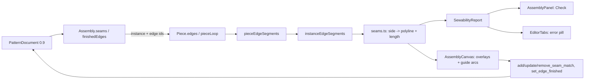
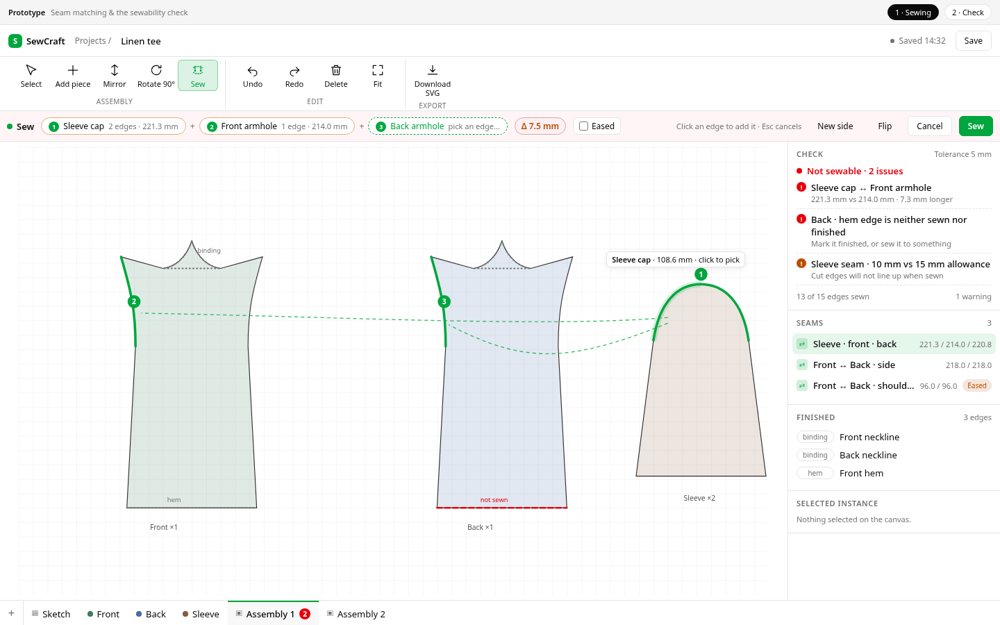
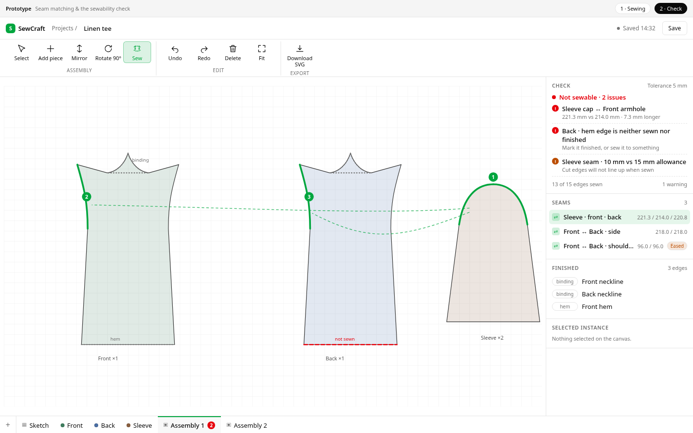

# Seam matching and the sewability check

Status: **proposed** — decisions Q1–Q3 were taken with the maintainer on
2026-11-07; there are no open questions. Design only: nothing here is built yet.

Builds on: `2026-10-25-piece-tabs-and-assemblies.md` (assemblies, instances and
placement math), `2026-10-22-pieces-and-allowance.md` and
`2026-10-25-piece-containers-and-annotations.md` (the piece loop),
`2026-10-19-seam-allowance-sketch-tool.md` (per-edge allowances) and the
`split_line` command from `2026-11-06-line-split-tool.md`.
Command spec: `0.21.0` → `0.22.0`. Pattern schema: `sewcraft.pattern/0.8` →
`sewcraft.pattern/0.9`.
Prototype: `.ai/specs/assets/seams-and-sewability/mockup-01-seams.html` (two
states; `#check` opens the result). Screenshots:
`mockup-01-seams-sewing.png` and `mockup-01-seams-check.png`.

## 📝 TLDR

A maker records which stretches of which placed pieces are sewn together, and
which edges are finished instead (hem, binding, fold, opening). The assembly tab
then answers one question — **is this pattern sewable?** — by reporting every
edge that is neither sewn nor finished, every seam whose sides do not measure the
same, and every seam that no longer resolves. Matched edges are drawn as paired
overlays with a guide arc, and a count sits on the assembly's tab.

This is deliberately **not** a 3D preview. It is the data model and the arithmetic
a 3D preview would need, shipped alone because it is useful alone: it catches the
drafting mistakes that make a garment unsewable before anything is cut.

## 📝 Decisions

| #   | Question                                                          | Decision                                                                                                                                       |
| --- | ----------------------------------------------------------------- | ---------------------------------------------------------------------------------------------------------------------------------------------- |
| Q1  | How is a deliberate length difference (sleeve ease) treated?       | A difference beyond **5 mm** is an error unless the seam is flagged **eased**, in which case it is reported as a warning with its delta.        |
| Q2  | Which "finished" kinds exist?                                     | **`hem`, `binding`, `fold`, `opening`** — a closed enum so the report can name and group them.                                                  |
| Q3  | What happens to seams when a sewn edge is split or removed?       | `split_line` **repairs** every seam that names the edge, in place. Any other break (deleted edge, re-authored loop) is reported, never guessed. |
| D4  | Where does a seam live?                                           | On the **assembly**, naming instances. A seam joins placed pieces, not pieces in the abstract; two assemblies may sew the same pieces differently. |
| D5  | What can a seam side address?                                     | A **run of consecutive loop edges** on one instance. Mid-edge spans (arbitrary start/end points) are out of scope; `split_line` is the escape.  |
| D6  | How many sides may a seam have?                                   | **Two or more**, ordered by layer. A three-layer seam is one record, not three pairwise seams.                                                   |
| D7  | Where does the tolerance live?                                    | A **package constant**, not stored in the document. Per-seam tolerance is a later, additive field.                                              |
| D8  | Does the check block anything?                                    | **No.** It is advisory: save, export and the editor behave exactly as today. Only the disaster of a malformed document is prevented by validation. |
| D9  | How is the verdict surfaced?                                      | A **Check section** in the assembly panel plus an **error count pill on the assembly tab**, so it stays visible with the panel closed.          |

## 📝 Problem Statement

- **Who needs it:** the maker drafting a multi-panel pattern (front, back, sleeve,
  facing) who must hold the sewing order in their head, and who cannot tell a
  forgotten edge from a deliberately free one by looking at the layout.
- **What happens today:** an assembly places instances and nothing else. There is
  no record anywhere of what is sewn to what, so no tool can check a pattern, and
  a future 3D preview has nothing to consume. The vocabulary already exists in
  the domain — `docs/domain/glossary.md` names seams and seam allowances — but the
  document has no seam record; the legacy `Seam` type in `types.ts` is a
  deprecated *allowance* record and must not be reused.
- **What the pieces already give us:** a piece is an ordered closed loop of edge
  ids (`Piece.edges`), and `pieceLoop()` already resolves the stitch loop and each
  edge's span into it (`starts`, `spans`, `naturalStart`). Edge identity, order
  and length are therefore derived, not stored — the seam record only has to say
  *which edges are paired*, never what shape they are.
- **Evidence it matters:** the 2026-11-07 exploration and the prototype above.
  Every real pattern has edges that legitimately sew to nothing (hems, bound
  necklines, openings) and edges that must sew to something; without a record the
  two are indistinguishable, which is exactly the mistake the check exists to
  catch.
- **Constraints:** commands are the only mutation path; `@sewcraft/geometry`
  stays pure and dependency-light; units remain millimetres; the stored schema is
  additive so `0.8` documents keep loading; the 100 % coverage gate applies to
  every branch; no backend change, because `patterns.geometry` is opaque JSON.

## 📝 Proposed Solution

### Options considered

| #   | Option                                                                                                | Trade-offs                                                                                                                                                                                                                       | Verdict                        |
| --- | ----------------------------------------------------------------------------------------------------- | -------------------------------------------------------------------------------------------------------------------------------------------------------------------------------------------------------------------------------- | ------------------------------ |
| A   | **`Assembly.seams[]` naming instance + edge run**, plus `finishedEdges[]`                             | Everything lives where placement already lives; one document round-trip; the check is a pure function of the assembly slice. Costs a schema addition and four commands.                                                            | **Recommended**                |
| B   | **Seams as a new `kind: 'seam'` entity**, like marks                                                  | Reuses selection, `delete_entity` and the inspector. But a seam has no geometry of its own, spans two instances, and would have to be excluded from `pieceEdges`, `entityPoints` and the solver — a second lifecycle for nothing.        | Rejected — wrong owner        |
| C   | **`Piece.seams[]`**, joining piece edges to piece edges                                               | No assembly dependency, and a seam would apply to every instance. But a sleeve sewn into one assembly and left loose in another is legitimate, and a seam needs two *placed* things to have a direction.                              | Rejected — D4                 |
| D   | **Infer seams automatically** from equal edge lengths                                                 | Zero authoring. But the same 80 mm edge can plausibly join three others, and a real pattern has many equal lengths by accident; a wrong guess is worse than no guess.                                                              | Rejected — unreliable         |
| E   | **Make the check a hard gate** on save or export                                                      | Stronger guarantee. But a work-in-progress pattern is unsewable by definition, and blocking save would lose work.                                                                                                                 | Rejected — D8                 |

### Shape

- **Model.** `Assembly` gains optional `seams: SeamMatch[]` and
  `finishedEdges: FinishedEdge[]`. `SeamMatch` holds 2+ `SeamRun`s (instance,
  run of edges, direction) and an `eased` flag. A `FinishedEdge` names an
  instance, an edge and one of four kinds. Both arrays are optional and absent
  means empty, so a `0.8` document needs no conversion.
- **Rules.** Every edge of every placed piece's resolved loop is in exactly one
  seam side **or** marked finished. A seam's sides must measure within 5 mm of
  each other unless eased, and should carry the same cut allowance. Anything that
  cannot be resolved is reported, never repaired silently.
- **Geometry.** One new pure module, `packages/geometry/src/seams.ts`, resolving
  a side to an assembly-space polyline, its length, a validation predicate and the
  whole-assembly report. It builds on two new per-edge accessors (`piece.ts`,
  `assembly.ts`) that the canvas needs anyway for edge picking.
- **Editor.** A **Sew** mode in the assembly ribbon; the canvas highlights the
  stitch edge under the pointer and accumulates picks; a prompt bar shows the
  running sides, their lengths and the eased flag; the panel gains **Check**,
  **Seams** and **Finished** sections; the assembly tab gains an error-count pill.
- **Nothing else moves.** No export, no backend, no solver, no ribbon change on a
  piece tab.

## 📝 Architecture



The takeaway: the stored seam is a tiny reference record; everything visible is
derived on read, so an edited piece can never leave a stale seam drawing.

- `packages/geometry/src/types.ts` — `SeamMatch`, `SeamRun`, `FinishedEdge`,
  `FinishKind`, the two optional `Assembly` arrays, `PATTERN_SCHEMA = 0.9`.
- `packages/geometry/src/piece.ts` — new `pieceEdgeSegments(document, piece)`,
  returning the stitch polyline of every loop edge **in authored `Piece.edges`
  order**, excluding the corner-round bridges that `orientedPolylines` produces
  between edges. `null` when the loop does not resolve.
- `packages/geometry/src/assembly.ts` — new
  `instanceEdgeSegments(document, piece, instance)` mapping those polylines
  through `placePoint`; the same function the canvas uses to hit-test an edge.
- `packages/geometry/src/seams.ts` — `SEAM_LENGTH_TOLERANCE`,
  `resolveSeamRun` (assembly-space polyline and length), `validateSeamRun`,
  `validateSeam`, `sewabilityReport`. Pure; no Vue, DOM or network.
- `packages/geometry/src/commands/assemblies.ts` — the four seam commands and the
  cascades in `remove_instance`/`delete_piece`/`delete_assembly`.
- `packages/geometry/src/commands/entities.ts` — `applySplitLine` re-points seam
  runs at the two halves.
- `packages/geometry/src/migration.ts` — `0.9` becomes current; `0.8` stays in
  `KNOWN_PATTERN_SCHEMAS` because the change is additive.
- `frontend/src/components/AssemblyCanvas.vue` — per-edge paths, pointer
  hit-testing, pick/hover/selected overlays, guide arcs, and a `seams` display
  layer.
- `frontend/src/components/SeamPromptBar.vue` — the sewing gesture's running
  state (new; mirrors `ConstraintPromptBar.vue`).
- `frontend/src/components/AssemblyPanel.vue` — Check, Seams and Finished
  sections.
- `frontend/src/components/EditorTabs.vue` — the assembly error pill.
- `frontend/src/views/EditorView.vue`, `frontend/src/lib/editor-ribbon.ts` — the
  Sew action and ephemeral pick state.
- `docs/domain/command-spec.{md,json}`, `config/geometry.php` — three-way sync at
  `0.22.0`.
- `docs/architecture/geometry-core.md`, `data-model.md`, `docs/domain/glossary.md`
  — the seam model, the report contract and the vocabulary.

Backend: no change. `patterns.geometry` is opaque JSON, so the `0.9` shape travels
through `PatternPersistence`, autosave and versioning untouched.

## 📝 Data Model

```ts
/**
 * One side of a seam: a run of loop edges on one placed instance. Named `SeamRun`
 * rather than `SeamSide`, which already means an allowance's left/right offset.
 */
export interface SeamRun {
  /** An instance of the seam's own assembly. */
  instance: EntityId;
  /**
   * Consecutive ids from that piece's `edges`, in authored loop order. The last
   * may join the first, so a run may wrap around the loop.
   */
  edges: EntityId[];
  /**
   * Whether this side is traversed against the run's authored order, so its last
   * edge's end meets the seam's start. Absent means forward.
   */
  reversed?: boolean;
}

/** Two or more sides sewn together; `sides` is ordered by layer. */
export interface SeamMatch {
  id: EntityId;
  sides: SeamRun[];
  /** A deliberate length difference (ease); turns `length_mismatch` into a warning. */
  eased?: boolean;
}

export const FINISH_KINDS = ['hem', 'binding', 'fold', 'opening'] as const;
export type FinishKind = (typeof FINISH_KINDS)[number];

/** An edge that is deliberately not sewn to anything. */
export interface FinishedEdge {
  instance: EntityId;
  edge: EntityId;
  kind: FinishKind;
}

export interface Assembly {
  id: EntityId;
  name: string;
  instances: AssemblyInstance[];
  /** Optional; absent means no seams. */
  seams?: SeamMatch[];
  /** Optional; absent means no finished edges. */
  finishedEdges?: FinishedEdge[];
}
```

`PATTERN_SCHEMA` becomes `sewcraft.pattern/0.9`. Both new arrays are optional, so
`normalizeDocument` needs no conversion step: a `0.8` document loads as-is apart
from the schema stamp, and both arrays stay absent. Every reader uses
`assembly.seams ?? []`.

The **seam length tolerance** is a constant:

```ts
/** Millimetres within which two seam sides count as the same length. */
export const SEAM_LENGTH_TOLERANCE = 5;

/** Two cut allowances closer than this count as equal. */
export const ALLOWANCE_MATCH_TOLERANCE = 1e-6;
```

It is exported so the panel can print it and tests can reason about it. It is not
stored, not editable and not per-seam (D7); `eased` is the per-seam escape.

**Conventions that the contract depends on:**

- An edge id in a `SeamRun` addresses the edge's **stitch** polyline, never its
  cut line. Allowance width is irrelevant to how long a seam is, which is why a
  change of allowance never invalidates a seam.
- Order inside `edges` is `Piece.edges` order, not the derived walk order; the
  walk may run the loop backwards and the side's `reversed` flag is relative to
  the authored order. This keeps the stored order stable when the loop's winding
  changes, and makes adjacency a simple index test with a wrap at the end.
- `sides` order is **layer order**. For a two-layer seam it is the order the
  maker picked; for three or more it is the stacking order. Nothing in the check
  reads it beyond consistency, but a future drape solver needs it and it costs
  nothing to fix now.
- A side may name the **same instance** as another side. That is a dart or a
  sleeve underarm sewn to itself, and it must be allowed.
- A side's **polyline follows the stitch loop** from the run's first edge to its
  last, including any corner-round bridge between consecutive edges of the run.
  The bridge belongs to no edge, but it is part of the seam: it counts in the
  length and it exists in the vertex correspondence. A run that spans a rounded
  corner without its bridge would measure short and would leave a gap in 3D.
- **The seam start is the first edge's outer end** — the end of the run's first
  edge that is not shared with the next edge (or, for a one-edge run, its
  authored start). Every other side is traversed from its own run start, or from
  its run end when `reversed`. This is the correspondence a future preview welds
  by, and it is the reason `reversed` is stored now rather than derived later.

## 📝 API Contracts

### Seam resolution (read-only, pure)

```ts
export interface ResolvedSeamRun {
  instance: EntityId;
  /** Assembly-space stitch polyline, bridges included, in run order. */
  points: Vec2[];
  /** `reversed` as stored; the correspondence reads it, the check ignores it. */
  reversed: boolean;
  length: number;
}

export function resolveSeamRun(
  document: PatternDocument,
  assembly: Assembly,
  side: SeamRun,
): ResolvedSeamRun | null;
```

`resolveSeamRun` is the seam's geometric contract for both consumers: the check
measures `length`, and a future preview samples `points` to weld the sides. It
returns `null` for any unresolvable reference, never throws.

### Report (read-only, pure)

```ts
export type SeamIssueKind =
  | 'unmatched_edge' // error: no seam and no finish mark
  | 'length_mismatch' // error unless eased, then warning
  | 'allowance_mismatch' // warning: sides carry different cut distances
  | 'folded_edge_sewn' // warning: an edge with a double-fold allowance is sewn
  | 'missing_reference' // error: instance, piece, edge or loop no longer resolves
  | 'edge_used_twice'; // error: two seams or a seam and a finish mark claim one edge

export interface SeamIssue {
  kind: SeamIssueKind;
  severity: 'error' | 'warning';
  /** The seam the issue belongs to, when it is about a seam. */
  seam?: EntityId;
  /** The instance and edge to highlight. */
  instance?: EntityId;
  edge?: EntityId;
  /** The other side, for a pair comparison. */
  instanceB?: EntityId;
  edgeB?: EntityId;
  /** Millimetres: side lengths, or cut allowances, per the kind. */
  valueA?: number;
  valueB?: number;
  /** `valueA` minus `valueB`, present on the two comparison kinds. */
  delta?: number;
}

export interface SewabilityReport {
  /** Every edge of every resolved placed loop. */
  edgeCount: number;
  seamCount: number;
  finishedCount: number;
  /** Errors first, then warnings; stable document order inside each. */
  issues: SeamIssue[];
  errors: number;
  warnings: number;
}

export function sewabilityReport(document: PatternDocument, assembly: Assembly): SewabilityReport;
```

`sewabilityReport` is the whole contract consumed by the panel, the tab pill and
the canvas. It is a pure function of the assembly slice, so `documentForAssembly`
must keep passing the assembly through unchanged (it already spreads the target).

**Rule order.** For each placed instance whose loop resolves:

1. Each loop edge is either claimed by exactly one seam side or marked finished.
   Neither → `unmatched_edge`. Both, or twice → `edge_used_twice`.
2. Each seam resolves every side; any failure → one `missing_reference` naming
   the seam and the first unresolvable instance/edge.
3. All resolved sides' lengths are compared; `max − min > SEAM_LENGTH_TOLERANCE`
   → `length_mismatch` (`error`, or `warning` when `eased`).
4. Every edge of every resolved side supplies its cut distance
   (`allowanceDistance`); when the smallest and largest across the whole seam
   differ by more than `ALLOWANCE_MATCH_TOLERANCE` (1e-6 mm) → one
   `allowance_mismatch` (warning) naming those two edges and their values.
5. Any edge in a seam that carries a `double` allowance → `folded_edge_sewn`
   (warning), because a double-fold edge is a fold line, not a seam.

An instance whose piece has no resolvable loop contributes one `missing_reference`
and no edges; it cannot be sewn, and saying so is more useful than silently
skipping it.

### Commands

All four take `assembly` (the id), keep `command.id` as the created record's id
where they create one, and are validated by the rules below. `spec_version` goes
to **0.22.0** and the three files change together.

| Command               | Params                                                    | Rules and undo                                                                                                                                                                       |
| --------------------- | --------------------------------------------------------- | ------------------------------------------------------------------------------------------------------------------------------------------------------------------------------------ |
| `add_seam_match`      | `{ assembly, sides, eased? }`                             | Assembly exists; 2+ sides; every instance belongs to it; every edge is in that instance's piece loop; edges inside a side are consecutive in `Piece.edges` order with at most one wrap; no edge repeats within the seam; no edge already sewn or finished. Record id = `command.id`. Inverse: `remove_seam_match`. |
| `update_seam_match`   | `{ assembly, seam, eased?, sides? }`                      | At least one field. `sides`, when present, passes the same validation as `add_seam_match` while ignoring this seam's own claims. Inverse carries the previous values.                      |
| `remove_seam_match`   | `{ assembly, seam }`                                      | Unknown seam is a no-op. Inverse recreates the record exactly.                                                                                                                       |
| `set_edge_finished`   | `{ assembly, instance, edge, kind }`                      | `kind` is a `FinishKind` or `null` to clear. Instance belongs to the assembly, edge belongs to its loop, and the edge is not in a seam. Inverse restores the previous kind (or `null`).    |

Cascades, each inside the command that triggers it:

- `remove_instance` drops every seam that names the instance **whole** (a seam
  with one side left is meaningless, not repaired) and its finished edges. When
  it dropped anything the inverse becomes `null` and undo relies on the journal
  snapshot; otherwise the existing `add_instance` inverse is unchanged.
- `delete_piece` already removes instances in the same command; those seams and
  finished edges go with them. Its inverse is already `null`.
- `delete_assembly` takes its seams and finished edges with it (the whole record
  is deleted).
- `split_line` replaces the split edge **in place** with `[originalId,
  command.id]` inside every seam side that names it. The original id survives as
  the `start → point` half, which is exactly the authored order, so no direction
  bookkeeping is needed.

`config/geometry.php`, `docs/domain/command-spec.json` and
`docs/domain/command-spec.md` are updated in one step, including a migration
paragraph: `sewcraft.pattern/0.9` is additive over `0.8`, which still loads.

## 📝 UI/UX

The prototype is the reference for spacing, states and interaction.





**Sew mode.** A **Sew** action in the assembly ribbon toggles a mode (it renders
pressed, like an armed tool). In the mode:

- Hovering the canvas highlights the nearest stitch edge within a small
  screen-space distance (the same pixel tolerance the piece canvas uses for
  picking) and shows its length in a small cursor-adjacent readout.
- Clicking an edge **picks** it. The picking rule is positional and needs no
  modifier: an edge on an instance already in the gesture, adjacent to that
  side's run in loop order, **extends** that side; **any other edge starts the
  next side** — a different instance, or a non-adjacent run on the same instance,
  which is how a dart is picked. Clicking an already-picked edge removes it (and
  removes its side when it empties). **New side** in the prompt bar seals the
  current side so the next click starts another one, even on the same instance —
  that is how a dart's two adjacent edges become two sides rather than one run.
  This is what makes a three-layer seam expressible without a mode for it.
- The prompt bar shows every side as a chip with its edge count and length, the
  running delta between sides, and — once two sides exist — an **Eased**
  checkbox and **Flip** (toggles `reversed` on the last side). **Sew** commits one
  `add_seam_match`; it is enabled at two sides and never disabled by a length
  difference, only annotated by it. **Cancel** and Escape drop the gesture.
- Committing clears the gesture and selects the new seam.

**Canvas overlays.** Sewn edges are drawn over the stitch line in the primary
colour; finished edges as a muted dotted overlay; an edge that is neither is
drawn as a destructive dashed overlay. The selected seam (from the panel, or the
one just committed) draws one dashed guide arc between the midpoints of its
sides, so a pair is legible at a glance even though the pieces lie apart. All of
it is one display-menu layer, **Seams**, beside the existing cut, allowance,
stitch, fold, notch and label layers, and it is on by default.

**Panel.** Three new sections on the assembly tab, above the existing Assembly
section:

- **Check** — the verdict ("Sewable" in primary, or "Not sewable · 2 issues" in
  destructive), each issue as a clickable row, and a footer naming the tolerance
  and the finished totals. Clicking an issue selects the seam or edge it names.
  An `unmatched_edge` row carries a **Mark finished** menu (`hem`, `binding`,
  `fold`, `opening`) that dispatches `set_edge_finished` without leaving the
  report; that is how an edge becomes finished. With no instances the section
  reads "Nothing to check".
- **Seams** — one row per seam: the instance names it joins (`Front ↔ Back`,
  `Sleeve · front ↔ back` when one instance is on both sides), each side's length
  in tabular numerals, and an `Eased` chip. A row with a broken reference shows
  its **Remove** action instead of a length. Selecting a row highlights it on the
  canvas.
- **Finished** — one row per marked edge with its kind as a menu (to change it),
  grouped by kind when several share one, and a clear action.

**Tab pill.** An assembly tab whose report has errors shows a small destructive
pill with the error count beside its name, `aria-label="2 seam issues"`; warnings
alone show nothing. It is computed from the full document in `EditorTabs.vue`, so
it is correct while a piece tab is open.

**Read-only.** Sew is disabled, no pick is accepted, and the panel renders the
report without the remove actions. The tab pill still shows.

**Accessibility.** The prompt bar is `role="status"` with a polite live region and
announces each pick ("2 edges picked, side 1, 214.0 mm"); the canvas keeps the
existing `aria-live` selection line. Edge picking itself is pointer-driven — a
per-edge keyboard picker is out of scope, and the panel remains fully keyboard
reachable for reviewing and removing seams.

## 📝 Edge Cases & Failure Scenarios

- **An empty assembly.** Zero edges, so vacuously sewable; the panel shows
  "Nothing to check" and the tab shows no pill.
- **A piece whose loop does not resolve.** Its instance reports
  `missing_reference`; there are no edges to match, and the check does not crash
  on the absent loop.
- **A forgotten edge.** `unmatched_edge` names the instance and edge and is
  highlighted on the canvas; marking it finished is the offered escape.
- **An edge both sewn and finished.** `set_edge_finished` and `add_seam_match`
  both refuse it with a message that names the other claim, so the state is only
  reachable from a hand-edited document — where `edge_used_twice` reports it.
- **A seam whose instance was removed.** The cascade removes the seam wholesale,
  so a one-sided seam can never exist.
- **A seam left broken by editing.** Re-authoring a loop or deleting an edge
  produces `missing_reference` on that seam; the panel offers Remove, and undo
  restores everything through the journal snapshot.
- **Splitting a sewn edge.** `split_line` repairs the run; the seam keeps its
  length, within floating-point noise. Splitting a second time repairs again.
- **A mirrored instance.** Nothing to repair: mirroring is a transform applied
  after the loop resolves, so edge order and lengths are unchanged.
- **Two instances of one piece.** They are distinct sides in every seam; a seam
  on one never leaks to the other.
- **A dart.** Two sides on the same instance with non-overlapping runs is valid
  and is the reason sides may share an instance; a dart's two edges are adjacent,
  so **New side** is what puts them on separate sides.
- **A three-layer seam.** One record, three sides; order is the layer order. A
  length difference between any two of the three fails the same rule.
- **An eased seam with a large delta.** A warning with the measured delta, never
  an error; the maker's flag is trusted.
- **Editing an allowance.** Cut distance changes, so `allowance_mismatch` may
  appear or clear; lengths are untouched, so no seam breaks.
- **A hand-edited document.** Unknown instance, unknown edge, duplicate edge and
  a one-sided seam are all reported as issues rather than thrown, matching the
  existing broken-anchor and broken-formula behaviour.
- **Changing the pick mid-gesture.** Escape cancels the whole gesture; clicking
  the last chip's edge removes that pick. No command is dispatched until Sew.

## 📝 Risks & Impact Review

- **A new public concept in the stored schema.** `seams` and `finishedEdges` are
  additive and optional, so a `0.8` document loads in this build with no
  conversion. A `0.9` document is refused by an older build's schema whitelist
  rather than half-read, which is the existing upgrade path; losing the seam
  records means re-sewing them on a downgrade. Worth stating in
  `BACKWARD_COMPATIBILITY.md`.
- **Edge granularity forces splitting.** A pattern drafted with long continuous
  curves needs `split_line` before it can be sewn edge-by-edge. Q3's repair keeps
  that from being destructive, but it is still friction; mid-edge spans are the
  additive fix and must not be half-built now.
- **`reversed` is unused by the check.** It exists for the future drape and for
  the prompt bar's Flip. A speculative field is acceptable only because it is
  optional and defaults to a well-defined value; it must not grow into a
  half-finished direction model.
- **The verdict can be true with warnings.** Allowance mismatch and a sewn fold
  edge are warnings by design, so "sewable" does not mean "correct". The panel
  shows the warning list separately from the verdict to keep that honest.
- **Report cost on every render.** The tab pill resolves every assembly's loops
  on each document change. This is cheap at pattern scale, but the report should
  be a `computed` over the document identity, not recomputed per row.
- **Coverage surface.** Six issue kinds, two severities, four commands, four
  cascades and a picking state machine — each branch needs a test; the plan
  below keeps the pure layer ahead of the UI so the gate stays reachable.
- **No new blocking behaviour.** Because the check is advisory (D8), a mistake in
  the report degrades to a wrong badge, never to lost work. That is the main
  reason it ships before any 3D work that would depend on it.

## 📋 Phasing

- **Phase 1 — Model, rules and commands (geometry only).** Schema `0.9`, the
  types, the per-edge accessors, `seams.ts`, the four commands, the cascades and
  the `split_line` repair, with docs. The app behaves exactly as today; the
  document can already carry and validate seams.
- **Phase 2 — Sewing in the assembly tab.** Per-edge rendering and hit-testing,
  Sew mode, the prompt bar, overlays and guide arcs, the display layer. Committing
  a seam works end to end.
- **Phase 3 — Check surface and polish.** The Check/Seams/Finished panel, the tab
  pill, read-only and empty states, accessibility, the remaining docs and the full
  gate with screenshots of both prototype states.

Each phase leaves the app working; Phase 1 is invisible, Phase 2 is authoring,
Phase 3 is the verdict.

## 📋 Implementation Plan

### Phase 1 — Model, rules and commands

1. **Schema and types.** Add `SeamRun`, `SeamMatch`, `FinishKind`,
   `FinishedEdge`, the optional `Assembly` arrays and `PATTERN_SCHEMA = 0.9`;
   keep `0.8` in `KNOWN_PATTERN_SCHEMAS` with a comment explaining the additive
   step. Unit-test a `0.8` document loading with both arrays absent.
2. **Per-edge geometry.** Add `pieceEdgeSegments` in `piece.ts` (authored
   `Piece.edges` order, corner-round bridges excluded) and
   `instanceEdgeSegments` in `assembly.ts`. Test walk-reversed edges, a rounded
   corner (bridge absent, neighbouring edges whole), a mirrored instance and an
   unresolvable loop returning `null`.
3. **Seam resolution.** Create `seams.ts` with `SEAM_LENGTH_TOLERANCE`,
   `resolveSeamRun`, `validateSeamRun` and `validateSeam`. Test
   adjacency with a wrap, a non-consecutive run, a repeated edge, an unknown
   edge, an unknown instance and a side in another assembly.
4. **The report.** Implement `sewabilityReport` with the six issue kinds and
   both severities, in the stated rule order. Test one case per kind, the eased
   downgrade, the untouched boundary at exactly 5 mm, an empty assembly, and a
   hand-edited duplicate.
5. **Commands.** Add `add_seam_match`, `update_seam_match`,
   `remove_seam_match` and `set_edge_finished` with validation, inverses and
   no-op behaviour; extend the command union. Test every rejection and every
   inverse.
6. **Cascades and split repair.** Wire `remove_instance` (whole-seam removal,
   `inverse: null` when something was dropped), `delete_piece`,
   `delete_assembly` and the `split_line` in-place run replacement. Test each
   cascade, the undo snapshot path and a double split.
7. **Command spec and docs.** Bump `spec_version` to `0.22.0` in
   `config/geometry.php`, `docs/domain/command-spec.json` and
   `docs/domain/command-spec.md` with the four commands and a migration
   paragraph; update `docs/architecture/geometry-core.md` and
   `docs/architecture/data-model.md` with the seam model and report contract;
   add the glossary entries. Run the geometry package's tests, typecheck and
   coverage.

### Phase 2 — Sewing in the assembly tab

8. **Per-edge canvas.** Render one stitch path per loop edge in
   `AssemblyCanvas.vue`, use `instanceEdgeSegments` for pointer hit-testing, and
   add hover/picked/matched/finished/unmatched overlays plus the guide arc. Add
   the `Seams` display layer to `CanvasDisplayMenu` wiring. Component-test the
   overlays and the selection guide.
9. **Sew mode and prompt bar.** Add the Sew action to `ASSEMBLY_RIBBON_GROUPS`,
   the ephemeral pick state in `EditorView.vue`, and `SeamPromptBar.vue` with
   chips, New side, running delta, Eased, Flip, Sew and Cancel. Test
   extend/new-side/remove/new-side-again picking, the Escape cancel, the
   disabled-at-one-side commit, and that a length mismatch does not disable Sew.
10. **Commit path.** Dispatch one `add_seam_match` with `sides` in pick order,
    reselect and clear the gesture, and keep the journal entry grouped with its
    inverse. Test the emitted payload and read-only refusal.

### Phase 3 — Check surface and polish

11. **Panel.** Add the Check, Seams and Finished sections to `AssemblyPanel.vue`,
    the issue click-to-select wiring, the eased toggle
    (`update_seam_match`) and the per-row remove actions. Test the verdict text,
    every issue row kind, the empty state and read-only.
12. **Tab pill.** Compute the report in `EditorTabs.vue` and render the error
    count pill on assembly tabs with its accessible name. Test errors, warnings
    only, and a piece tab left unaffected.
13. **Display and states.** Wire the `Seams` layer through `EditorView.vue` and
    `CanvasDisplayMenu`, cover the empty assembly, an unresolvable piece and a
    broken seam, and verify the pick announcements.
14. **Docs, prototype and gate.** Add the prototype asset, finish the glossary
    and architecture wording, then run `npm run format`, `typecheck`, `lint`,
    `format:check`, `test:coverage`, `build` and the command-spec test; capture
    screenshots of both prototype states for the PR.

## ✅ Acceptance criteria

- [ ] A seam record pairs two or more runs of consecutive loop edges on placed
      instances, in layer order, and is stored on the assembly.
- [ ] A finished edge records an instance, an edge and one of `hem`, `binding`,
      `fold` or `opening`, is created from its `unmatched_edge` row, and can be
      re-kinded or cleared in the Finished section.
- [ ] Every edge is expected to be either sewn exactly once or marked finished;
      anything else is reported as an issue the panel can show and the canvas can
      highlight.
- [ ] A seam whose sides differ by more than 5 mm is an error unless it is
      marked eased, in which case it is a warning carrying the delta.
- [ ] A seam with differing cut allowances, or a sewn double-fold edge, is a
      warning; "sewable" means no errors.
- [ ] The check is advisory: saving, autosave, versioning and export behave
      exactly as before.
- [ ] The assembly tab shows the seam tool, the overlays, the guide arc and the
      Check, Seams and Finished sections; the tab carries an error-count pill.
- [ ] Removing an instance removes its seams whole; `split_line` repairs seam
      runs in place; every cascade is undoable through the journal snapshot.
- [ ] `sewcraft.pattern/0.9` is current, `0.8` still loads with no data
      conversion, and the command spec is in sync at `0.22.0` across all three
      files.
- [ ] `npm run format`, `typecheck`, `lint`, `format:check`, `test:coverage`,
      `build` and the backend command-spec test pass, with statements, branches,
      functions and lines at 100 %.

## 🔭 Prepared for a 3D preview

The preview itself is a separate feature; see
`.ai/specs/briefs/2026-11-07-3d-preview.md`. This spec deliberately stores the
three things that would be expensive to add later:

1. **Layer order** (`sides` order) — which panel lies on which when surfaces meet.
2. **Direction** (`reversed`) — which end of a run meets the seam start, so a
   preview welds vertices without twisting the seam.
3. **Ease** (`eased`) — the maker's statement that a length difference is
   deliberate; a preview distributes it evenly along the side.

A **zipper is a seam**, not two `opening` marks: the two tape edges are sewn to
each other (or to a strip's edges), which keeps the pouch a closed shell. Marking
both sides `opening` would leave the shell open, and pressure inflation would
leak. The glossary records this convention.

Deferred, each additive: a seam `kind` (`plain | zipper | …`), an ease
distribution shape, fabric face and thickness, and a body collider.

## Out of scope

- **Any 3D preview or drape simulation.** The seam record is the input it will
  need; nothing here renders in 3D.
- **Mid-edge seam spans** (partial edge matching, notches as seam endpoints) and
  distributing ease along a seam. `split_line` is the v1 answer.
- **Automatic seam detection** from lengths, notches or piece names.
- **Seam allowance trimming or notching** at a seam; the check compares cut
  distances but never edits them.
- **Exporting seams.** Neither SVG nor a future sheet draws them.
- **A garment-connectivity check.** It is redundant with "no unmatched edge": a
  floating piece has every edge unmatched, and an assembly may legitimately hold
  two separate garments.
- **Per-seam tolerance, seam-level notes, seam sequencing or a sewing order.**
- **Constraint or dimension behaviour across pieces.**
